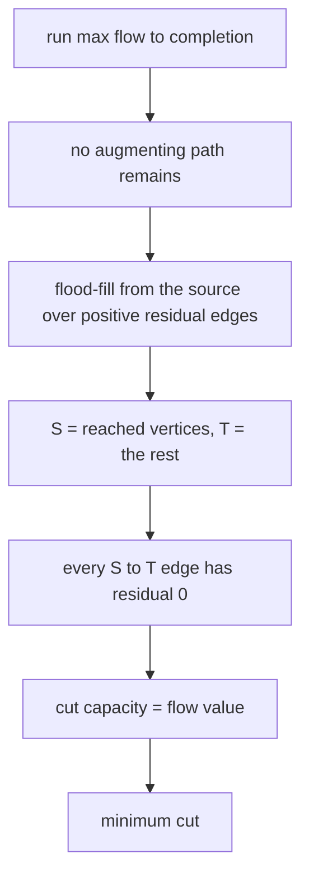
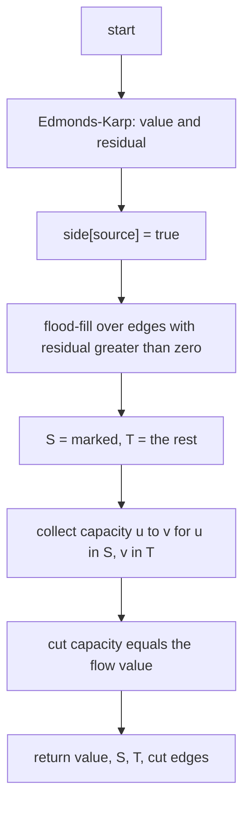
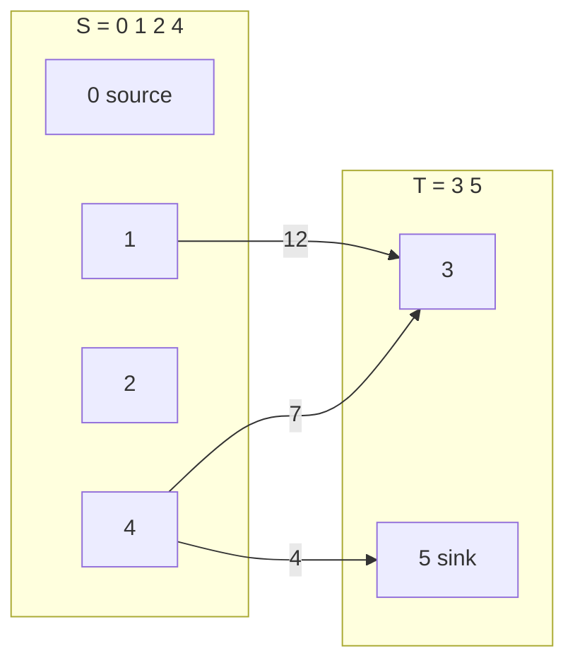
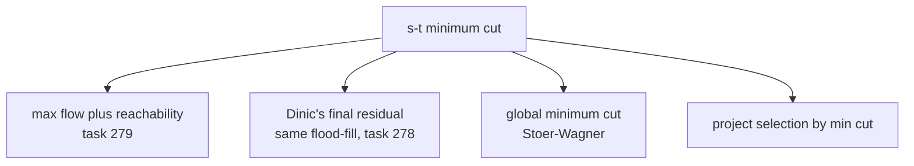

# 279 — Min-cut using max-flow (s-t cut extraction).

> **Tier:** Intermediate · **CTCI chapter:** Ch 4 — Trees and Graphs
> **Task spec:** [279-min-cut-using-max-flow-s-t-cut-extraction.md](../../../tasks/intermediate/279-min-cut-using-max-flow-s-t-cut-extraction.md)
> **Solutions:** [Python](../../../solutions/python/intermediate/279-min-cut-using-max-flow-s-t-cut-extraction/solution.py) ·
> [Java](../../../solutions/java/intermediate/279-min-cut-using-max-flow-s-t-cut-extraction/Solution.java) ·
> [JavaScript](../../../solutions/javascript/intermediate/279-min-cut-using-max-flow-s-t-cut-extraction/solution.js) ·
> [C#](../../../solutions/csharp/intermediate/279-min-cut-using-max-flow-s-t-cut-extraction/Solution.cs)

## 1. Problem restatement

**Input:** `n` vertices, a capacity matrix, a `source` and a `sink`.

**Output:** the **minimum capacity `s`-`t` cut** — a partition of the vertices into a set `S`
containing the source and a set `T` containing the sink, such that the total capacity of the edges
from `S` to `T` is as small as possible. The function returns four things: the flow value, `S`, `T`,
and the list of cut edges with their capacities.

| Input | Result | Cut |
| --- | --- | --- |
| the CLRS figure, 6 vertices | value `23`, edges summing to `23` | `S = {0,1,2,4}`, `T = {3,5}`, edges `1→3 (12)`, `4→3 (7)`, `4→5 (4)` |
| diamond `0→1(3), 0→2(2), 1→3(2), 2→3(3)` | value `4`, cut capacity `4` | the four edges across the split |
| `0→1 (7)`, source `0`, sink `2` | value `0`, `S = {0,1}`, `T = {2}`, no cut edges | the sink is unreachable |
| 60 random LCG graphs, 6 vertices | cut capacity `= ` flow `= ` brute-force minimum | asserted every trial |

The docstring states the method in one line: "Run max flow, then take the vertices still reachable
from `s` in the residual graph as `S`. The edges leaving `S` form the minimum cut and
max-flow = min-cut is asserted against an independent brute-force enumeration of every `s`-`t` cut."

## 2. Intuition

The **max-flow min-cut theorem** says the value of a maximum flow equals the capacity of a minimum
cut. This task does not search for the cut at all: it *reads it off* the residual network that the
flow algorithm leaves behind.

The argument is short. Let `S` be the set of vertices still reachable from the source in the final
residual network — the network that remains when every augmentation is done and no augmenting path
exists. Then:

1. `source ∈ S` by construction, and `sink ∉ S`, because if the sink were reachable there would be an
   augmenting path and the flow would not be maximum.
2. Every edge `u → v` with `u ∈ S` and `v ∈ T` has **zero residual**: had it any left, `v` would have
   been reached by the same BFS. So the cut is saturated, and its capacity equals the flow across it.
3. Every edge from `S` to `T` carries its full capacity, and every unit of flow must cross from `S` to
   `T` exactly once, so `flow value = cut capacity`.



Two consequences are worth stating, because they explain why the extraction is free. First, the
residual network is already built by `max_flow` — the function returns it, so the cut costs one extra
BFS. Second, the cut found this way is a *certificate*: the tests check that its capacity equals the
flow, and separately that the flow equals a brute-force minimum over all cuts. Both halves of the
theorem are verified on every fixture.

## 3. Algorithm

1. Run Edmonds–Karp (task [277](../../../tasks/intermediate/277-maximum-flow-edmonds-karp.md)) and
   keep both the flow value and the final residual matrix.
2. `side[source] = true`; flood-fill from the source over every edge with `residual[u][v] > 0`,
   marking visited vertices.
3. `S` is the marked set, `T` is its complement.
4. Collect the cut edges: every pair `(u, v)` with `u ∈ S`, `v ∈ T` and `capacity[u][v] > 0`, together
   with that capacity.
5. Return the value, `S`, `T` and the cut edges.

```text
function max_flow(n, capacity, source, sink)
    residual ← a copy of capacity
    total ← 0
    while true do
        BFS from source over positive residual edges, recording parent
        if parent[sink] = -1 then return (total, residual)
        bottleneck ← the smallest residual on the parent path to the sink
        for every edge (u, v) on that path do
            residual[u][v] ← residual[u][v] - bottleneck
            residual[v][u] ← residual[v][u] + bottleneck
        total ← total + bottleneck
end

function min_cut(n, capacity, source, sink)
    (value, residual) ← max_flow(n, capacity, source, sink)
    side ← false for every vertex
    side[source] ← true
    queue ← [source]
    while queue is not empty do
        u ← remove first element of queue
        for v ← 0 to n - 1 do
            if not side[v] and residual[u][v] > 0 then
                side[v] ← true
                append v to queue
    in_s ← every vertex with side = true
    in_t ← every vertex with side = false
    cut_edges ← (u, v, capacity[u][v]) for u in in_s and v in in_t with capacity[u][v] > 0
    return (value, in_s, in_t, cut_edges)
end
```

The flood-fill is the same shape as one BFS inside the flow algorithm, but with one difference that
matters: it does **not** stop at the sink. It cannot — the sink is unreachable by construction — so
it explores the whole source side of the residual network and stops naturally.



## 4. Worked example

Take the CLRS graph and read the cut off the residual network left by the three augmentations
(`12`, `4`, `7`) that produce the flow of `23`. The residual residuals of interest are:

```text
0→1: 4     0→2: 2     1→2: 10    1→3: 0
2→4: 3     4→3: 0     4→5: 0     3→5: 1
```

**Flood-fill from `0`:**

| Step | Pop `u` | Positive residual edges | Newly marked |
| --- | --- | --- | --- |
| 1 | `0` | `0→1` (4), `0→2` (2) | `1`, `2` |
| 2 | `1` | `1→0`, `1→2` (10); `1→3` has residual `0` | none |
| 3 | `2` | `2→0`, `2→1`, `2→4` (3) | `4` |
| 4 | `4` | `4→2`; `4→3` and `4→5` both have residual `0` | none |

So `S = {0, 1, 2, 4}` and `T = {3, 5}`. The cut edges are the ones with positive capacity running
from `S` to `T`:

| Edge | Capacity | Residual after the flow |
| --- | --- | --- |
| `1 → 3` | `12` | `0` — saturated by augmentation 1 |
| `4 → 3` | `7` | `0` — saturated by augmentation 3 |
| `4 → 5` | `4` | `0` — saturated by augmentation 2 |
| total | **`23`** | equals the flow value, the asserted equality |



Every edge crossing the boundary is saturated, which is exactly the statement that no residual edge
leaves `S`: the three cut edges all have residual zero, and all other `S`-to-`T` pairs have capacity
zero in the first place. Note also that the cut is not a "layer" of the graph — `S` jumps from `2` to
`4` while leaving `3` on the other side.

For the **stranded** fixture — `0→1 (7)` with sink `2` — the maximum flow is `0` and the residual is
untouched, so the flood-fill marks `0` and then `1`, and stops. `S = {0, 1}`, `T = {2}`, and no edge
crosses from `S` to `T` with positive capacity, so `cut_edges` is empty and its capacity `0` equals
the flow. That is the asserted triple `value == 0`, `in_s == {0, 1}`, `in_t == {2}`,
`cut_edges == []`.

## 5. Complexity

Let `V` be the number of vertices and `E` the number of edges.

| Measure | Bound | Why it holds |
| --- | --- | --- |
| Time, max flow | `O(V³ * E)` with this matrix form | `O(V*E)` augmentations, `O(V²)` per BFS |
| Time, cut extraction | `O(V²)` | one flood-fill over the residual matrix |
| Time, cut edge collection | `O(V²)` | the double loop over `S` and `T` |
| Time, total | dominated by the flow | the extraction is a rounding error next to the flow computation |
| Space | `O(V²)` | the residual matrix, returned by `max_flow` so no second copy is needed |
| Time, brute-force minimum cut | `O(2^(V-2) * V²)` | every subset of the middle vertices, each scored by a scan |

The interesting complexity fact is the contrast: the brute force enumerates `2^(V-2)` cuts, while the
flow-based extraction is polynomial and, once the flow is known, costs one traversal. That is what
makes the theorem a tool rather than a curiosity — the minimisation problem is solved by solving a
different problem (max flow) and then reading the answer, and the `value == min_cut_brute_force`
assertions on 60 random graphs are the evidence that the reading is correct.

## 6. Pitfalls and edge cases

- **The sink is never in `S`.** If the flood-fill could reach the sink, an augmenting path would still
  exist and the flow would not have been maximum. `5 in in_t` is asserted.
- **Residual zero, not capacity zero.** The boundary test is on the *residual*: an edge from `S` to `T`
  with capacity `40` and no residual left is on the cut. Checking `capacity[u][v] == 0` instead of
  `residual[u][v] == 0` would mark the wrong set.
- **Saturated cut edges are the flowed-through ones.** Every cut edge is saturated in the asserted
  fixtures, because the flow pushes through them until they are full. A cut edge with residual left
  would contradict step 2 of the argument.
- **Unreachable sink.** The stranded fixture produces `value = 0`, `S = {0, 1}`, `T = {2}` and an
  **empty** cut edge list — the minimum cut has capacity zero and no edges, which is a legitimate
  result and the reason `cut_edges == []` is asserted rather than treated as failure.
- **Isolated vertices.** A vertex with no incident edge lands in `T` unless the source can reach it,
  and it contributes nothing to the capacity sum. The partition still covers all `n` vertices.
- **Both directions of an edge.** The cut capacity counts only `S`-to-`T` edges, never `T`-to-`S`. The
  CLRS graph has `3→2 (9)` and `2→1 (4)` crossing the boundary backwards, and they must not be added.
- **Returning the residual.** `max_flow` returns `(total, residual)` so that `min_cut` does not have
  to re-run the flow to inspect the final state; in Java the pair is packed into an `int[][]` with the
  value in row `0`.
- **Non-unique cuts.** When several minimum cuts exist, this method returns the one closest to the
  source — the source side is the *maximal* `S`. The tests therefore assert the capacity and the
  membership of the source and sink, not a specific partition, except where the fixture fixes it.
- **Java's string packing.** `describeMinCut` formats `value|cutCapacity|bitsPerVertex`, and the test
  parses it with `split("\\|")`; the bits are ordered by vertex index, so `parts[2].startsWith("1")`
  checks that vertex `0` is in `S` and `endsWith("0")` that the last vertex is in `T`.
- **Determinism of the random tests.** `lcg_capacities` uses `seed = (seed * 75 + 74) % 65537` with
  `seed % 4 == 0` and capacity `seed % 10`, starting at `24680`, so all four languages run the same 60
  graphs.
- **Integer widths.** Capacities and the cut total are `int` in Java and C#; a cut whose capacity
  exceeds `2³¹ - 1` needs `long` there.

## 7. Variants and follow-ups

- **Max flow itself.** [277-maximum-flow-edmonds-karp.md](../../../tasks/intermediate/277-maximum-flow-edmonds-karp.md)
  computes the value; this task reuses it verbatim and adds the extraction step.
- **Dinic's residual.** [278-dinic-s-algorithm-for-max-flow-basic.md](../../../tasks/intermediate/278-dinic-s-algorithm-for-max-flow-basic.md)
  ends in exactly the same state — a residual network with no augmenting path — so the same
  flood-fill works, and the file there already cross-checks the value against an enumerated cut.
- **Global min cut.** The Stoer–Wagner algorithm minimises over *all* cuts, without a fixed source or
  sink, and does not go through max flow.
- **Project selection and closure problems.** Those are the practical applications: model the
  problem so that a minimum cut separates the profitable choices from the unprofitable ones, then read
  the `S` side as the answer.
- **Matching duality.** [275-maximum-bipartite-matching-hopcroft-karp-outline.md](../../../tasks/intermediate/275-maximum-bipartite-matching-hopcroft-karp-outline.md)
  is the vertex-cover counterpart: König's theorem says the minimum vertex cover of a bipartite graph
  has the same size as its maximum matching, and the cover can also be read off a residual-style
  labelling.



## 8. Check yourself

1. Why is the sink guaranteed not to be in `S`?

<details><summary>Show answer</summary>

Because `S` is defined by reachability in the *final* residual network, which is produced only after
the flow algorithm terminates — and it terminates precisely when no augmenting path exists. A
reachable sink would be an augmenting path, so the sink must be unreachable.

</details>

2. Why does every edge from `S` to `T` have zero residual?

<details><summary>Show answer</summary>

If `u ∈ S` and `residual[u][v] > 0`, the flood-fill would have marked `v` as well, putting it in `S`.
So the residual must be zero. That is what makes the cut saturated and its capacity equal to the flow
across it.

</details>

3. In the CLRS trace, which edges are on the cut, and what are their capacities?

<details><summary>Show answer</summary>

`S = {0, 1, 2, 4}` and `T = {3, 5}`. The forward edges with positive capacity are `1 → 3 (12)`,
`4 → 3 (7)` and `4 → 5 (4)`, summing to `23` — the flow value. The backward edges `3 → 2` and
`2 → 1` cross the same boundary in the other direction and are not counted.

</details>

4. What does the function return when the sink is unreachable from the start?

<details><summary>Show answer</summary>

A flow value of `0`, `S` equal to everything reachable (in the fixture `{0, 1}`), `T` the rest
(`{2}`), and an empty cut edge list. The minimum cut has capacity zero, and the assertion
`cut_edges == []` records that a valid cut can contain no edges at all.

</details>

5. The tests check both `sum(cut capacities) == value` and `value == min_cut_brute_force(...)`. Why
   both?

<details><summary>Show answer</summary>

The first is an internal consistency check: the partition this algorithm produced really is a cut
whose capacity equals the computed flow, which is the constructive half of the theorem. The second
compares against an exhaustive minimisation over all `2^(V-2)` partitions, which is the optimality
half. Together they cover both directions — the returned cut is valid, and no cut is smaller.

</details>
