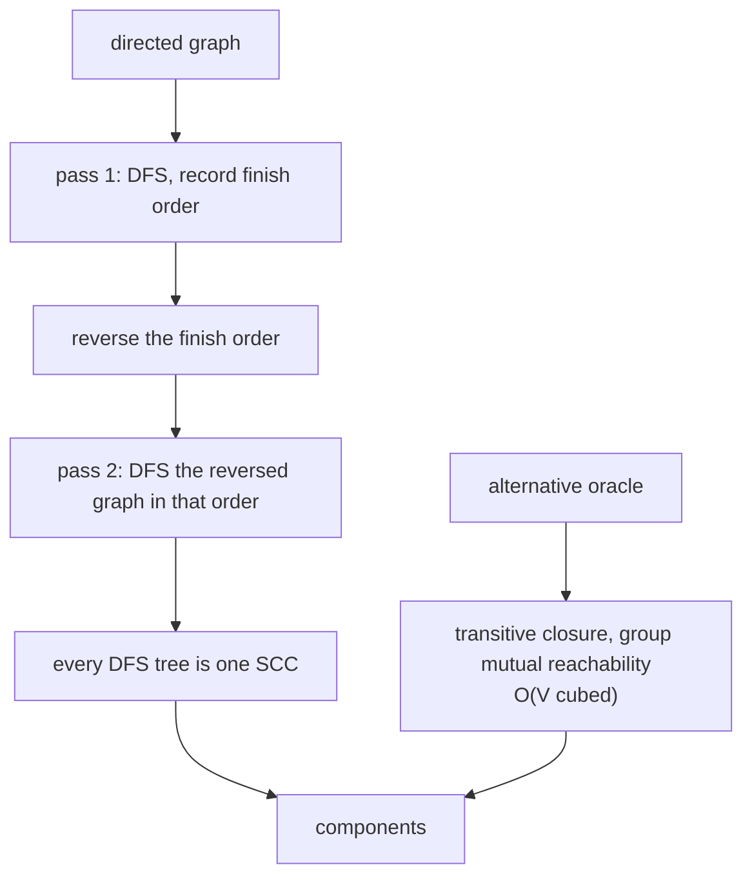
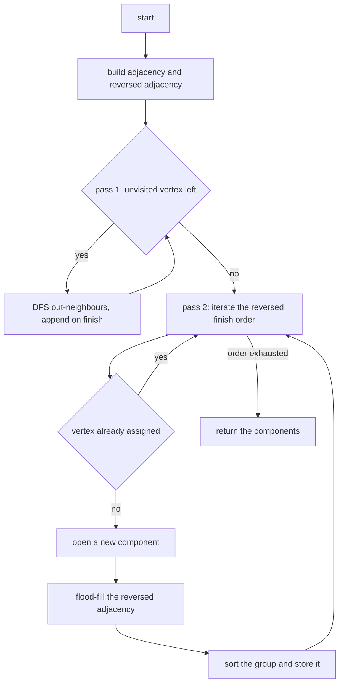
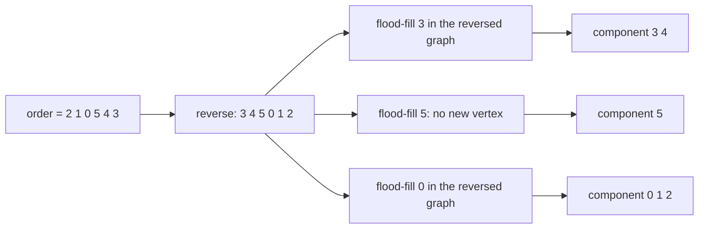
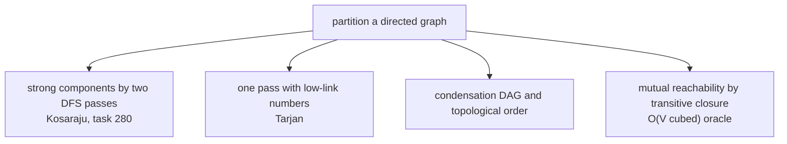

# 280 — Count connected components in directed graph strongly connected (Kosaraju).

> **Tier:** Intermediate · **CTCI chapter:** Ch 4 — Trees and Graphs
> **Task spec:** [280-count-connected-components-in-directed-graph-strongly-connected.md](../../../tasks/intermediate/280-count-connected-components-in-directed-graph-strongly-connected.md)
> **Solutions:** [Python](../../../solutions/python/intermediate/280-count-connected-components-in-directed-graph-strongly-connected/solution.py) ·
> [Java](../../../solutions/java/intermediate/280-count-connected-components-in-directed-graph-strongly-connected/Solution.java) ·
> [JavaScript](../../../solutions/javascript/intermediate/280-count-connected-components-in-directed-graph-strongly-connected/solution.js) ·
> [C#](../../../solutions/csharp/intermediate/280-count-connected-components-in-directed-graph-strongly-connected/Solution.cs)

## 1. Problem restatement

**Input:** `n` vertices labelled `0 .. n-1` and a list of directed edges `(u, v)`. The graph is not
required to be connected, and self-loops are allowed.

**Output:** the **strongly connected components** — maximal sets of vertices in which every vertex
reaches every other — as a list of sorted vertex lists, plus `count_components`, which returns their
number.

| Call | Result | Why |
| --- | --- | --- |
| `count_components(3, [(0,1),(1,2),(2,0)])` | `1` | a directed cycle reaches everywhere inside |
| `count_components(4, [cycle, (3,3)])` | `2` | the self-loop vertex is its own component |
| `count_components(3, [(0,1),(1,2)])` | `3` | a DAG has only singleton components |
| `count_components(3, [])` | `3` | no edges, three isolated vertices |
| `count_components(3, [(0,1),(1,0),(1,2)])` | `2` | the mutual pair `{0,1}` plus the tail `{2}` |
| `count_components(2, [(0,1)])` | `2` | one direction is *not* strong connectivity |
| `strongly_connected_components(6, classic)` | `[[3,4], [5], [0,1,2]]` | `classic = [(0,1),(1,2),(2,0),(3,4),(4,3),(4,5)]` |

The docstring names the method: "Kosaraju: DFS the graph to get finish order, then DFS the reversed
graph in reverse finish order — each tree is one SCC. Cross-checked against a transitive-closure
oracle."

## 2. Intuition

Strong connectivity is a *mutual* reachability requirement, and that symmetry is what makes the
problem separable. Define `u ~ v` when `u` reaches `v` **and** `v` reaches `u`. This is an equivalence
relation, so it partitions the vertices, and the components can be found by looking for structure
rather than by testing every pair.

The naive version is exactly the oracle the file ships: compute the transitive closure with the
Floyd–Warshall triple loop, then group the vertices that mutually reach each other. That is `O(V³)`
and it is correct — 120 random 6-vertex graphs assert equality with it — but it also throws away the
sequential structure of the graph.

Kosaraju exploits that structure in two passes:

1. A depth-first search records each vertex **when it finishes**, i.e. after all of its descendants
   are done. The last vertex to finish in a component is the one that can reach the most within it.
2. Reversing the *order* and walking the reversed graph in that order makes the two passes meet: each
   DFS tree of the second pass is exactly one strongly connected component.



The intuition for why pass 2 works is in the reverse graph. If `u` can reach `v` in the original graph,
then `v` can reach `u` in the reversed graph. Walking the reversed graph starting from the
*latest*-finishing vertices therefore starts at the vertices that are sources of the component DAG,
and each tree it grows cannot leak into another component: any edge it can follow stays inside the
component, because the component is a sink in the reversed condensation order.

## 3. Algorithm

1. Build both the adjacency list and the reversed adjacency list from the edges.
2. **Pass 1:** for every vertex in index order, if it is unvisited, run a depth-first search that
   appends each vertex to `order` *after* recursing into its out-neighbours.
3. **Pass 2:** iterate `reversed(order)`. For each still-unassigned vertex `u`, assign a new component
   index and flood-fill `u` in the **reversed** adjacency, assigning the same index to everything
   reached. Sort each component's vertex list.
4. Return the components in the order they were discovered.

```text
function strongly_connected_components(n, edges)
    adjacency ← empty lists for 0 .. n - 1
    reversed_adjacency ← empty lists for 0 .. n - 1
    for each pair (a, b) in edges do
        append b to adjacency[a]
        append a to reversed_adjacency[b]
    end
    visited ← false for every vertex
    order ← []
    for v ← 0 to n - 1 do
        if not visited[v] then dfs_finish(v)
    end
    component ← -1 for every vertex
    components ← []
    for u in reversed(order) do
        if component[u] ≠ -1 then continue
        index ← number of components so far
        component[u] ← index
        group ← [u]
        stack ← [u]
        while stack is not empty do
            x ← pop from stack
            for each y in reversed_adjacency[x] do
                if component[y] = -1 then
                    component[y] ← index
                    append y to group
                    push y onto stack
        append the sorted group to components
    end
    return components
end

procedure dfs_finish(u)
    visited[u] ← true
    for each v in adjacency[u] do
        if not visited[v] then dfs_finish(v)
    append u to order
end
```

The single line that matters most is `order.append(u)` — it happens *after* the loop over
`adjacency[u]`, which is what makes `order` a finishing order rather than a discovery order. Pass 2
then uses the reversed graph and the reversed order together; flipping only one of the two produces
garbage that still looks like components.



## 4. Worked example

Trace `strongly_connected_components(6, classic)` with
`classic = [(0,1), (1,2), (2,0), (3,4), (4,3), (4,5)]`. The graph is a 3-cycle `0 → 1 → 2 → 0`, a
mutual pair `3 ↔ 4`, and a tail `4 → 5`.

**Pass 1 — finish order.** The outer loop starts at vertex `0`.

| DFS start | Recursion | Appended on finish (`order` grows) |
| --- | --- | --- |
| `0` | `0 → 1 → 2`, then `2`'s neighbour `0` is visited | `2`, then `1`, then `0` |
| `3` | `3 → 4`, `4`'s neighbours are `3` (visited) and `5`; `5` has none | `5`, then `4`, then `3` |

So `order = [2, 1, 0, 5, 4, 3]`. Vertices `1` and `2` are already visited when the outer loop reaches
them, and the whole run is one DFS per component root.

**Pass 2 — reversed order on the reversed graph.** `reversed(order) = [3, 4, 5, 0, 1, 2]`, and the
reversed adjacency is `rev[0] = [2]`, `rev[1] = [0]`, `rev[2] = [1]`, `rev[3] = [4]`, `rev[4] = [3]`,
`rev[5] = [4]`.

| Step | Vertex | Already assigned | Component opened | Flood-fill in the reversed graph | Group |
| --- | --- | --- | --- | --- | --- |
| 1 | `3` | no | 0 | `rev[3] = [4]` so `4` joins; `rev[4] = [3]` is assigned | `[3, 4]` |
| 2 | `4` | yes | — | — | — |
| 3 | `5` | no | 1 | `rev[5] = [4]` is assigned, so nothing joins | `[5]` |
| 4 | `0` | no | 2 | `rev[0] = [2]`, then `rev[2] = [1]`, then `rev[1] = [0]` | `[0, 1, 2]` |
| 5 | `1` | yes | — | — | — |
| 6 | `2` | yes | — | — | — |

The result is `[[3, 4], [5], [0, 1, 2]]`, whose sorted form `[[0, 1, 2], [3, 4], [5]]` is the asserted
partition — and `count_components(6, classic) == 3` is the asserted count. Two details are worth
noting. The components come out in **reverse topological order** of the condensation, so the block
`{3, 4}` is discovered before the cycle `{0, 1, 2}`. And vertex `5` is a singleton: the edge `4 → 5`
leaves the component, and in the reversed graph it becomes `5 → 4`, which cannot pull `4` into `5`'s
tree because `4` was already assigned.



The fixture is written to accept either grouping order, because Kosaraju's component *order* is not
part of the contract — only the partition is.

## 5. Complexity

Let `V = n` be the number of vertices and `E` the number of edges.

| Measure | Bound | Why it holds |
| --- | --- | --- |
| Time, pass 1 | `O(V + E)` | each vertex is visited once; each out-edge is examined once |
| Time, pass 2 | `O(V + E)` | each vertex is assigned once; each reversed edge is examined once |
| Time, sorting the groups | `O(V log V)` | at most `V` entries in total across all components |
| Time, total | `O(V + E)` | dominated by the two DFS passes |
| Space | `O(V + E)` | adjacency, reversed adjacency, `visited`, `order`, `component` and the stacks |
| Recursion depth | `O(V)` | the pass-1 DFS is recursive; a path graph is the worst case |
| Time, closure oracle | `O(V³)` | the Floyd–Warshall triple loop, plus `O(V²)` for grouping |

Both passes are linear, so the algorithm is optimal up to the sort of the component lists — the output
itself has `V` vertices to report. The recursion in pass 1 is the one practical limitation: a graph
that is a long path makes the call stack as deep as the graph is long, which is why the second pass
uses an explicit stack.

## 6. Pitfalls and edge cases

- **Finish order, not discovery order.** `order.append(u)` must run after the neighbour loop. Appending
  on entry makes pass 2 meaningless, and the components come out as singletons or merged wrongly.
- **Reverse the graph *and* the order.** Both flips are needed; applying only one leaves the algorithm
  with an inconsistent view and it will happily return a wrong partition.
- **`count_components(3, [])` is `3`,** not `0` or `1`: isolated vertices are components of size one.
  The no-edge case and the DAG case (`(0,1), (1,2)` → `3`) both assert this.
- **One direction is not enough.** `count_components(2, [(0,1)])` returns `2`; `0` reaches `1` but not
  the reverse, so they are separate components. This is the difference between strong and weak
  connectivity.
- **Self-loops.** `cycle + [(3,3)]` has two components: a self-loop makes a vertex strongly connected
  to itself, which it already is, and the isolated vertex `3` forms its own component. Self-loops must
  still be added to the adjacency so the DFS sees the edge.
- **Singleton components are normal.** Every vertex that participates in no cycle is a component by
  itself; the vertex count is the upper bound asserted in the random tests
  (`count_components(6, edges) <= 6`).
- **Component order is not specified.** Kosaraju discovers components in reverse topological order,
  which depends on the vertex order and the adjacency order. The tests compare
  `sorted(components)` against the oracle, and the classic fixture accepts either order explicitly.
- **Group contents are compared, not just counts.** The random check asserts
  `sorted(components) == brute_force_components(6, edges)` for 120 deterministic graphs, so a wrong
  partition with the right number of pieces would still fail.
- **The closure oracle's grouping key.** `brute_force_components` keys each vertex by the tuple of
  vertices it mutually reaches; two vertices in the same SCC produce identical keys, which is exactly
  the equivalence-relation argument.
- **Deterministic random graphs.** `random_graphs` uses `seed = (seed * 75 + 74) % 65537` with an edge
  when `seed % 3 == 0`, starting from `13579`, so Python, JavaScript, Java and C# all test the same
  120 graphs.
- **Recursion limits.** A very deep graph can overflow the recursion in pass 1; the iterative second
  pass shows the pattern for replacing it with an explicit stack.
- **Duplicated edges.** Parallel edges are harmless — the DFS may look at a neighbour twice, but the
  visited/assigned arrays ignore the second visit.

## 7. Variants and follow-ups

- **Tarjan's algorithm.** A single DFS with a stack of "on-stack" vertices and low-link numbers finds
  all components in one pass, at the cost of a subtler invariant.
- **Path-based strong components.** A second `O(V + E)` one-pass alternative that keeps a stack of
  candidate roots.
- **Reachability instead of components.** The transitive-closure oracle here is the same `O(V³)`
  computation used when the question is "which vertices can reach which", with no grouping.
- **Condensation.** Contracting each SCC to a vertex yields a DAG; Kosaraju's discovery order is a
  reverse topological order of it, which is why this algorithm is also used as a preprocessing step
  for topological sorting of general digraphs.
- **Related traversals.** [273](../../../tasks/intermediate/273-find-eulerian-trail-in-directed-graph-hierholzer.md)
  validates a digraph by weak connectivity and degree balance, and
  [274](../../../tasks/intermediate/274-check-if-graph-is-bipartite-bfs-coloring.md) partitions an
  *undirected* graph into two colour classes — the same "partition by structure" flavour with very
  different invariants.



## 8. Check yourself

1. Why is the DFS in pass 1 appending on *finish* rather than on discovery?

<details><summary>Show answer</summary>

The finishing order encodes the structure of the condensation: a vertex finishes only after every
vertex it can reach has finished, so the last vertex of a source component in the reachability order
finishes first among its peers. Pass 2 needs that order to start from the right components; a
discovery order carries no such information.

</details>

2. In the classic fixture, why does vertex `5` end up alone instead of joining `{3, 4}`?

<details><summary>Show answer</summary>

Because strong connectivity needs both directions. There is an edge `4 → 5` but no path back from `5`
to `4`, so `5` is not mutually reachable with anything and forms a singleton component — the asserted
count of `3` is `[0,1,2]`, `[3,4]`, `[5]`. In the reversed graph the edge points `5 → 4`, and when the
flood-fill for `5` starts, `4` has already been assigned to the `{3, 4}` component, so it cannot join.

</details>

3. What goes wrong if pass 2 walks the original graph instead of the reversed one?

<details><summary>Show answer</summary>

The trees no longer coincide with components. Reversal is what turns "vertices that can reach this
one" into "vertices this one can reach", matching the order produced by pass 1. With the original
graph the flood-fill spreads along outgoing edges and can cross into vertices that are not mutually
reachable, merging distinct components.

</details>

4. How does the file verify the partition independently of Kosaraju?

<details><summary>Show answer</summary>

`brute_force_components` computes the transitive closure with the Floyd–Warshall triple loop and then
keys each vertex by the tuple of vertices it mutually reaches. Every SCC produces one key, so grouping
by key gives the components directly. The random tests compare `sorted(components)` from Kosaraju with
that oracle on 120 generated graphs.

</details>

5. What is the complexity of each pass, and where does the extra `log` come from?

<details><summary>Show answer</summary>

Each pass is `O(V + E)`: every vertex is visited or assigned once and every edge examined once in its
direction. The only non-linear term is sorting each component's vertex list before returning it, which
totals `O(V log V)` across all components — a presentation detail, not part of the algorithm's core
cost.

</details>
