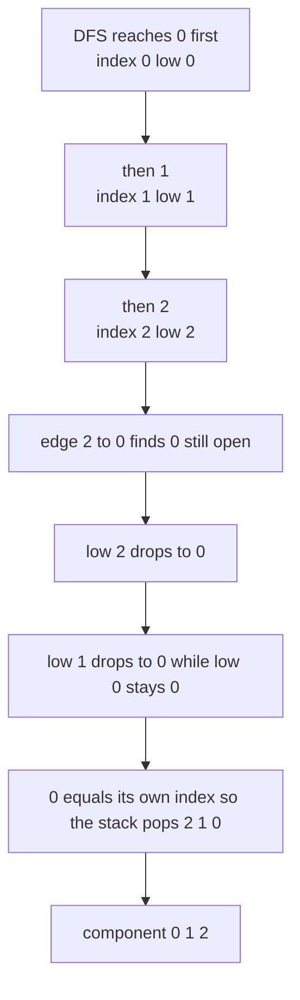
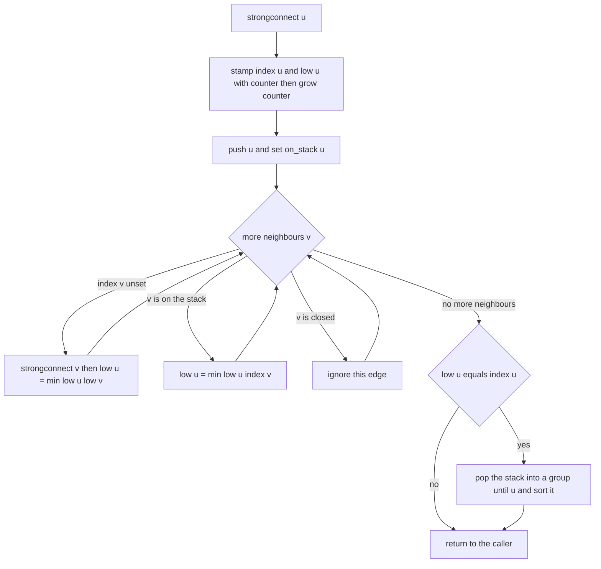
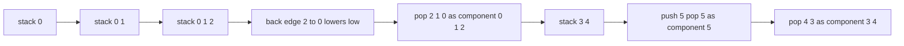

# 281 — Tarjan’s strongly connected components.

> **Tier:** Intermediate · **CTCI chapter:** Ch 4 — Trees and Graphs
> **Task spec:** [281-tarjan-s-strongly-connected-components.md](../../../tasks/intermediate/281-tarjan-s-strongly-connected-components.md)
> **Solutions:** [Python](../../../solutions/python/intermediate/281-tarjan-s-strongly-connected-components/solution.py) ·
> [Java](../../../solutions/java/intermediate/281-tarjan-s-strongly-connected-components/Solution.java) ·
> [JavaScript](../../../solutions/javascript/intermediate/281-tarjan-s-strongly-connected-components/solution.js) ·
> [C#](../../../solutions/csharp/intermediate/281-tarjan-s-strongly-connected-components/Solution.cs)

## 1. Problem restatement

**Input:** a vertex count `n` (vertices are the integers `0 … n - 1`) and a list of directed
edges `(a, b)` meaning `a → b`. Self loops and parallel edges are allowed; the graph does not
have to be connected.

**Output:** the strongly connected components (SCCs) of the graph as a list of groups. Each
group is the **sorted** list of its vertex ids, and the groups themselves are ordered by their
smallest vertex. That canonical form is what makes the four solutions comparable — every one of
them sorts the group internally and then sorts the group list, so the same graph always produces
byte-identical output.

The task spec is a one-liner (“Tarjan’s strongly connected components.”), so the contract is
fixed by the assertions the solution files ship with:

| Call | Result | Why |
| --- | --- | --- |
| `tarjan_scc(6, [(0,1),(1,2),(2,0),(3,4),(4,3),(4,5)])` | `[[0,1,2],[3,4],[5]]` | two cycles plus a sink vertex |
| `tarjan_scc(3, [(0,1),(1,2),(2,0)])` | `[[0,1,2]]` | one big cycle |
| `tarjan_scc(3, [(0,1),(1,2)])` | `[[0],[1],[2]]` | a DAG has only singleton SCCs |
| `tarjan_scc(3, [])` | `[[0],[1],[2]]` | no edges, three isolated vertices |
| `tarjan_scc(3, [(0,1),(1,0),(1,2)])` | `[[0,1],[2]]` | mutual pair plus a tail |
| `tarjan_scc(2, [(0,1)])` | `[[0],[1]]` | a one-way edge is not an SCC |
| `tarjan_scc(1, [(0,0)])` | `[[0]]` | a self loop is its own SCC |

On top of those fixed cases the files run 120 deterministic random graphs with `n = 6`: the
generator advances `seed ← (seed · 75 + 74) mod 65537` for every ordered pair `u ≠ v` and keeps
the edge when `seed mod 3 == 0`. Each random graph must

1. match the result of the Kosaraju implementation that is included as an independent oracle,
2. partition the vertices exactly (flattening the groups and sorting gives `[0,1,2,3,4,5]`),
3. survive canonicalisation unchanged (canonicalising twice is a no-op), and
4. contain at least one group of size greater than one somewhere in the 120 graphs — otherwise
   the test would pass trivially on a graph family with no real SCCs.

## 2. Intuition

The naive idea is to compute reachability: `u` and `v` are in the same SCC when each can reach
the other. Running a fresh DFS from every vertex costs `O(V · (V + E))`, and the Floyd–Warshall
closure costs `O(V³)`; both then need a clustering step on top. Kosaraju solves it in two passes
over the graph but needs the reversed graph stored as well.

Tarjan’s insight is that **a single DFS already knows everything**. Assign each vertex a
discovery time `index[u]` in the order the DFS first reaches it, and maintain a *low-link*
`low[u]`: the smallest discovery time reachable from `u`’s subtree using at most one back edge.
A vertex `u` is the root of an SCC exactly when `low[u] == index[u]` — meaning nothing in its
subtree can climb back to a vertex discovered before `u`. At that moment the SCC of `u` is
sitting on top of the DFS stack: every vertex pushed after `u` and not yet popped belongs to
`u`’s component, so we pop until we see `u`.

The stack is therefore a set of *open* components, and the `on_stack` flag distinguishes “reached
but not yet assigned to a component” from “already assigned”. A back or cross edge to a vertex
that is still open may lower the low-link; an edge to a vertex that is already closed is ignored,
because that vertex has been filed away in an earlier component and cannot be part of ours.



The single-pass property is the whole point: one depth-first walk, one index counter, one stack.

## 3. Algorithm

1. Build the adjacency list, keeping the edge order that the input gave (this makes the random
   cross-checks deterministic).
2. Initialise `index[v] = -1` (meaning unvisited), `low[v] = 0`, `on_stack[v] = false`, an empty
   stack and a counter starting at `0`.
3. For every vertex `v` in increasing order, if `index[v]` is still `-1`, call `strongconnect(v)`.
4. `strongconnect(u)`: stamp `index[u] = low[u] = counter`, increment the counter, push `u` and
   mark it on the stack.
5. Walk the neighbours of `u`: an unvisited `v` is a tree edge — recurse and then set
   `low[u] = min(low[u], low[v])`; a visited `v` that is still on the stack is a back or cross
   edge into the open set — set `low[u] = min(low[u], index[v])`; a visited `v` that is off the
   stack is ignored.
6. After the loop, if `low[u] == index[u]`, pop vertices off the stack into a fresh group until
   `u` itself is popped; sort the group and append it to the component list.
7. Sort the components by their first (smallest) vertex and return them.

```text
procedure tarjan_scc(n, edges)
    adjacency ← empty list per vertex
    for each edge (a, b) do
        append b to adjacency[a]
    end
    index ← array of n filled with -1
    low ← array of n zeros
    on_stack ← array of n false values
    stack ← empty stack
    components ← empty list
    counter ← 0

    function strongconnect(u)
        index[u] ← counter
        low[u] ← counter
        counter ← counter + 1
        push u onto stack
        on_stack[u] ← true
        for each v in adjacency[u] do
            if index[v] = -1 then
                strongconnect(v)
                low[u] ← min(low[u], low[v])
            else if on_stack[v] then
                low[u] ← min(low[u], index[v])
            end
        end
        if low[u] = index[u] then
            group ← empty list
            repeat
                w ← pop stack
                on_stack[w] ← false
                append w to group
            until w = u
            sort group ascending
            append group to components
        end
    end

    for v ← 0 to n - 1 do
        if index[v] = -1 then
            strongconnect(v)
        end
    end
    sort components by their smallest vertex
    return components
end
```

Note the recursion: every language ships the recursive form, so the DFS depth can reach `n`.



The outer loop in step 3 restarts the walk for every vertex the first DFS did not reach, which is
what makes the algorithm work on disconnected graphs.

## 4. Worked example

Take the “classic” graph from the assertions:
`n = 6`, edges `0→1, 1→2, 2→0, 3→4, 4→3, 4→5`. The DFS starts at vertex `0`:

| Step | Visit | `index` set | `low` after step | Stack (bottom → top) | Note |
| --- | --- | --- | --- | --- | --- |
| 1 | `0` | `index[0] = 0` | `low[0] = 0` | `0` | pushed, marked open |
| 2 | `1` | `index[1] = 1` | `low[1] = 1` | `0 1` | tree edge `0→1` |
| 3 | `2` | `index[2] = 2` | `low[2] = 2` | `0 1 2` | tree edge `1→2` |
| 4 | — | — | `low[2] = min(2, index[0]) = 0` | `0 1 2` | back edge `2→0`, `0` is open |
| 5 | — | — | `low[2] ≠ index[2]` | `0 1 2` | `2` does not close a component |
| 6 | — | — | `low[1] = min(1, low[2]) = 0` | `0 1 2` | returning from `2` into `1` |
| 7 | — | — | `low[1] ≠ index[1]` | `0 1 2` | `1` does not close a component |
| 8 | — | — | `low[0] = min(0, low[1]) = 0` | `0 1 2` | returning from `1` into `0` |
| 9 | — | — | `low[0] == index[0] = 0` | *(empty)* | pop `2`, then `1`, then `0` → group `[0,1,2]` |
| 10 | `3` | `index[3] = 3` | `low[3] = 3` | `3` | `1` and `2` are already visited |
| 11 | `4` | `index[4] = 4` | `low[4] = 4` | `3 4` | tree edge `3→4` |
| 12 | — | — | `low[4] = min(4, index[3]) = 3` | `3 4` | back edge `4→3`, `3` is open |
| 13 | `5` | `index[5] = 5` | `low[5] = 5` | `3 4 5` | tree edge `4→5` |
| 14 | — | — | `low[5] == index[5] = 5` | `3 4` | `5` has no out-edges → group `[5]` |
| 15 | — | — | `low[4] = min(3, low[5]) = 3` | `3 4` | `low[4] = 3 ≠ index[4] = 4` |
| 16 | — | — | `low[3] = min(3, low[4]) = 3` | *(empty)* | pop `4`, then `3` → group `[3,4]` |

The component list is `[[0,1,2],[5],[3,4]]`; sorting by smallest vertex gives
`[[0,1,2],[3,4],[5]]`, which is exactly what all four files assert. Vertex `5` is discovered
*inside* `3`’s subtree but still becomes its own component, because a dangling out-edge is not
enough to merge components — only a cycle is.



Across the 120 generated graphs the same code runs beside the Kosaraju oracle
(`kosaraju_scc` in Python, `kosarajuScc` in Java and JavaScript, `KosarajuScc` in C#): two DFS
passes, the second over the reversed graph, are immune to the low-link subtleties, so agreement
between the two is a strong signal.

## 5. Complexity

Let `V = n` and `E` be the number of edges (self loops and parallel edges included).

| Measure | Bound | Why it holds |
| --- | --- | --- |
| Time, best | O(V + E) | even a graph with no edges still walks the outer loop over all vertices |
| Time, average | O(V + E) | every vertex is pushed and popped once, every edge is examined exactly once |
| Time, worst | O(V + E) | the `min` operations and array writes are constant work per edge |
| Space, graph | O(V + E) | the adjacency list stores one entry per input edge |
| Space, bookkeeping | O(V) | `index`, `low`, `on_stack` and the component stack |
| Space, output | O(V) | every vertex appears in exactly one group |
| Alternative: Kosaraju oracle | time O(V + E), space O(V + E) extra | needs the reversed adjacency list |

The low-link update is the only place where the algorithm can go wrong asymptotically: using
`low[v]` instead of `index[v]` for a cross edge to a closed vertex would still terminate, but it
would merge components that are not strongly connected, and the Kosaraju cross-check would fail
immediately.

## 6. Pitfalls and edge cases

- **Empty edge list.** `tarjan_scc(3, [])` is `[[0],[1],[2]]` — every isolated vertex is its own
  SCC. An implementation that returns `[]` is wrong.
- **One-way edge.** `tarjan_scc(2, [(0,1)])` is `[[0],[1]]`, not `[[0,1]]`; reachability has to
  hold in *both* directions.
- **Self loop.** `tarjan_scc(1, [(0,0)])` is `[[0]]`. The self loop is a back edge to a vertex
  that is still open, so it lowers `low[0]` to `index[0]` and nothing changes.
- **A DAG.** Every component is a singleton and the algorithm performs no popping until the very
  end of each root’s recursion.
- **Cross edges to closed vertices.** These must be ignored. Only the `on_stack` branch is
  allowed to touch `low[u]`, and it uses `index[v]`, never `low[v]`.
- **Parallel edges.** The adjacency list stores each input edge, so a doubled edge simply
  repeats the same relaxation; it cannot change the answer.
- **Disconnected graphs.** The outer loop is not optional — without it, vertices in later
  components are never stamped and never appear in any group. The random check that every graph
  partitions into `[0,1,2,3,4,5]` is what catches this.
- **Recursion depth.** All four files recurse once per vertex of a path; a graph with a long
  chain and a small stack will overflow. The sizes used here (`n = 6`) never come close.
- **Output canonicalisation.** The DFS can emit components in any order and the pop order inside
  a component is reverse discovery order. Both the group sort and the group-list sort are
  required for the assertions (and the Kosaraju comparison) to succeed.
- **`n = 0`.** The outer loop body never runs, so the returned list is empty. None of the files
  assert this case, but nothing in the code special-cases it either.

## 7. Variants and follow-ups

- **Bridges and cut vertices.** The same `disc`/`low` walk answers both questions with a
  different comparison at the end: [282-bridge-edges-in-undirected-graph-tarjan.md](../../../tasks/intermediate/282-bridge-edges-in-undirected-graph-tarjan.md)
  tests `low[v] > disc[u]` on a tree edge, and
  [283-articulation-points-cut-vertices.md](../../../tasks/intermediate/283-articulation-points-cut-vertices.md)
  tests `low[v] >= disc[u]` plus the root rule.
- **Kosaraju instead of Tarjan.** Two passes and a reversed graph, no low-links at all:
  [280-count-connected-components-in-directed-graph-strongly-connected.md](../../../tasks/intermediate/280-count-connected-components-in-directed-graph-strongly-connected.md).
  The four files here already contain it as an oracle, so the two algorithms can be compared
  side by side.
- **Condensation.** Contract every SCC to a single node and the result is always a DAG; that DAG
  is what makes later problems (longest path, cycle detection, 2-SAT) tractable.
- **Iterative Tarjan.** Converting `strongconnect` to an explicit work stack removes the
  recursion-depth limit; the push/pop discipline of the component stack is unchanged.
- The walkthrough in [Trees and Graphs](../../ctci/04-trees-and-graphs.md) places SCCs next to
  topological sort and cycle detection as the three DFS-family graph questions.

## 8. Check yourself

1. Why does `low[u] == index[u]` mean that `u` roots an SCC?

<details><summary>Show answer</summary>

Because `index[u]` is the earliest discovery time that `u`’s subtree can reach. If that equals
`u`’s own discovery time, no vertex from the subtree can reach anything discovered before `u`,
so nothing outside the open stack segment is reachable from `u` and `u` is the shallowest member
of its component — the segment from `u` upwards on the stack is exactly the SCC.

</details>

2. What happens if the algorithm uses `low[v]` instead of `index[v]` for an edge to a visited
   vertex that is *not* on the stack?

<details><summary>Show answer</summary>

That vertex is already assigned to an earlier component. Propagating its low-link pulls a
discovery time from an unrelated component into `u`’s subtree and can prevent `u` from closing
its own component, so components get merged incorrectly. The correct rule is: relax with
`index[v]`, and only when `v` is still on the stack.

</details>

3. `n = 4` with edges `(0,1), (1,0), (2,3), (3,2)`. What does the function return?

<details><summary>Show answer</summary>

`[[0,1],[2,3]]`. Vertex `0` closes `[0,1]` when its recursion returns, then the outer loop
reaches `2`, which closes `[2,3]`. Both groups are already sorted and already ordered by smallest
vertex, so no reordering happens.

</details>

4. How many pushes and pops does the component stack see in total?

<details><summary>Show answer</summary>

Exactly `V` pushes and `V` pops: a vertex is pushed the first time `strongconnect` stamps it and
is popped once, when its root closes the component. That is why the stack work contributes
`O(V)` and not something worse.

</details>

5. Why do the solution files cross-check against Kosaraju instead of including a hand-written
   list of expected components for random graphs?

<details><summary>Show answer</summary>

Hand-writing expectations for many random graphs is error-prone, while Kosaraju is an
independent algorithm with a completely different mechanism (two passes, reversed graph, no
low-links). Agreement on 120 generated graphs, plus the requirement that at least one of them
contains a real multi-vertex component, catches both the flat-ranking bug and the “everything is
a singleton” failure.

</details>
