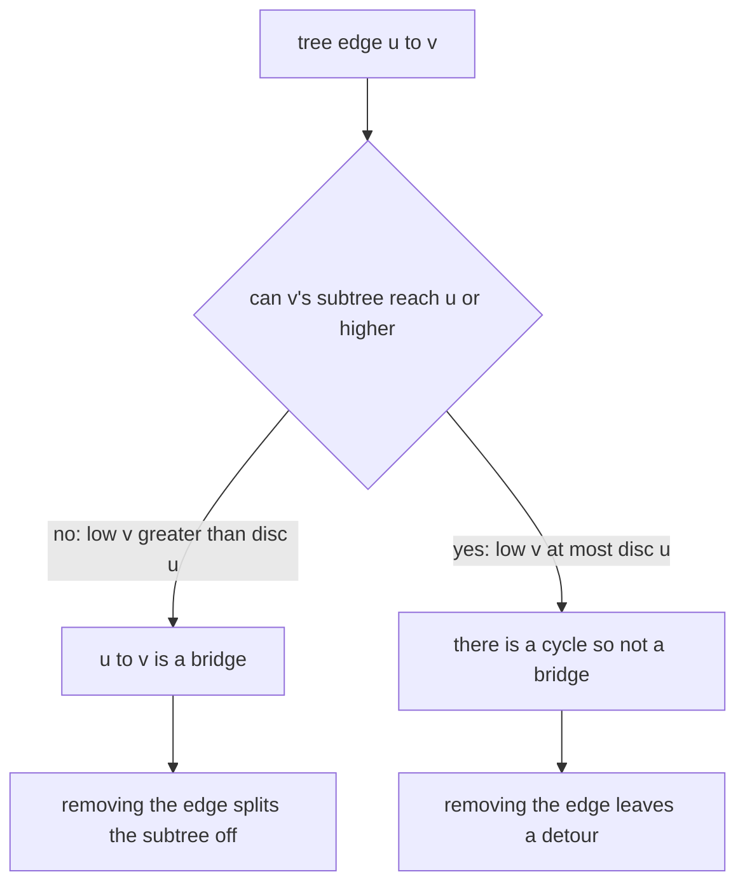
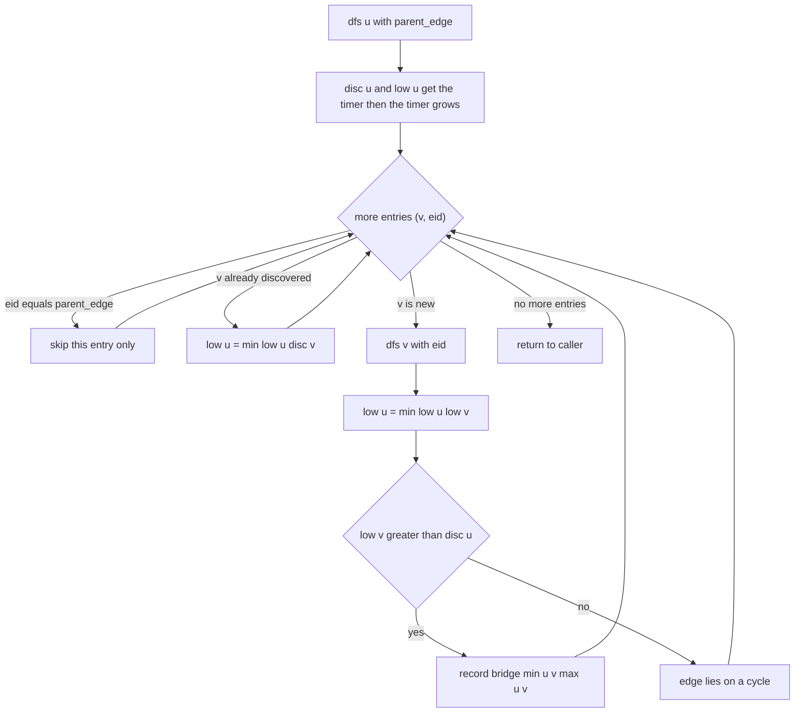
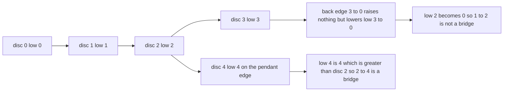

# 282 — Bridge edges in undirected graph (Tarjan).

> **Tier:** Intermediate · **CTCI chapter:** Ch 4 — Trees and Graphs
> **Task spec:** [282-bridge-edges-in-undirected-graph-tarjan.md](../../../tasks/intermediate/282-bridge-edges-in-undirected-graph-tarjan.md)
> **Solutions:** [Python](../../../solutions/python/intermediate/282-bridge-edges-in-undirected-graph-tarjan/solution.py) ·
> [Java](../../../solutions/java/intermediate/282-bridge-edges-in-undirected-graph-tarjan/Solution.java) ·
> [JavaScript](../../../solutions/javascript/intermediate/282-bridge-edges-in-undirected-graph-tarjan/solution.js) ·
> [C#](../../../solutions/csharp/intermediate/282-bridge-edges-in-undirected-graph-tarjan/Solution.cs)

## 1. Problem restatement

**Input:** a vertex count `n` (vertices `0 … n - 1`) and an undirected edge list. Self loops are
allowed; parallel edges are allowed, which means the same unordered pair may appear more than
once and the two directions `(u, v)` and `(v, u)` may both be present.

**Output:** every **bridge** — an edge whose deletion increases the number of connected
components — as a canonical `(min, max)` pair, with the whole list sorted. Self loops can never be
bridges. The graph may be disconnected; isolated vertices simply contribute nothing.

The task spec is a one-liner (“Bridge edges in undirected graph (Tarjan).”), so the contract is
fixed by the assertions the four solution files ship with:

| Call | Result | Why |
| --- | --- | --- |
| `find_bridges(3, [(0,1),(1,2)])` | `[(0,1),(1,2)]` | a path: every edge is a bridge |
| `find_bridges(3, [(0,1),(1,2),(2,0)])` | `[]` | a triangle has no bridges |
| `find_bridges(4, [(0,1),(1,2),(2,3),(3,0)])` | `[]` | a 4-cycle has no bridges |
| `find_bridges(5, [(0,1),(1,2),(2,3),(3,0),(2,4)])` | `[(2,4)]` | a cycle with one pendant edge |
| `find_bridges(5, [(0,1),(1,2),(3,4)])` | `[(0,1),(1,2),(3,4)]` | disconnected input |
| `find_bridges(3, [(0,1),(0,1),(1,2)])` | `[(1,2)]` | parallel edges form a 2-cycle |
| `find_bridges(2, [(0,0),(0,1)])` | `[(0,1)]` | a self loop is never a bridge |
| `find_bridges(3, [(0,1)])` | `[(0,1)]` | vertex `2` is isolated but still present |

Beyond those fixed rows the files check 120 random **simple** graphs and 120 random
**multigraphs** (`n = 6`, `seed = 13579`, `seed ← (seed · 75 + 74) mod 65537`, edge kept when
`seed mod 3 == 0`). For each graph the Tarjan answer must equal the brute-force answer, and every
reported pair must be an edge that actually occurs in the input (self loops excluded), so a
spurious “bridge” that is not even an edge fails the run. Both families must also contain at
least one case with bridges and at least one case without, otherwise the comparison would be
vacuous.

The brute-force oracle is the definition itself: `count_components(n, edges)` counts connected
components with an iterative walk, `brute_force_bridges` deletes each edge in turn and reports the
edge when the component count goes **up**.

## 2. Intuition

The naive idea is to test every edge by deleting it and recounting components. That is exactly
what the oracle does: `E` deletions times `O(V + E)` per count is `O(E · (V + E))` — fine as a
check, too slow as a solution.

Tarjan’s observation: run **one** DFS and stamp each vertex with a discovery time `disc[u]`. Add
the low-link `low[v]`: the smallest discovery time reachable from `v`’s subtree using tree edges
plus at most one back edge. A tree edge `u → v` is a bridge exactly when `low[v] > disc[u]`:
strictly greater means `v`’s subtree cannot reach `u` or any vertex discovered before `u`, so
removing `u → v` disconnects the subtree. When `low[v] == disc[u]` there is a back edge from the
subtree to `u` itself, which closes a cycle, so the edge is not a bridge.



The second half of the insight is how to walk an undirected graph with parallel edges. The usual
trick “skip the parent vertex” is wrong here: with the pair `(0,1)` present twice, the second copy
looks like a back edge only if you allow re-entering the parent. The four files therefore store an
**edge id** with every adjacency entry and skip only the exact edge they arrived on
(`if eid == parent_edge: continue` in Python, the same guard in the other three). That single
change is what makes the doubled-edge assertion pass.


## 3. Algorithm

1. Build adjacency lists of `(neighbour, edge id)` pairs, skipping self loops — a self loop can
   never disconnect anything.
2. Initialise `disc[v] = -1` for all vertices, `low[v] = 0`, a timer starting at `0`, and an empty
   bridge list.
3. For every vertex in increasing order with `disc[v] == -1`, start `dfs(v, -1)`; this covers
   disconnected graphs.
4. `dfs(u, parent_edge)`: set `disc[u] = low[u] = timer` and grow the timer.
5. For every `(v, eid)` in `adjacency[u]`: if `eid == parent_edge`, skip it (only the arrival edge,
   not every edge back to the parent). Otherwise, if `disc[v] != -1`, this is a back edge to an
   ancestor → `low[u] = min(low[u], disc[v])`. If `disc[v] == -1`, recurse into `v`, then set
   `low[u] = min(low[u], low[v])` and, when `low[v] > disc[u]`, record the bridge
   `(min(u, v), max(u, v))`.
6. Sort the bridge list and return it, so the output is canonical whatever the DFS order was.

```text
procedure find_bridges(n, edges)
    adjacency ← empty list per vertex
    for eid ← 0 to length(edges) - 1 do
        (a, b) ← edges[eid]
        if a ≠ b then
            append (b, eid) to adjacency[a]
            append (a, eid) to adjacency[b]
        end
    end
    disc ← array of n filled with -1
    low ← array of n zeros
    timer ← 0
    bridges ← empty list

    function dfs(u, parent_edge)
        disc[u] ← timer
        low[u] ← timer
        timer ← timer + 1
        for each (v, eid) in adjacency[u] do
            if eid = parent_edge then
                continue
            end
            if disc[v] ≠ -1 then
                low[u] ← min(low[u], disc[v])
            else
                dfs(v, eid)
                low[u] ← min(low[u], low[v])
                if low[v] > disc[u] then
                    append (min(u, v), max(u, v)) to bridges
                end
            end
        end
    end

    for v ← 0 to n - 1 do
        if disc[v] = -1 then
            dfs(v, -1)
        end
    end
    sort bridges ascending
    return bridges
end
```



The `low[v] > disc[u]` comparison is strict on purpose. Relaxing it to `>=` turns every cycle edge
into a bridge and breaks the triangle and square assertions; nothing else in the algorithm needs
adjusting.

## 4. Worked example

Trace the “square plus tail” case: `n = 5`, edges `(0,1)`, `(1,2)`, `(2,3)`, `(3,0)`, `(2,4)` with
ids `0 … 4`. Adjacency: `0 → (1,0), (3,3)`; `1 → (0,0), (2,1)`; `2 → (1,1), (3,2), (4,4)`;
`3 → (2,2), (0,3)`; `4 → (2,4)`. The outer loop starts at vertex `0`:

| Step | Call | `disc`/`low` set | Action | Bridges found |
| --- | --- | --- | --- | --- |
| 1 | `dfs(0, -1)` | `disc[0] = low[0] = 0` | enter from the outer loop | — |
| 2 | `dfs(1, 0)` | `disc[1] = low[1] = 1` | tree edge `(0,1)` with id `0` | — |
| 3 | — | — | entry `(0,0)` has `eid == parent_edge` → skipped | — |
| 4 | `dfs(2, 1)` | `disc[2] = low[2] = 2` | tree edge `(1,2)` with id `1` | — |
| 5 | `dfs(3, 2)` | `disc[3] = low[3] = 3` | tree edge `(2,3)` with id `2` | — |
| 6 | — | `low[3] = min(3, disc[0]) = 0` | back edge `(0,3)` reaches the ancestor `0` | — |
| 7 | — | `low[2] = min(2, low[3]) = 0` | return to `2`, test `low[3] > disc[2]` → `0 > 2` false | — |
| 8 | `dfs(4, 4)` | `disc[4] = low[4] = 4` | tree edge `(2,4)` with id `4` | — |
| 9 | — | — | `(2,4)` is `4`’s only entry and is its parent edge | — |
| 10 | — | `low[2] = min(0, low[4]) = 0` | return to `2`, test `low[4] > disc[2]` → `4 > 2` true | `(2,4)` |
| 11 | — | `low[1] = min(1, low[2]) = 0` | return to `1`, test `low[2] > disc[1]` → `0 > 1` false | `(2,4)` |
| 12 | — | `low[0] = min(0, low[1]) = 0` | return to `0`, test `low[1] > disc[0]` → `0 > 0` false | `(2,4)` |
| 13 | — | `low[0] = min(0, disc[3]) = 0` | remaining entry `(3,3)` is a back edge to a done vertex | `(2,4)` |

Every edge of the square is protected by the back edge `(0,3)`, so steps 7, 11 and 12 all decline
to record a bridge, and the pendant edge from step 10 is the only one reported. The result is
`[(2,4)]`, matching the assertion.



Parallel edges behave like a very short cycle. With `(0,1)` listed twice, the DFS enters `1` along
id `0`, then sees id `1` as a legitimate back edge and drives `low[1]` down to `disc[0] = 0`, so
neither copy is a bridge — while the leftover `(1,2)` still is, exactly as asserted.

## 5. Complexity

Let `V = n` and `E` be the number of input edges.

| Measure | Bound | Why it holds |
| --- | --- | --- |
| Time, best | O(V + E) | the outer loop touches every vertex even when there are no edges |
| Time, average | O(V + E) | each edge id is examined at most twice, once from each endpoint |
| Time, worst | O(V + E) | the only per-edge work is a comparison and one `min` |
| Space, graph | O(V + E) | adjacency stores two entries per non-loop edge |
| Space, bookkeeping | O(V) | `disc` and `low` plus the recursion stack |
| Space, output | O(E) | at most `E` bridges are returned |
| Time of the brute-force oracle | O(E · (V + E)) | one component count per deleted edge |
| Space of the oracle | O(V + E) | a fresh adjacency list per candidate edge |

Sorting the bridges adds `O(B log B)` with `B ≤ E`, which is dominated by `O(V + E)` for the
graph sizes used here, but it is what makes the output comparable at all.

## 6. Pitfalls and edge cases

- **Skipping the parent by vertex instead of by edge id.** This is *the* bug of the task: with
  parallel edges the parent is a legitimate neighbour through a second edge, and a vertex-based
  skip hides the back edge. Then `low[v] > disc[u]` is true for both copies and the assertion
  `find_bridges(3, [(0,1),(0,1),(1,2)]) == [(1,2)]` fails with `[(0,1),(1,2)]`.
- **Using `>=` instead of `>`.** Every cycle edge becomes a bridge; the triangle and square
  assertions fail.
- **Self loops.** They are dropped while building the adjacency list, because a loop can never
  increase the component count when removed. `find_bridges(2, [(0,0),(0,1)])` must be `[(0,1)]`.
- **Disconnected input.** The outer loop must restart the DFS for unvisited vertices;
  `find_bridges(5, [(0,1),(1,2),(3,4)])` expects three bridges across two components.
- **Isolated vertices.** They never appear in an edge and never in the output, but they still cost
  one iteration of the outer loop — `find_bridges(3, [(0,1)])` has vertex `2` in exactly that role.
- **Canonical orientation and order.** The DFS may discover a bridge as `(v, u)`; the files store
  `(min(u, v), max(u, v))` and sort the list, so the result does not depend on the DFS start.
- **Back edge target.** A back edge relaxes with `disc[v]`, never with `low[v]`. Using `low[v]`
  before `v` has finished would be fine only for tree edges, which is why the code relaxes with
  `low[v]` exclusively in the tree-edge branch.
- **Recursion depth.** The DFS is recursive in all four files; a long path graph can overflow a
  small stack, and the asserted graphs are tiny by comparison.
- **Random graphs are seeded, not arbitrary.** The LCG makes the cross-check reproducible; the
  “has a bridge” and “has no bridge” coverage flags are what guarantee the seeded families are
  actually interesting.

## 7. Variants and follow-ups

- **Sibling question: cut vertices.** The same `disc`/`low` walk with `low[v] >= disc[u]` at
  non-root vertices finds articulation points:
  [283-articulation-points-cut-vertices.md](../../../tasks/intermediate/283-articulation-points-cut-vertices.md).
- **Sibling question: components in a directed graph.** Swap the undirected adjacency for a
  directed one and the low-link rules change to Tarjan’s SCC form:
  [281-tarjan-s-strongly-connected-components.md](../../../tasks/intermediate/281-tarjan-s-strongly-connected-components.md).
- **2-edge-connected components.** Contract every non-bridge edge and the remaining blocks are the
  bridge-connected components; that is the standard follow-up interview question after bridges.
- **Online bridge finding / union-find.** Incremental versions maintain the bridge set with
  union-find as edges are added, trading the `O(V + E)` offline pass for `O(E α(V))` but handling
  updates.
- **Graph traversal basics** for the DFS that underpins all of this are in
  [Trees and Graphs](../../ctci/04-trees-and-graphs.md).

## 8. Check yourself

1. Why is the bridge test `low[v] > disc[u]` and not `low[v] >= disc[u]`?

<details><summary>Show answer</summary>

`low[v] == disc[u]` means `v`’s subtree can reach `u` itself, so the edge `u → v` lies on a cycle
and its removal leaves a detour. Only a strict inequality says the subtree cannot climb back to
`u` or above, which is exactly the bridge condition. The `>=` form is the articulation-point test,
where reaching `u` still matters because `u` is removed rather than the edge.

</details>

2. Why must the DFS skip the parent *edge id* rather than the parent vertex?

<details><summary>Show answer</summary>

With parallel edges `(0,1)` and `(0,1)`, the second copy is a real back edge from `1` to `0`. If
the code skips every entry whose neighbour is the parent, that back edge is hidden, `low[1]` stays
at `disc[1]`, and both copies are wrongly reported as bridges. Tracking ids skips only the one
edge used to arrive.

</details>

3. How many bridges does a graph with `V` vertices and no cycles have, and what does the algorithm
   return for it?

<details><summary>Show answer</summary>

A forest with `C` connected components has `V - C` edges and all of them are bridges. The
assertions use this shape twice: the 3-vertex path returns both edges, and the disconnected case
`[(0,1),(1,2),(3,4)]` returns all three.

</details>

4. What is the complexity of the oracle used in the tests, and why is that acceptable there?

<details><summary>Show answer</summary>

`O(E · (V + E))`: it deletes each edge and recounts components. It only runs on graphs with
`n = 6` and a couple hundred trials, so the cost is irrelevant; its value is being an
implementation of the definition rather than a second clever algorithm that could share the same
bug.

</details>

5. A vertex has degree zero in a graph with other components. Does it change the answer?

<details><summary>Show answer</summary>

No. It has no edges, so it can never be part of a bridge, and the outer loop merely stamps it with
a `disc` value and returns. The assertion `find_bridges(3, [(0,1)]) == [(0,1)]` covers exactly that
shape.

</details>
