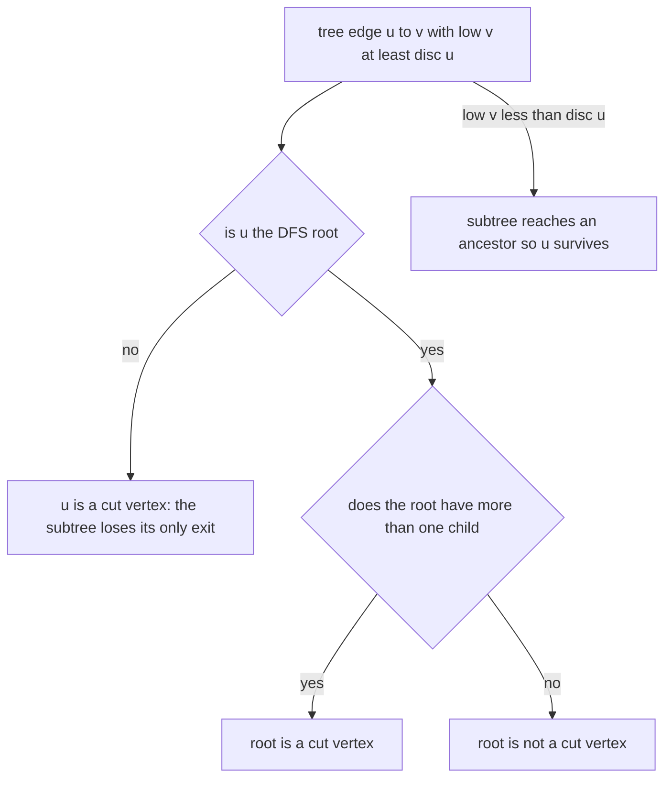
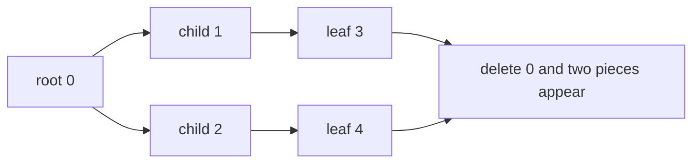
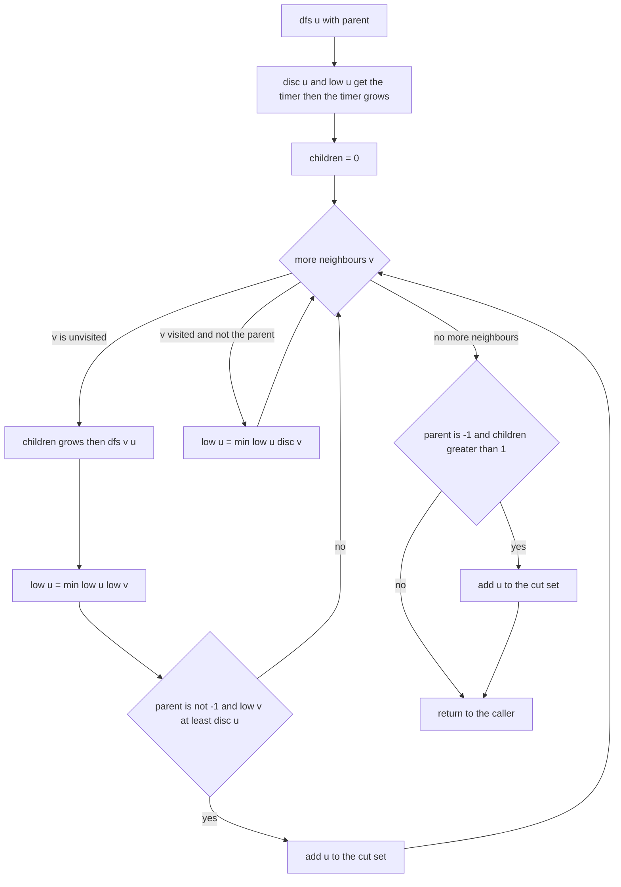
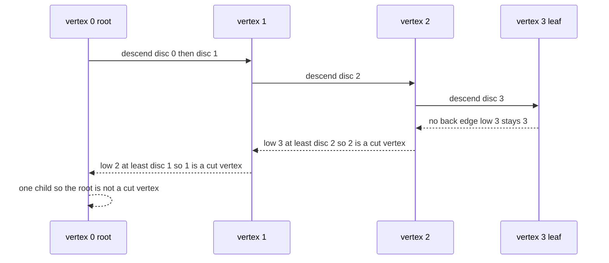

# 283 — Articulation points (cut vertices).

> **Tier:** Intermediate · **CTCI chapter:** Ch 4 — Trees and Graphs
> **Task spec:** [283-articulation-points-cut-vertices.md](../../../tasks/intermediate/283-articulation-points-cut-vertices.md)
> **Solutions:** [Python](../../../solutions/python/intermediate/283-articulation-points-cut-vertices/solution.py) ·
> [Java](../../../solutions/java/intermediate/283-articulation-points-cut-vertices/Solution.java) ·
> [JavaScript](../../../solutions/javascript/intermediate/283-articulation-points-cut-vertices/solution.js) ·
> [C#](../../../solutions/csharp/intermediate/283-articulation-points-cut-vertices/Solution.cs)

## 1. Problem restatement

**Input:** a vertex count `n` (vertices `0 … n - 1`) and an undirected edge list. Parallel edges
may appear more than once; vertex ids are the only thing that matters, so a doubled edge behaves
like a 2-cycle.

**Output:** every **articulation point** — a vertex whose removal increases the number of
connected components of the graph — in increasing order. Removing a vertex also removes its
incident edges. The graph may be disconnected.

The task spec is a one-liner (“Articulation points (cut vertices).”), so the contract is fixed by
the assertions the four solution files ship with:

| Call | Result | Why |
| --- | --- | --- |
| `articulation_points(4, [(0,1),(1,2),(2,3)])` | `[1, 2]` | the interior vertices of a path |
| `articulation_points(4, [(0,1),(1,2),(2,3),(3,0)])` | `[]` | a cycle survives any single removal |
| `articulation_points(5, [(0,1),(0,2),(0,3),(0,4)])` | `[0]` | the centre of a star |
| `articulation_points(3, [(0,1),(0,2)])` | `[0]` | the DFS root with two children |
| `articulation_points(6, [(0,1),(1,2),(2,0),(3,4),(4,5),(5,3)])` | `[]` | two disjoint triangles |
| `articulation_points(4, [(0,1),(1,2),(2,0),(2,3)])` | `[2]` | a triangle with a tail |
| `articulation_points(2, [(0,1)])` | `[]` | removing either endpoint leaves one vertex |
| `articulation_points(3, [])` | `[]` | isolated vertices |
| `articulation_points(3, [(0,1),(0,1),(1,2)])` | `[1]` | parallel edges still form a 2-cycle |
| `articulation_points(7, …link two cycles through 2…)` | `[2]` | the shared vertex of two cycles |
| `articulation_points(10, path of 10 vertices)` | `[1,2,3,4,5,6,7,8]` | every interior vertex of a long path |

Two further families are checked: 120 random simple graphs generated with divisor `3` and another
120 with divisor `5` (`n = 6`, `seed = 13579`, `seed ← (seed · 75 + 74) mod 65537`, edge kept when
`seed mod divisor == 0`, each unordered pair at most once). Each graph must agree with the
delete-one-vertex oracle, and each family must contain at least one graph *with* a cut vertex and
one *without*, so the comparison is never vacuous.

The oracle is the definition: `count_components(n, edges, skipped)` counts connected components
while ignoring vertex `skipped`, and `brute_force_articulation_points` reports every `v` for which
that count exceeds the baseline.

## 2. Intuition

Testing every vertex by deleting it and recounting components costs `O(V · (V + E))`. The DFS
low-link machinery turns the whole question into a single pass.

Stamp each vertex with `disc[u]` when the DFS first reaches it and maintain `low[u]`, the smallest
discovery time reachable from `u`’s subtree using tree edges plus at most one back edge. Then, for
a tree edge `u → v`:

- if `low[v] >= disc[u]`, nothing in `v`’s subtree can climb above `u`, so **removing `u`**
  disconnects the subtree — `u` is an articulation point;
- if `low[v] < disc[u]`, there is a back edge from the subtree to some ancestor of `u`, and that
  route survives the removal of `u`.

The comparison is `>=`, not the strict `>` used for bridges, precisely because a back edge to `u`
itself does not help once `u` is the vertex being deleted.

The one case the tree-edge rule cannot see is the **root of the DFS**. The root has no ancestors,
so `low[v] >= disc[root]` is always true; what actually matters is whether it has more than one
child in the DFS tree, because two separate subtrees are joined only through the root.



That root rule is why `articulation_points(3, [(0,1),(0,2)])` returns `[0]` while
`articulation_points(2, [(0,1)])` returns `[]`: in the star the DFS root has two children, in the
single edge it has one.



## 3. Algorithm

1. Build undirected adjacency lists, keeping every input edge (so parallel edges stay parallel).
2. Initialise `disc[v] = -1` for all vertices, `low[v] = 0`, a timer at `0`, and an empty set of
   articulation points.
3. For each vertex in increasing order with `disc[v] == -1`, call `dfs(v, -1)`; the parent of the
   root is `-1`.
4. `dfs(u, parent)`: stamp `disc[u] = low[u] = timer`, grow the timer, and start a child counter
   at `0`.
5. For each neighbour `v`: if `disc[v] == -1`, this is a tree edge — increment the child counter,
   recurse, relax `low[u] = min(low[u], low[v])`, and if `parent != -1` and `low[v] >= disc[u]`,
   add `u` to the set. Otherwise, if `v != parent`, it is a back edge — relax
   `low[u] = min(low[u], disc[v])`.
6. After the loop, if `parent == -1` and the child counter is greater than one, add `u` — the root
   rule.
7. Return the articulation points sorted.

```text
procedure articulation_points(n, edges)
    adjacency ← empty list per vertex
    for each edge (a, b) do
        append b to adjacency[a]
        append a to adjacency[b]
    end
    disc ← array of n filled with -1
    low ← array of n zeros
    timer ← 0
    points ← empty set

    function dfs(u, parent)
        disc[u] ← timer
        low[u] ← timer
        timer ← timer + 1
        children ← 0
        for each v in adjacency[u] do
            if disc[v] = -1 then
                children ← children + 1
                dfs(v, u)
                low[u] ← min(low[u], low[v])
                if parent ≠ -1 and low[v] ≥ disc[u] then
                    add u to points
                end
            else if v ≠ parent then
                low[u] ← min(low[u], disc[v])
            end
        end
        if parent = -1 and children > 1 then
            add u to points
        end
    end

    for v ← 0 to n - 1 do
        if disc[v] = -1 then
            dfs(v, -1)
        end
    end
    sort points ascending
    return points as a list
end
```



## 4. Worked example

Trace the path `n = 4`, edges `(0,1)`, `(1,2)`, `(2,3)`. Adjacency: `0 → 1`; `1 → 0, 2`;
`2 → 1, 3`; `3 → 2`. The outer loop starts at `0`:

| Step | Call | Values set | Decision | Cut set |
| --- | --- | --- | --- | --- |
| 1 | `dfs(0, -1)` | `disc[0] = low[0] = 0`, `children = 0` | root, parent `-1` | `{}` |
| 2 | `dfs(1, 0)` | `disc[1] = low[1] = 1`, `children = 0` | tree edge `0→1` | `{}` |
| 3 | — | — | neighbour `0` equals the parent → skipped | `{}` |
| 4 | `dfs(2, 1)` | `disc[2] = low[2] = 2`, `children = 0` | tree edge `1→2` | `{}` |
| 5 | — | — | neighbour `1` equals the parent → skipped | `{}` |
| 6 | `dfs(3, 2)` | `disc[3] = low[3] = 3`, `children = 0` | tree edge `2→3` | `{}` |
| 7 | — | — | `3`’s only neighbour is its parent → skipped | `{}` |
| 8 | — | `low[2] = min(2, low[3]) = 2` | back in `2`: `low[3] >= disc[2]` → `3 >= 2` true | `{2}` |
| 9 | — | `low[1] = min(1, low[2]) = 1` | back in `1`: `low[2] >= disc[1]` → `2 >= 1` true | `{1, 2}` |
| 10 | — | `low[0] = min(0, low[1]) = 0` | back in `0`: parent is `-1`, so the tree-edge rule is off | `{1, 2}` |
| 11 | — | `children` of `0` is `1` | root rule needs `children > 1` → not added | `{1, 2}` |

The result is `[1, 2]`, the two interior vertices, matching the assertion.



Compare that with the 4-cycle `(0,1),(1,2),(2,3),(3,0)`: after descending `0 → 1 → 2 → 3`, the
neighbour list of `3` contains `0`, which is not the parent, so `low[3]` drops to `disc[0] = 0`.
Returning up, `low[3] = 0 >= disc[2] = 2` is false and `low[2] = 0 >= disc[1] = 1` is false, so no
vertex is added — the cycle survives any single removal, as asserted.

## 5. Complexity

Let `V = n` and `E` be the number of input edges.

| Measure | Bound | Why it holds |
| --- | --- | --- |
| Time, best | O(V + E) | even an edgeless graph walks all vertices once |
| Time, average | O(V + E) | each adjacency entry is inspected once per endpoint |
| Time, worst | O(V + E) | constant work per entry plus the final sort of the answer |
| Space, graph | O(V + E) | adjacency keeps both directions of every input edge |
| Space, bookkeeping | O(V) | `disc`, `low`, the recursion stack and the cut set |
| Space, output | O(V) | at most `V` cut vertices |
| Time of the brute-force oracle | O(V · (V + E)) | one component count per removed vertex |
| Space of the oracle | O(V + E) | a fresh adjacency list per candidate vertex |

Sorting the answer costs `O(V log V)`, which is invisible next to the traversal. The interesting
part of the bound is the oracle: 240 random graphs times up to 6 vertex deletions each is still
trivial at this size but would be hopeless on a real 100 000-vertex graph.

## 6. Pitfalls and edge cases

- **Forgetting the root rule.** The DFS root always satisfies the tree-edge test, so without the
  `children > 1` check every root would be reported.
  `articulation_points(3, [(0,1),(0,2)])` must be `[0]`, and `articulation_points(2, [(0,1)])`
  must be `[]` — the same rule, two different answers.
- **Using `>` instead of `>=`.** That is the bridge test; it misses cut vertices whose only exit
  from the subtree is a back edge to the vertex itself, which is exactly the triangle-plus-tail
  assertion `articulation_points(4, [(0,1),(1,2),(2,0),(2,3)]) == [2]`.
- **Skipping the parent by vertex id, not by edge.** For parallel edges this discards a genuine
  2-cycle. The code compares `v != parent`, and the doubled edge `(0,1), (0,1)` is *not* skipped
  twice in a way that breaks the answer because the parallel copy re-enters the same neighbour —
  the assertion `articulation_points(3, [(0,1),(0,1),(1,2)]) == [1]` is what pins this behaviour
  down.
- **Relaxing with `low[v]` on a back edge.** Back edges must use `disc[v]`: `low[v]` may not be
  final yet while `v` is still being explored.
- **Disconnected graphs.** Each component gets its own root via the outer loop, and each such
  root is tested with the same child rule — the two-triangles assertion `[]` covers exactly that.
- **Isolated vertices.** A vertex with no edges has zero children, so it is never reported —
  `articulation_points(3, []) == []`.
- **Duplicated output.** A vertex can satisfy the tree-edge rule for several of its children; the
  implementations keep the answer in a set (`set`, `TreeSet`, `SortedSet`) or deduplicate before
  sorting, so `u` is reported once.
- **Recursion depth.** All four files recurse; the longest graph asserted (a 10-vertex path) is far
  from any stack limit.
- **Output order.** The cut set is unordered by construction, so the final sort is part of the
  contract: the long-path assertion expects the exact list `[1 … 8]`.

## 7. Variants and follow-ups

- **Bridge edges instead of vertices.** The sibling question uses a strict comparison and tracks
  the arrival *edge*: [282-bridge-edges-in-undirected-graph-tarjan.md](../../../tasks/intermediate/282-bridge-edges-in-undirected-graph-tarjan.md).
- **Strongly connected components.** The same low-link walk on a directed graph, with an explicit
  stack of open components: [281-tarjan-s-strongly-connected-components.md](../../../tasks/intermediate/281-tarjan-s-strongly-connected-components.md).
- **Biconnected components.** Each articulation point splits the graph into blocks; collecting the
  blocks is a small change (push the current edge path when the cut condition fires) and is the
  standard follow-up.
- **Iterative DFS.** Rewriting the recursion with an explicit stack removes the depth limit and is
  asked for whenever the input can be a long chain.
- **Where this lives in the book.** The traversal template behind the walk is in
  [Trees and Graphs](../../ctci/04-trees-and-graphs.md).

## 8. Check yourself

1. Why does the root need a special rule?

<details><summary>Show answer</summary>

The root has no ancestors, so for every child `v` the inequality `low[v] >= disc[root]` is
automatically true (there is nothing discovered before the root to reach). What actually decides
whether removing the root disconnects the graph is how many independent subtrees hang off it: one
child means the rest of the graph is still connected through that child, two or more means the
root was the only join.

</details>

2. What is the difference between the articulation test and the bridge test?

<details><summary>Show answer</summary>

Bridges test `low[v] > disc[u]` on a tree edge; cut vertices test `low[v] >= disc[u]`. The
strictness matters because a back edge from `v`’s subtree directly to `u` keeps `u → v` on a cycle
(no bridge) but does not save `u` when `u` itself is deleted.

</details>

3. How many articulation points does a tree with `V ≥ 2` vertices have?

<details><summary>Show answer</summary>

Every vertex except the leaves, so `V` minus the leaf count. There are no back edges at all, so
each child satisfies `low[v] >= disc[u]`, and the DFS root follows the multi-child rule. The
assertions use the path shape, where the answer is all interior vertices.

</details>

4. A vertex appears in the cut set twice during the walk. How do the four files handle that?

<details><summary>Show answer</summary>

They never build a list with duplicates: Python and JavaScript use a set of vertex ids, Java a
`TreeSet` and C# a `SortedSet`. Converted to a sorted list at the end, the answer is correct even
when several children of the same vertex trigger the rule.

</details>

5. Why does the test suite generate graphs with two different edge densities (divisor `3` and
   divisor `5`)?

<details><summary>Show answer</summary>

Sparse graphs have many cut vertices, dense graphs almost none. Using two densities — plus the
explicit coverage assertions that each family produced at least one graph with a cut vertex and
one without — stops the suite from passing on a family where the answer is always the same
trivial value.

</details>
