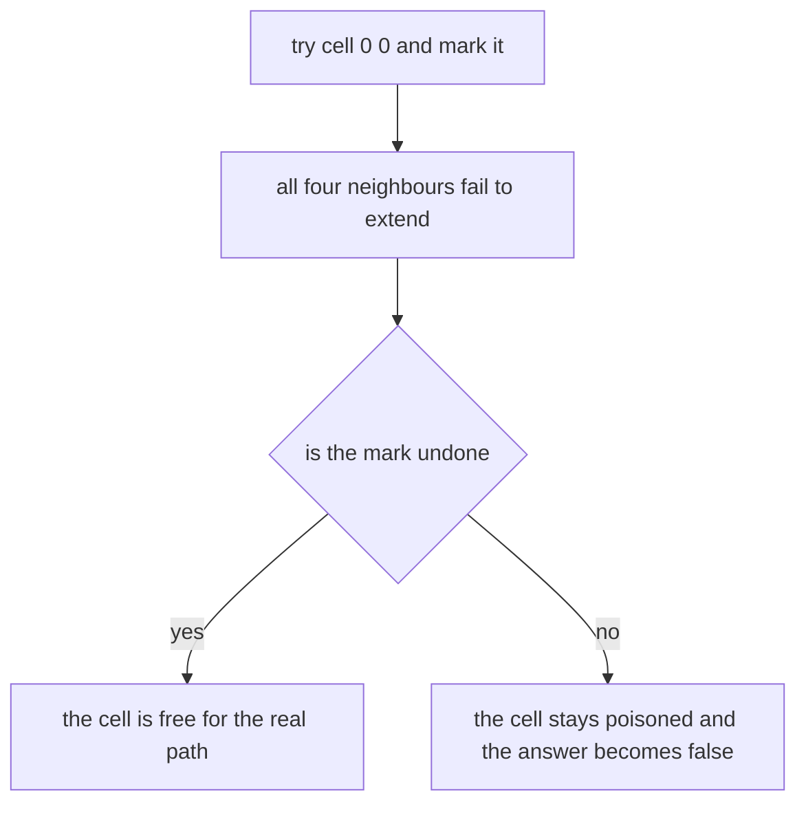
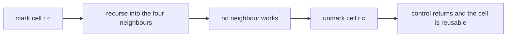
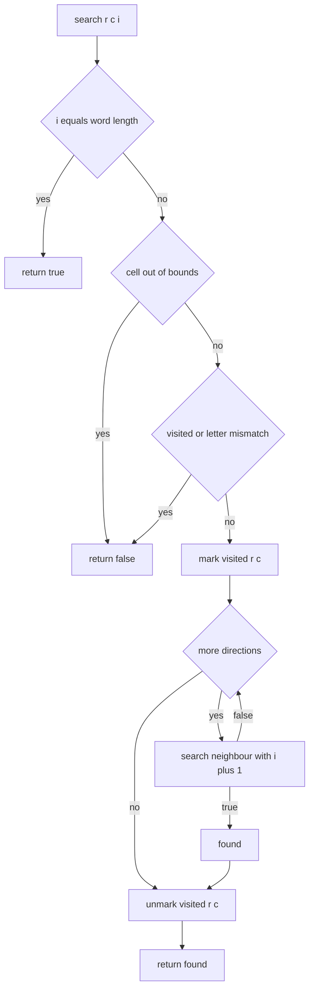
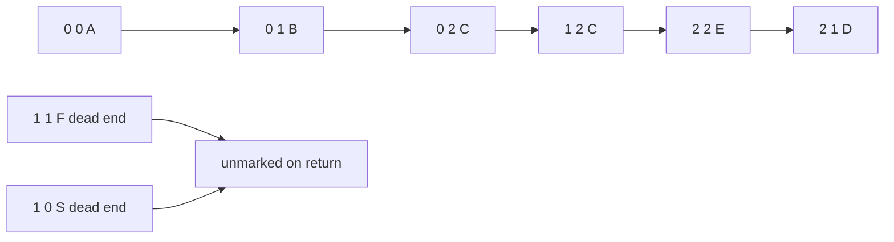

# 284 — Word search in board (DFS backtracking).

> **Tier:** Intermediate · **CTCI chapter:** Ch 8 — Recursion and Dynamic Programming
> **Task spec:** [284-word-search-in-board-dfs-backtracking.md](../../../tasks/intermediate/284-word-search-in-board-dfs-backtracking.md)
> **Solutions:** [Python](../../../solutions/python/intermediate/284-word-search-in-board-dfs-backtracking/solution.py) ·
> [Java](../../../solutions/java/intermediate/284-word-search-in-board-dfs-backtracking/Solution.java) ·
> [JavaScript](../../../solutions/javascript/intermediate/284-word-search-in-board-dfs-backtracking/solution.js) ·
> [C#](../../../solutions/csharp/intermediate/284-word-search-in-board-dfs-backtracking/Solution.cs)

## 1. Problem restatement

**Input:** a rectangular board of single characters (in Python a list of equal-length strings, in
Java/C# an array of strings, in JavaScript an array of strings) and a word.

**Output:** `True` when the word can be spelled by a path of 4-directionally adjacent cells —
up, down, left, right, no diagonals — that never reuses a cell; `False` otherwise. The search may
start at any cell.

The task spec is a one-liner (“Word search in board (DFS backtracking).”), so the contract is
fixed by the assertions the four solution files ship with:

| Call | Result | Why |
| --- | --- | --- |
| `exist(["ABCE","SFCS","ADEE"], "ABCCED")` | `True` | a snake through the top-left corner |
| `exist(["ABCE","SFCS","ADEE"], "SEE")` | `True` | forced path down the right half |
| `exist(["ABCE","SFCS","ADEE"], "ABCB")` | `False` | the `B` would have to be reused |
| `exist(["ABCE","SFES","ADEE"], "ABCESEEEFS")` | `True` | needs cells freed by backtracking |
| `exist(["A"], "A")` | `True` | a 1×1 board |
| `exist(["A"], "B")` | `False` | letter mismatch |
| `exist(["A"], "AA")` | `False` | one cell cannot be used twice |
| `exist(["AB","CD"], "ABDC")` | `True` | a full tour of the 2×2 board |
| `exist(["AB","CD"], "ABCD")` | `False` | that tour is not adjacency-legal |
| `exist(board, "")` | `False` | the empty word short-circuits to `False` |

The second board is the **trap case** built into the files: a deliberately buggy
`buggy_exist_without_unmarking` / `buggyExistWithoutUnmarking` variant is shipped alongside, and
the assertions demand `exist(trap, "ABCESEEEFS") is True` while
`buggy_exist_without_unmarking(trap, "ABCESEEEFS") is False`. That pair is the whole reason the
tutorial stresses backtracking.

Random coverage: 150 cases on `3×3` boards filled from the alphabet `"ABC"` with word lengths
`1 … 4` (generator `seed ← (seed · 75 + 74) mod 65537`) must match an independent BFS oracle over
`(row, column, visited-mask)` states, plus 50 **planted** cases where the word is read off a random
simple path and must therefore be `True`. The planted counter is asserted to be exactly `50`.

## 2. Intuition

The naive idea is a plain DFS: from every cell, walk in all four directions, marking cells as
used. The subtle part is what happens after a branch fails. If the marking is never undone, the
cells explored by a failed branch stay marked forever, and a later branch that *needs* those cells
is silently blocked.



The fix is one line in both directions: mark before recursing, unmark after the recursion returns.
That is genuine backtracking — the visited array is the shared state, and every return path
restores it.



The search is also self-pruning: a cell is only entered when `board[r][c]` equals the next letter
of the word, so the number of surviving branches per level is at most three (going back where you
came from is immediately rejected), not four.

## 3. Algorithm

1. Take `rows` and `cols` from the board; return `False` for an empty word.
2. Allocate a `visited` grid of the same shape, all `False`.
3. Define `search(r, c, i)`: return `True` when `i` has reached the end of the word; return `False`
   when `(r, c)` is outside the board, already visited, or holds a letter different from `word[i]`.
4. Mark `visited[r][c]`, then try the four directions in a fixed order (`down, up, right, left` in
   the files) with `search(r + dr, c + dc, i + 1)`, stopping at the first `True`.
5. Unmark `visited[r][c]` before returning — whether the branch succeeded or not the grid is left
   as it was found, which is what makes the recursion composable.
6. Try `search(r, c, 0)` for every cell; return `True` as soon as one succeeds.

```text
procedure exist(board, word)
    if word is empty then
        return false
    end
    rows ← number of rows of board
    cols ← number of columns of board
    visited ← rows × cols grid of false
    directions ← list of four (dr, dc) offsets

    function search(r, c, i)
        if i = length(word) then
            return true
        end
        if r < 0 or r ≥ rows or c < 0 or c ≥ cols then
            return false
        end
        if visited[r][c] or board[r][c] ≠ word[i] then
            return false
        end
        visited[r][c] ← true
        found ← false
        for each (dr, dc) in directions do
            if search(r + dr, c + dc, i + 1) then
                found ← true
                break
            end
        end
        visited[r][c] ← false
        return found
    end

    for r ← 0 to rows - 1 do
        for c ← 0 to cols - 1 do
            if search(r, c, 0) then
                return true
            end
        end
    end
    return false
end
```



## 4. Worked example

Trace `exist(["ABCE","SFCS","ADEE"], "ABCCED")`. The board is

```text
row 0: A B C E
row 1: S F C S
row 2: A D E E
```

and the directions are tried in the order down, up, right, left. Every attempt starts from the
first cell holding the first letter:

| Step | `search(r, c, i)` | Letter needed | Branch | Outcome |
| --- | --- | --- | --- | --- |
| 1 | `search(0,0,0)` | `A` | mark `(0,0)` | enter |
| 2 | `search(1,0,1)` | `B` | down to `S` | mismatch → `False` |
| 3 | `search(-1,0,1)` | `B` | up | out of bounds → `False` |
| 4 | `search(0,1,1)` | `B` | right, mark `(0,1)` | enter |
| 5 | `search(1,1,2)` | `C` | down to `F` | mismatch → `False` |
| 6 | `search(0,2,2)` | `C` | right, mark `(0,2)` | enter |
| 7 | `search(1,2,3)` | `C` | down, mark `(1,2)` | enter |
| 8 | `search(2,2,4)` | `E` | down, mark `(2,2)` | enter |
| 9 | `search(3,2,5)` | `D` | down | out of bounds → `False` |
| 10 | `search(1,2,5)` | `D` | up to a visited cell | `False` |
| 11 | `search(2,3,5)` | `D` | right to `E` | mismatch → `False` |
| 12 | `search(2,1,5)` | `D` | left, mark `(2,1)` | enter |
| 13 | `search(3,1,6)` | — | any direction with `i = 6 = len(word)` | `True` |
| 14 | — | — | unwind, unmarking `(2,1)`, `(2,2)`, `(1,2)`, `(0,2)`, `(0,1)`, `(0,0)` | `True` |

The path is `A(0,0) → B(0,1) → C(0,2) → C(1,2) → E(2,2) → D(2,1)`; steps 2, 3, 5, 9, 10 and 11
are dead ends that each returned `False` without leaving a mark behind.



The trap case shows why the unmarking is not cosmetic. On

```text
row 0: A B C E
row 1: S F E S
row 2: A D E E
```

the word `ABCESEEEFS` is only reachable as
`A(0,0) → B(0,1) → C(0,2) → E(0,3) → S(1,3) → E(2,3) → E(2,2) → E(1,2) → F(1,1) → S(1,0)`. The
first branch the DFS tries after `S(1,3)` is `E(1,2) → E(2,2) → E(2,3)`, which runs out of
neighbours one letter short of `F`. If those three cells keep their marks, the successful route can
never be assembled and the answer is a wrong `False` — exactly what the shipped
`buggy_exist_without_unmarking` demonstrates.

## 5. Complexity

Let `R`, `C` be the board dimensions and `L = len(word)`.

| Measure | Bound | Why it holds |
| --- | --- | --- |
| Time, best | O(R · C) | a first-letter mismatch in every cell stops immediately |
| Time, average | far below the worst case | the letter check prunes most branches and at most three neighbours survive per level |
| Time, worst | O(R · C · 3^L) | every start cell roots a tree whose depth is `L` with at most 3 live children per node |
| Space, visited | O(R · C) | one boolean per cell |
| Space, recursion | O(L) | the recursion depth never exceeds the word length |
| Space, oracle | O(R · C · 2^(R·C)) states | the BFS explores `(cell, visited-mask)` pairs, which is fine only for 3×3 boards |
| Time of the oracle | proportional to the state count | each state is expanded once, guarded by a `seen` set |

The `3^L` factor is the reason the tests keep boards at `3×3` and words at most four letters: the
algorithm is exponential in the word length, not in the board area.

## 6. Pitfalls and edge cases

- **Not unmarking.** Covered above; it is the single bug the shipped “buggy” variant exists to
  demonstrate, and it changes the answer on the trap board.
- **Empty word.** All four files return `False` immediately (`if not word: return False`), so
  `exist(board, "")` is `False` rather than the vacuously-`True` answer some people expect.
- **Reusing a cell.** `exist(["A"], "AA")` is `False`: the only cell is marked during the first
  step, so the second letter finds no unvisited neighbour.
- **Diagonal moves.** Only the four axis-aligned offsets are used; a diagonal path would make
  `exist(["AB","CD"], "ABCD")` succeed, and the assertion demands `False`.
- **Starting cell.** The search must try *every* cell, not only cells on the border or the first
  occurrence of `word[0]`; the planted random cases start wherever the generator’s random walk
  happened to begin.
- **Board shape.** The files assume a rectangular board and read `cols` from the first row
  (`len(board[0])`), so ragged input is undefined; no assertion covers it.
- **Letter comparison happens before recursing.** The check `board[r][c] != word[i]` is inside
  `search`, so a wrong neighbour costs one call and no marking — putting the check in the parent
  loop instead is an equivalent but subtly different structure.
- **Anchoring in JavaScript.** The oracle encodes a state as one integer
  (`cell << shift | mask` in JavaScript and C#, a tuple in Python and Java), so very large boards
  would overflow; the tests stay at 3×3.
- **Mutating the input.** The board is only read; the `visited` grid is the state that changes and
  is restored on the way out.

## 7. Variants and follow-ups

- **Word search II.** A whole dictionary instead of one word: build a trie once and reuse it
  across all start cells, which turns `O(R·C·3^L)`-per-word into a single traversal of the board.
- **Enumerate the paths.** Replace the boolean return with a list of paths — the same recursion
  with an accumulating path buffer that is popped after each call, the pattern used in
  [287-combination-sum-backtracking.md](../../../tasks/intermediate/287-combination-sum-backtracking.md).
- **Constrained placement.** The row/column/diagonal conflict rules of
  [285-n-queens-problem-backtracking.md](../../../tasks/intermediate/285-n-queens-problem-backtracking.md)
  exercise the same mark-test-unmark cycle with a richer constraint.
- **Grid pathfinding.** When cells may be revisited and only the shortest route matters, the
  visited-set trick becomes a BFS distance array instead; compare with
  [270-implement-a-algorithm-for-grid-pathfinding.md](../../../tasks/intermediate/270-implement-a-algorithm-for-grid-pathfinding.md).
- **The recursion chapter** [Recursion and Dynamic Programming](../../ctci/08-recursion-and-dp.md)
  frames backtracking as “try, recurse, undo”.

## 8. Check yourself

1. Why does `exist(["A"], "AA")` return `False` although `"AA"` has the right letters?

<details><summary>Show answer</summary>

Because the word must be spelled by a path that never reuses a cell. The only cell is marked when
the first letter is consumed, so when the second letter is matched against the four neighbours
there is no legal move and the branch fails.

</details>

2. What exactly does the “unmark” line accomplish for the trap board?

<details><summary>Show answer</summary>

It restores `visited` to the state it had when the current call was entered, so a failed branch
leaves no trace. Without it, the cells consumed by the first attempt at `ABCESEEEFS` remain marked
and the only successful route — which reuses those very cells — becomes unreachable, so the
function returns `False`.

</details>

3. Why is the DFS allowed to try the four directions in any fixed order?

<details><summary>Show answer</summary>

Because `exist` answers a yes/no question about existence, not a question about the
lexicographically smallest path. Any complete exploration of the branch space gives the same
boolean; ordering only changes which path is found first. (Contrast the enumeration tasks, where
the order is part of the documented output.)

</details>

4. The worst case is often written `O(R · C · 4^L)`. Why do the files justify at most three live
   branches per level?

<details><summary>Show answer</summary>

The cell the search just came from is marked, so it is rejected immediately by the `visited`
check. That leaves at most three unvisited neighbours, and since the letter test prunes further,
`3^L` is the tighter bound for the recursion tree rooted at a single start cell.

</details>

5. How does the BFS oracle differ from the DFS, and why is it a fair cross-check?

<details><summary>Show answer</summary>

The oracle explores states `(row, column, visited-mask)` breadth-first with an explicit `seen`
set, using the popcount of the mask as the current prefix length; it never backtracks because each
state carries its own path history. It is a different search order and a different state
representation, and it still answers the same question, so agreement on 150 boards is meaningful
evidence rather than a tautology.

</details>
