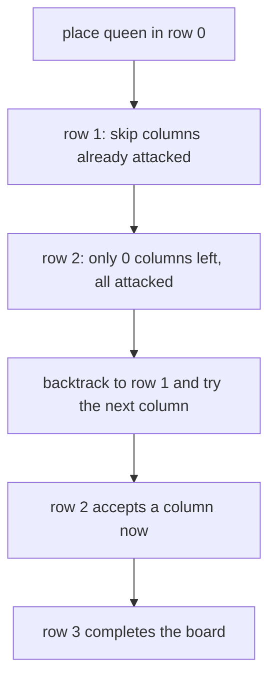
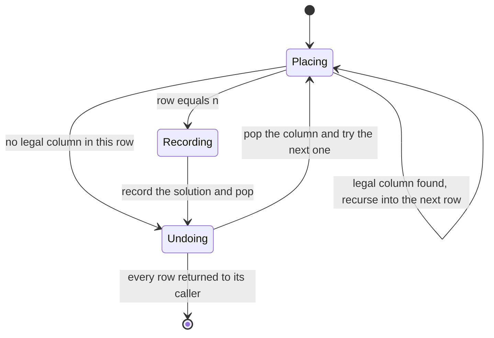
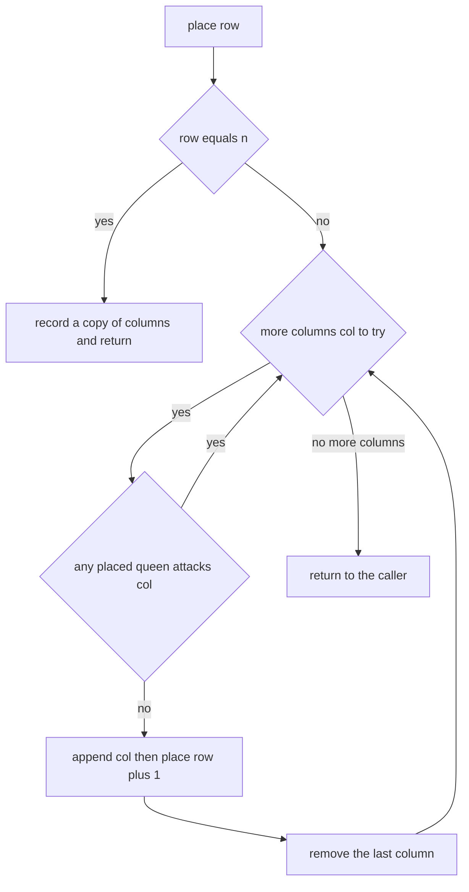
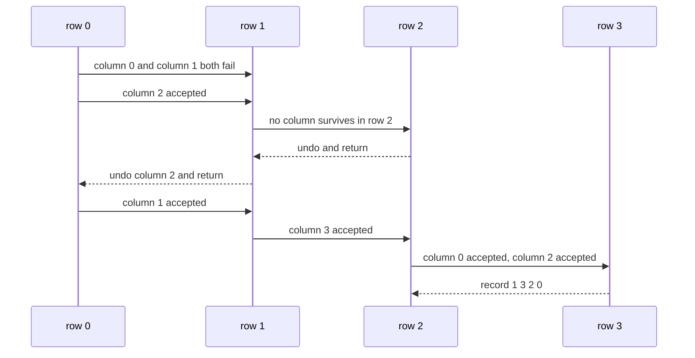

# 285 — N-Queens problem (backtracking).

> **Tier:** Intermediate · **CTCI chapter:** Ch 8 — Recursion and Dynamic Programming
> **Task spec:** [285-n-queens-problem-backtracking.md](../../../tasks/intermediate/285-n-queens-problem-backtracking.md)
> **Solutions:** [Python](../../../solutions/python/intermediate/285-n-queens-problem-backtracking/solution.py) ·
> [Java](../../../solutions/java/intermediate/285-n-queens-problem-backtracking/Solution.java) ·
> [JavaScript](../../../solutions/javascript/intermediate/285-n-queens-problem-backtracking/solution.js) ·
> [C#](../../../solutions/csharp/intermediate/285-n-queens-problem-backtracking/Solution.cs)

## 1. Problem restatement

**Input:** a board size `n`.

**Output:** *all* ways to place `n` queens on an `n × n` board so that no two attack each other.
A solution is encoded as a list of column indices, one per row — `[1, 3, 0, 2]` means “row 0 has
its queen in column 1, row 1 in column 3, row 2 in column 0, row 3 in column 2”. Because the
search tries columns in increasing order and recurses row by row, the returned list of solutions is
in **lexicographic order**, which the assertions check explicitly.

The task spec is a one-liner (“N-Queens problem (backtracking).”), so the contract is fixed by the
assertions the four solution files ship with:

| Call | Result | Why |
| --- | --- | --- |
| `count_solutions(1)` | `1` | a single cell |
| `count_solutions(2)`, `count_solutions(3)` | `0`, `0` | no placement exists |
| `count_solutions(4)` | `2` | the smallest board with solutions |
| `count_solutions(5)` | `10` | known sequence |
| `count_solutions(6)` | `4` | known sequence |
| `count_solutions(7)` | `40` | known sequence |
| `count_solutions(8)` | `92` | the classic 8-queens answer |
| `first_solution(1)` | `[0]` | trivial |
| `first_solution(4)` | `[1, 3, 0, 2]` | hand-verified lexicographic first |
| `first_solution(2)`, `first_solution(3)` | `None` (C#: `null`) | no placement exists |

For every `n` from `1` to `8` the files also check that the length of the full solution list equals
`count_solutions(n)`, that the list is already sorted (so the order is deterministic), that every
returned placement passes `is_valid_solution`, that `first_solution(n)` is the first element, and
that an independent permutation oracle — every permutation of `0 … n - 1`, filtered by the
diagonal test — returns the same count.

## 2. Intuition

The naive idea is to try every assignment of queens to cells: `n²` choices per queen, `n` queens,
`n^(2n)` combinations. Even the slightly better formulation — one queen per row, so only `n^n`
placements — is hopeless.

The first structural insight removes almost all of it: **every valid placement has exactly one
queen per row and exactly one per column**. Fixing the row order means the state is just the list
of columns chosen so far; placing the next queen means choosing a column that no earlier queen
already attacks. That is `n` choices per row with pruning, not `n²`.

The second insight is what makes the attack test cheap. Because there is one queen per row and rows
are filled top to bottom, a new queen at `(row, col)` conflicts with a placed queen at
`(pr, pc)` exactly when

- `col == pc` (same column), or
- `abs(col - pc) == row - pr` (same diagonal — the row distance equals the column distance).



Backtracking is what turns “try all placements” into “try placements that are still possible”. The
moment a row has no legal column, the recursion returns and the previous row advances — the
alternative would be to keep enumerating boards that are already known to be dead.



## 3. Algorithm

1. Keep a list `columns` where `columns[r]` is the queen’s column in row `r`.
2. `place(row)`: if `row == n`, a complete placement exists — append a **copy** of `columns` to the
   solution list and return.
3. Otherwise try `col` from `0` to `n - 1` in increasing order.
4. For each already placed queen `(pr, pc)`, reject the candidate when `col == pc` or
   `abs(col - pc) == row - pr`. Any rejection ends this candidate immediately.
5. If the candidate survives, append it, recurse into `place(row + 1)` and pop it — the pop is the
   undo step.
6. Return the collected solutions. `count_solutions` is `len` of that list, and `first_solution`
   is the first element or `None`.

```text
procedure solve_n_queens(n)
    solutions ← empty list
    columns ← empty list

    function place(row)
        if row = n then
            append a copy of columns to solutions
            return
        end
        for col ← 0 to n - 1 do
            safe ← true
            for each (pr, pc) in columns with index do
                if col = pc or abs(col - pc) = row - pr then
                    safe ← false
                    break
                end
            end
            if safe then
                append col to columns
                place(row + 1)
                remove the last element of columns
            end
        end
    end

    place(0)
    return solutions
end
```

Trying `col` in increasing order is what makes the output lexicographic: the first solution the
search records is the one that always prefers the smallest legal column at the earliest row, which
is `[1, 3, 0, 2]` for `n = 4`.



## 4. Worked example

Trace `n = 4`. Rows are filled top to bottom; `columns` grows on the way down and shrinks on the
way back up.

| Step | Row | Candidate `col` | Conflict check | `columns` after | Note |
| --- | --- | --- | --- | --- | --- |
| 1 | 0 | 0 | nothing placed | `[0]` | accepted |
| 2 | 1 | 0 | same column as row 0 | `[0]` | rejected |
| 3 | 1 | 1 | `abs(1-0) == 1-0` diagonal | `[0]` | rejected |
| 4 | 1 | 2 | no conflict | `[0, 2]` | accepted |
| 5 | 2 | 0 | same column as row 0 | `[0, 2]` | rejected |
| 6 | 2 | 1 | `abs(1-2) == 2-1` diagonal | `[0, 2]` | rejected |
| 7 | 2 | 2 | same column as row 1 | `[0, 2]` | rejected |
| 8 | 2 | 3 | `abs(3-2) == 2-1` diagonal | `[0, 2]` | rejected — row 2 is dead |
| 9 | 1 | 3 | `abs(3-0) == 1-0` diagonal | `[0]` | rejected; row 1 exhausted |
| 10 | 0 | 1 | nothing placed | `[1]` | accepted, backtracking worked |
| 11 | 1 | 3 | no conflict | `[1, 3]` | accepted |
| 12 | 2 | 0 | no conflict | `[1, 3, 0]` | accepted |
| 13 | 3 | 0 | same column as row 2 | `[1, 3, 0]` | rejected |
| 14 | 3 | 1 | `abs(1-0) == 3-2` diagonal | `[1, 3, 0]` | rejected |
| 15 | 3 | 2 | `abs(2-1) == 3-0` diagonal, and `abs(2-3)` for row 2 | `[1, 3, 0]` | rejected |
| 16 | 3 | 3 | same column as row 1 | `[1, 3, 0]` | rejected — row 3 is dead |
| 17 | 2 | 1 | `abs(1-3) == 2-1` diagonal, same column as row 0 | `[1, 3]` | rejected |
| 18 | 2 | 2 | no conflict | `[1, 3, 2]` | accepted |
| 19 | 3 | 0 | no conflict | `[1, 3, 2, 0]` | **solution recorded** |
| 20 | … | … | unwind to row 0 and continue | … | second solution `[2, 0, 3, 1]` found later |

Step 19 is the first recorded solution, and it is the asserted `first_solution(4) == [1, 3, 0, 2]`.
The second solution, `[2, 0, 3, 1]`, completes the asserted count of `2` for `n = 4`.



## 5. Complexity

| Measure | Bound | Why it holds |
| --- | --- | --- |
| Time, best | O(n²) | columns are rejected as fast as they are tested on a board with a solution in the first branch |
| Time, average | well below the worst case | pruning removes diagonals and columns as soon as a row is placed |
| Time, worst | O(n! · n) | the search tree is a permutation tree: at most `n · (n-1) · … ` nodes, each doing `O(n)` conflict checks |
| Space, recursion | O(n) | one frame per row |
| Space, state | O(n) | the `columns` list |
| Space, output | O(S · n) | `S` solutions, each of length `n`; `S` is 92 for `n = 8` |
| Time of the permutation oracle | O(n! · n²) | it builds every permutation and filters it |

The counts in the assertions — `1, 0, 0, 2, 10, 4, 40, 92` — cannot be derived from the bound
alone; they are the known sequence of `n`-queens solutions and are hard-coded as a check on the
pruning rules. A missing diagonal test inflates every count; an over-strict test drives them to
zero.

## 6. Pitfalls and edge cases

- **Sharing the state instead of copying it.** `solutions.append(columns)` in Python would record a
  reference to the live list and every recorded solution would end up identical (empty). The files
  append `columns[:]` — Java and C# copy into a new list, JavaScript the same.
- **Forgetting to pop.** Without the undo, `columns` keeps growing and later branches see stale
  queens; the counts for `n = 4` collapse to the wrong value.
- **Impossible sizes.** `n = 2` and `n = 3` have no solutions at all, so `first_solution` must
  return “nothing” rather than crash: the Python and JavaScript helpers return `None`, the Java one
  `null`, the C# one uses a nullable array.
- **`n = 1`.** The single queen satisfies every rule; the count is `1` and the first solution is
  `[0]`.
- **Row distance in the diagonal test.** Using `row - pr` (the actual row gap) is required; using
  `1` or forgetting the `abs` on the column difference both produce wrong boards. The test relies
  on rows being distinct by construction, which is why only the column term is compared.
- **Lexicographic determinism.** The output order depends on the loop `for col in range(n)`. The
  files assert `solutions == sorted(solutions)` for every `n` up to `8`, so a shuffled iteration
  order fails even when the set of placements is right.
- **Duplicate solutions.** One queen per row plus the conflict test makes duplicates impossible;
  the oracle would not catch them, so the structure is doing the work.
- **Combinatorial blow-up.** `brute_force_count` enumerates `n!` permutations and recomputes the
  diagonal test for each, which is why it is only used up to `n = 8`.
- **C# nullability.** `FirstSolution` returns `int[]?`, so callers must handle `null`; comparing
  with `is_valid_solution` on a null result would throw.

## 7. Variants and follow-ups

- **Just one solution.** `first_solution` replaces “collect all” with “return the first”: the
  recursion returns `True` up the stack instead of recording, which stops the search early.
- **Count only.** `count_solutions` is a counter instead of a list, the same trick used in
  [288-generate-parentheses-balanced-parentheses-generator.md](../../../tasks/intermediate/288-generate-parentheses-balanced-parentheses-generator.md)
  where the balance rule plays the role of the diagonal test.
- **Bitmask boards.** Representing columns and both diagonal families as bit masks makes each
  conflict check a couple of shifts — the standard optimisation once the shape of the recursion is
  understood.
- **Sudoku** generalises the same “place a value, test the constraints, undo” cycle to a much
  richer constraint set:
  [286-sudoku-solver-backtracking-heuristics.md](../../../tasks/intermediate/286-sudoku-solver-backtracking-heuristics.md).
- The authoring chapter is [Recursion and Dynamic Programming](../../ctci/08-recursion-and-dp.md).

## 8. Check yourself

1. Why is one queen per row enough to describe the whole board?

<details><summary>Show answer</summary>

Two queens in the same row attack each other, so a legal placement has at most one queen per row —
and with exactly `n` queens on `n` rows, exactly one per row. The same argument applies to columns,
which is why a solution can be written as a permutation of column indices.

</details>

2. Why does the diagonal test use `abs(col - pc) == row - pr` and not a slope comparison?

<details><summary>Show answer</summary>

Two cells are on the same diagonal exactly when the row distance equals the column distance. Since
rows are filled top to bottom and `(pr, pc)` is always above `(row, col)`, `row - pr` is the
positive row gap, and comparing it to `abs(col - pc)` covers both diagonal directions in one
expression.

</details>

3. `count_solutions(4)` is `2` while the permutation oracle enumerates `4! = 24` permutations. How
   many does it keep?

<details><summary>Show answer</summary>

Two. `[1, 3, 0, 2]` and `[2, 0, 3, 1]` are the only permutations of `0 … 3` with no shared diagonal,
so the oracle returns `2` and agrees with the backtracking count.

</details>

4. What breaks if the recorded solution is not copied?

<details><summary>Show answer</summary>

The recorded value aliases the working list, which is popped back to empty as the recursion
unwinds. The result set then contains `n!`-many references to the same (eventually empty) list, so
`count_solutions` is still `2` for `n = 4` but `first_solution(4)` is `[]` and
`is_valid_solution` fails.

</details>

5. Why can `first_solution` be the whole algorithm when the interview only wants one board?

<details><summary>Show answer</summary>

Because the search already finds the lexicographically smallest placement first: keeping the loop
order and returning on the first success gives `[1, 3, 0, 2]` for `n = 4` without exploring the
rest of the tree. The files keep both entry points, with `count_solutions` built on the exhaustive
version.

</details>
