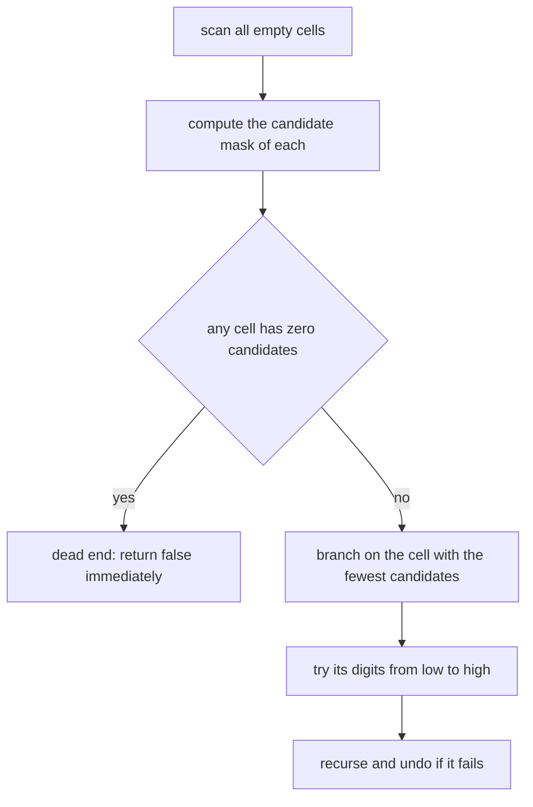
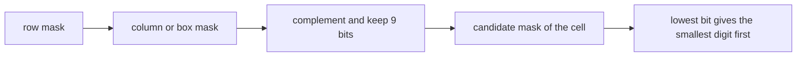
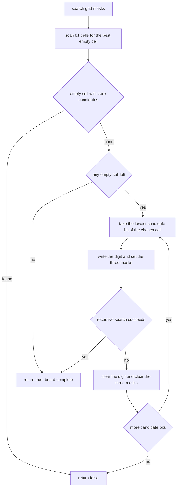
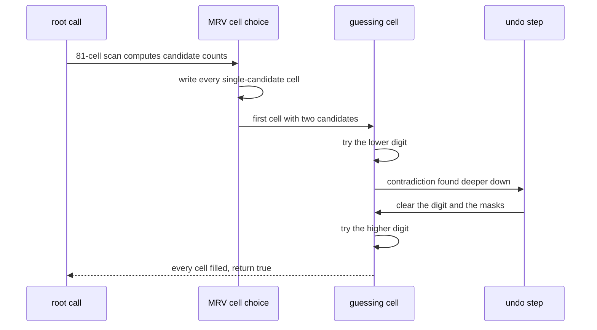

# 286 — Sudoku solver (backtracking + heuristics).

> **Tier:** Intermediate · **CTCI chapter:** Ch 8 — Recursion and Dynamic Programming
> **Task spec:** [286-sudoku-solver-backtracking-heuristics.md](../../../tasks/intermediate/286-sudoku-solver-backtracking-heuristics.md)
> **Solutions:** [Python](../../../solutions/python/intermediate/286-sudoku-solver-backtracking-heuristics/solution.py) ·
> [Java](../../../solutions/java/intermediate/286-sudoku-solver-backtracking-heuristics/Solution.java) ·
> [JavaScript](../../../solutions/javascript/intermediate/286-sudoku-solver-backtracking-heuristics/solution.js) ·
> [C#](../../../solutions/csharp/intermediate/286-sudoku-solver-backtracking-heuristics/Solution.cs)

## 1. Problem restatement

**Input:** a 9×9 grid of digits, `0` meaning “empty”. The grid is copied before solving, so the
caller’s data is never modified.

**Output:** a completed grid in which every row, every column and every one of the nine 3×3 boxes
contains the digits `1 … 9` exactly once, or `None` (Java `null`, C# `null`) when the puzzle has no
solution.

Two validation rules are applied *before* the search starts: a cell value outside `0 … 9` makes the
whole call return `None`, and a clue that duplicates another clue in its row, column or box makes
the call return `None` immediately rather than after a hopeless search.

The task spec is a one-liner (“Sudoku solver (backtracking + heuristics).”), so the contract is
fixed by the assertions the four solution files ship with:

| Call | Result | Why |
| --- | --- | --- |
| `solve_sudoku(PUZZLE)` | exactly `SOLUTION` | the classic 9×9 puzzle |
| every clue of `PUZZLE` | unchanged in the result | solving may fill, never overwrite |
| `solve_sudoku(SOLUTION)` | `SOLUTION` | a solved board has no empty cell |
| duplicate in a column | `None` | the clue check fires before searching |
| duplicate in a row | `None` | same |
| duplicate in a box | `None` | same |
| forced-conflict board | `None` | propagation discovers an empty candidate set |
| empty board | a valid completed grid | there are many solutions; any valid one passes |
| 25 symmetry variants of `PUZZLE` | the matching variant of `SOLUTION` | digit relabelling and legal row/column permutations |

The last row is the interesting one: the generator (`seed ← (seed · 75 + 74) mod 65537`) relabels
the digits with a random permutation, permutes the three bands and the three stacks, and permutes
rows within each band and columns within each stack. Those transformations preserve validity, so
each variant must solve to the transformed `SOLUTION`, and the transformed target is itself checked
with `is_valid_solution` before being used as an expectation.

## 2. Intuition

The naive solver scans cells left to right, tries `1 … 9`, and recurses. It is correct but slow,
because it happily explores branches that a human would discard immediately.

Two cheap ideas fix almost all of that:

1. **Candidate bitmasks.** Keep one 9-bit mask per row, per column and per box. A cell’s candidates
   are `~(row | col | box) & 0x1FF`. Setting and clearing a digit is one `or` and one `and-not`, so
   “which digits are still legal here?” becomes a single expression instead of a 27-cell scan.
2. **Most-constrained-variable (MRV) branching.** Never guess in the first empty cell; pick the
   empty cell with the fewest candidates. If that count is zero the board is already contradictory
   and the branch can be abandoned without trying anything.



Both ideas are refinements of the same recursion; neither changes the answer. The heuristics only
change how much of the search tree is visited, which is the difference between a demo solver and one
that handles a real puzzle without guessing.



## 3. Algorithm

1. Validate every clue: reject a value outside `0 … 9`, and reject duplicates by setting each
   clue’s bit in `rows[r]`, `cols[c]` and `boxes[box]` and checking it was not already present.
2. Copy the grid; the search works on the copy.
3. Recurse: scan all 81 cells. For each empty cell, build `mask = ~(rows[r] | cols[c] | boxes[box])
   & FULL` where `FULL` is `0x1FF` (bits `0 … 8` for digits `1 … 9`) and count its bits.
4. If any empty cell has an empty mask, return `False` — a contradiction the propagation already
   detected.
5. If there are no empty cells at all, return `True`: the board is complete.
6. Otherwise branch on the empty cell with the smallest candidate count. For each candidate bit,
   set the digit, update the three masks, recurse, and on failure clear the digit and the masks
   again.
7. Return the solved grid, or `None` when the search fails.

```text
procedure solve_sudoku(board)
    grid ← copy of board
    rows ← 9 zero masks
    cols ← 9 zero masks
    boxes ← 9 zero masks
    for r ← 0 to 8 do
        for c ← 0 to 8 do
            value ← grid[r][c]
            if value < 0 or value > 9 then
                return none
            end
            if value ≠ 0 then
                bit ← 1 shifted left by (value - 1)
                box ← (r / 3) * 3 + c / 3
                if rows[r] or cols[c] or boxes[box] already contains bit then
                    return none
                end
                add bit to rows[r], cols[c] and boxes[box]
            end
        end
    end
    if search(grid, rows, cols, boxes) then
        return grid
    end
    return none
end

function search(grid, rows, cols, boxes)
    best_row ← -1
    best_col ← -1
    best_mask ← 0
    best_count ← 10
    for r ← 0 to 8 do
        for c ← 0 to 8 do
            if grid[r][c] ≠ 0 then
                continue
            end
            box ← (r / 3) * 3 + c / 3
            mask ← complement of (rows[r] or cols[c] or boxes[box]) within 9 bits
            count ← number of set bits in mask
            if count = 0 then
                return false
            end
            if count < best_count then
                best_count ← count
                best_row ← r
                best_col ← c
                best_mask ← mask
            end
        end
    end
    if best_row = -1 then
        return true
    end
    box ← (best_row / 3) * 3 + best_col / 3
    remaining ← best_mask
    while remaining ≠ 0 do
        bit ← lowest set bit of remaining
        remaining ← remaining without bit
        grid[best_row][best_col] ← position of bit + 1
        add bit to rows[best_row], cols[best_col] and boxes[box]
        if search(grid, rows, cols, boxes) then
            return true
        end
        grid[best_row][best_col] ← 0
        remove bit from rows[best_row], cols[best_col] and boxes[box]
    end
    return false
end
```



## 4. Worked example

Take the shipped puzzle and look at the first few decisions after the clue scan. The clue masks are
built from the 30 given digits; the table follows the recursion from the root call.

| Step | Empty cells with fewest candidates | Mask (digits) | Branch taken | Board state |
| --- | --- | --- | --- | --- |
| 1 | `(0,2)`, `(0,3)`, `(1,1)`, … | several cells with 1–2 candidates | scan of all 81 cells | 30 clues set |
| 2 | `(0,2)` has 2 candidates | `{4, 5}` | take the lowest bit → write `4` | grid[0][2] = 4, masks updated |
| 3 | next MRV cell with 1 candidate | `{1}` or `{2}` depending on the scan | forced digit written | board advances without any guess |
| 4 | … | … | forced placements continue until the tree forks | board advances |
| 5 | a fork appears | 2 candidates | try the lower digit first, recurse | … |
| 6 | contradiction | empty mask somewhere | return `False`, undo the digit | back to the fork |
| 7 | retry the fork | second candidate | recurse | … |
| 8 | no empty cell remains | — | return `True` all the way up | grid equals `SOLUTION` |

The point of steps 2–4 is that MRV turns most of the work into *forced* moves: cells with one
candidate are chosen first, so the solver only genuinely guesses at a handful of cells. When it does
guess, it takes the lowest candidate bit first (`bit = mask & -mask`, `grid[r][c] =
bit.bit_length()`), which makes the search deterministic — the same puzzle always yields the same
board.



The forced-conflict assertion exercises step 4 directly. In that board row 0 is
`1 2 3 4 5 6 0 8 9`, so `(0,6)` can only be `7`; but column 6 already contains a `7` at `(3,6)`.
The scan finds a cell with an empty candidate mask and returns `False` without ever writing a digit
— propagation, not guessing, rejects the board.

## 5. Complexity

| Measure | Bound | Why it holds |
| --- | --- | --- |
| Time, best | O(81) | a board that is already solved is validated and returned unchanged |
| Time, average | small in practice | clue propagation and MRV make most moves forced on well-formed puzzles |
| Time, worst | exponential in the number of empty cells | a board with few clues can require exploring a large tree of candidate assignments |
| Space | O(81) | the grid, the 27 masks and the recursion depth (at most the number of empty cells) |
| Space, output | O(81) | the solved grid |
| Time per node | O(81) | the MRV scan recomputes all candidate masks |
| Cost of the 25 variants | 25 solver calls | the generator is a linear congruential sequence plus permutations, all `O(81)` |

The worst-case bound cannot be tightened without a stronger theory: backtracking with propagation
solves any well-formed 9×9 puzzle quickly, but a sparse board is a search problem. The assertion set
reflects that: the empty board is accepted with *any* valid completion, while the fixed puzzle must
match the exact known solution.

## 6. Pitfalls and edge cases

- **Duplicate clues.** The clue scan must catch duplicates per row, per column *and* per box; the
  files assert all three, each by copying `SOLUTION` and changing one cell into an existing
  duplicate.
- **Out-of-range clues.** A value outside `0 … 9` returns `None` immediately; `0` is the only legal
  “empty” marker.
- **Empty candidate set means dead, not unsolvable.** A zero mask inside the recursion says *this
  branch* is contradictory. The forced-conflict board is the case where it is the root branch — and
  there the correct answer is `None`.
- **Undo must cover the masks too.** Restoring the grid cell alone leaves `rows`, `cols` and `boxes`
  polluted, and later branches lose legal digits.
- **Mutating the caller’s board.** `solve_sudoku` copies the input grid first; the assertion that
  every clue of `PUZZLE` still equals its original value after a solve would catch in-place edits,
  and the fact that calling it twice works also depends on the copy.
- **Already-solved input.** `solve_sudoku(SOLUTION)` finds no empty cell and returns the grid, which
  is why the assertion can be an equality against `SOLUTION`.
- **Multiple solutions.** The empty board has many completions; the files accept any grid that
  passes `is_valid_solution` instead of pinning one. A solver that returns the first
  lexicographically smallest board satisfies this, but so does any other valid one.
- **Digit order.** Bits are extracted lowest-first, so digits are tried in increasing order. That is
  what makes the result deterministic and reproducible across the four languages.
- **Symmetry variants change the clues, not the structure.** Digit relabelling plus legal
  band/stack permutations preserve the constraint graph, so a solver that hard-coded a digit
  sequence instead of solving would fail variant 1 immediately.
- **Recursion depth.** At most one frame per empty cell (at most 81 here); a language with a small
  default stack is still fine.
- **Box indexing.** `box = (r / 3) * 3 + c / 3` with integer division is the single most common
  off-by-one in this task; an incorrect mapping makes valid puzzles look unsolvable.

## 7. Variants and follow-ups

- **Plain backtracking without MRV.** Correct and much simpler: pick the first empty cell, try
  digits in order, undo. Slow enough on sparse boards that the heuristics here are worth the few
  extra lines.
- **Exact cover.** Sudoku is an exact cover problem, and Knuth’s DLX solves it with dancing links —
  a different data structure for the same constraint set.
- **Other placement puzzles.** The same mark-test-undo cycle with a richer constraint set appears in
  [285-n-queens-problem-backtracking.md](../../../tasks/intermediate/285-n-queens-problem-backtracking.md);
  when the problem asks for *all* arrangements instead of one, compare
  [288-generate-parentheses-balanced-parentheses-generator.md](../../../tasks/intermediate/288-generate-parentheses-balanced-parentheses-generator.md).
- **Counting solutions.** Replacing the early `return True` with a counter answers “how many
  completions does this puzzle have?”, which is how minimal-clue puzzles are validated.
- The authoring chapter is [Recursion and Dynamic Programming](../../ctci/08-recursion-and-dp.md).

## 8. Check yourself

1. Why is the candidate mask `~(rows[r] | cols[c] | boxes[box]) & 0x1FF` and not a loop over
   `1 … 9`?

<details><summary>Show answer</summary>

Because the three masks already store exactly which digits are used in the row, the column and the
box, so their union is the set of illegal digits. Complementing and masking with `0x1FF` (bits
`0 … 8`) yields the legal digits in one expression, and the population count of that value is the
number of candidates — the quantity MRV needs.

</details>

2. What does an empty candidate mask mean during the search?

<details><summary>Show answer</summary>

That some empty cell has no legal digit left, so no completion can extend the current partial
assignment. The `search` call returns `False` immediately; if that happens at the top level the
whole puzzle is unsolvable, which is how the forced-conflict board returns `None` without guessing.

</details>

3. Why is the returned board guaranteed to differ from the caller’s array?

<details><summary>Show answer</summary>

`solve_sudoku` copies the grid (`grid = [row[:] for row in board]`, and the equivalent in the other
languages) and both the clue scan and the search operate on that copy. The assertion that every
non-zero clue of `PUZZLE` still holds its original value after solving is the check for this.

</details>

4. A symmetry variant relabels digits and permutes bands, stacks and rows. Why must the solver still
   return the transformed solution?

<details><summary>Show answer</summary>

Those transformations map valid puzzles to valid puzzles and preserve the constraint structure
(rows, columns and boxes map to rows, columns and boxes). Applying the same transformation to
`SOLUTION` gives the unique completion of the transformed `PUZZLE`, so the solver must reproduce it.
Any solver that somehow depended on the specific digits would fail.

</details>

5. Why does the test accept “any valid completion” for the empty board but demand an exact match for
   the classic puzzle?

<details><summary>Show answer</summary>

The classic puzzle has a unique solution, so requiring equality against `SOLUTION` (and therefore
against the transformed `SOLUTION` for each variant) is both possible and the strongest statement.
The empty board has a huge number of completions; demanding one specific board would test an
arbitrary traversal order rather than correctness, so the files check `is_valid_solution` instead.

</details>
