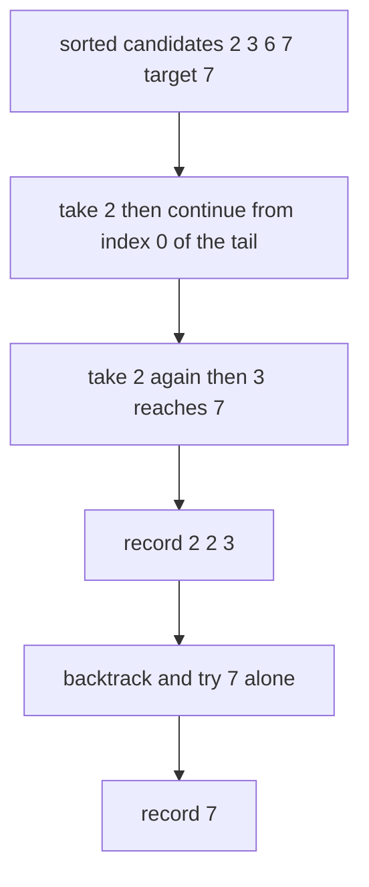
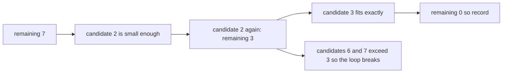
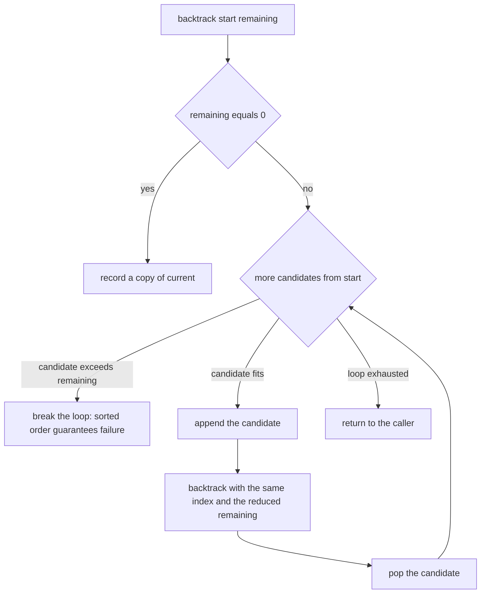
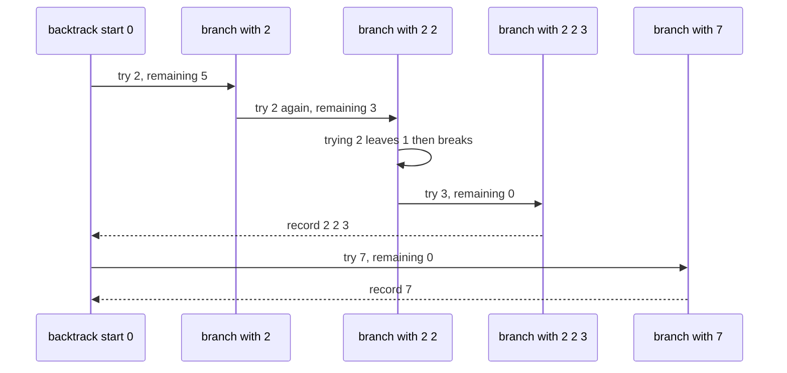

# 287 — Combination sum (backtracking).

> **Tier:** Intermediate · **CTCI chapter:** Ch 8 — Recursion and Dynamic Programming
> **Task spec:** [287-combination-sum-backtracking.md](../../../tasks/intermediate/287-combination-sum-backtracking.md)
> **Solutions:** [Python](../../../solutions/python/intermediate/287-combination-sum-backtracking/solution.py) ·
> [Java](../../../solutions/java/intermediate/287-combination-sum-backtracking/Solution.java) ·
> [JavaScript](../../../solutions/javascript/intermediate/287-combination-sum-backtracking/solution.js) ·
> [C#](../../../solutions/csharp/intermediate/287-combination-sum-backtracking/Solution.cs)

## 1. Problem restatement

**Input:** a list of positive candidate integers and a target sum. Each candidate may be used
**any number of times**.

**Output:** every distinct combination of candidates that sums to the target, each combination
written in non-decreasing order, with the list of combinations itself sorted. Combinations are
*mutisets*: `[2, 2, 3]` and `[3, 2, 2]` are the same answer and must appear once.

The task spec is a one-liner (“Combination sum (backtracking).”), so the contract is fixed by the
assertions the four solution files ship with:

| Call | Result | Why |
| --- | --- | --- |
| `combination_sum([2,3,6,7], 7)` | `[[2,2,3],[7]]` | repetition allowed, `7` used once |
| `combination_sum([2,3,5], 8)` | `[[2,2,2,2],[2,3,3],[3,5]]` | three distinct multisets |
| `combination_sum([7,2,3,6], 7)` | `[[2,2,3],[7]]` | input order does not matter |
| `combination_sum([2,3], 0)` | `[[]]` | the empty combination sums to `0` |
| `combination_sum([2,3], -1)` | `[]` | a negative target has no solution |
| `combination_sum([2,4], 7)` | `[]` | odd target, even candidates |
| `combination_sum([2], 1)` | `[]` | target below every candidate |
| `combination_sum([5], 10)` | `[[5,5]]` | the same candidate twice |
| `combination_sum([8], 4)` | `[]` | candidate exceeds the target |

Random coverage: 200 cases with `1 … 4` distinct candidates drawn from `1 … 8` and a target in
`0 … 12` (generator `seed ← (seed · 75 + 74) mod 65537`). Each result must equal an independent
oracle that chooses how many copies of each candidate to take, and every combination is checked to
sum to the target, to contain only input values, to be sorted, and to be unique across the result
set — `len(results) == len(seen)` pins the no-duplicates property directly.

## 2. Intuition

The naive approach enumerates all tuples of candidates of every length and keeps the ones that sum
to the target. The number of tuples is unbounded (repetition is allowed), so this is not even a
finite enumeration — and even truncated at `target / min(candidate)` it repeats each multiset in
every possible order.

The key insight is a **canonical generation order**: sort the candidates and only ever append a
candidate that is at index `start` or later. Two consequences follow immediately:

- Every multiset has exactly one non-decreasing arrangement, so it is generated exactly once — no
  duplicate filtering is needed.
- After taking the candidate at index `i`, the next call passes the **same** index `i`, which is
  what allows repetition (`[5, 5]`); passing `i + 1` instead would solve the *combination sum II*
  variant where each candidate is used at most once.



The second insight is a pruning rule that falls out of the sorted order: if the current candidate
is already larger than what is left of the target, every later candidate is larger too, so the loop
can `break` instead of `continue`. That is what makes `combination_sum([2,4], 7)` return
immediately rather than exploring `2 + 2 + 2 + …`.



## 3. Algorithm

1. Sort the candidates ascending into `numbers`; the input order must not influence the output.
2. Keep a working list `current` and a result list.
3. `backtrack(start, remaining)`: if `remaining == 0`, append a **copy** of `current` to the
   results and return.
4. Otherwise loop `i` from `start` to the end of `numbers`. If `numbers[i] > remaining`, break —
   sorted order guarantees no later candidate can fit either.
5. Append `numbers[i]` to `current`, recurse with `backtrack(i, remaining - numbers[i])` (the same
   index, which permits repetition), then pop the value.
6. Sort the result list and return it; the DFS order is already canonical, but the explicit sort
   makes the output independent of the recursion order across languages.

```text
procedure combination_sum(candidates, target)
    numbers ← candidates sorted ascending
    results ← empty list
    current ← empty list

    function backtrack(start, remaining)
        if remaining = 0 then
            append a copy of current to results
            return
        end
        for i ← start to length(numbers) - 1 do
            if numbers[i] > remaining then
                break
            end
            append numbers[i] to current
            backtrack(i, remaining - numbers[i])
            remove the last element of current
        end
    end

    backtrack(0, target)
    sort results
    return results
end
```



## 4. Worked example

Trace `combination_sum([2, 3, 6, 7], 7)`. After sorting, `numbers = [2, 3, 6, 7]` and the search
starts with `backtrack(0, 7)`.

| Step | Call | `current` before | Candidate | Remaining after | Note |
| --- | --- | --- | --- | --- | --- |
| 1 | `backtrack(0, 7)` | `[]` | `2` | `5` | fits |
| 2 | `backtrack(0, 5)` | `[2]` | `2` | `3` | repetition allowed |
| 3 | `backtrack(0, 3)` | `[2, 2]` | `2` | `1` | fits |
| 4 | `backtrack(0, 1)` | `[2, 2, 2]` | `2` | — | `2 > 1` → break immediately |
| 5 | `backtrack(0, 3)` | `[2, 2]` | `3` | `0` | exact hit |
| 6 | `backtrack(1, 0)` | `[2, 2, 3]` | — | — | `remaining == 0` → record `[2, 2, 3]` |
| 7 | `backtrack(0, 3)` | `[2, 2]` | `6` | — | `6 > 3` → break |
| 8 | `backtrack(0, 5)` | `[2]` | `3` | `2` | fits |
| 9 | `backtrack(1, 2)` | `[2, 3]` | `3` | — | `3 > 2` → break, nothing to record |
| 10 | `backtrack(0, 5)` | `[2]` | `6` | — | `6 > 5` → break |
| 11 | `backtrack(0, 7)` | `[]` | `3` | `4` | fits |
| 12 | `backtrack(1, 4)` | `[3]` | `3` | `1` | fits |
| 13 | `backtrack(1, 1)` | `[3, 3]` | `3` | — | `3 > 1` → break |
| 14 | `backtrack(1, 4)` | `[3]` | `6` | — | `6 > 4` → break |
| 15 | `backtrack(0, 7)` | `[]` | `6` | `1` | fits |
| 16 | `backtrack(2, 1)` | `[6]` | `6` | — | `6 > 1` → break |
| 17 | `backtrack(0, 7)` | `[]` | `7` | `0` | exact hit |
| 18 | `backtrack(3, 0)` | `[7]` | — | — | record `[7]` |

Two multisets are recorded: `[2, 2, 3]` and `[7]`, in that order, which is already sorted and
matches the assertion. Steps 4, 7, 9, 13, 14 and 16 are the pruning rule at work — each of them
would otherwise be a wasted recursive call.



The oracle used in the tests attacks the problem from the other direction: for each candidate it
chooses how many copies to take (`0, 1, 2, …` while the product still fits), which enumerates the
same multisets in a completely different order. The results are compared after sorting, and the
per-combination checks (sum, membership, sortedness, uniqueness) hold for both.

## 5. Complexity

Let `T` be the target and `m` the smallest candidate.

| Measure | Bound | Why it holds |
| --- | --- | --- |
| Time, best | O(n log n) | a target of `0` records `[[]]` and a negative target records nothing; the sort dominates |
| Time, average | far below the worst case | the `break` prunes every candidate larger than the remaining sum |
| Time, worst | exponential in `T / m` | the recursion tree has depth at most `T / m` and fans out over the candidates, and the results themselves can be numerous |
| Space, recursion | O(T / m) | one frame per appended candidate; deeper would exceed the target |
| Space, working list | O(T / m) | `current` holds at most `T / m` values |
| Space, output | O(R · L) | `R` combinations of average length `L` |
| Time of the oracle | proportional to the number of multisets | it enumerates candidate multiplicities, not tuples |
| Comparison with the coin-change DP | O(T · len(coins)) for the *count* only | task 293 counts combinations; this task needs the combinations themselves, which the count DP does not produce |

The important distinction from the coin-change family: a DP over sums answers “how many” or “how
few” in polynomial time, but listing every combination is inherently output-sensitive — the answer
can be exponentially large even when the DP value is small.

## 6. Pitfalls and edge cases

- **Duplicates in the output.** Advancing the loop from `start` with sorted candidates prevents
  `[2, 2, 3]` and `[2, 3, 2]` from both being emitted. The random checks build a `seen` set of
  tuples and assert `len(results) == len(seen)`.
- **Repetition.** The recursive call must pass `i`, not `i + 1`. Passing `i + 1` silently turns the
  problem into the “use each candidate once” variant and loses `[5, 5]`, `[2, 2, 2, 2]` and friends.
- **Target `0`.** `combination_sum([2,3], 0)` is `[[]]` — one empty combination — not `[]`. The
  base case is checked *before* the loop, so it fires immediately.
- **Negative target.** `combination_sum([2,3], -1)` is `[]`: with positive candidates the base case
  is never reached and the loop breaks on the first candidate.
- **Unsorted input.** `combination_sum([7,2,3,6], 7)` must give the same answer as the sorted call;
  both the “generate once” argument and the `break` pruning depend on sorting first.
- **Pruning with `break` vs `continue`.** Because the candidates are sorted, `break` is correct and
  strictly faster; `continue` still works but does more work, and *not* pruning at all can recurse
  forever with a candidate of size `1` and a large target.
- **Recording a copy.** `results.append(current)` would store a live reference that is popped back
  to empty; Python uses `current[:]`, and the other languages build a fresh list per record.
- **Undo.** The pop after the recursive call is what keeps sibling branches independent; forgetting
  it makes `current` grow monotonically.
- **Input duplicates.** The random generator draws *distinct* candidates, so inputs such as
  `[2, 2, 3]` are not exercised by the assertions; with duplicate values the plain algorithm would
  emit the same multiset more than once, which is why the classic follow-up sorts and skips equal
  neighbours.
- **Magnitude of the search.** A target of `12` with candidates `[1, 2]` is already a large result
  set; the tests keep `target ≤ 12` and at most four candidates for that reason.

## 7. Variants and follow-ups

- **Each candidate at most once.** Change the recursive index to `i + 1` and the same skeleton
  solves the restricted variant; with duplicates in the input you additionally skip equal neighbours
  at the same depth.
- **Count instead of enumerate.** If only the number of combinations is asked for, the coin-change
  DP does it in `O(T · len(coins))`:
  [293-coin-change-number-of-ways-dp.md](../../../tasks/intermediate/293-coin-change-number-of-ways-dp.md).
- **Fewest coins.** Minimising the number of parts instead of listing them:
  [294-coin-change-minimum-coins-dp.md](../../../tasks/intermediate/294-coin-change-minimum-coins-dp.md).
- **Prefix-based enumeration.** Cutting a string into valid pieces uses exactly the same
  try-recurse-undo shape with a validity test in place of the sum:
  [290-palindrome-partitioning-all-partitions-backtracking.md](../../../tasks/intermediate/290-palindrome-partitioning-all-partitions-backtracking.md).
- The authoring chapter is [Recursion and Dynamic Programming](../../ctci/08-recursion-and-dp.md).

## 8. Check yourself

1. Why is the candidate list sorted before the search?

<details><summary>Show answer</summary>

Two reasons. Sorting makes the “non-decreasing order” canonical so each multiset is generated
exactly once, and it makes the `numbers[i] > remaining → break` pruning valid, because every later
candidate is at least as large as the one that just failed.

</details>

2. What changes if the recursive call uses `i + 1` instead of `i`?

<details><summary>Show answer</summary>

Each candidate may be used at most once, so repetition disappears: `combination_sum([5], 10)` would
return `[]` instead of `[[5,5]]`, and `[2,3,5]` with target `8` would lose `[2,2,2,2]` and `[2,3,3]`.
That is the sibling problem, not this one.

</details>

3. Why is `combination_sum([2,3], 0)` equal to `[[]]`?

<details><summary>Show answer</summary>

The base case `remaining == 0` is tested at the top of the recursion, before any candidate is
considered: the empty set of candidates is a legitimate combination whose sum is `0`. So the answer
is a single empty combination rather than no combinations.

</details>

4. Could the DP from task 293 be adapted to produce these lists?

<details><summary>Show answer</summary>

Not directly in the same shape. The count DP collapses states — it keeps only how many ways there
are to reach each sum — while this task needs the actual multisets, and there can be exponentially
many of them. You would have to store predecessor information and rebuild every path, which is
exactly what the backtracking tree already does.

</details>

5. Why does the oracle choose multiplicities rather than tuples?

<details><summary>Show answer</summary>

Because it must not repeat each multiset in every order. Choosing “take `k` copies of candidate `i`”
for each `i` in turn enumerates each multiset exactly once, in an order (grouped by candidate) that
is completely different from the DFS order, which makes the agreement a genuinely independent
check.

</details>
