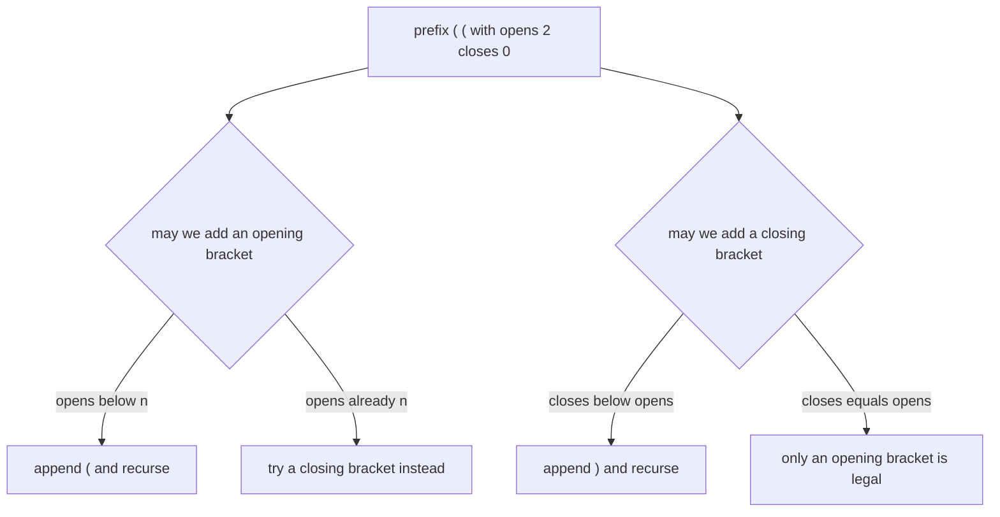
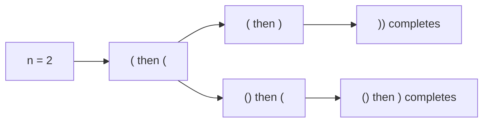
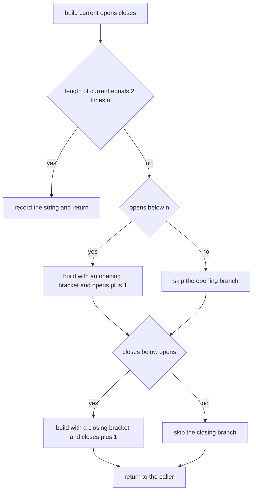
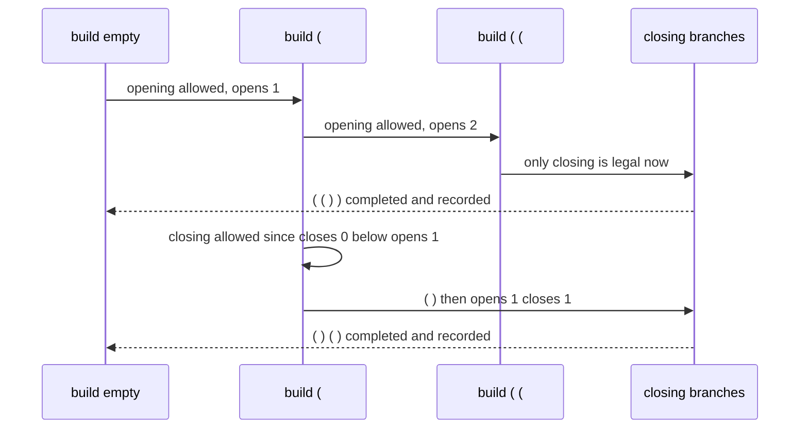

# 288 — Generate parentheses (balanced parentheses generator).

> **Tier:** Intermediate · **CTCI chapter:** Ch 8 — Recursion and Dynamic Programming
> **Task spec:** [288-generate-parentheses-balanced-parentheses-generator.md](../../../tasks/intermediate/288-generate-parentheses-balanced-parentheses-generator.md)
> **Solutions:** [Python](../../../solutions/python/intermediate/288-generate-parentheses-balanced-parentheses-generator/solution.py) ·
> [Java](../../../solutions/java/intermediate/288-generate-parentheses-balanced-parentheses-generator/Solution.java) ·
> [JavaScript](../../../solutions/javascript/intermediate/288-generate-parentheses-balanced-parentheses-generator/solution.js) ·
> [C#](../../../solutions/csharp/intermediate/288-generate-parentheses-balanced-parentheses-generator/Solution.cs)

## 1. Problem restatement

**Input:** an integer `n`, the number of parenthesis pairs.

**Output:** every well-formed string of `n` opening and `n` closing parentheses, in lexicographic
order. The order is not accidental: `"("` sorts before `")"`, and the files always try the opening
bracket first, so the emitted list is exactly the sorted list. A negative `n` returns the empty
list.

The task spec is a one-liner (“Generate parentheses (balanced parentheses generator).”), so the
contract is fixed by the assertions the four solution files ship with:

| Call | Result | Why |
| --- | --- | --- |
| `generate_parentheses(0)` | `[""]` | zero pairs: exactly one string, the empty one |
| `generate_parentheses(1)` | `["()"]` | one pair |
| `generate_parentheses(2)` | `["(())", "()()"]` | `C(2) = 2` strings |
| `generate_parentheses(3)` | `["((()))", "(()())", "(())()", "()(())", "()()()"]` | `C(3) = 5`, already sorted |
| `generate_parentheses(-1)` | `[]` | a negative count has no valid string |

For every `n` from `0` to `10` the files additionally assert that

- the number of strings equals the Catalan number `C(n)`,
- the list is already sorted and calling the function twice returns the same list (determinism),
- each string has length `2n`, is balanced by an independent checker, and contains exactly `n`
  opens and `n` closes,

and for every `n` from `0` to `7` the result must equal a brute-force enumeration of all `2^(2n)`
parenthesis strings filtered by the same balance checker — `2^14 = 16384` strings at the top end.
The known Catalan values used as anchors are `C(4) = 14`, `C(5) = 42`, `C(8) = 1430` and
`C(10) = 16796`.

## 2. Intuition

The naive generator takes all `2^(2n)` strings of `n` opens and `n` closes and filters them. That is
what `brute_force_balanced` does as an oracle, and it is exactly the kind of work the real solution
avoids by never *constructing* an invalid prefix.

The key insight is that a prefix can be extended by `"("` only if fewer than `n` opens have been
used, and by `")"` only if the number of closes is **strictly smaller** than the number of opens.
The second rule is the entire balance condition: keeping `closes < opens` at every step means the
running depth never touches zero early, so no prefix ever becomes invalid — no filtering, no
backtracking out of illegal states.



Trying the opening bracket first is what makes the output lexicographic, and it is also why the
recursion never has to sort anything. The flip side is that the solution emits strings in a fixed
order rather than in an arbitrary one, which the assertions check for every `n` up to `10`.



## 3. Algorithm

1. Return `[]` when `n` is negative; otherwise start from the empty prefix with `opens = 0` and
   `closes = 0`.
2. `build(current, opens, closes)`: when the prefix length reaches `2n`, record the string and
   return.
3. If `opens < n`, recurse with `current + "("` and `opens + 1`.
4. If `closes < opens`, recurse with `current + ")"` and `closes + 1`.
5. The two calls are tried in that order, which produces the lexicographic order; no deduplication
   or sorting is needed.
6. Return the collected strings.

```text
procedure generate_parentheses(n)
    if n < 0 then
        return empty list
    end
    results ← empty list

    function build(current, opens, closes)
        if length(current) = 2 * n then
            append current to results
            return
        end
        if opens < n then
            build(current + "(", opens + 1, closes)
        end
        if closes < opens then
            build(current + ")", opens, closes + 1)
        end
    end

    build("", 0, 0)
    return results
end
```



## 4. Worked example

Trace `generate_parentheses(2)`. Every call prints the prefix it is building; the two branches are
always tried opening-bracket-first.

| Step | Call | `opens` | `closes` | Decision | Recorded |
| --- | --- | --- | --- | --- | --- |
| 1 | `build("", 0, 0)` | 0 | 0 | length 0 ≠ 4; `opens < 2` → append `(` | — |
| 2 | `build("(", 1, 0)` | 1 | 0 | `opens < 2` → append `(` | — |
| 3 | `build("((", 2, 0)` | 2 | 0 | `opens = n` so no open branch; `closes < opens` → append `)` | — |
| 4 | `build("(()", 2, 1)` | 2 | 1 | `opens = n`; `closes < opens` → append `)` | — |
| 5 | `build("(())", 2, 2)` | 2 | 2 | length 4 = `2n` | `"(())"` |
| 6 | `build("(()", 2, 1)` | 2 | 1 | both branches already taken → return | `"(())"` |
| 7 | `build("(", 1, 0)` | 1 | 0 | `closes < opens` → append `)` | `"(())"` |
| 8 | `build("()", 1, 1)` | 1 | 1 | `opens < 2` → append `(` | `"(())"` |
| 9 | `build("()(", 2, 1)` | 2 | 1 | `closes < opens` → append `)` | `"(())"` |
| 10 | `build("()()", 2, 2)` | 2 | 2 | length 4 = `2n` | `"(())", "()()"` |

The result is `["(())", "()()"]`, the asserted value. Note that the prefix `")"` is never even
considered: at step 1 `closes = 0 = opens`, so the closing branch is skipped by the guard.



## 5. Complexity

Let `C(n)` be the `n`-th Catalan number, the number of valid strings.

| Measure | Bound | Why it holds |
| --- | --- | --- |
| Time, best | O(1) | `n = 0` records the empty string; negative `n` returns immediately |
| Time, average | Θ(n · C(n)) | the recursion tree has exactly `C(n)` leaves and `Θ(C(n))` internal nodes, and each recorded string is copied in `O(n)` |
| Time, worst | Θ(n · C(n)) | the search visits every valid prefix exactly once — there are no dead branches to prune |
| Space, recursion | O(n) | the depth is at most `2n` |
| Space, output | O(n · C(n)) | `C(n)` strings of length `2n` |
| Time of the brute-force oracle | Θ(2^(2n) · n) | it enumerates all `2^(2n)` strings and checks each in `O(n)` |
| Catalan growth | C(8) = 1430, C(10) = 16796 | the asserted anchors, roughly `4^n / (n^1.5)` |

The oracle’s cost is why it is only run for `n ≤ 7`: `2^14 = 16384` strings, of which only `C(7) =
429` are balanced. The generator produces exactly the balanced ones and touches nothing else.

## 6. Pitfalls and edge cases

- **`n = 0`.** The answer is `[""]` — a list containing the empty string, not an empty list. The
  base case fires on the very first call because `2n = 0`.
- **Negative `n`.** All four files guard up front and return an empty list, so the recursion never
  sees a negative target length.
- **`closes < opens`, not `closes < n`.** Allowing a close whenever fewer than `n` closes have been
  used generates prefixes such as `")("` and lets the balance fall below zero. The strict comparison
  is the whole correctness argument.
- **Ordering.** Trying the opening bracket first yields sorted output; reversing the two branches
  still enumerates every string but fails the lexicographic assertions (and the flat equality with
  the sorted brute-force result).
- **`opens < n`, not `opens <= n`.** An off-by-one here emits strings with `n + 1` pairs, caught by
  the length and pair-count assertions.
- **Recording the string, not the builder.** The Java file passes a `StringBuilder`; it must append
  the current contents rather than the object, otherwise every recorded string would keep mutating.
- **Catalan arithmetic.** `catalan` iterates `value = value * 2 * (2i + 1) / (i + 2)`, which stays
  exact with integer division in Python, Java and C#; on very large `n` the product would overflow,
  which is why only the anchors up to `C(10) = 16796` are asserted.
- **Value vs pointer hygiene in JavaScript.** `generateParentheses` returns fresh strings, and the
  deterministic assertion compares two separate calls with a deep equality test.
- **Stack depth.** `2n` frames; `n = 10` is trivial, and the tests stop there.

## 7. Variants and follow-ups

- **Filter instead of generate.** The brute-force variant enumerates `2^(2n)` strings and keeps the
  balanced ones; it is the oracle here, and the comparison quantifies how much the guard saves.
- **Count only.** If the question is “how many?”, the answer is `C(n)` and no recursion is needed —
  the closed-form product in `catalan` computes it in `O(n)`.
- **k-ary parentheses.** More bracket types (or nesting rules) generalise the two guards into a
  stack of open types, which is the same try-recurse-undo shape with a richer validity test.
- **Other cell-level constraints.** Placing `n` non-attacking queens uses the same recursion over a
  position and a legality test per candidate:
  [285-n-queens-problem-backtracking.md](../../../tasks/intermediate/285-n-queens-problem-backtracking.md).
- **Cutting a string into valid pieces.** A nearly identical skeleton with a piece validity test:
  [290-palindrome-partitioning-all-partitions-backtracking.md](../../../tasks/intermediate/290-palindrome-partitioning-all-partitions-backtracking.md).
- The authoring chapter is [Recursion and Dynamic Programming](../../ctci/08-recursion-and-dp.md).

## 8. Check yourself

1. Why does the generator never need to test whether an intermediate prefix is balanced?

<details><summary>Show answer</summary>

Because the two guards maintain the invariant `0 ≤ closes ≤ opens ≤ n` on every prefix. A string is
appended only when its length is `2n`, at which point `closes = opens = n` follows from the guards,
so every recorded string is balanced by construction. Nothing that violates the invariant is ever
built.

</details>

2. Why is `generate_parentheses(0)` equal to `[""]` rather than `[]`?

<details><summary>Show answer</summary>

Zero pairs have exactly one well-formed string: the empty string. The base case tests
`length(current) == 2 * n`, which is `0 == 0` on the first call, so `""` is recorded immediately and
the two guarded branches are never entered.

</details>

3. How many recursive calls does the generator make for `n = 3`?

<details><summary>Show answer</summary>

The calls form a binary tree over valid prefixes: 5 leaves (`C(3) = 5`) and, since internal nodes
are exactly the proper prefixes that satisfy the guards, a total in `Θ(C(n))` — the tests assert the
leaf count equals `catalan(n)`, and each leaf corresponds to one recorded string.

</details>

4. What changes if the two branches are swapped, so `")"` is tried before `"("`?

<details><summary>Show answer</summary>

The set of strings is unchanged, because the guards are symmetric in what they allow — but the
order becomes the reverse of lexicographic, and the assertions that compare against
`sorted(strings)` (and against the sorted brute-force list) fail. The ordering is part of the
contract precisely because it is easy to lose.

</details>

5. Why does the brute-force oracle only run up to `n = 7`?

<details><summary>Show answer</summary>

It enumerates `2^(2n)` strings. At `n = 7` that is `16384` strings, most of them invalid; at
`n = 10` it would be over a million while the generator itself produces only `16796`. The oracle is
there to validate the generator on small inputs, and the Catalan anchors take over above that.

</details>
