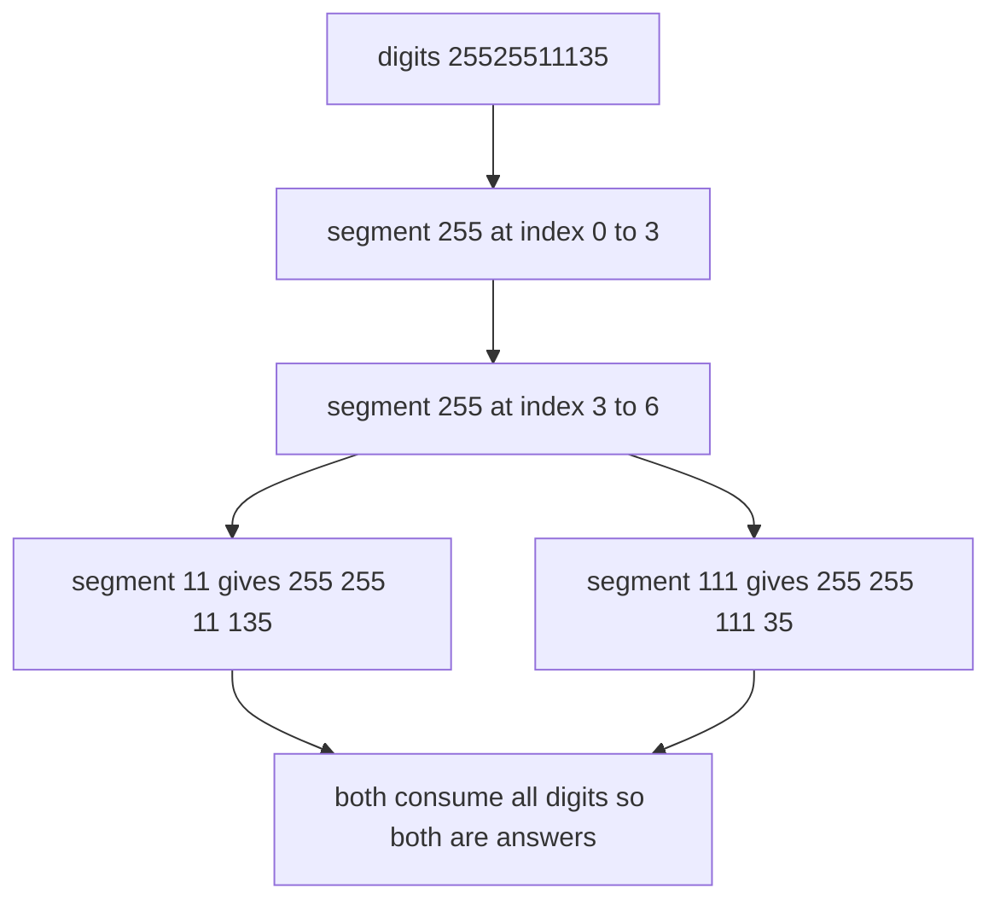
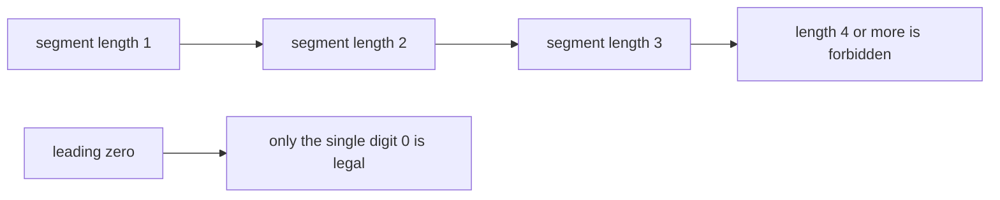
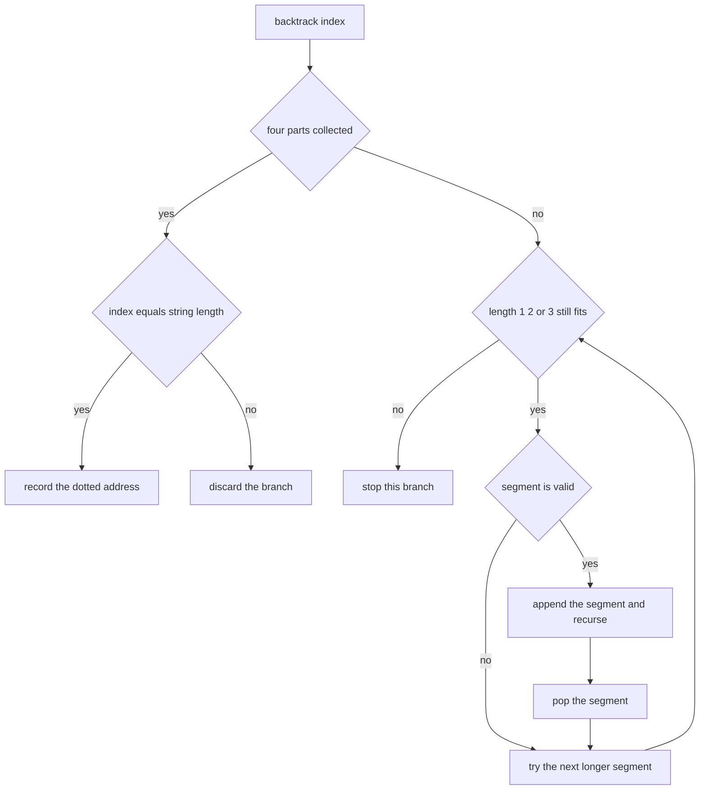
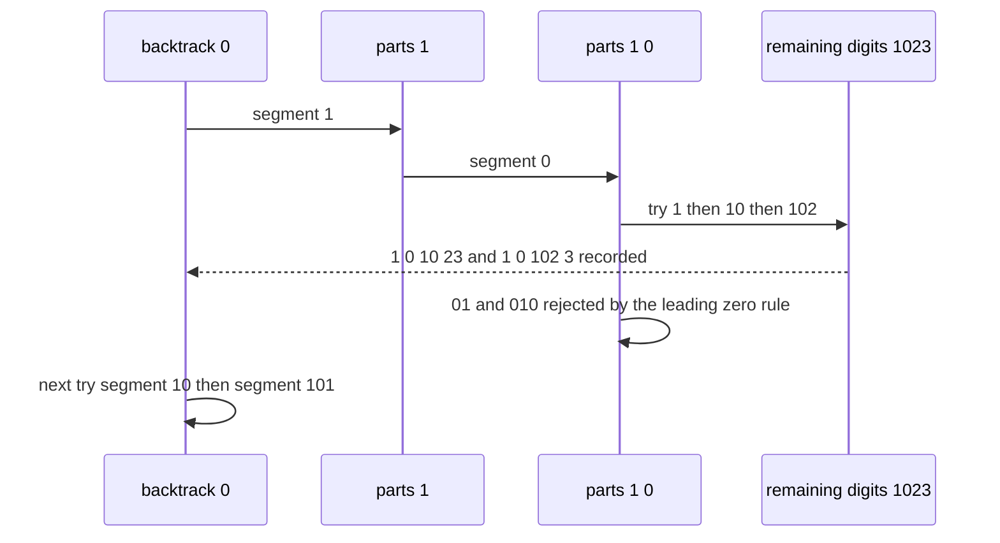

# 289 — Restore IP addresses from string (backtracking).

> **Tier:** Intermediate · **CTCI chapter:** Ch 8 — Recursion and Dynamic Programming
> **Task spec:** [289-restore-ip-addresses-from-string-backtracking.md](../../../tasks/intermediate/289-restore-ip-addresses-from-string-backtracking.md)
> **Solutions:** [Python](../../../solutions/python/intermediate/289-restore-ip-addresses-from-string-backtracking/solution.py) ·
> [Java](../../../solutions/java/intermediate/289-restore-ip-addresses-from-string-backtracking/Solution.java) ·
> [JavaScript](../../../solutions/javascript/intermediate/289-restore-ip-addresses-from-string-backtracking/solution.js) ·
> [C#](../../../solutions/csharp/intermediate/289-restore-ip-addresses-from-string-backtracking/Solution.cs)

## 1. Problem restatement

**Input:** a string of digits `s`.

**Output:** every way to split `s` into four non-empty segments that form a valid IPv4 address, each
written with dots between the segments. A segment is valid when it has one to three digits, its
numeric value is at most `255`, and it has no leading zero unless the segment is exactly `"0"`. The
segments must be used in order and must consume the whole string, so the output is a set of strings
of the form `a.b.c.d`.

The task spec is a one-liner (“Restore IP addresses from string (backtracking).”), so the contract
is fixed by the assertions the four solution files ship with:

| Call | Result | Why |
| --- | --- | --- |
| `restore_ip_addresses("25525511135")` | `["255.255.11.135", "255.255.111.35"]` | two ways to cut the tail |
| `restore_ip_addresses("0000")` | `["0.0.0.0"]` | each segment is exactly `"0"` |
| `restore_ip_addresses("1111")` | `["1.1.1.1"]` | the only 4/4 split |
| `restore_ip_addresses("010010")` | `["0.10.0.10", "0.100.1.0"]` | leading zeros forbid `"01"` |
| `restore_ip_addresses("101023")` | `["1.0.10.23", "1.0.102.3", "10.1.0.23", "10.10.2.3", "101.0.2.3"]` | five splits, in DFS order |
| `restore_ip_addresses("255255255255")` | `["255.255.255.255"]` | the maximum address |
| `restore_ip_addresses("111")` | `[]` | fewer than 4 digits |
| `restore_ip_addresses("")` | `[]` | empty input |
| `restore_ip_addresses("1111111111111")` | `[]` | 13 digits cannot fit in four segments |
| `restore_ip_addresses("256256256256")` | `[]` | every segment would exceed `255` |

Random coverage: 200 strings of length `1 … 14` built from the generator `seed ← (seed · 75 + 74)
mod 65537`, one random digit per character. For each string the *sorted* result must equal an
independent oracle that tries every triple of cut positions, every returned address must round-trip
back to the original digit string with all four segments valid, and the result must contain no
duplicates.

## 2. Intuition

The naive idea is to insert three dots in every possible place: there are `C(11, 3) = 165` triples of
dot positions for an 11-digit string, and for each you validate four segments. That is exactly the
oracle, and for the sizes involved it is perfectly fast — but it wastes work on prefixes that are
already impossible.

The insight that makes the search direct: the address is built **left to right**, and at each of the
four steps you either consume one, two or three digits. Once the current prefix is illegal — say the
segment is `"256"` or `"01"` — every continuation is illegal too, so the branch dies immediately. The
only state the recursion needs is the index where the next segment starts and how many segments are
already fixed.



Two pruning facts bound the whole search:

- A segment has at most three digits, so `len(s) > 12` can never work and `len(s) < 4` has too few
  digits per segment. Both are rejected before the recursion starts.
- The recursion stops at four segments: once `len(parts) == 4`, either the digits are exhausted
  (record) or they are not (discard). There is no fifth segment to try.



## 3. Algorithm

1. Reject up front: `len(s) < 4` or `len(s) > 12` cannot be split into four valid segments.
2. Keep a working list `parts` and a result list.
3. `backtrack(index)`: if `parts` already holds four segments, then record `".".join(parts)` when
   `index` is exactly `len(s)`, and return either way.
4. Otherwise try segment lengths `1`, `2`, `3` in that order. Stop when `index + length` would run
   past the end of the string; skip a segment that fails `is_valid_segment`.
5. Append the segment, recurse into `backtrack(index + length)`, then pop it.
6. `is_valid_segment` accepts a non-empty segment of at most three digits, rejects a leading zero
   unless the segment is exactly `"0"`, and otherwise requires the numeric value to be at most
   `255`.

```text
procedure restore_ip_addresses(s)
    if length(s) < 4 or length(s) > 12 then
        return empty list
    end
    results ← empty list
    parts ← empty list

    function backtrack(index)
        if length(parts) = 4 then
            if index = length(s) then
                append join of parts with dots to results
            end
            return
        end
        for length ← 1 to 3 do
            if index + length > length(s) then
                break
            end
            segment ← substring of s from index for length characters
            if is_valid_segment(segment) then
                append segment to parts
                backtrack(index + length)
                remove the last element of parts
            end
        end
    end

    backtrack(0)
    return results
end

function is_valid_segment(segment)
    if segment is empty or length(segment) > 3 then
        return false
    end
    if first character of segment = "0" then
        return segment = "0"
    end
    return numeric value of segment ≤ 255
end
```



## 4. Worked example

Trace `restore_ip_addresses("101023")`. The recursion always tries one digit first, then two, then
three:

| Step | `backtrack(index)` | Segments tried here | `parts` | Outcome |
| --- | --- | --- | --- | --- |
| 1 | `backtrack(0)` | `"1"` | `[1]` | valid, recurse |
| 2 | `backtrack(1)` | `"0"` | `[1, 0]` | valid, recurse |
| 3 | `backtrack(2)` | `"1"` | `[1, 0, 1]` | valid, recurse |
| 4 | `backtrack(3)` | `"0"`, `"02"`, `"023"` | `[1, 0, 1]` | `"0"` completes four parts but stops at index 4 → discard; the other two have leading zeros → skip |
| 5 | `backtrack(2)` | `"10"` | `[1, 0, 10]` | valid, recurse |
| 6 | `backtrack(4)` | `"2"`, `"23"` | `[1, 0, 10]` | `"2"` completes four parts at index 5 → discard; `"23"` consumes the rest → record `1.0.10.23` |
| 7 | `backtrack(4)` | `"102"` | — | overruns the string → break the length loop |
| 8 | `backtrack(2)` | `"102"` | `[1, 0, 102]` | valid (`102 ≤ 255`), recurse |
| 9 | `backtrack(5)` | `"3"` | `[1, 0, 102, 3]` | four parts, index 6 = `len(s)` → record `1.0.102.3` |
| 10 | `backtrack(1)` | `"01"`, `"010"` | — | leading zero in both → skip |
| 11 | `backtrack(0)` | `"10"` | `[10]` | valid, recurse into `[10, 1]`, `[10, 10]`, … |
| 12 | … | `[10, 1, 0]` then `[10, 1, 0, 23]` | … | record `10.1.0.23` |
| 13 | … | `[10, 10, 2]` then `[10, 10, 2, 3]` | … | record `10.10.2.3` |
| 14 | `backtrack(0)` | `"101"` | `[101]` | valid, recurse |
| 15 | … | `[101, 0, 2]` then `[101, 0, 2, 3]` | … | record `101.0.2.3` |

The recorded addresses in order are `1.0.10.23`, `1.0.102.3`, `10.1.0.23`, `10.10.2.3`,
`101.0.2.3` — exactly the asserted list, which is the DFS order produced by trying shorter segments
first. Steps 4, 6 and 7 show the two kinds of rejection — a leftover digit and a segment that
overruns the string — while step 10 shows the leading-zero rule.



## 5. Complexity

| Measure | Bound | Why it holds |
| --- | --- | --- |
| Time, best | O(1) | a length outside `4 … 12` is rejected before any recursion |
| Time, average | a few dozen calls | at most three choices per segment and at most 11 dots-candidates |
| Time, worst | O(3⁴) segment choices | four segments, three lengths each, and at most `C(11,3) = 165` cut triples overall |
| Space, recursion | O(1) | the depth is capped at four |
| Space, working list | O(1) | at most four segments |
| Space, output | O(R · 15) | `R` addresses, each at most 15 characters |
| Time of the oracle | O(3³) triples | it iterates `i`, `j`, `k` with each window capped at three digits |
| Length of the segment check | O(1) | at most three characters are examined |

The constant bound is the pleasant part of this problem: unlike the other backtracking tasks in this
tier, the search depth is fixed at four, so the total work is bounded by a small constant. The
oracle’s triple loop is an equivalent-size enumeration, which is why the two can be compared on 200
random strings without any regard for performance.

## 6. Pitfalls and edge cases

- **Leading zeros.** `"01"` is not a valid segment even though `1 ≤ 255`; only the single character
  `"0"` may start with a zero. `restore_ip_addresses("0000") == ["0.0.0.0"]` and
  `restore_ip_addresses("010010") == ["0.10.0.10", "0.100.1.0"]` are the assertions that cover it.
- **Length pruning.** Fewer than four or more than twelve digits cannot work; the files return `[]`
  before recursing, which is why the empty string and `"111"` cost nothing.
- **Not consuming everything.** Four segments that leave digits behind must be discarded: the
  `index == len(s)` check inside the four-part branch is what rejects them. Missing it makes
  `"101023"` produce a wrong extra answer.
- **Stopping at four segments.** Recursing while `len(parts) < 4` rather than after collecting the
  fourth prevents a fifth segment from ever appearing.
- **Segment length.** The loop tries `1, 2, 3` and stops as soon as `index + length` overruns; the
  `break` is safe because longer segments would overrun even more.
- **`255` boundary.** `"255"` is legal, `"256"` is not; the comparison must be `<= 255` on the parsed
  value, and comparing digit strings lexicographically happens to be correct only because the
  length is capped at three — the shipped `is_valid_segment` parses the integer.
- **Determinism of the order.** The files assert the exact list for `"101023"`, so the
  shortest-segment-first order is part of the contract; the random checks compare with `sorted(...)`
  because the oracle enumerates cut positions in a different order.
- **Duplicates.** A given cut triple produces one address, and different triples produce different
  addresses, so duplicates are impossible — the random checks still assert
  `len(results) == len(set(results))` as a guard.
- **Empty and short input.** `""` and `"111"` both return `[]`; the upper bound of 12 digits is what
  rejects `"1111111111111"`.
- **Input hygiene.** The files assume the input contains digits only; no assertion covers letters or
  signs, and `int(segment)` would raise on them in Python.

## 7. Variants and follow-ups

- **Fixed number of parts.** Varying the segment count (for instance “restore a date” or “split into
  `k` palindromes”) is the same recursion with a different bound on `len(parts)`.
- **Validity as a palindrome test.** The cutting skeleton is shared with
  [290-palindrome-partitioning-all-partitions-backtracking.md](../../../tasks/intermediate/290-palindrome-partitioning-all-partitions-backtracking.md),
  where the per-piece test replaces the numeric rule.
- **Counting instead of listing.** The same recursion with a counter in place of the result list
  answers “how many valid addresses?”, the shape used in
  [287-combination-sum-backtracking.md](../../../tasks/intermediate/287-combination-sum-backtracking.md).
- **Bounded combinations.** When segments may only be added with a fixed set of choices and the
  target is a sum rather than a string length, compare the coin-change DP family:
  [293-coin-change-number-of-ways-dp.md](../../../tasks/intermediate/293-coin-change-number-of-ways-dp.md).
- The authoring chapter is [Recursion and Dynamic Programming](../../ctci/08-recursion-and-dp.md).

## 8. Check yourself

1. Why is `"01"` rejected but `"0"` accepted?

<details><summary>Show answer</summary>

IPv4 text form forbids leading zeros in a segment, so a multi-digit segment may not start with
`0`. A segment that *is* the single digit `0` is fine, which is why `"0000"` restores to `0.0.0.0`
— each of the four segments is the one-character string `"0"`.

</details>

2. Why does the function return `[]` immediately for a 13-digit string?

<details><summary>Show answer</summary>

Four segments of at most three digits can cover at most 12 digits, so a 13-digit string has no
valid split at all. The guard also rejects strings shorter than four digits, where four non-empty
segments cannot fit.

</details>

3. What happens if the four-segment branch forgets to check `index == len(s)`?

<details><summary>Show answer</summary>

Addresses that leave digits unused would be recorded, so `"101023"` would gain bogus extra answers
(for example a branch that stops after `1.0.10.` with the `23` unconsumed). The check is what
enforces “consume the whole string”.

</details>

4. Why is the segment loop a `break` rather than a `continue` when it overruns the string?

<details><summary>Show answer</summary>

Because the lengths are tried in increasing order: once `index + length > len(s)`, every longer
length overruns as well, so there is nothing left to try in that call.

</details>

5. Why do the random checks compare `sorted(results)` with the oracle instead of the raw list?

<details><summary>Show answer</summary>

The two enumerate in different orders — the DFS tries shorter segments first, while the oracle
iterates cut positions `i < j < k`. The *set* of addresses is what must agree; the fixed-order
assertion for `"101023"` pins down this particular implementation’s order separately.

</details>
