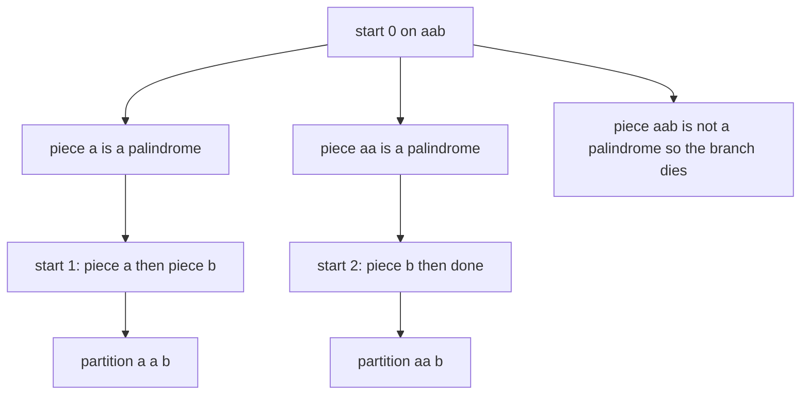
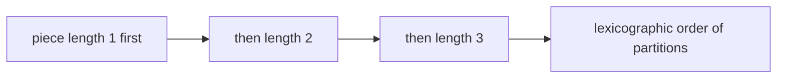
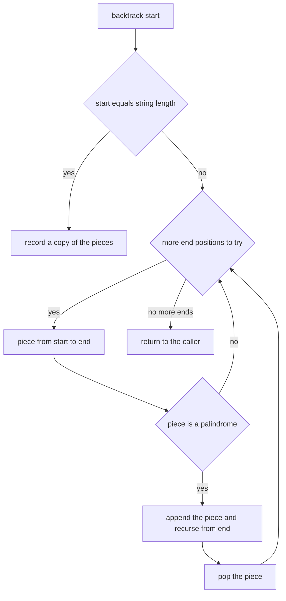
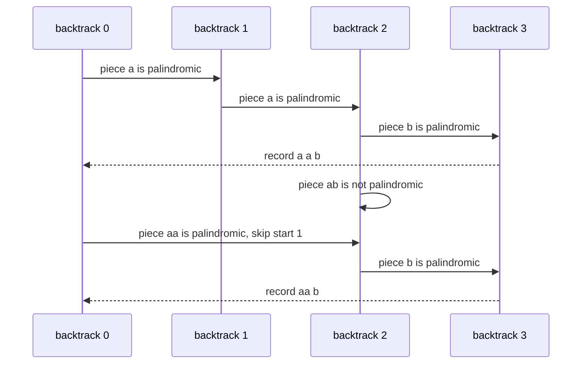

# 290 — Palindrome partitioning, all partitions (backtracking).

> **Tier:** Intermediate · **CTCI chapter:** Ch 8 — Recursion and Dynamic Programming
> **Task spec:** [290-palindrome-partitioning-all-partitions-backtracking.md](../../../tasks/intermediate/290-palindrome-partitioning-all-partitions-backtracking.md)
> **Solutions:** [Python](../../../solutions/python/intermediate/290-palindrome-partitioning-all-partitions-backtracking/solution.py) ·
> [Java](../../../solutions/java/intermediate/290-palindrome-partitioning-all-partitions-backtracking/Solution.java) ·
> [JavaScript](../../../solutions/javascript/intermediate/290-palindrome-partitioning-all-partitions-backtracking/solution.js) ·
> [C#](../../../solutions/csharp/intermediate/290-palindrome-partitioning-all-partitions-backtracking/Solution.cs)

## 1. Problem restatement

**Input:** a string `s`.

**Output:** every way to cut `s` into pieces such that each piece is a palindrome. Each partition is
a list of substrings, the pieces are in the order they appear in `s`, and they concatenate back to
`s` exactly. The partitions are emitted shortest-piece-first, which makes the list lexicographically
sorted and therefore deterministic.

The task spec is a one-liner (“Palindrome partitioning all partitions (backtracking).”), so the
contract is fixed by the assertions the four solution files ship with:

| Call | Result | Why |
| --- | --- | --- |
| `palindrome_partitioning("aab")` | `[["a","a","b"], ["aa","b"]]` | `"ab"` is not a palindrome |
| `palindrome_partitioning("a")` | `[["a"]]` | a single character is always valid |
| `palindrome_partitioning("aba")` | `[["a","b","a"], ["aba"]]` | characters or the whole string |
| `palindrome_partitioning("aaa")` | `[["a","a","a"], ["a","aa"], ["aa","a"], ["aaa"]]` | all four cut sets are palindromic |
| `palindrome_partitioning("aaaa")` | equals the brute-force result | `2^3 = 8` partitions |
| `len(palindrome_partitioning("aaaa"))` | `8` | every substring of `"aaaa"` is palindromic |
| `len(palindrome_partitioning("abba"))` | `3` | `a|b|b|a`, `a|bb|a`, `abba` |
| `palindrome_partitioning("")` | `[[]]` | zero pieces concatenate to `""` |

Random coverage: 200 strings of length `1 … 7` over the alphabet `"abc"` (generator
`seed ← (seed · 75 + 74) mod 65537`) must match a brute-force enumeration of all `2^(n-1)` cut
sets, must already be in the documented order (`partitions == sorted(partitions)`), and each
partition is checked to concatenate back to `s`, to contain only non-empty palindromic pieces, and
to be unique. A canonicalised comparison (`",".join(pieces)`) repeats the equality check in a form
that is insensitive to the order of the partition list.

## 2. Intuition

The brute-force idea is to choose a subset of the `n - 1` gaps between characters as cut points.
There are `2^(n-1)` subsets, and each one has to be validated piece by piece. That is exactly the
oracle, and it is a useful statement of the problem but not a good way to generate the answers.

The insight that removes the wasted work: a partition is built by **extending a prefix**, and a
prefix is only worth extending while every piece so far is a palindrome. So the recursion keeps the
index where the next piece starts, tries every possible end for that piece, and only recurses when
the piece it just cut is a palindrome. Invalid prefixes (`"aab"` cut as `"aa" | "b" | …`, or
`"ab…"`) die at the cut that created them.



Cutting shortest-first has a second benefit: the resulting partition lists come out in
lexicographic order without any sorting step, because the first piece is as short as possible, then
the second, and so on. The files assert that property directly.



## 3. Algorithm

1. Keep a result list and a working list `current` holding the pieces chosen so far.
2. `backtrack(start)`: when `start == len(s)`, every character has been consumed — append a copy of
   `current` to the results and return.
3. Otherwise try every `end` from `start + 1` to `len(s)`: the candidate piece is `s[start:end]`.
4. If the piece is a palindrome, append it, recurse with `backtrack(end)`, then pop it. Otherwise
   skip this end and try a longer piece.
5. `is_palindrome` is a two-pointer walk from the two ends of the piece, which returns `False` at
   the first mismatch.
6. Return the collected partitions; the shortest-piece-first loop order is what makes the list
   lexicographically sorted.

```text
procedure palindrome_partitioning(s)
    results ← empty list
    current ← empty list

    function backtrack(start)
        if start = length(s) then
            append a copy of current to results
            return
        end
        for end ← start + 1 to length(s) do
            piece ← substring of s from start up to but not including end
            if is_palindrome(piece) then
                append piece to current
                backtrack(end)
                remove the last element of current
            end
        end
    end

    backtrack(0)
    return results
end

function is_palindrome(text)
    left ← 0
    right ← length(text) - 1
    while left < right do
        if text[left] ≠ text[right] then
            return false
        end
        left ← left + 1
        right ← right - 1
    end
    return true
end
```



## 4. Worked example

Trace `palindrome_partitioning("aab")`. Each call tries pieces of increasing length starting at
`start`:

| Step | `backtrack(start)` | Candidate piece | Palindrome? | `current` | Outcome |
| --- | --- | --- | --- | --- | --- |
| 1 | `backtrack(0)` | `"a"` | yes | `[a]` | recurse |
| 2 | `backtrack(1)` | `"a"` | yes | `[a, a]` | recurse |
| 3 | `backtrack(2)` | `"b"` | yes | `[a, a, b]` | recurse |
| 4 | `backtrack(3)` | — | — | `[a, a, b]` | `start = 3 = len(s)` → record `["a","a","b"]` |
| 5 | `backtrack(2)` | `"ab"` | no | `[a, a]` | skip, end loop finished |
| 6 | `backtrack(1)` | `"ab"` | no | `[a]` | skip, end loop finished |
| 7 | `backtrack(0)` | `"aa"` | yes | `[aa]` | recurse |
| 8 | `backtrack(2)` | `"b"` | yes | `[aa, b]` | recurse |
| 9 | `backtrack(3)` | — | — | `[aa, b]` | record `["aa","b"]` |
| 10 | `backtrack(0)` | `"aab"` | no | `[]` | skip, end loop finished |

The two recorded partitions are `["a","a","b"]` and `["aa","b"]`, in that order, matching the
assertion. Steps 5, 6 and 10 are the three cuts that the palindrome test rejects; note that step 10
rejects the *whole string*, so `"aab"` never appears as a single piece even though the recursion
does consider it.



The oracle walks the same space from the other side: it enumerates every subset of the `n - 1` cut
positions as a bit mask, materialises the pieces of each cut set, keeps the sets whose pieces are
all palindromes, and sorts the survivors. For `"aaaa"` all `2^3 = 8` cut sets survive, which is the
asserted length.

## 5. Complexity

Let `n = len(s)`.

| Measure | Bound | Why it holds |
| --- | --- | --- |
| Time, best | O(n) | a string of distinct characters has exactly one partition (all singletons) |
| Time, average | below the worst case | the palindrome test kills whole subtrees, including the invalid first cuts |
| Time, worst | O(n · 2^n) | the cut points form a binary choice, and each candidate piece is checked in `O(n)` |
| Space, recursion | O(n) | the depth is at most `n` pieces |
| Space, working list | O(n) | `current` holds at most `n` pieces |
| Space, output | O(P · n) | `P` partitions of at most `n` pieces |
| Time of the oracle | O(2^(n-1) · n) | every cut set is materialised and validated |
| Palindrome check | O(len(piece)) | two pointers converging from both ends |

For `"aaaa"` the answer count is the maximum possible, `2^(n-1)`, so the output alone is
exponential — this is an enumeration problem, not an optimisation one, and the tests keep `n ≤ 7`.

## 6. Pitfalls and edge cases

- **Empty string.** `palindrome_partitioning("") == [[]]` — one partition with no pieces, because
  `start == len(s)` is true on the very first call. Returning `[]` would be wrong.
- **Single character.** `"a"` gives `[["a"]]`; a piece of length one is always a palindrome and the
  loop from `start + 1` never runs past the end.
- **The whole string as one piece.** It is tried last at each start and accepted only when the whole
  remainder is a palindrome — that is what produces `["aba"]` and `["aaa"]`.
- **Empty pieces.** The loop starts at `end = start + 1`, so a piece is never empty; an empty piece
  would make the recursion loop forever.
- **Recording the working list.** Each solution stores a *copy* of `current` (Python `current[:]`,
  Java and C# a fresh list, JavaScript a spread). Recording the live list yields `P` references to
  the same empty list after the unwinding pops.
- **Order.** Pieces are tried shortest-first, so the partition list is lexicographically sorted; the
  files assert `partitions == sorted(partitions)` and additionally compare
  `",".join(pieces)` canonical forms against the oracle.
- **Concatenation invariant.** Every recorded partition must join back to `s`; the random checks
  assert `"".join(parts) == s` for each result, which catches a missing `pop` or a wrong `end`.
- **Duplicates.** Different cut sets produce different partitions, so duplicates cannot occur; the
  files still assert uniqueness with a `seen` set.
- **Exponential output.** `"aaaa"` already has `8` answers for `n = 4`; the generator keeps strings
  at length `≤ 7` so the oracle stays tractable.
- **Piece type.** The Python and Java APIs return lists of lists of strings; JavaScript returns an
  array of arrays, and the C# helper `SequencesEqual` compares nested lists structurally, so a
  reference comparison would report a false failure.

## 7. Variants and follow-ups

- **Minimum cuts.** Asking for the fewest cuts needs dynamic programming over prefix palindromes
  instead of enumeration — the same `is_palindrome` test drives both, but the answer is a single
  number.
- **Cutting digits instead of letters.** The same try-each-piece recursion with a numeric validity
  rule: [289-restore-ip-addresses-from-string-backtracking.md](../../../tasks/intermediate/289-restore-ip-addresses-from-string-backtracking.md).
- **Sum instead of palindrome.** Replacing the palindrome test with a running subtraction turns the
  recursion into [287-combination-sum-backtracking.md](../../../tasks/intermediate/287-combination-sum-backtracking.md).
- **Generating structures rather than cuts.** Building balanced strings under a depth constraint is
  the same skeleton with two guards instead of a palindromic test:
  [288-generate-parentheses-balanced-parentheses-generator.md](../../../tasks/intermediate/288-generate-parentheses-balanced-parentheses-generator.md).
- The authoring chapter is [Recursion and Dynamic Programming](../../ctci/08-recursion-and-dp.md).

## 8. Check yourself

1. Why is `["ab"]` never produced by `palindrome_partitioning("aab")`?

<details><summary>Show answer</summary>

`"ab"` is not a palindrome, so the cut at `end = 3` from `start = 1` is rejected by the palindrome
test and no recursion follows it. The only accepted pieces are `"a"`, `"aa"` and `"b"`.

</details>

2. Why does the empty string return `[[]]` rather than `[]`?

<details><summary>Show answer</summary>

Because the base case tests `start == len(s)`, which holds immediately when the string is empty.
There is exactly one way to cut `""` into palindromic pieces: cut it not at all. The result is a
list containing one empty partition.

</details>

3. How many partitions does `palindrome_partitioning("aaaa")` have, and why?

<details><summary>Show answer</summary>

`8 = 2^3`. Every substring of `"aaaa"` is a palindrome, so every subset of the three internal gaps
is a valid cut set, and the recursion enumerates exactly those.

</details>

4. What is the purpose of the `pop` after the recursive call?

<details><summary>Show answer</summary>

It restores `current` to the state it had on entry, so sibling `end` values start from the same
prefix. Without the pop the working list grows monotonically, every recorded partition would be a
prefix of a longer one, and the concatenation check `"".join(parts) == s` would fail.

</details>

5. Why do the tests compare canonicalised strings in addition to the raw lists?

<details><summary>Show answer</summary>

The canonical form sorts the comma-joined keys, so it compares the *set* of partitions while
ignoring their order. Pairing it with the direct list equality (`partitions == brute_force(...)`)
means both the content and the documented shortest-first order are checked.

</details>
