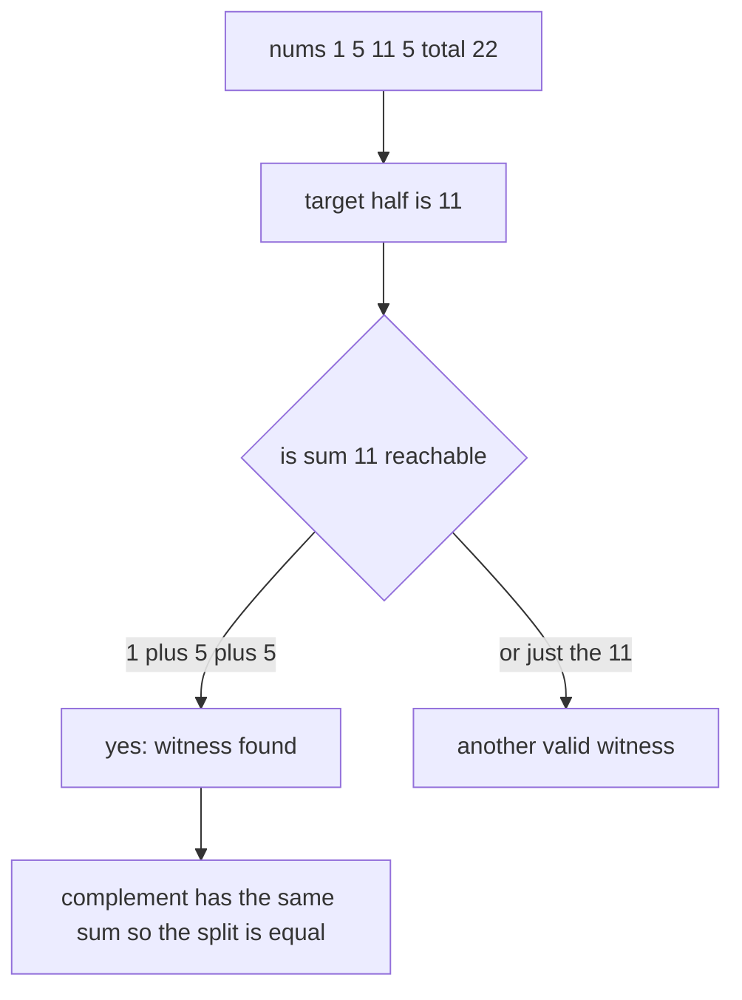
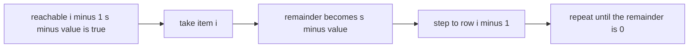
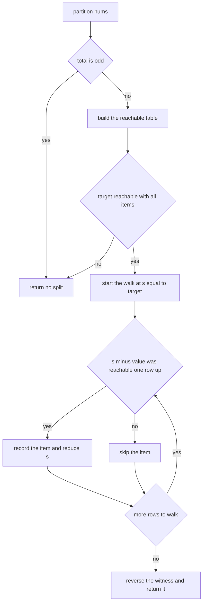
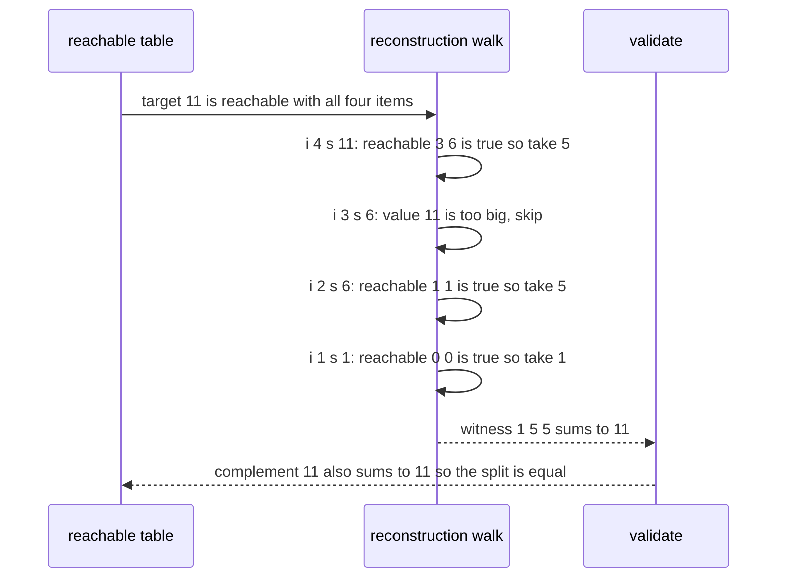

# 291 — Partition equal subset DP with reconstructing sets.

> **Tier:** Intermediate · **CTCI chapter:** Ch 8 — Recursion and Dynamic Programming
> **Task spec:** [291-partition-equal-subset-dp-with-reconstructing-sets.md](../../../tasks/intermediate/291-partition-equal-subset-dp-with-reconstructing-sets.md)
> **Solutions:** [Python](../../../solutions/python/intermediate/291-partition-equal-subset-dp-with-reconstructing-sets/solution.py) ·
> [Java](../../../solutions/java/intermediate/291-partition-equal-subset-dp-with-reconstructing-sets/Solution.java) ·
> [JavaScript](../../../solutions/javascript/intermediate/291-partition-equal-subset-dp-with-reconstructing-sets/solution.js) ·
> [C#](../../../solutions/csharp/intermediate/291-partition-equal-subset-dp-with-reconstructing-sets/Solution.cs)

## 1. Problem restatement

**Input:** a list `nums` of positive integers.

**Output:** “can `nums` be split into two groups with equal sums?” — and, when the answer is yes, a
witness: one of the two groups, listed as the actual values. The complement of that witness is the
other group.

The API shape differs by language because the answer is a pair: the Python file returns a tuple
`(True, side)` or `(False, None)`; Java, JavaScript and C# return the witness array itself or
`null`/`undefined` when no split exists. An empty input is a *successful* split with an empty
witness.

The task spec is a one-liner (“Partition equal subset DP with reconstructing sets.”), so the
contract is fixed by the assertions the four solution files ship with:

| Call | Result | Why |
| --- | --- | --- |
| `partition([1,5,11,5])` | `(True, [1,5,5])` | `1 + 5 + 5 = 11` and `11 = 11` |
| `partition([1,2,3,5])` | `(False, None)` | total `11` is odd |
| `partition([1,2])` | `(False, None)` | total `3` is odd |
| `partition([])` | `(True, [])` | two empty groups have equal sums |
| `partition([2,2,2])` | `(False, None)` | total `6` is even but no subset sums to `3` |
| `partition([1,2,3,4])` | `True` with `sum(side) == 5` | for example `1 + 4` or `2 + 3` |

Random coverage: 200 instances built from the generator `seed ← (seed · 75 + 74) mod 65537`, each
with `2 … 9` items whose values are `1 + seed mod 15`. The decision must equal an exhaustive
subset-mask oracle, and every reported witness must pass `validate(nums, side)` — the side must be a
sub-multiset of `nums` and must have the same sum as the values left over.

## 2. Intuition

Exhaustive search tests all `2^n` subsets. The observation that makes it polynomial: the two groups
have equal sums exactly when one of them sums to `total / 2`, where `total = sum(nums)`. If `total`
is odd the answer is immediately no, and otherwise the question is the classic **subset sum**:
“is `total / 2` reachable using each item at most once?”



The second half of the task is the **witness**. A boolean DP only answers yes/no; to rebuild a
subset you keep the whole table `reachable[i][s]`, meaning “sum `s` is achievable using the first
`i` items”. Then walk backwards from `(n, target)`: at item `i` with current remainder `s`, if
`s - value` was already reachable *without* item `i`, taking item `i` is a safe step, so record it
and reduce `s`. The walk always terminates at `(0, 0)`, which is where the recursion started.



## 3. Algorithm

1. Compute `total`. If `total` is odd, return “no split”.
2. Set `target = total / 2` and allocate a boolean table with `n + 1` rows and `target + 1`
   columns; `reachable[0][0] = true` (the empty prefix reaches sum `0`).
3. For `i` from `1` to `n`, let `value = nums[i - 1]` and for every `s` set
   `reachable[i][s] = reachable[i - 1][s] or (s >= value and reachable[i - 1][s - value])`.
4. If `reachable[n][target]` is false, no split exists.
5. Otherwise reconstruct: start at `s = target` and walk `i` from `n` down to `1`. If
   `s >= value` and `reachable[i - 1][s - value]`, take item `i - 1` into the witness and subtract
   `value` from `s`.
6. Reverse the witness so it lists the items in input order (the walk collects them from the end),
   and return it together with the “yes” answer.

```text
procedure partition(nums)
    total ← sum of nums
    if total is odd then
        return (false, none)
    end
    target ← total / 2
    n ← length(nums)
    reachable ← table of (n + 1) rows and (target + 1) columns filled with false
    reachable[0][0] ← true
    for i ← 1 to n do
        value ← nums[i - 1]
        for s ← 0 to target do
            reachable[i][s] ← reachable[i - 1][s]
            if s ≥ value and reachable[i - 1][s - value] then
                reachable[i][s] ← true
            end
        end
    end
    if reachable[n][target] = false then
        return (false, none)
    end
    side ← empty list
    s ← target
    for i ← n down to 1 do
        value ← nums[i - 1]
        if s ≥ value and reachable[i - 1][s - value] then
            append value to side
            s ← s - value
        end
    end
    reverse side
    return (true, side)
end
```



## 4. Worked example

Trace `partition([1, 5, 11, 5])`. `total = 22`, so `target = 11`. The table has 5 rows and 12
columns; the rows below show only the sums that are reachable after each prefix.

| Step | Prefix | Item `i` (value) | Newly reachable sums | `s = 11` in the last row? |
| --- | --- | --- | --- | --- |
| 1 | `[]` | — | `{0}` | — |
| 2 | `[1]` | 1 | `{0, 1}` | — |
| 3 | `[1, 5]` | 5 | `{0, 1, 5, 6}` | — |
| 4 | `[1, 5, 11]` | 11 | `{0, 1, 5, 6, 11, 12, 16, 17}` | yes — but that witness uses the `11` |
| 5 | `[1, 5, 11, 5]` | 5 | adds `{10, 11}` (values above the target are not stored) | yes |

The reconstruction walk then runs from `(i = 4, s = 11)` back to `(i = 0, s = 0)`:

| Walk step | `i` | `value = nums[i-1]` | Test `reachable[i-1][s-value]` | Witness so far | `s` after |
| --- | --- | --- | --- | --- | --- |
| 1 | 4 | 5 | `reachable[3][6]` is true | `[5]` | 6 |
| 2 | 3 | 11 | `s = 6 < 11`, cannot take | `[5]` | 6 |
| 3 | 2 | 5 | `reachable[1][1]` is true | `[5, 5]` | 1 |
| 4 | 1 | 1 | `reachable[0][0]` is true | `[5, 5, 1]` | 0 |

After reversing, the witness is `[1, 5, 5]`, whose sum is `11`; the remaining values are
`[11]`, whose sum is also `11`. The pair `(True, [1, 5, 5])` is exactly the asserted result. Note
step 2: the `11` could have been taken instead, and then the witness would simply be `[11]` — both
are valid splits, and the reconstruction rule picks the one that keeps the remainder reachable
without the current item.



The `[2,2,2]` assertion shows why the parity check alone is not enough: `total = 6` is even, but the
column `s = 3` in the final row is false because three twos cannot make an odd sum. The decision
comes from the table, not from the parity shortcut.

## 5. Complexity

Let `n = len(nums)`, `S = sum(nums)` and `T = S / 2`.

| Measure | Bound | Why it holds |
| --- | --- | --- |
| Time, best | O(n) | an odd total is rejected after a single pass to compute the sum |
| Time, average | Θ(n · T) | every table cell is computed once from its two predecessors |
| Time, worst | Θ(n · T) | the reconstruction walk adds only `O(n)` |
| Space, table | Θ(n · T) | the witness needs the whole table, so the `O(T)` rolling-row optimisation is not available |
| Space, auxiliary | O(n) | the witness |
| Space, output | O(n) | the witness lists at most `n` values |
| Space of the exhaustive oracle | O(n) masks | it enumerates `2^n` subsets and keeps only the running sums |
| Time of the exhaustive oracle | Θ(2^n · n) | one pass per subset |

The `O(n · T)` table is pseudo-polynomial: it depends on the *magnitudes* in the input, not only on
`n`. The tests keep values at `1 … 15` and `n ≤ 9`, so `T` stays small — with values around `10^9`
even a single row would be impossible.

## 6. Pitfalls and edge cases

- **Odd total.** `partition([1,2,3,5])` and `partition([1,2])` are `(False, None)` / `null`; the
  parity test short-circuits the table allocation entirely.
- **Even total is not enough.** `partition([2,2,2])` must be a failure even though `6 / 2 = 3` is an
  integer; the reachability table is the authority.
- **Empty input.** The Python tuple is `(True, [])`; Java, JavaScript and C# return an empty array.
  Allocating the table with `target = 0` still works, and the reconstruction loop has nothing to
  walk.
- **Witness must be a sub-multiset.** Values repeat (`[1,5,11,5]` has two fives), so `validate`
  removes each witness value from a copy of `nums` instead of counting occurrences in a set;
  membership tests alone would accept a witness with more copies than the input holds.
- **Reconstruction direction.** The walk goes from `i = n` down to `1` and compares against row
  `i - 1`; walking forwards, or testing `reachable[i][s - value]` (which includes item `i`), can
  pick an item twice and produce an invalid witness.
- **Condition ordering.** The test `s >= value` must come before indexing `s - value`, otherwise a
  negative column index appears whenever the remainder is smaller than the item.
- **Input order of the witness.** The walk collects items from the end, so the shipped code reverses
  the list; the assertions compare against `[1,5,5]` for `[1,5,11,5]`, and the random checks compare
  `sorted(side)` style sums and multiset validity rather than the raw ordering.
- **Multiple valid witnesses.** The rule “take the item when the remainder stays reachable without
  it” makes the output deterministic but is not the only correct choice; the tests check the
  *properties* of the witness (sum, multiset validity) plus the decision, not one specific subset.
- **Table orientation.** Writing `reachable[s][i]` instead of `reachable[i][s]` is harmless if used
  consistently, but mixing the two — as happens when the reconstruction loop and the DP loop
  disagree on the order of indices — silently reads the wrong cell and yields a witness whose sum
  is wrong.
- **Space trade-off.** The usual subset-sum trick of keeping one rolling row is not applicable here
  precisely because the witness needs the historical rows.

## 7. Variants and follow-ups

- **Decision only.** If no witness is required, one rolling row of `T + 1` booleans drops the space
  to `O(T)`:
  [217-subset-sum-decision-problem-dp-boolean.md](../../../tasks/intermediate/217-subset-sum-decision-problem-dp-boolean.md).
- **Counting the splits.** Replacing the boolean cells with counts answers “how many subsets sum to
  the target?”, the same table shape with addition instead of `or`:
  [218-count-subsets-that-sum-to-target-dp.md](../../../tasks/intermediate/218-count-subsets-that-sum-to-target-dp.md).
- **Minimum difference.** Dropping the equality requirement and looking for the best reachable sum
  is the closely related optimisation:
  [292-minimum-subset-sum-difference-dp.md](../../../tasks/intermediate/292-minimum-subset-sum-difference-dp.md).
- **More than two groups.** Splitting into `k` equal-sum groups is NP-hard in general and is solved
  by backtracking rather than by a two-row table:
  [216-partition-array-into-k-equal-sum-subsets-backtracking.md](../../../tasks/intermediate/216-partition-array-into-k-equal-sum-subsets-backtracking.md).
- The authoring chapter is [Recursion and Dynamic Programming](../../ctci/08-recursion-and-dp.md).

## 8. Check yourself

1. Why does the problem reduce to subset sum?

<details><summary>Show answer</summary>

If one group sums to `total / 2`, the complement automatically sums to `total - total / 2 =
total / 2` as well, so the two groups are equal. Conversely any equal split gives a subset summing
to `total / 2`. The equality requirement therefore only needs one subset to be found.

</details>

2. `[2, 2, 2]` has an even total. Why is there still no split?

<details><summary>Show answer</summary>

Every subset of `[2,2,2]` has an even sum (`0, 2, 4, 6`), and the target is `3`. Column `3` of the
final DP row stays false, so the answer is no — a parity check on the total is necessary but not
sufficient.

</details>

3. Why is the reconstruction walk able to take an item whenever `reachable[i-1][s-value]` holds?

<details><summary>Show answer</summary>

That cell says the remainder `s - value` is achievable with the first `i - 1` items alone. Adding
item `i - 1` therefore reaches exactly `s` using items `1 … i` with item `i` used once, so the
step is safe by definition of the table, and the invariant “`s` is reachable with the first `i`
items” is preserved all the way down to `(0, 0)`.

</details>

4. Why does the implementation keep the full table instead of the usual single row?

<details><summary>Show answer</summary>

The witness needs history: at step `i` the walk asks whether `s - value` was reachable *before*
item `i` existed. A rolling row overwrites row `i - 1` in place, so that question can no longer be
answered. Decision-only variants can use one row precisely because they never look back.

</details>

5. How would you detect that a witness is invalid without re-running the DP?

<details><summary>Show answer</summary>

Run `validate`: remove each witness value from a copy of `nums` (failing if a value is missing, which
catches a repeated item), then compare `sum(side)` with the sum of the leftovers. Both checks are
`O(n)`, and the random suite performs them for all 200 generated instances.

</details>
