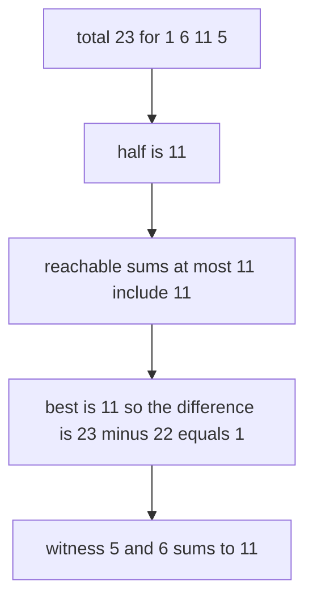
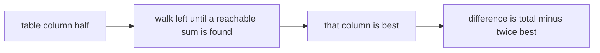
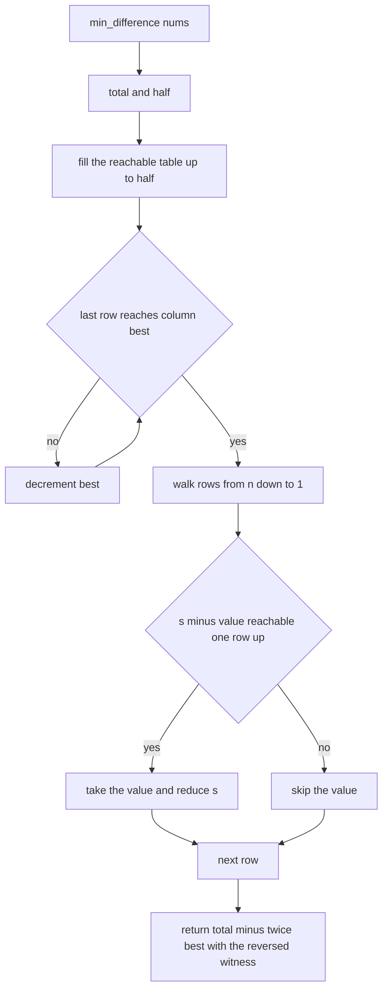
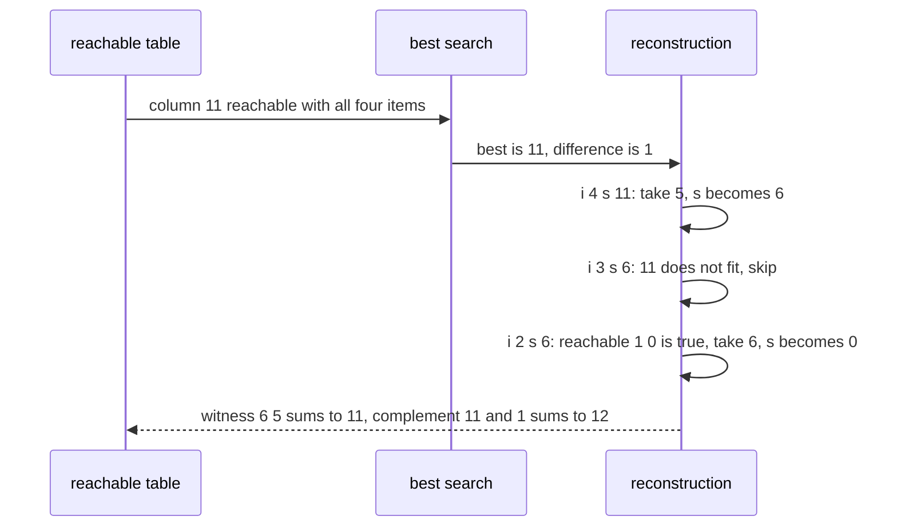

# 292 — Minimum subset sum difference (DP).

> **Tier:** Intermediate · **CTCI chapter:** Ch 8 — Recursion and Dynamic Programming
> **Task spec:** [292-minimum-subset-sum-difference-dp.md](../../../tasks/intermediate/292-minimum-subset-sum-difference-dp.md)
> **Solutions:** [Python](../../../solutions/python/intermediate/292-minimum-subset-sum-difference-dp/solution.py) ·
> [Java](../../../solutions/java/intermediate/292-minimum-subset-sum-difference-dp/Solution.java) ·
> [JavaScript](../../../solutions/javascript/intermediate/292-minimum-subset-sum-difference-dp/solution.js) ·
> [C#](../../../solutions/csharp/intermediate/292-minimum-subset-sum-difference-dp/Solution.cs)

## 1. Problem restatement

**Input:** a list `nums` of positive integers.

**Output:** the smallest possible value of `|sum(A) - sum(B)|` over all ways of splitting `nums`
into two disjoint groups that together contain every element, plus a witness: one of the two groups
as a list of values. The witness is the group that achieves the optimum.

Like task 291, the answer is a pair, and the languages package it differently: Python returns
`(difference, side)`, JavaScript returns `[difference, side]`, C# returns a
`(int Difference, int[] Side)` tuple, and the Java file packs everything into one `int[]` whose
first element is the difference and whose remaining elements are the witness.

The task spec is a one-liner (“Minimum subset sum difference (DP).”), so the contract is fixed by the
assertions the four solution files ship with:

| Call | Result | Why |
| --- | --- | --- |
| `min_difference([1,6,11,5])` | difference `1`, `sorted(side) == [5,6]` | `12` versus `11` |
| `min_difference([3,3,3])` | difference `3`, `side == [3]` | `3` versus `6` |
| `min_difference([1,2,3,4])` | difference `0`, `sorted(side) == [1,4]` | `5` versus `5` |
| `min_difference([7])` | difference `7`, `side == []` | one element cannot be split |
| `min_difference([])` | difference `0`, `side == []` | two empty groups |

Random coverage: 200 instances from the generator `seed ← (seed · 75 + 74) mod 65537`, starting at
`777`; each instance has `1 … 14` items with values `1 + seed mod 25`. The reported difference must
equal an exhaustive `2^n` subset enumeration, and the witness must satisfy
`total - 2 · sum(side) == difference` — the arithmetic identity that ties the witness back to the
reported optimum.

## 2. Intuition

There are `2^n` subsets to consider, and the difference of a split is
`|sum(A) - sum(B)| = |total - 2 · sum(A)|`, so the objective depends only on the sum of one side.
That single identity collapses the problem: find the subset sum `best` closest to `total / 2`, and
the answer is `total - 2 · best`.



Sums above `total / 2` never need to be stored: if a subset sums to `s > total / 2`, its complement
sums to `total - s < total / 2` and produces the same difference, so it is enough to keep one column
per reachable sum up to `floor(total / 2)`. That halves the table and makes “the best sum” a
backwards walk from the middle of the table instead of a search over all sums.



## 3. Algorithm

1. Compute `total` and `half = total / 2` (integer division).
2. Allocate `reachable` with `n + 1` rows and `half + 1` columns; `reachable[0][0] = true`.
3. Fill the table exactly as for subset sum: for `i` from `1` to `n` and every `s` up to `half`, set
   `reachable[i][s] = reachable[i - 1][s] or (s >= value and reachable[i - 1][s - value])`.
4. Find `best`: start at `half` and decrement while the last row does not reach that sum. Because
   `0` is always reachable, the loop terminates.
5. Reconstruct the witness for `best`: walk `i` from `n` down to `1`, taking item `i - 1` whenever
   `s >= value` and `reachable[i - 1][s - value]`, and subtracting the value from `s`.
6. Reverse the witness (it was collected from the end) and return `total - 2 · best` together with
   it.

```text
procedure min_difference(nums)
    total ← sum of nums
    half ← total / 2
    n ← length(nums)
    reachable ← table of (n + 1) rows and (half + 1) columns filled with false
    reachable[0][0] ← true
    for i ← 1 to n do
        value ← nums[i - 1]
        for s ← 0 to half do
            reachable[i][s] ← reachable[i - 1][s]
            if s ≥ value and reachable[i - 1][s - value] then
                reachable[i][s] ← true
            end
        end
    end
    best ← half
    while best > 0 and reachable[n][best] = false do
        best ← best - 1
    end
    side ← empty list
    s ← best
    for i ← n down to 1 do
        value ← nums[i - 1]
        if s ≥ value and reachable[i - 1][s - value] then
            append value to side
            s ← s - value
        end
    end
    reverse side
    return (total - 2 * best, side)
end
```



## 4. Worked example

Trace `min_difference([1, 6, 11, 5])`. `total = 23` and `half = 11`, so the table has 5 rows and
12 columns.

| Prefix | Item `i` (value) | Reachable sums up to 11 |
| --- | --- | --- |
| `[]` | — | `{0}` |
| `[1]` | 1 | `{0, 1}` |
| `[1, 6]` | 6 | `{0, 1, 6, 7}` |
| `[1, 6, 11]` | 11 | `{0, 1, 6, 7, 11}` |
| `[1, 6, 11, 5]` | 5 | `{0, 1, 5, 6, 7, 11}` |

Column `11` is reachable in the last row, so `best` stops immediately at `11` and the difference is
`23 - 2 · 11 = 1`. The reconstruction then runs from `(i = 4, s = 11)`:

| Walk step | `i` | `value` | Test `reachable[i-1][s-value]` | Witness | `s` after |
| --- | --- | --- | --- | --- | --- |
| 1 | 4 | 5 | `reachable[3][6]` is true (`6` from the prefix) | `[5]` | 6 |
| 2 | 3 | 11 | `s = 6 < 11` → skip | `[5]` | 6 |
| 3 | 2 | 6 | `reachable[1][0]` is true (the empty prefix) | `[5, 6]` | 0 |
| 4 | 1 | 1 | `s = 0 < 1` → skip | `[5, 6]` | 0 |

The reversed witness is `[6, 5]`, which sums to `11`; the complement is `11 + 1 = 12`, and
`12 - 11 = 1` is the asserted difference. `sorted(side) == [5, 6]` is what the files assert, since
the walk produces values in descending index order rather than sorted order.

The `[7]` assertion exercises the other end of the search: `total = 7`, `half = 3`, and the only
reachable sums are `{0}` because taking the single item would exceed `half`. `best` decrements all
the way to `0`, the witness is empty, and the difference is the whole total — exactly what
`min_difference([7]) == (7, [])` states.



## 5. Complexity

Let `n = len(nums)`, `S = sum(nums)` and `H = floor(S / 2)`.

| Measure | Bound | Why it holds |
| --- | --- | --- |
| Time, best | O(n) | `n = 1` or an empty input still fills one row of a `0`-column table |
| Time, average | Θ(n · H) | each cell is computed from its two predecessors |
| Time, worst | Θ(n · H) | plus the `O(H)` walk to find `best` and the `O(n)` reconstruction |
| Space, table | Θ(n · H) | the witness needs history, so no rolling row |
| Space, auxiliary | O(n) | the witness itself |
| Space of the exhaustive oracle | O(1) besides the sums | it enumerates `2^n` masks and tracks the best difference |
| Time of the exhaustive oracle | Θ(2^n · n) | one addition per item per subset |

Storing only sums up to `H` rather than up to `S` is what halves both the time and the memory of the
table, and it is the reason `total - 2 · best` is always non-negative for the chosen `best`.

## 6. Pitfalls and edge cases

- **Single element.** `[7]` cannot be split into non-empty groups at all, and the algorithm reports
  the whole value as the difference with an empty witness — the empty side is a legitimate answer,
  not an error.
- **Empty input.** `total = 0`, the table has a single column, `best = 0`, and the result is
  `(0, [])`.
- **Exact split.** When `H` itself is reachable the difference is `0` and the loop in step 4 does no
  work; `[1,2,3,4]` is that case, with the witness `[1,4]` (summing to `H = 5`).
- **Searching the best column.** The loop must scan *downwards* from `half`; scanning upwards would
  find the smallest reachable sum, which maximises the difference. Column `0` is always reachable,
  so the loop cannot run past the start.
- **Integer division.** For odd totals, `half = (total - 1) / 2`; both halves of the split cannot be
  equal, and the best achievable difference is therefore at least `1`. Using `total / 2` in floating
  point and indexing with it would break.
- **Witness validity.** The reconstruction compares against row `i - 1`, so each item is considered
  once. The random checks assert `total - 2 · sum(side) == difference`, which fails for a witness
  that takes an item twice or drops the wrong one.
- **Duplicate values.** As in task 291, the witness is one side of a *multiset* split, so the checks
  never assume distinct values; the assertions that use `[3,3,3]` and `[1,6,11,5]` both contain
  repeats.
- **Return packing.** The Java file returns a single `int[]` where index `0` is the difference, so
  the tests read `answer[0]` and treat the tail as the witness; in Python and JavaScript the
  difference and the side are separate values. A port that mixes the two conventions compares a
  witness against a difference.
- **Value magnitudes.** The table size grows with the *values*, not just the count; the generator
  keeps values at `1 … 25` and `n ≤ 14` for that reason.
- **Table order.** Row `i` must be fully built from row `i - 1` before it is used by row `i + 1`;
  in-place updates within the same row would let one item be counted several times.

## 7. Variants and follow-ups

- **Equal split only.** Asking whether the difference can be `0` is a single boolean cell and allows
  a rolling row:
  [291-partition-equal-subset-dp-with-reconstructing-sets.md](../../../tasks/intermediate/291-partition-equal-subset-dp-with-reconstructing-sets.md).
- **Counting the ways.** Enumerating how many subsets reach a given sum:
  [218-count-subsets-that-sum-to-target-dp.md](../../../tasks/intermediate/218-count-subsets-that-sum-to-target-dp.md).
- **Decision only.** Whether a single target sum is reachable, with one boolean row:
  [217-subset-sum-decision-problem-dp-boolean.md](../../../tasks/intermediate/217-subset-sum-decision-problem-dp-boolean.md).
- **Meet in the middle.** When the values are too large for a sum-indexed table, splitting the input
  in half and combining sorted half-sums answers the same question:
  [219-implement-meet-in-the-middle-for-subset-problems-n-40.md](../../../tasks/intermediate/219-implement-meet-in-the-middle-for-subset-problems-n-40.md).
- The authoring chapter is [Recursion and Dynamic Programming](../../ctci/08-recursion-and-dp.md).

## 8. Check yourself

1. Why is it enough to store subset sums up to `floor(total / 2)`?

<details><summary>Show answer</summary>

Because a subset summing to `s` has a complement summing to `total - s`, and
`|total - 2s| = |total - 2(total - s)|`. Every difference is therefore already realised by a subset
whose sum is at most `total / 2`, so larger sums carry no new information.

</details>

2. What does the reported difference have to do with the witness?

<details><summary>Show answer</summary>

`difference = total - 2 · sum(side)`: the witness is the lighter side, its sum is `best`, and the
heavier side sums to `total - best`. The random checks assert this identity for every generated
instance, which is a much stronger statement than “the difference looks small”.

</details>

3. For `[1,6,11,5]` the value `12 = 1 + 11` is also reachable. Why is it not the answer?

<details><summary>Show answer</summary>

Because `12 > half = 11`. The subset `{1, 11}` has a complement of `{6, 5}` with sum `11`, giving
the same difference of `1` — the algorithm finds that equivalent split instead of storing sums above
the middle, which is exactly why the table is halved.

</details>

4. Why does `[7]` report a difference of `7` instead of failing?

<details><summary>Show answer</summary>

The problem allows an empty side: splitting `[7]` into `{}` and `{7}` gives a difference of `7`,
which is the best possible. The search lands on `best = 0`, the witness is empty, and `total - 0 =
7` is returned.

</details>

5. Why does the table need the full `n + 1` rows here, unlike a pure decision problem?

<details><summary>Show answer</summary>

For the same reason as task 291: the reconstruction walks back through rows and asks what was
reachable *before* the current item. A rolling row would erase exactly the information the witness
needs, so the memory stays `Θ(n · half)` when a witness is required.

</details>
