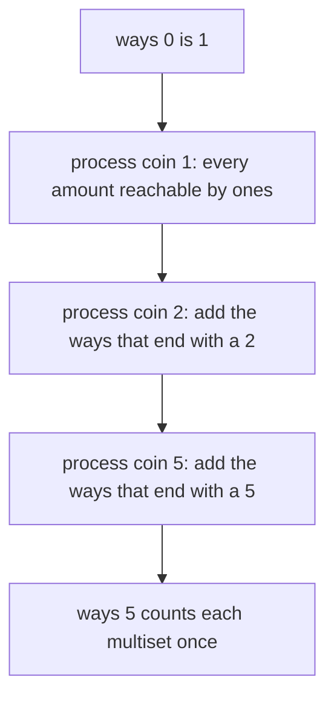
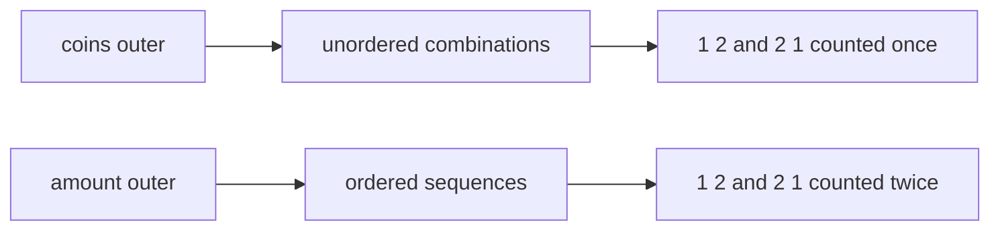
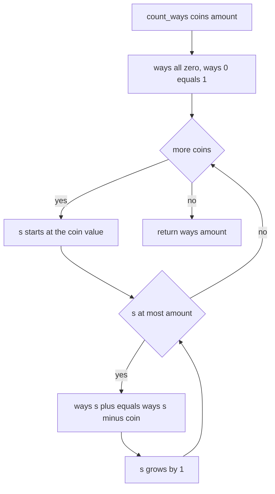
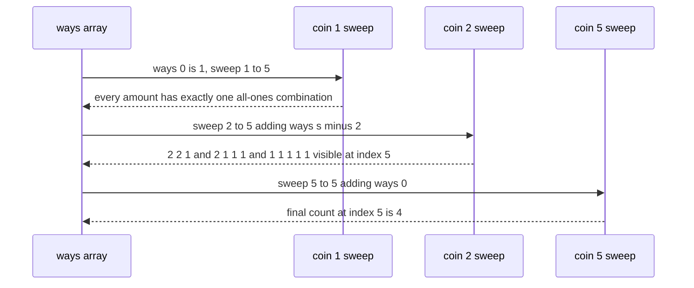

# 293 — Coin change: number of ways (DP).

> **Tier:** Intermediate · **CTCI chapter:** Ch 8 — Recursion and Dynamic Programming
> **Task spec:** [293-coin-change-number-of-ways-dp.md](../../../tasks/intermediate/293-coin-change-number-of-ways-dp.md)
> **Solutions:** [Python](../../../solutions/python/intermediate/293-coin-change-number-of-ways-dp/solution.py) ·
> [Java](../../../solutions/java/intermediate/293-coin-change-number-of-ways-dp/Solution.java) ·
> [JavaScript](../../../solutions/javascript/intermediate/293-coin-change-number-of-ways-dp/solution.js) ·
> [C#](../../../solutions/csharp/intermediate/293-coin-change-number-of-ways-dp/Solution.cs)

## 1. Problem restatement

**Input:** a list of coin denominations with unlimited supply of each, and a target amount.

**Output:** how many **unordered** combinations of coins sum to the amount. Order does not matter:
`1 + 2` and `2 + 1` are the same combination and must be counted once. An amount of `0` has exactly
one combination — the empty one.

The task spec is a one-liner (“Coin change number of ways (DP).”), so the contract is fixed by the
assertions the four solution files ship with:

| Call | Result | Why |
| --- | --- | --- |
| `count_ways([1,2,5], 5)` | `4` | `{5}`, `{2,2,1}`, `{2,1,1,1}`, `{1,1,1,1,1}` |
| `count_ways([2], 3)` | `0` | no combination of twos makes an odd amount |
| `count_ways([1,2,5], 0)` | `1` | the empty combination |
| `count_ways([1], 10)` | `1` | only ten ones |
| `count_ways([], 0)` | `1` | no coins, empty amount |
| `count_ways([2,3,5], 9)` | `3` | `{5,2,2}`, `{3,3,3}`, `{3,2,2,2}` |
| `count_ways([1,2], 3)` | `2` | `{1,1,1}` and `{1,2}`; ordered counting would answer `3` |

The last row is the sharpest test of the ordering convention: with permutations allowed, `3` would
be reachable as `1+1+1`, `1+2` and `2+1`. The files also check 150 random instances
(`seed ← (seed · 75 + 74) mod 65537`, starting at `24680`, `1 … 5` distinct coins drawn from
`1 … 8` and an amount in `0 … 59`) against an independent recursive counter that walks the coin
list choosing a multiplicity for each denomination.

## 2. Intuition

The naive idea is: to make `amount`, pick a first coin and recurse on what is left. That counts
*sequences* — it will happily produce `1 + 2` and `2 + 1` as two different answers.

The fix is the classic one for unordered counting: process the **coins one at a time**, and for each
coin extend everything reachable so far by one more copy of that coin. After processing coin `c`,
`ways[s]` holds the number of combinations of amounts summing to `s` that use only the coins seen so
far, with unlimited copies of each. Adding a new coin is a left-to-right sweep:

```text
for s ← coin to amount do
    ways[s] ← ways[s] + ways[s - coin]
```

Because `ways[s - coin]` is read *after* the current coin has already been allowed to contribute to
it, a coin can be used any number of times; because the coin loop is the outer loop, each
combination is discovered exactly once — at the moment its largest denomination is first allowed.





## 3. Algorithm

1. Allocate `ways` with `amount + 1` zeros and set `ways[0] = 1` — the empty combination reaches
   sum `0`.
2. For each `coin` in the input list, sweep `s` from `coin` to `amount` and add
   `ways[s - coin]` to `ways[s]`.
3. Return `ways[amount]`.

```text
procedure count_ways(coins, amount)
    ways ← array of (amount + 1) zeros
    ways[0] ← 1
    for each coin in coins do
        for s ← coin to amount do
            ways[s] ← ways[s] + ways[s - coin]
        end
    end
    return ways[amount]
end
```



The loop nesting is the whole algorithm. Swapping the two loops produces the *ordered* count, and
the file that documents this in comment form is the one checked by
`count_ways([1,2], 3) == 2`.

## 4. Worked example

Trace `count_ways([1, 2, 5], 5)` with the array `ways[0 … 5]` starting as `[1, 0, 0, 0, 0, 0]`.

| Step | Coin | `s` | Update | `ways` after |
| --- | --- | --- | --- | --- |
| 1 | 1 | 0 | initial state | `[1, 0, 0, 0, 0, 0]` |
| 2 | 1 | 1 | `ways[1] += ways[0]` | `[1, 1, 0, 0, 0, 0]` |
| 3 | 1 | 2 | `ways[2] += ways[1]` | `[1, 1, 1, 0, 0, 0]` |
| 4 | 1 | 3 | `ways[3] += ways[2]` | `[1, 1, 1, 1, 0, 0]` |
| 5 | 1 | 4 | `ways[4] += ways[3]` | `[1, 1, 1, 1, 1, 0]` |
| 6 | 1 | 5 | `ways[5] += ways[4]` | `[1, 1, 1, 1, 1, 1]` |
| 7 | 2 | 2 | `ways[2] += ways[0]` | `[1, 1, 2, 1, 1, 1]` |
| 8 | 2 | 3 | `ways[3] += ways[1]` | `[1, 1, 2, 2, 1, 1]` |
| 9 | 2 | 4 | `ways[4] += ways[2]` | `[1, 1, 2, 2, 3, 1]` |
| 10 | 2 | 5 | `ways[5] += ways[3]` | `[1, 1, 2, 2, 3, 3]` |
| 11 | 5 | 5 | `ways[5] += ways[0]` | `[1, 1, 2, 2, 3, 4]` |

The final value is `4`, matching the assertion. Reading the table as combinations makes the coin
order visible: at step 10 `ways[5]` counts `{1,1,1,1,1}`, `{2,1,1,1}` and `{2,2,1}` — the
combinations that use only ones and twos — and step 11 adds the single `{5}`. No combination is
visited twice because each coin's sweep only composes combinations in which that coin is the largest
denomination used.



The oracle counts the same sets from a different angle: it recurses over the coin index and, at each
denomination, enumerates how many copies to take (`0, 1, 2, …` while they still fit the remainder).
That produces each multiset exactly once as well, but in a completely different order, which makes
the agreement on 150 random instances meaningful.

## 5. Complexity

Let `m = len(coins)` and `A = amount`.

| Measure | Bound | Why it holds |
| --- | --- | --- |
| Time, best | O(m) | amount `0` still processes every coin, but every inner loop is empty |
| Time, average | Θ(m · A) | each coin sweeps the array once |
| Time, worst | Θ(m · A) | constant work per cell |
| Space | Θ(A) | one counter array; the coin list itself is `O(m)` |
| Space of the recursive oracle | O(m) stack | depth is bounded by the number of denominations |
| Time of the recursive oracle | proportional to the number of multisets | it enumerates multiplicities rather than table cells |

The count grows quickly but only the final cell is returned. Java and C# use a 64-bit accumulator
(`long`) because the number of combinations can overflow 32 bits well before the input looks large;
Python integers are unbounded, and the JavaScript tests stay inside the exact-integer range. This is
the *counting* variant of coin change — the table is one-dimensional, unlike the reconstruction DP in
tasks 291 and 292, because no witness is required.

## 6. Pitfalls and edge cases

- **Loop order.** Coins outside, amount inside counts combinations; the reverse counts sequences and
  fails `count_ways([1,2], 3) == 2` by returning `3`.
- **`ways[0] = 1`.** The empty combination is what makes `count_ways([1,2,5], 0) == 1` and forces
  `10` ones to be counted from `ways[10] += ways[9]`. Starting from `0` would return `0` everywhere.
- **Impossible amounts.** `count_ways([2], 3) == 0` — the sweep never writes an odd index, and the
  final read returns the initial zero.
- **Empty coin list.** `count_ways([], 0) == 1` and `count_ways([], 5) == 0`; the outer loop simply
  does nothing.
- **Duplicate denominations.** The generator draws distinct coins; duplicated denominations are not
  covered by the assertions, and they would change the meaning of “combination” unless the list is
  deduplicated first.
- **Unbounded supply vs 0/1.** The sweep runs left to right (`s` ascending) so a coin can contribute
  to itself repeatedly, which is exactly the unlimited-supply assumption. Sweeping right to left
  turns the same code into the 0/1 counting problem.
- **Accumulator width.** The counts are combinatorial; the Java and C# files accumulate in `long`,
  which is why their signatures return `long` rather than `int`.
- **Amount as an index.** The array is indexed by the *sum*, so `amount` must be a non-negative
  integer; negative amounts are not asserted and would need a guard.
- **No memoised recursion.** Writing the same recurrence top-down works, but plain recursion without
  memoisation re-explores the same states exponentially; the bottom-up sweep is the shipped form.

## 7. Variants and follow-ups

- **Ordered counting.** Swap the loops to count sequences (compositions) instead of combinations;
  with coins `[1, 2, 3]` and amount `4` the two answers differ, and the assertion `[1,2] → 3 = 2`
  documents which convention this task uses.
- **Fewest coins.** Replacing the addition with a minimum turns the sweep into
  [294-coin-change-minimum-coins-dp.md](../../../tasks/intermediate/294-coin-change-minimum-coins-dp.md).
- **Each coin at most once.** Iterate the same two loops with the amount sweep reversed to obtain the
  0/1 counting problem, which is the shape of
  [218-count-subsets-that-sum-to-target-dp.md](../../../tasks/intermediate/218-count-subsets-that-sum-to-target-dp.md).
- **Producing the combinations.** When the caller wants the multisets rather than their number, a
  table of counts is not enough and the backtracking enumeration takes over:
  [287-combination-sum-backtracking.md](../../../tasks/intermediate/287-combination-sum-backtracking.md).
- The authoring chapter is [Recursion and Dynamic Programming](../../ctci/08-recursion-and-dp.md).

## 8. Check yourself

1. Why does the coin-by-coin order count each combination exactly once?

<details><summary>Show answer</summary>

After coin `i` has been processed, `ways[s]` counts the combinations whose denominations come from
the first `i` coins only. Every multiset has a unique largest denomination index, so it is added at
exactly one step — the sweep where that coin enters — and never revisited, because later sweeps only
compose combinations that include the new (higher-index) coin.

</details>

2. What happens if the two loops are swapped?

<details><summary>Show answer</summary>

Each addition then composes over all coins at every sum, so `ways[s]` counts *sequences* of coins.
`count_ways([1,2], 3)` becomes `3` (`1+1+1`, `1+2`, `2+1`) instead of the asserted `2`.

</details>

3. Why is `ways[0]` initialised to `1` rather than `0`?

<details><summary>Show answer</summary>

Because there is exactly one way to make an amount of `0`: use no coins. That base case is also the
seed every sweep propagates — `ways[coin] += ways[0]` is how the single-coin combination enters the
table.

</details>

4. Why does `count_ways([2], 3)` return `0` although the recurrence is defined everywhere?

<details><summary>Show answer</summary>

The only sweep is `s = 2, 3` with `ways[s] += ways[s - 2]`. `ways[1]` stays `0` (it was never
seeded), so `ways[3] += ways[1]` adds nothing. Odd sums are simply unreachable with an even coin.

</details>

5. Why do Java and C# use a 64-bit accumulator instead of `int`?

<details><summary>Show answer</summary>

The number of combinations grows combinatorially — with coins `[1, 2]` alone the count for amount
`n` is `n/2 + 1`, and richer coin sets grow faster still. A 32-bit accumulator can overflow on
inputs that look harmless, so the shipped signatures return `long`; Python’s integers do not
overflow, and the tests keep the JavaScript values inside the exact-integer range.

</details>
