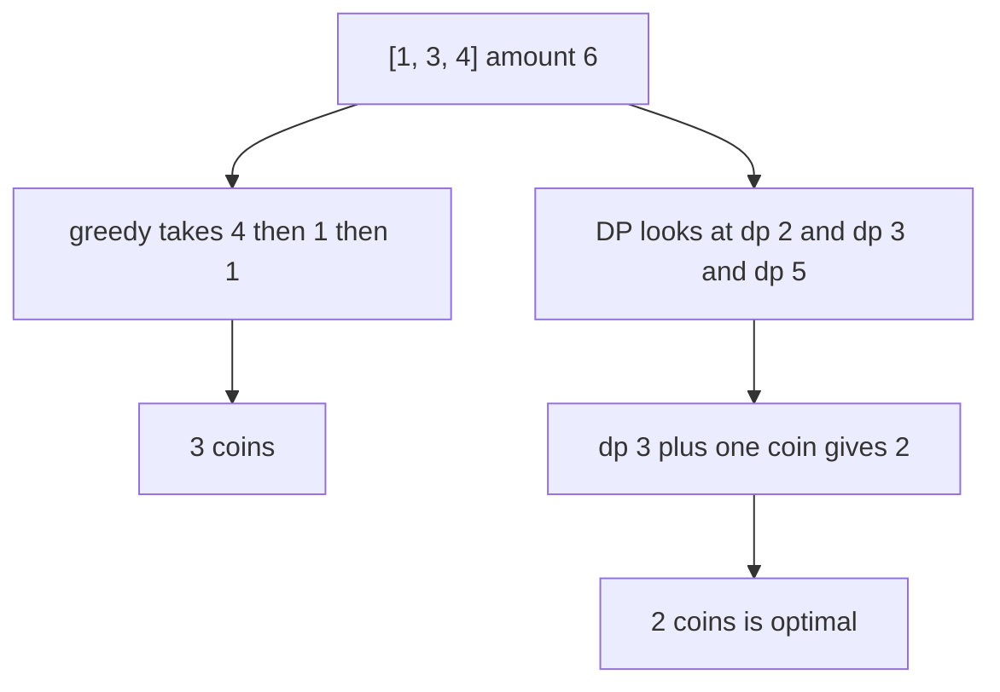
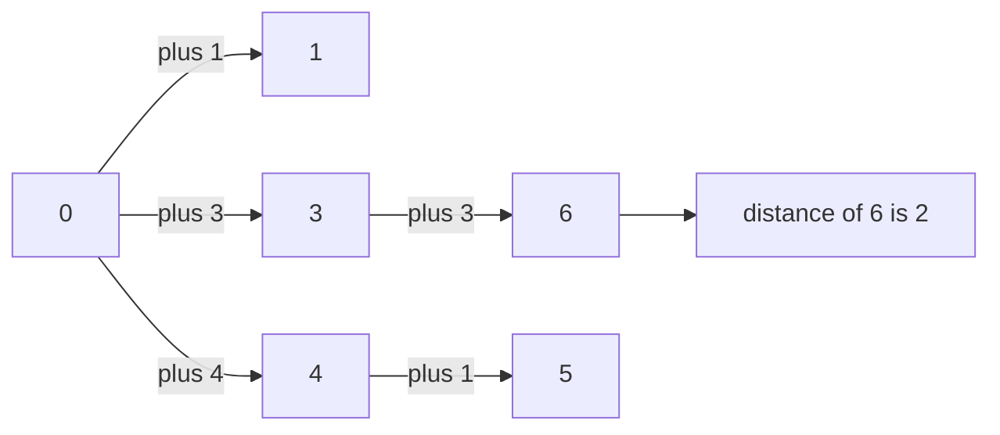
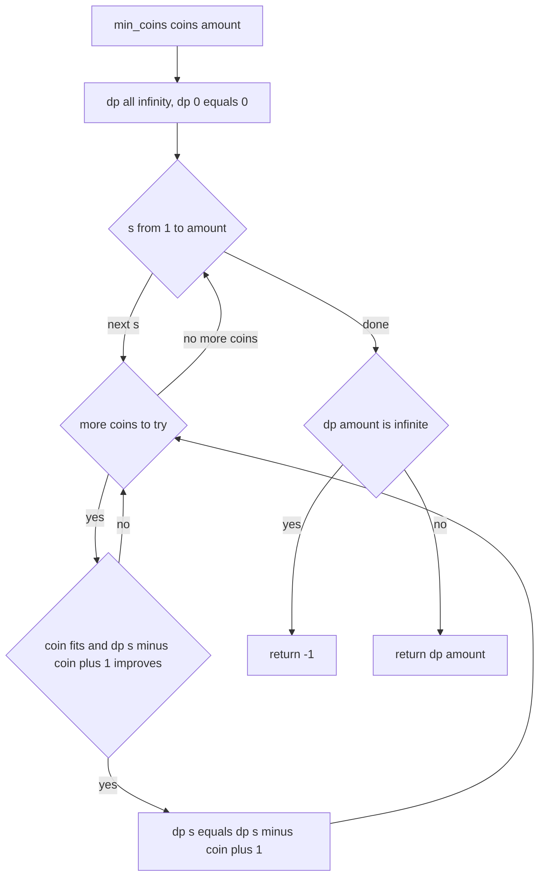
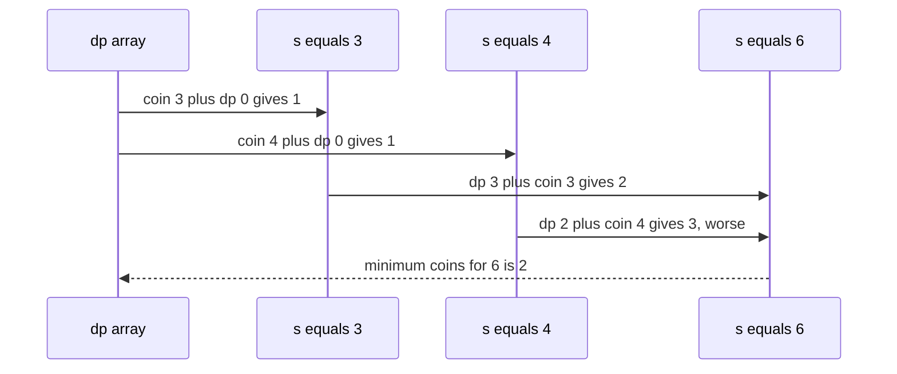

# 294 — Coin change: minimum coins (DP).

> **Tier:** Intermediate · **CTCI chapter:** Ch 8 — Recursion and Dynamic Programming
> **Task spec:** [294-coin-change-minimum-coins-dp.md](../../../tasks/intermediate/294-coin-change-minimum-coins-dp.md)
> **Solutions:** [Python](../../../solutions/python/intermediate/294-coin-change-minimum-coins-dp/solution.py) ·
> [Java](../../../solutions/java/intermediate/294-coin-change-minimum-coins-dp/Solution.java) ·
> [JavaScript](../../../solutions/javascript/intermediate/294-coin-change-minimum-coins-dp/solution.js) ·
> [C#](../../../solutions/csharp/intermediate/294-coin-change-minimum-coins-dp/Solution.cs)

## 1. Problem restatement

**Input:** a list of coin denominations with unlimited supply of each, and a target amount.

**Output:** the **fewest** coins that sum to the amount, or the documented sentinel `-1` when no
combination reaches it. `-1` is safe because a coin count is never negative, so it cannot collide
with a real answer.

The task spec is a one-liner (“Coin change minimum coins (DP).”), so the contract is fixed by the
assertions the four solution files ship with:

| Call | Result | Why |
| --- | --- | --- |
| `min_coins([1,2,5], 11)` | `3` | `5 + 5 + 1` |
| `min_coins([2], 3)` | `-1` | odd amount, even coin |
| `min_coins([1,2,5], 0)` | `0` | no coins needed |
| `min_coins([1,3,4], 6)` | `2` | `3 + 3` beats the greedy `4 + 1 + 1` |
| `min_coins([1,3,4], 9)` | `3` | `4 + 4 + 1` (or `3 + 3 + 3`) |
| `min_coins([5,7], 11)` | `-1` | `10` is under, `12` is over — nothing lands on `11` |
| `min_coins([], 0)` | `0` | the empty combination |

The `[1,3,4]` rows are the reason this task exists in the curriculum: they are the smallest
counterexample to the greedy “always take the largest coin that fits” rule. The files also check 150
random instances (`seed ← (seed · 75 + 74) mod 65537`, starting at `13579`, `1 … 4` distinct coins
drawn from `1 … 7`, amount in `0 … 79`) against a breadth-first-search oracle over reachable
amounts.

## 2. Intuition

Greedy is tempting: repeatedly take the largest coin that still fits. For `[1,3,4]` and `6` it takes
`4`, then `1`, then `1` — three coins — while `3 + 3` uses two. Greedy fails because the coin system
is not canonical; there is no exchange argument that makes the locally best choice globally safe.

The dynamic-programming view is simple and robust: let `dp[s]` be the fewest coins that sum to `s`.
Then

```text
dp[s] = 1 + min over coins c with c <= s of dp[s - c]
```

Every solution of `s` ends with some last coin `c`, and the prefix before it is an optimal solution
of `s - c` — otherwise replacing the prefix would improve the whole. That optimal-substructure
argument is what makes the recurrence exact, and it is what greedy lacks.



The second reading of the same recurrence is a **graph**: amounts are vertices, a coin is an edge of
weight one from `s` to `s + c`, and the answer is the shortest path from `0` to `amount`. That is
exactly what the BFS oracle computes, and it is why the DP is correct even when a coin is larger than
half the amount.



## 3. Algorithm

1. Allocate `dp` with `amount + 1` entries, all set to infinity, and `dp[0] = 0`.
2. For every sum `s` from `1` to `amount`, and every coin `c`: if `c <= s` and `dp[s - c] + 1` is
   smaller than the current `dp[s]`, update `dp[s]`.
3. Return `dp[amount]`, or the sentinel `-1` when it is still infinity.

```text
procedure min_coins(coins, amount)
    infinity ← a value larger than any possible coin count
    dp ← array of (amount + 1) entries filled with infinity
    dp[0] ← 0
    for s ← 1 to amount do
        for each coin in coins do
            if coin ≤ s and dp[s - coin] + 1 < dp[s] then
                dp[s] ← dp[s - coin] + 1
            end
        end
    end
    if dp[amount] = infinity then
        return -1
    end
    return dp[amount]
end
```



## 4. Worked example

Trace `min_coins([1, 3, 4], 6)` with `dp` starting as `[0, ∞, ∞, ∞, ∞, ∞, ∞]`.

| Step | `s` | Coins tried | Best update | `dp` after the row |
| --- | --- | --- | --- | --- |
| 1 | 1 | 1 → `dp[0]+1 = 1` | `dp[1] = 1` | `[0, 1, ∞, ∞, ∞, ∞, ∞]` |
| 2 | 2 | 1 → `dp[1]+1 = 2`; 3 and 4 do not fit | `dp[2] = 2` | `[0, 1, 2, ∞, ∞, ∞, ∞]` |
| 3 | 3 | 1 → `dp[2]+1 = 3`; 3 → `dp[0]+1 = 1`; 4 does not fit | `dp[3] = 1` | `[0, 1, 2, 1, ∞, ∞, ∞]` |
| 4 | 4 | 1 → `dp[3]+1 = 2`; 3 → `dp[1]+1 = 2`; 4 → `dp[0]+1 = 1` | `dp[4] = 1` | `[0, 1, 2, 1, 1, ∞, ∞]` |
| 5 | 5 | 1 → `dp[4]+1 = 2`; 3 → `dp[2]+1 = 3`; 4 → `dp[1]+1 = 2` | `dp[5] = 2` | `[0, 1, 2, 1, 1, 2, ∞]` |
| 6 | 6 | 1 → `dp[5]+1 = 3`; 3 → `dp[3]+1 = 2`; 4 → `dp[2]+1 = 3` | `dp[6] = 2` | `[0, 1, 2, 1, 1, 2, 2]` |

The answer is `dp[6] = 2`, reached by the coin `3` on top of `dp[3] = 1` — the greedy split `4 + 1 +
1` would have needed three coins. Row 3 is the decisive one: it is the cheap `dp[3] = 1` that makes
row 6 cheap, which is exactly the information greedy throws away.



The BFS oracle reaches the same number as a shortest-path distance: it starts at amount `0` with
distance `0` and expands `u → u + c` for every coin, so the first time it dequeues `amount` it has
found the fewest-coin combination. For `[5,7]` and `11` the BFS never dequeues `11` and the distance
stays `-1`, which is precisely the documented sentinel.

## 5. Complexity

Let `m = len(coins)` and `A = amount`.

| Measure | Bound | Why it holds |
| --- | --- | --- |
| Time, best | O(m) | amount `0` still reads every coin but performs no update |
| Time, average | Θ(A · m) | every sum tries every coin once |
| Time, worst | Θ(A · m) | the update is a comparison and an addition |
| Space | Θ(A) | one array of `A + 1` counters |
| Space of the BFS oracle | Θ(A) | a distance array plus a queue |
| Time of the BFS oracle | Θ(A · m) | it mirrors the DP but explores in layers |
| Greedy alternative | Θ(m log m + m) | sorting plus a sweep — correct only for canonical coin systems |

The DP is pseudo-polynomial: the work depends on the *value* of `amount`, not only on the number of
coins. The tests keep `amount ≤ 79` and at most four denominations, which is why both the DP and the
queue-based oracle fit comfortably.

## 6. Pitfalls and edge cases

- **Greedy is wrong in general.** `min_coins([1,3,4], 6)` must be `2`; a greedy loop returns `3`.
  This is the one assertion that decides whether the implementation is actually a DP.
- **Sentinel collisions.** `-1` marks “impossible”. Returning `0` for an unreachable amount would be
  indistinguishable from the empty combination, and returning infinity would leak the internal
  representation.
- **Amount `0`.** `min_coins([1,2,5], 0) == 0` — no coins. Any coin list, including the empty one,
  gives the same answer.
- **Empty coin list with a positive amount.** No update is ever possible, so the result is `-1`; no
  assertion covers it, but it follows from the initialisation.
- **Unreachable amounts.** `[5,7]` and `11` is the asserted example: the two candidate sums around
  `11` are `10` and `12`, so the entry stays at infinity.
- **Coin larger than the amount.** The `c <= s` guard prevents a negative index; `coin <= s` must be
  tested before reading `dp[s - c]`.
- **Loop order does not matter here.** Unlike the *counting* variant in
  [293-coin-change-number-of-ways-dp.md](../../../tasks/intermediate/293-coin-change-number-of-ways-dp.md),
  minimisation is order-insensitive, which is why sum-outer/coin-inner is used.
- **Infinity representation.** Python uses `float("inf")`, JavaScript `Infinity`, and Java and C#
  a large sentinel value; comparing against it at the end is what produces `-1`, so the sentinel must
  be larger than any reachable count (`amount + 1` would already suffice for a coin list containing
  a coin of value `1`).
- **Input hygiene.** Negative or zero denominations are not asserted; a zero coin would make the
  `1 + dp[s]` update self-referential and must be filtered out in a production version.
- **Unbounded supply.** Every coin may be reused, which is the default here because the recurrence
  reads `dp[s - c]` for the same, already updated, row rather than a previous row.

## 7. Variants and follow-ups

- **Counting the combinations.** Addition instead of minimisation gives
  [293-coin-change-number-of-ways-dp.md](../../../tasks/intermediate/293-coin-change-number-of-ways-dp.md).
- **Listing the coins.** When the caller wants the actual multiset, the BFS/DP state must carry a
  parent pointer, the shape used by the reconstruction in
  [291-partition-equal-subset-dp-with-reconstructing-sets.md](../../../tasks/intermediate/291-partition-equal-subset-dp-with-reconstructing-sets.md).
- **Each coin at most once.** Turning the coin loop into the outer loop and sweeping the amount
  downwards yields the 0/1 counting problem:
  [218-count-subsets-that-sum-to-target-dp.md](../../../tasks/intermediate/218-count-subsets-that-sum-to-target-dp.md).
- **Enumerating all combinations.** When the multisets themselves are wanted rather than the fewest
  coins, use backtracking: [287-combination-sum-backtracking.md](../../../tasks/intermediate/287-combination-sum-backtracking.md).
- **Weighted version.** The bounded-quantity variant becomes a knapsack problem:
  [295-0-1-knapsack-dp-with-reconstruction.md](../../../tasks/intermediate/295-0-1-knapsack-dp-with-reconstruction.md).
- The authoring chapter is [Recursion and Dynamic Programming](../../ctci/08-recursion-and-dp.md).

## 8. Check yourself

1. Why does `min_coins([1,3,4], 6)` return `2` while a greedy algorithm returns `3`?

<details><summary>Show answer</summary>

Greedy takes `4` first because it is the largest coin that fits, leaving `2` to be made with two
ones — three coins. The DP instead discovers `dp[3] = 1` (a single `3`) and then `dp[6] = dp[3] + 1 =
2` using a second `3`. There is no exchange argument that makes the largest coin optimal for
arbitrary coin systems.

</details>

2. What is the meaning of the sentinel `-1`?

<details><summary>Show answer</summary>

“No combination of the given coins sums to this amount.” It is safe because a coin count is always
non-negative, so no real answer can be `-1`; it also cannot be confused with the empty combination,
which is a legitimate answer of `0`.

</details>

3. Why is the recurrence `dp[s] = 1 + min(dp[s - c])` correct?

<details><summary>Show answer</summary>

Any optimal solution of `s` uses some coin `c` as its last coin, and the remaining coins form a
solution of `s - c`. If that remainder were not optimal for `s - c`, replacing it with a shorter one
would give a better solution of `s`, contradicting optimality. Taking the minimum over all `c`
therefore yields the optimum.

</details>

4. Why can the BFS oracle be trusted as an independent check?

<details><summary>Show answer</summary>

It models the same problem as an unweighted graph where each coin is an edge of weight one from `s`
to `s + c`, and breadth-first search on an unweighted graph returns exact shortest-path distances. It
uses a queue and a distance array instead of a table of relaxations, so it exercises the answer
through a different mechanism.

</details>

5. When would the DP’s one-dimensional array be a problem?

<details><summary>Show answer</summary>

Only when the amount — not the number of coins — gets large. The array has `amount + 1` entries, so
an amount in the billions is impossible even for a handful of coins; that is when meet-in-the-middle
or a different formulation is needed. This task’s inputs keep `amount ≤ 79`.

</details>
