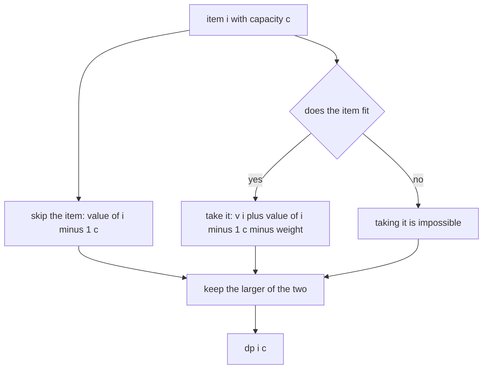
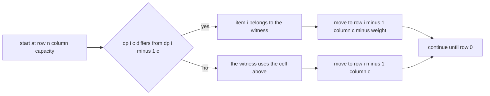
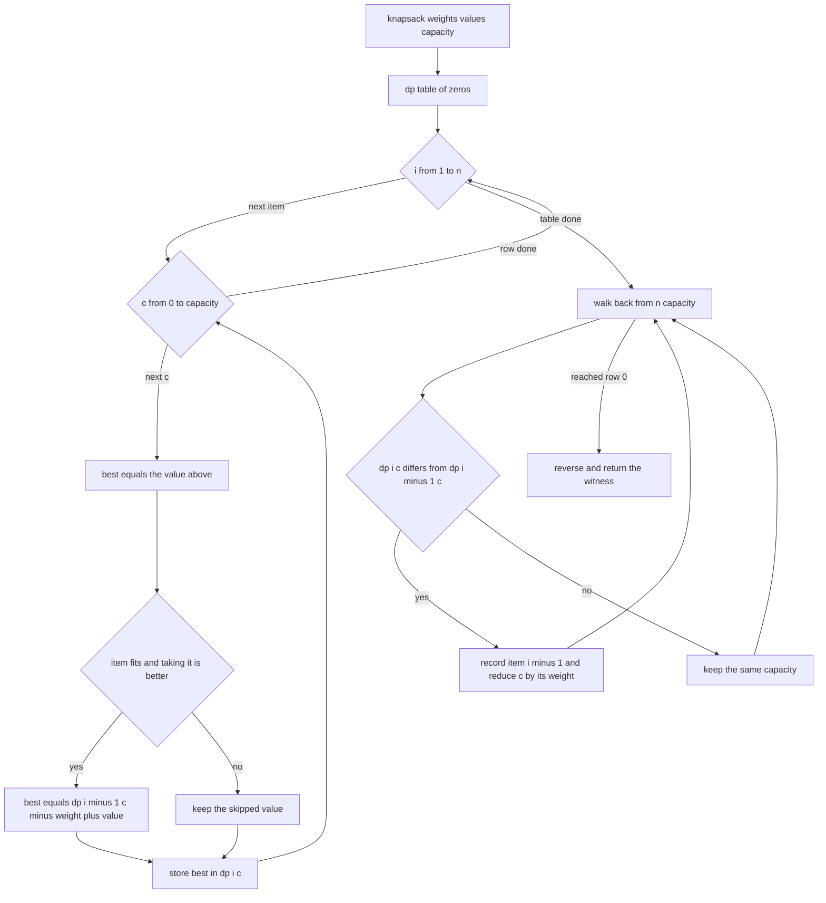
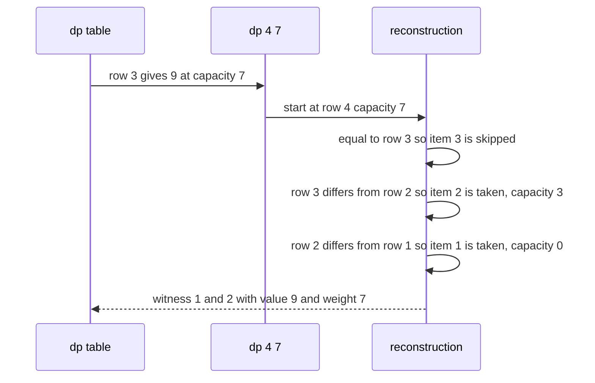

# 295 — 0/1 knapsack (DP) with reconstruction.

> **Tier:** Intermediate · **CTCI chapter:** Ch 8 — Recursion and Dynamic Programming
> **Task spec:** [295-0-1-knapsack-dp-with-reconstruction.md](../../../tasks/intermediate/295-0-1-knapsack-dp-with-reconstruction.md)
> **Solutions:** [Python](../../../solutions/python/intermediate/295-0-1-knapsack-dp-with-reconstruction/solution.py) ·
> [Java](../../../solutions/java/intermediate/295-0-1-knapsack-dp-with-reconstruction/Solution.java) ·
> [JavaScript](../../../solutions/javascript/intermediate/295-0-1-knapsack-dp-with-reconstruction/solution.js) ·
> [C#](../../../solutions/csharp/intermediate/295-0-1-knapsack-dp-with-reconstruction/Solution.cs)

## 1. Problem restatement

**Input:** two parallel arrays — a weight and a value for each item — and the capacity of the
knapsack.

**Output:** the largest total value that fits into the capacity, together with the **indices** of one
optimal set of items. Each item may be taken at most once (that is the 0/1 rule), so the answer is a
subset, not a multiset.

As with the other reconstruction tasks in this tier the pair is packaged differently per language:
Python returns `(value, chosen)`, JavaScript returns `[value, chosen]`, C# returns a
`(int Value, int[] Chosen)` tuple, and the Java file packs the answer into one `int[]` whose first
element is the optimal value and whose remaining elements are the chosen indices.

The task spec is a one-liner (“0/1 Knapsack (DP) with reconstruction.”), so the contract is fixed by
the assertions the four solution files ship with. With `weights = [1,3,4,5]` and
`values = [1,4,5,7]`:

| Call | Result | Why |
| --- | --- | --- |
| `knapsack(w, v, 7)` | value `9`, `sorted(weights[i]) == [3,4]` | items 1 and 2 (`4 + 5`) weigh `7` |
| the reported indices | distinct, `sum(weights) <= 7`, `sum(values) == 9` | the witness is consistent |
| `knapsack(w, v, 0)` | `(0, [])` | nothing fits |
| `knapsack([2,9], [3,100], 5)` | `(3, [0])` | item 0 fits, item 1 does not |
| `knapsack([4], [9], 4)` | `(9, [0])` | the single item fits exactly |
| `knapsack(w, v, 100)` | value `17`, all four indices | everything fits |

Random coverage: 120 instances (`seed ← (seed · 75 + 74) mod 65537`, starting at `555`) with
`1 … 14` items whose weights and values are both `1 + seed mod 12`, and a capacity in `0 … 39`. The
value must equal an exhaustive `2^n` enumeration, and the witness must have distinct indices,
`sum(weights[i]) <= capacity` and `sum(values[i]) == value`.

## 2. Intuition

Trying all `2^n` subsets is `O(2^n · n)` and is exactly what the oracle does. The classic
observation that makes it polynomial: the subproblem is “items `1 … i` and capacity `c`”, and it has
very few distinct shapes — `n · (capacity + 1)` of them.

Two consequences follow:

- **Optimal substructure.** An optimal solution for `(i, c)` either leaves item `i` out (then it is
  an optimal solution of `(i - 1, c)`) or takes it (then the rest is an optimal solution of
  `(i - 1, c - w_i)` plus `v_i`). Taking the better of the two is exhaustive.
- **The capacity is the dimension.** Unlike subset-sum problems where the target is a sum, here the
  state variable is how much space is left, which is why the table is `n × (capacity + 1)`.



The reconstruction is the mirror image of the recurrence. Walking from `(n, capacity)` upwards
through the rows, the value at `(i, c)` differs from `(i - 1, c)` exactly when item `i - 1` is part
of the recurrence’s best choice for that cell — so recording it and moving to `(i - 1, c - w)` yields
a set of items whose total value is `dp[n][capacity]` and whose total weight fits.



## 3. Algorithm

1. Allocate a table `dp` with `n + 1` rows and `capacity + 1` columns, all zeros; row `0` means “no
   items considered”.
2. For `i` from `1` to `n`, let `weight = weights[i - 1]` and `value = values[i - 1]`. For every
   capacity `c` from `0` to `capacity`, start from `dp[i][c] = dp[i - 1][c]` (skip the item) and
   replace it with `dp[i - 1][c - weight] + value` when `c >= weight` and that is strictly better.
3. The optimum is `dp[n][capacity]`.
4. Reconstruct: set `c = capacity` and walk `i` from `n` down to `1`. Whenever
   `dp[i][c] != dp[i - 1][c]`, item `i - 1` was taken — record its index and subtract its weight from
   `c`.
5. Reverse the collected indices so the witness is in ascending index order and return it with the
   optimum value.

```text
procedure knapsack(weights, values, capacity)
    n ← length(weights)
    dp ← table of (n + 1) rows and (capacity + 1) columns filled with 0
    for i ← 1 to n do
        weight ← weights[i - 1]
        value ← values[i - 1]
        for c ← 0 to capacity do
            best ← dp[i - 1][c]
            if c ≥ weight and dp[i - 1][c - weight] + value > best then
                best ← dp[i - 1][c - weight] + value
            end
            dp[i][c] ← best
        end
    end
    chosen ← empty list
    c ← capacity
    for i ← n down to 1 do
        if dp[i][c] ≠ dp[i - 1][c] then
            append (i - 1) to chosen
            c ← c - weights[i - 1]
        end
    end
    reverse chosen
    return (dp[n][capacity], chosen)
end
```



## 4. Worked example

Trace `knapsack([1,3,4,5], [1,4,5,7], 7)`. The table below shows `dp[i][c]` for the interesting
capacities; row `0` is all zeros.

| `i` | Item `(weight, value)` | `c = 3` | `c = 4` | `c = 5` | `c = 6` | `c = 7` |
| --- | --- | --- | --- | --- | --- | --- |
| 0 | — | 0 | 0 | 0 | 0 | 0 |
| 1 | (1, 1) | 1 | 1 | 1 | 1 | 1 |
| 2 | (3, 4) | 4 | 5 | 5 | 5 | 5 |
| 3 | (4, 5) | 4 | 5 | 6 | 6 | 9 |
| 4 | (5, 7) | 4 | 5 | 7 | 8 | 9 |

Row 3 is where the optimum `9` appears: at `c = 7`, skipping the fourth item and taking `(4, 5)`
together with item 2 `(3, 4)` gives `5 + 4 = 9`, beating every alternative. The reconstruction then
walks the rows from `(4, 7)`:

| Walk step | `i` | `c` | `dp[i][c]` vs `dp[i-1][c]` | Decision | Chosen |
| --- | --- | --- | --- | --- | --- |
| 1 | 4 | 7 | `9` vs `9` — equal | skip item 3 | `[]` |
| 2 | 3 | 7 | `9` vs `5` — different | take item 2 (weight 4, value 5), `c = 3` | `[2]` |
| 3 | 2 | 3 | `4` vs `1` — different | take item 1 (weight 3, value 4), `c = 0` | `[2, 1]` |
| 4 | 1 | 0 | `0` vs `0` — equal | skip item 0 | `[2, 1]` |

After reversing, the witness is `[1, 2]`, whose weights are `3 + 4 = 7` and whose values are
`4 + 5 = 9` — exactly the asserted `sorted(weights[i]) == [3, 4]` and value `9`. Step 1 is the
useful negative case: an item that does *not* change the cell’s value is not part of this optimal
set, even though taking it could be optimal for some other instance.



The capacity `100` assertion is the sanity check at the other extreme: with enough room the optimum
is simply the sum of all values (`1 + 4 + 5 + 7 = 17`) and every index appears in the witness.

## 5. Complexity

Let `n = len(weights)` and `C = capacity`.

| Measure | Bound | Why it holds |
| --- | --- | --- |
| Time, best | Θ(n · C) | the table is filled cell by cell even when every item is too heavy |
| Time, average | Θ(n · C) | two candidate values per cell |
| Time, worst | Θ(n · C) | plus `O(n)` for the reconstruction |
| Space, table | Θ(n · C) | the witness needs history, so no rolling row |
| Space, auxiliary | O(n) | the index list |
| Space of the exhaustive oracle | O(1) besides the running totals | it enumerates `2^n` masks |
| Time of the exhaustive oracle | Θ(2^n · n) | one pass over the items per subset |
| Fractional relaxation | Θ(n log n) | greedy by ratio is optimal when items may be split — see task 296 |

The DP is pseudo-polynomial: capacity, not just the number of items, drives the cost. The tests keep
`C ≤ 39` and `n ≤ 14`, so the table stays small while the oracle’s `2^14` masks are still cheap to
enumerate.

## 6. Pitfalls and edge cases

- **The 0/1 rule.** Reading `dp[i][c - weight]` instead of `dp[i - 1][c - weight]` lets item `i` be
  used repeatedly, which turns the problem into unbounded knapsack and inflates the value. The
  assertion `knapsack([2,9],[3,100],5) == (3, [0])` would fail, because the unbounded version would
  take `2 + 2` and report `6`.
- **Zero capacity.** The table still has one column (`c = 0`), every cell is `0`, and the walk finds
  no differing cell — `(0, [])`.
- **Item heavier than the capacity.** The `c >= weight` guard skips it; without the guard the index
  `c - weight` goes negative.
- **A single item that fits exactly.** `knapsack([4],[9],4) == (9, [0])` — the recurrence must use
  `>` against the skipped value so that taking the item with equal value does not lose the witness.
- **Distinct indices.** The reconstruction advances `i` after each decision, so an index can never
  appear twice; the random checks assert `len(set(chosen)) == len(chosen)`.
- **Witness consistency.** The checks assert `sum(weights[i]) <= capacity` and
  `sum(values[i]) == value`; a walk that compares the wrong rows produces a set whose value does not
  match the reported optimum.
- **Unequal array lengths.** The functions assume `len(weights) == len(values)`; the generator always
  builds both together, so a mismatch is undefined.
- **Zero-weight items.** Not generated: a weight of `0` would be harmless at `c >= weight` but would
  make several subsets equally valuable, and the reconstruction might return a different (still
  optimal) witness than a test expects.
- **Table versus rolling row.** The usual `O(C)` space optimisation is not available here because
  the witness needs `dp[i - 1]`; the shipped code always keeps the full table.
- **Return packing.** Java packs the value and the indices into one array; the tests read the head as
  the optimum and the tail as the witness, while Python, JavaScript and C# return the pair directly.
- **Integer overflow.** Values and weights are added repeatedly; the tests keep them at `1 … 12`, so
  32-bit arithmetic is safe, and Java/C# use `int` throughout.

## 7. Variants and follow-ups

- **Unbounded knapsack.** Allowing unlimited copies of each item flips the recurrence to
  `dp[i][c - weight]` and is the same shape as the coin-change DP:
  [294-coin-change-minimum-coins-dp.md](../../../tasks/intermediate/294-coin-change-minimum-coins-dp.md).
- **Fractional relaxation.** When items may be split, sorting by value per unit of weight and taking
  greedily is provably optimal:
  [296-fractional-knapsack-greedy.md](../../../tasks/intermediate/296-fractional-knapsack-greedy.md).
- **Decision only.** If the answer is just “can it be done?”, a boolean table (or a set of reachable
  sums) suffices:
  [217-subset-sum-decision-problem-dp-boolean.md](../../../tasks/intermediate/217-subset-sum-decision-problem-dp-boolean.md).
- **Equal-sum partition.** A knapsack with `value = weight` and `capacity = total / 2` answers the
  partition question: [291-partition-equal-subset-dp-with-reconstructing-sets.md](../../../tasks/intermediate/291-partition-equal-subset-dp-with-reconstructing-sets.md).
- The authoring chapter is [Recursion and Dynamic Programming](../../ctci/08-recursion-and-dp.md).

## 8. Check yourself

1. Why is `dp[i][c] = max(dp[i-1][c], dp[i-1][c - w] + v)` exhaustive?

<details><summary>Show answer</summary>

Every subset of the first `i` items either contains item `i` or not. If it does not, its best value
is `dp[i-1][c]`. If it does, the rest is a subset of the first `i - 1` items fitting into
`c - w`, and its best value is `dp[i-1][c - w] + v`. The maximum over these two disjoint cases is
therefore the optimum.

</details>

2. Why does the reconstruction compare `dp[i][c]` with `dp[i-1][c]` rather than with
   `dp[i-1][c - w] + v`?

<details><summary>Show answer</summary>

A difference between the two rows means the recurrence for `(i, c)` chose the “take it” branch over
the “skip it” branch, so item `i - 1` is part of *this* optimal solution. The alternative test would
also be true for items that merely tie with skipping, which can produce a witness that double-counts
weight or misses the capacity bound.

</details>

3. What would `knapsack([2,9],[3,100],5)` return if the recurrence used `dp[i][c - w]`?

<details><summary>Show answer</summary>

`(6, [0, 0])`: with unbounded reuse the algorithm would take the item of weight `2` twice. The
asserted answer is `(3, [0])`, which is why the 0/1 index (`i - 1`) matters.

</details>

4. Why must the witness be reversed at the end?

<details><summary>Show answer</summary>

The walk proceeds from the last item to the first, so it collects indices in descending order. The
files return indices in ascending order (matching the natural reading of the input arrays), so the
collected list is reversed before it is returned.

</details>

5. When does the fractional variant of this problem give a strictly better value?

<details><summary>Show answer</summary>

Whenever the optimal 0/1 solution leaves usable capacity that no whole remaining item can fill. For
example with one item of weight `3` and value `3`, a capacity of `2` yields value `0` in the 0/1
problem but `2` in the fractional relaxation, which is exactly the difference task 296 implements
with its `min(1, remaining / weight)` fraction.

</details>
