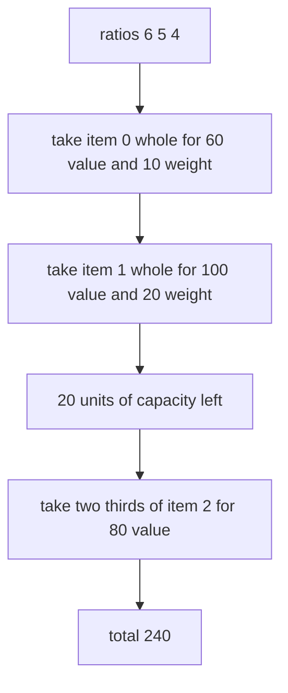
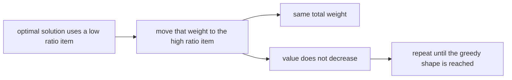
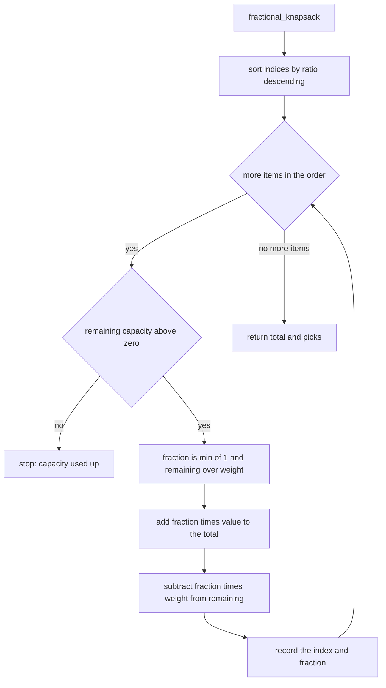
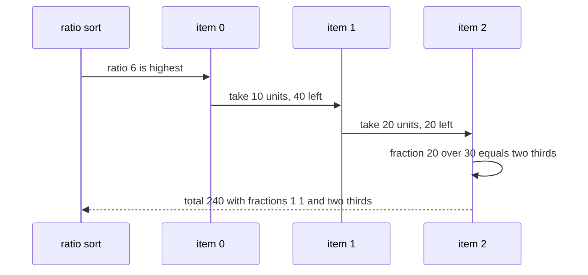

# 296 — Fractional knapsack (greedy).

> **Tier:** Intermediate · **CTCI chapter:** Ch 8 — Recursion and Dynamic Programming
> **Task spec:** [296-fractional-knapsack-greedy.md](../../../tasks/intermediate/296-fractional-knapsack-greedy.md)
> **Solutions:** [Python](../../../solutions/python/intermediate/296-fractional-knapsack-greedy/solution.py) ·
> [Java](../../../solutions/java/intermediate/296-fractional-knapsack-greedy/Solution.java) ·
> [JavaScript](../../../solutions/javascript/intermediate/296-fractional-knapsack-greedy/solution.js) ·
> [C#](../../../solutions/csharp/intermediate/296-fractional-knapsack-greedy/Solution.cs)

## 1. Problem restatement

**Input:** parallel arrays of weights and values plus a capacity, where **items may be split**: a
fraction `f` of item `i` contributes `f · value[i]` of value and `f · weight[i]` of weight, for any
`0 < f ≤ 1`.

**Output:** the maximum total value that fits, together with a witness — the list of
`(item index, fraction taken)` pairs. The fractions are written as floating point numbers, and the
tests compare them with a tolerance of `1e-9` rather than for equality.

The task spec is a one-liner (“Fractional knapsack (greedy).”), so the contract is fixed by the
assertions the four solution files ship with. With `weights = [10,20,30]` and
`values = [60,100,120]`:

| Call | Result | Why |
| --- | --- | --- |
| `fractional_knapsack(w, v, 50)` | `240.0`, indices `[0,1,2]`, fractions `1, 1, 2/3` | ratios `6, 5, 4`; the last item is cut |
| `fractional_knapsack(w, v, 60)` | `280.0`, all fractions `1` | the whole set fits |
| `fractional_knapsack(w, v, 0)` | `0.0`, no picks | nothing fits |
| `fractional_knapsack([5], [3], 2)` | `1.2`, fraction `0.4` | two fifths of the only item |

Random coverage: 120 instances (`seed ← (seed · 75 + 74) mod 65537`, starting at `424242`) with
`1 … 8` items whose weights and values are `1 + seed mod 9` and a capacity in `0 … 49`. Each run must
match an exhaustive oracle within `1e-9`, the picked weight `Σ f · w` must not exceed the capacity by
more than `1e-9`, the picked value `Σ f · v` must equal the reported total, and every fraction must
lie in `(0, 1]`.

## 2. Intuition

The 0/1 version of this problem — take an item whole or not at all — is where dynamic programming is
needed, because a locally best item can block a better combination (see
[295-0-1-knapsack-dp-with-reconstruction.md](../../../tasks/intermediate/295-0-1-knapsack-dp-with-reconstruction.md)).
Allowing fractions removes that obstacle entirely.

The greedy idea is to rank items by **value per unit of weight**, `value[i] / weight[i]`, and take
them from the best ratio downwards, filling the last item only partially. That is `6, 5, 4` for the
example above, so the solver fills the 10-unit and 20-unit items completely and then takes
`20 / 30 = 2/3` of the third.



Why is this optimal? An **exchange argument**: take any optimal solution and the highest-ratio item
`h`. If some lower-ratio item is used while `h` is not completely used, moving weight from the
lower-ratio item to `h` keeps the total weight the same and increases the value (or leaves it equal,
when the ratios tie). Repeating that exchange transforms any optimal solution into the greedy one
without ever losing value, so the greedy solution is optimal.



That is exactly the guarantee the *next* task in this tier lacks: nothing resembles this argument for
whole items, which is why 0/1 knapsack needs exponential search or a pseudo-polynomial table.

## 3. Algorithm

1. Sort the item indices by decreasing ratio `value[i] / weight[i]`, breaking ties by the smaller
   index so the order is deterministic.
2. Keep `remaining = capacity` (as a floating-point number), a running total and a pick list.
3. For each index in that order: stop when `remaining <= 0`. Otherwise compute
   `fraction = min(1, remaining / weight[index])`.
4. Add `fraction · value[index]` to the total, subtract `fraction · weight[index]` from `remaining`,
   and append `(index, fraction)` to the picks.
5. Return the total and the picks. The fractions in the picks list are always positive and never
   exceed `1`, and the first fraction below `1` is the last one taken.

```text
procedure fractional_knapsack(weights, values, capacity)
    order ← item indices sorted by decreasing value[i] / weight[i], ties by index
    remaining ← capacity as a real number
    total ← 0.0
    picks ← empty list
    for each index in order do
        if remaining ≤ 0 then
            break
        end
        fraction ← min(1.0, remaining / weights[index])
        total ← total + fraction * values[index]
        remaining ← remaining - fraction * weights[index]
        append (index, fraction) to picks
    end
    return (total, picks)
end
```



## 4. Worked example

Trace `fractional_knapsack([10,20,30], [60,100,120], 50)`. The ratios are `60/10 = 6`,
`100/20 = 5` and `120/30 = 4`, so the sorted order is `0, 1, 2`.

| Step | Item | Ratio | `remaining` before | `fraction` | Value added | `remaining` after | Total |
| --- | --- | --- | --- | --- | --- | --- | --- |
| 1 | 0 | 6.0 | 50.0 | `min(1, 50/10) = 1.0` | `60.0` | 40.0 | 60.0 |
| 2 | 1 | 5.0 | 40.0 | `min(1, 40/20) = 1.0` | `100.0` | 20.0 | 160.0 |
| 3 | 2 | 4.0 | 20.0 | `min(1, 20/30) = 2/3` | `80.0` | `0.0` | 240.0 |

The loop then ends: `remaining` is `0`, so step 3 of the algorithm breaks on the next iteration even
though there is no fourth item. The total `240.0` and the fractions `1.0, 1.0, 2/3` are exactly the
asserted values, and the witness consumes `10 + 20 + 20 = 50` units of capacity.

With a capacity of `60` the same order is followed but the third fraction becomes
`min(1, 30/30) = 1.0`, giving `60 + 100 + 120 = 280` — the whole set fits, and the assertion checks
that every fraction is `1.0`.



The oracle used in the tests enumerates every subset of whole items whose weight fits, and for each
of them adds a capped fraction of one further item. The cap matters: without `min(1, …)` the oracle
would be solving the *unbounded* variant in which an unlimited supply of the chosen item is
available, and it would report values the greedy algorithm is right not to achieve.

## 5. Complexity

Let `n = len(weights)`.

| Measure | Bound | Why it holds |
| --- | --- | --- |
| Time, best | Θ(n log n) | sorting dominates even when nothing fits (`capacity = 0`) |
| Time, average | Θ(n log n) | one sort plus a single linear sweep |
| Time, worst | Θ(n log n) | every item is examined at most once after the sort |
| Space, order | Θ(n) | the index permutation |
| Space, picks | O(n) | at most one entry per item |
| Space of the exhaustive oracle | O(n) | the mask and the running sums |
| Time of the exhaustive oracle | Θ(2^n · n) | every subset of whole items is evaluated |
| 0/1 alternative | Θ(n · capacity) | the DP from task 295 handles the unsplittable version |

The greedy sweep is `O(n)` on top of the sort, so the whole algorithm is dominated by sorting — a
large improvement over the DP as soon as the capacity is large, at the price of allowing fractions.

## 6. Pitfalls and edge cases

- **Comparing ratios is floating point.** The implementations divide two integers to get the ratio,
  which is safe for the tested magnitudes (`1 … 9` weights and values); with huge integers the
  comparison should be done by cross-multiplication (`v[a] · w[b]` versus `v[b] · w[a]`).
- **Tie-breaking.** Equal ratios are ordered by the smaller index, so the witness is deterministic;
  without a tie-break the picks for equal-ratio items could differ between runs.
- **Capacity `0`.** `remaining = 0` makes the loop break on the first item, so the total is `0.0` and
  the picks list is empty — the Java packing must then produce an array of length `1`.
- **Last-item fraction.** The `min(1, remaining / weight)` cap is what keeps a partly used item from
  being counted several times; without it the sweep would keep adding the same item and report values
  larger than any real solution.
- **A single item that is bigger than the capacity.** `fractional_knapsack([5],[3],2)` takes
  `0.4` of it for `1.2` of value; the fraction is strictly between `0` and `1`, which the random
  checks assert.
- **Floating-point comparison.** Totals and fractions are compared with a `1e-9` tolerance, and the
  capacity bound is checked as `Σ f · w <= capacity + 1e-9`, because `2/3 · 30` is not exactly `20`
  in binary floating point.
- **Fraction ordering in the witness.** Picks are appended in ratio order, so the witness is not
  sorted by item index; the assertions look at the indices `0, 1, 2` for the example only because the
  ratios happen to follow the input order.
- **Zero weight or zero value.** Not generated: a zero weight would make the ratio infinite, and a
  zero value would add a pick that contributes nothing. Production code should filter both.
- **Item count versus capacity.** Unlike the 0/1 DP, the running time does not depend on the capacity
  at all — the greedy sweep stops as soon as the capacity is filled.
- **Witness consistency.** The random checks recompute `Σ f · w` and `Σ f · v` from the picks and
  compare them with the capacity and the reported total, which catches a fraction applied to the
  wrong index.

## 7. Variants and follow-ups

- **No splitting allowed.** The 0/1 knapsack, where the same instance needs a DP table and a
  reconstruction walk:
  [295-0-1-knapsack-dp-with-reconstruction.md](../../../tasks/intermediate/295-0-1-knapsack-dp-with-reconstruction.md).
- **Fractional with a cost per item.** Adding a fixed cost per item used reintroduces the
  discrete-choice difficulty and the greedy argument collapses.
- **Minimising weight for a target value.** The dual formulation sorts by the same ratio in the
  opposite direction and is again greedy.
- **Unbounded supply.** If an item may be taken repeatedly in whole units, the problem becomes the
  coin-change DP family:
  [294-coin-change-minimum-coins-dp.md](../../../tasks/intermediate/294-coin-change-minimum-coins-dp.md).
- **Other greedy proofs.** The same exchange-argument style underpins interval scheduling and Huffman
  coding; the DP chapters in [Recursion and Dynamic Programming](../../ctci/08-recursion-and-dp.md)
  contrast those with the problems that need tables.

## 8. Check yourself

1. Why does splitting items make the greedy choice safe?

<details><summary>Show answer</summary>

Because there is no longer a “whole item or nothing” discontinuity. An exchange argument works: if an
optimal solution uses a lower-ratio item while a higher-ratio item is not fully used, moving weight
from the former to the latter keeps the total weight fixed and never decreases the value. Repeating
this reaches the greedy solution.

</details>

2. What would go wrong if the fraction were not capped at `1`?

<details><summary>Show answer</summary>

The sweep would keep taking the same item for the rest of the capacity — the unbounded
“fluid supply” variant — and report a value that no legal solution of this problem can achieve. The
oracle’s comment records the same trap: its fraction is capped at `1.0` on purpose.

</details>

3. Why is the witness not sorted by item index?

<details><summary>Show answer</summary>

Because the picks are appended while walking the items in *descending ratio* order, and a ratio order
need not coincide with the input order. The test assertions read the pairs in the emitted order and
recompute weight and value from them, so the order is irrelevant to correctness.

</details>

4. When is the fractional optimum strictly larger than the 0/1 optimum?

<details><summary>Show answer</summary>

Whenever the best 0/1 packing cannot fill the capacity exactly and a piece of a remaining item would
otherwise fit. With `weights = [3]`, `values = [3]` and capacity `2`, the 0/1 answer is `0` while the
fractional answer is `2`.

</details>

5. Where does the capacity appear in the running time?

<details><summary>Show answer</summary>

Nowhere — the sort is `Θ(n log n)` regardless of the capacity, and the sweep stops as soon as
`remaining` reaches `0`. That is the structural difference from the 0/1 DP, whose table has
`capacity + 1` columns and is therefore pseudo-polynomial.

</details>
