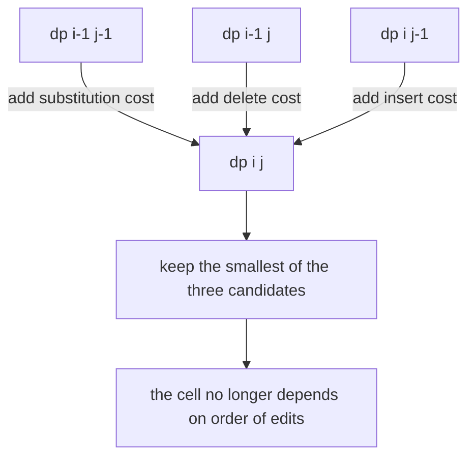
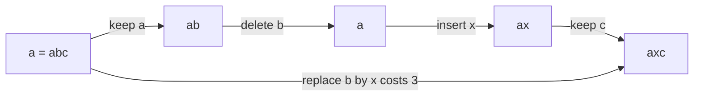
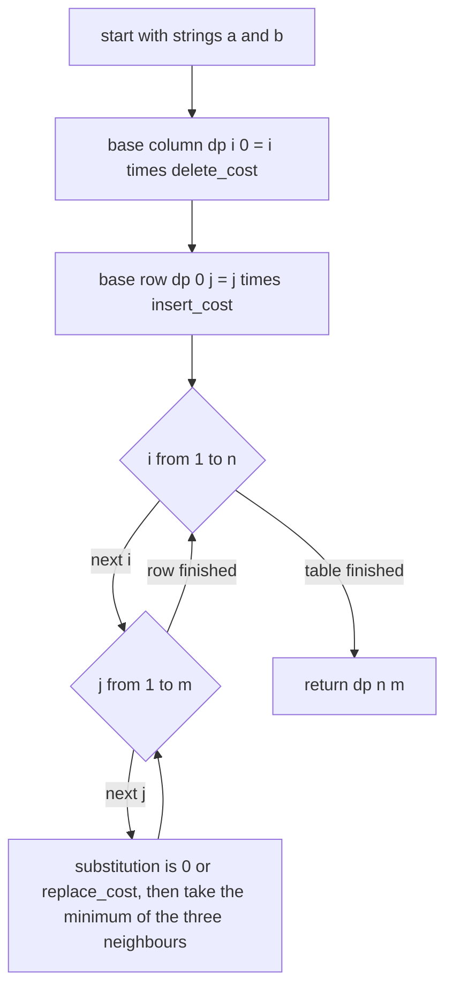
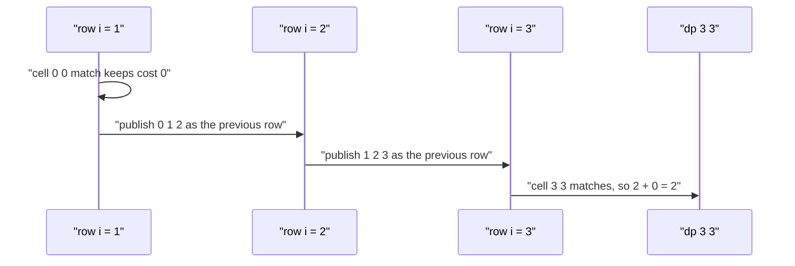

# 297 — Multi-dimensional DP example (edit distance variants).

> **Tier:** Intermediate · **CTCI chapter:** Ch 8 — Recursion and Dynamic Programming
> **Task spec:** [297-multi-dimensional-dp-example-edit-distance-variants.md](../../../tasks/intermediate/297-multi-dimensional-dp-example-edit-distance-variants.md)
> **Solutions:** [Python](../../../solutions/python/intermediate/297-multi-dimensional-dp-example-edit-distance-variants/solution.py) ·
> [Java](../../../solutions/java/intermediate/297-multi-dimensional-dp-example-edit-distance-variants/Solution.java) ·
> [JavaScript](../../../solutions/javascript/intermediate/297-multi-dimensional-dp-example-edit-distance-variants/solution.js) ·
> [C#](../../../solutions/csharp/intermediate/297-multi-dimensional-dp-example-edit-distance-variants/Solution.cs)

## 1. Problem restatement

**Input:** two strings `a` (length `n`) and `b` (length `m`), plus three non-negative integer
costs: `insert_cost`, `delete_cost` and `replace_cost`. All four solutions default every cost to
`1`, which is plain Levenshtein distance.

**Output:** the minimum total cost of an edit script that turns `a` into `b`, where one editing
operation is either

- **delete** a character of `a` (cost `delete_cost`),
- **insert** a character into `a` (cost `insert_cost`), or
- **replace** a character of `a` by one of `b` (cost `replace_cost`, free when the two characters
  already agree).

The assertions baked into the four solution files fix the contract:

| Call | Result | Why |
| --- | --- | --- |
| `edit_distance("kitten", "sitting")` | `3` | the textbook unit-cost answer |
| `edit_distance("flaw", "lawn")` | `2` | `flaw → law → lawn` |
| `edit_distance("abc", "abc")` | `0` | equal strings cost nothing, replacements are free on a match |
| `edit_distance("", "abcd")` | `4` | four insertions |
| `edit_distance("abcd", "")` | `4` | four deletions |
| `edit_distance("", "")` | `0` | both empty |
| `edit_distance("ab", "ba", 1, 1, 2)` | `2` | delete + insert beats two replacements |
| `edit_distance("abc", "axc", 1, 1, 3)` | `2` | two edits beat one expensive replacement |
| `edit_distance("abc", "axc", 1, 1, 1)` | `1` | with unit costs the replacement wins |
| `edit_distance("abc", "abcd", 1, 5, 1)` | `1` | cheap insertion |
| `edit_distance("abcd", "abc", 1, 5, 1)` | `5` | the matching deletion is expensive |
| `edit_distance("abc", "abcd", 7, 1, 1)` | `7` | expensive insertion, cheap deletion |

Each file also carries a second, independent implementation — a memoised recursion written
straight from the operation definition — and compares it against the table on 200 randomly
generated pairs of strings over the alphabet `abc` with randomly chosen costs in `1..3`. That
cross-check is the real specification of the variant behaviour: the table version must never
disagree with the naive recursion for asymmetric or inflated costs.

## 2. Intuition

The naive idea is to recurse on the definition: to turn `a[:i]` into `b[:j]`, either the last
characters match and you pay nothing, or you spend one operation on the last character and
recurse on what remains. Written directly that is exponential — the same `(i, j)` pair is reached
along many different operation orders.

The key insight is that the answer depends only on the pair of *prefix lengths*, never on the
order in which the edits were applied. So `dp[i][j]` — the cheapest way to turn the first `i`
characters of `a` into the first `j` characters of `b` — is a well-defined function of `(i, j)`,
and every cell is built from three neighbours that were already finished.



The second insight is the one that makes this task an *intermediate* variant rather than a
repetition of beginner task 123: because the three operations have separate costs, the recurrence
can never assume that a replacement dominates. When `replace_cost > insert_cost + delete_cost`,
the cheapest way past a mismatch is to delete the character of `a` and insert the wanted character
of `b` — two operations instead of one. The code does not special-case this; the `min` over the
three candidates discovers it, which is exactly why `"abc" → "axc"` costs `2` when a replacement
costs `3`.



Two unit-cost edits climb to `2`; the single replacement asked for `3`. The dynamic program keeps
both routes alive in the table and returns the cheaper one.

## 3. Algorithm

1. Let `n = length(a)` and `m = length(b)`; allocate the table `dp` with `n + 1` rows and `m + 1`
   columns.
2. Fill the base cases: deleting all of `a[:i]` costs `i * delete_cost`, so `dp[i][0] = i *
   delete_cost`; inserting all of `b[:j]` costs `j * insert_cost`, so `dp[0][j] = j * insert_cost`.
   `dp[0][0] = 0`.
3. For every `i` from `1` to `n`, and every `j` from `1` to `m`, set
   `substitution = 0` when `a[i - 1] == b[j - 1]`, otherwise `substitution = replace_cost`, then
   take the minimum of
   - `dp[i - 1][j - 1] + substitution` (align the two last characters),
   - `dp[i - 1][j] + delete_cost` (drop `a[i - 1]`),
   - `dp[i][j - 1] + insert_cost` (add `b[j - 1]`).
4. Return `dp[n][m]`.

```text
procedure edit_distance(a, b, insert_cost, delete_cost, replace_cost)
    n ← length(a)
    m ← length(b)
    dp ← table of n + 1 rows and m + 1 columns, all zero
    for i ← 1 to n do
        dp[i][0] ← i * delete_cost
    end
    for j ← 1 to m do
        dp[0][j] ← j * insert_cost
    end
    for i ← 1 to n do
        for j ← 1 to m do
            if a[i - 1] = b[j - 1] then
                substitution ← 0
            else
                substitution ← replace_cost
            end
            dp[i][j] ← minimum of dp[i - 1][j - 1] + substitution,
                                   dp[i - 1][j] + delete_cost,
                                   dp[i][j - 1] + insert_cost
        end
    end
    return dp[n][m]
end
```



The two nested loops fill the table row by row, so all three neighbours of a cell are already
computed when the cell is visited. Nothing needs recursion, and the visit order is fixed.

## 4. Worked example

Trace `edit_distance("abc", "axc", insert_cost=1, delete_cost=1, replace_cost=3)`, the case where a
replacement is deliberately overpriced. `a = abc`, `b = axc`, so `n = m = 3`.

Base cases: `dp[0][*] = [0, 1, 2, 3]` (insertions) and `dp[*][0] = [0, 1, 2, 3]` (deletions).

| Cell | `a[i-1]` vs `b[j-1]` | substitution | three candidates | chosen |
| --- | --- | --- | --- | --- |
| `dp[1][1]` | `a` vs `a` match | 0 | `0+0`, `1+1`, `1+1` | `0` |
| `dp[1][2]` | `a` vs `x` | 3 | `1+3`, `2+1`, `0+1` | `1` |
| `dp[1][3]` | `a` vs `c` | 3 | `2+3`, `3+1`, `1+1` | `2` |
| `dp[2][1]` | `b` vs `a` | 3 | `1+3`, `1+1`, `3+1` | `1` |
| `dp[2][2]` | `b` vs `x` | 3 | `0+3`, `2+1`, `1+1` | `2` |
| `dp[2][3]` | `b` vs `c` | 3 | `1+3`, `3+1`, `2+1` | `3` |
| `dp[3][1]` | `c` vs `a` | 3 | `2+3`, `1+1`, `4+1` | `2` |
| `dp[3][2]` | `c` vs `x` | 3 | `1+3`, `2+1`, `2+1` | `3` |
| `dp[3][3]` | `c` vs `c` match | 0 | `2+0`, `3+1`, `3+1` | `2` |

The finished table:

| `dp` | `j=0` | `j=1` (`a`) | `j=2` (`x`) | `j=3` (`c`) |
| --- | --- | --- | --- | --- |
| `i=0` | 0 | 1 | 2 | 3 |
| `i=1` (`a`) | 1 | 0 | 1 | 2 |
| `i=2` (`b`) | 2 | 1 | 2 | 3 |
| `i=3` (`c`) | 3 | 2 | 3 | **2** |

The answer is the bottom-right cell, `2`. The winning route is the one highlighted by
`dp[2][2] = 2`: delete `b`, insert `x`, keep `a` and `c` — two unit-cost operations. The
replacement route would have been `dp[2][2] + 3 = 5`, and the single-replacement script
`abc → axc` would have cost `3`.



Every row reads only the row above it and the cell to its left, which is why the algorithm can be
compressed to two rows; the shipped solutions keep the whole table for readability and because
`n * m` is small in every test case.

## 5. Complexity

Let `n = length(a)` and `m = length(b)`.

| Measure | Bound | Why it holds |
| --- | --- | --- |
| Time, best | O(n · m) | every cell of the table is computed exactly once, even when the strings are equal |
| Time, average | O(n · m) | three constant-time candidates per cell |
| Time, worst | O(n · m) | the loops are fixed; the data never changes how many cells exist |
| Space | O(n · m) | the full table `(n + 1) × (m + 1)`; no rolling array is used |
| Space of the oracle | O(n · m) | the memoised recursion caches one entry per distinct `(i, j)` pair |
| Time of the oracle | O(n · m) | each memoised state is solved once |
| Time of naive recursion | exponential | without the memo every operation order is re-explored |

Costs are plain machine integers and the recurrence only adds and compares, so there is no
precision question: the answers are exact in all four languages. The `kitten`/`sitting` pair shows
the practical size — a 7 × 8 table, 56 cells, independent of the costs used.

## 6. Pitfalls and edge cases

- **Empty strings.** `dp[0][j] = j * insert_cost` and `dp[i][0] = i * delete_cost` are the only
  cells computed; `"" → "abcd"` is `4`, `"abcd" → ""` is `4`, `"" → ""` is `0`. All four files
  assert these three rows.
- **Equal strings.** `substitution = 0` on a match, so the diagonal carries the value through and
  the result is `0`; the code never pays for a "replace a character by itself" operation.
- **Asymmetric costs.** `insert_cost ≠ delete_cost` is legal, and the direction matters:
  `("abc","abcd",1,5,1)` is `1` while `("abcd","abc",1,5,1)` is `5`. A recurrence that swapped the
  two roles would still pass the symmetric tests and fail these.
- **Inflated replacement cost.** With `replace_cost > insert_cost + delete_cost` the delete +
  insert route wins. `("ab","ba",1,1,2)` returns `2` rather than `4`, and `("abc","axc",1,1,3)`
  returns `2` rather than `3`.
- **Free replacement.** `replace_cost = 0` is not tested, but nothing in the recurrence forbids
  it; it would make mismatches free, and the table would collapse to `0` for equal-length strings.
  Costs must be non-negative for the greedy-free `min` to remain valid.
- **Integer growth.** Costs are added `n + m` times at most, so the result is bounded by
  `(n + m) · max_cost`. The Python and Java versions use machine-width indices but only `int`
  costs; the `long`-typed Java oracle guards the intermediate sums. Overflow is not reachable for
  realistic inputs, only for absurd costs near `Integer.MAX_VALUE`.
- **Indexing.** `a[i - 1]` and `b[j - 1]` translate 1-based table coordinates to 0-based string
  offsets; writing `a[i]` here is the classic off-by-one that shifts every answer.
- **Row 0 and column 0 are not interchangeable.** They scale with `insert_cost` and `delete_cost`
  respectively. Mirroring them silently breaks the asymmetric tests above.

## 7. Variants and follow-ups

- **Unit-cost Levenshtein.** With all three costs at `1` this is the beginner-level version
  [123-edit-distance-levenshtein-dp.md](../../../tasks/beginner/123-edit-distance-levenshtein-dp.md),
  which the same table solves; the interesting part here is that the recurrence keeps working when
  the costs stop being uniform.
- **Low-memory edit distance.** Keep only two rows instead of the table — the algorithm is
  unchanged, the space drops to `O(min(n, m))`; the full reconstruction needs Hirschberg's
  divide-and-conquer split, outlined in
  [414-implement-edit-distance-with-low-memory-hirschberg.md](../../../tasks/advanced/414-implement-edit-distance-with-low-memory-hirschberg.md).
- **Sibling two-string DPs.** [121-longest-common-subsequence-lcs-dp.md](../../../tasks/beginner/121-longest-common-subsequence-lcs-dp.md)
  and [305-shortest-common-supersequence-length-dp.md](./305-shortest-common-supersequence-length-dp.md)
  share the same grid shape, but their cells take a maximum and an addition respectively instead of
  a `min` over three weighted candidates.
- **Approximate search.** Wrapping this table in a threshold scan turns it into fuzzy matching, as
  in [701-implement-approximate-string-matching-with-edit-distance-thresho.md](../../../tasks/expert/701-implement-approximate-string-matching-with-edit-distance-thresho.md).
- The chapter walkthrough [Recursion and DP](../../ctci/08-recursion-and-dp.md) places this table
  next to the subset-sum and subsequence recurrences as the canonical two-dimensional DP.

## 8. Check yourself

1. Why does the recurrence need three candidates instead of always preferring a replacement?

<details><summary>Show answer</summary>

Because the costs are configurable and independent. When `replace_cost > insert_cost +
delete_cost`, deleting the wrong character and inserting the right one is cheaper than a
single replacement — `edit_distance("abc", "axc", 1, 1, 3)` returns `2` for exactly that reason.
A two-candidate recurrence would compute `3`.

</details>

2. What do the base cases represent, and why are they different?

<details><summary>Show answer</summary>

`dp[i][0]` means "turn the first `i` characters of `a` into the empty string" — that is `i`
deletions, hence `i * delete_cost`. `dp[0][j]` means "build the first `j` characters of `b` from
nothing" — `j` insertions, hence `j * insert_cost`. The two families differ because they use
different operations, which is why asymmetric costs show up in them.

</details>

3. How does the code verify that it handles asymmetric and inflated costs correctly?

<details><summary>Show answer</summary>

Each solution file contains `brute_edit`, an independent memoised recursion written directly from
the operation definition, and then runs 200 random trials over `abc`-strings with generated costs
in `1..3`, asserting `edit_distance(...) == brute_edit(...)` every time. Two implementations that
agree on randomized inputs are much stronger evidence than a handful of hand-picked cases.

</details>

4. What is the space cost of the shipped solutions, and what is the cheapest way to reduce it?

<details><summary>Show answer</summary>

`O(n · m)` for the full table (plus the same again for the oracle's memo, used only in tests).
Since a cell depends only on the previous row and the current row's left neighbour, keeping two
rows reduces it to `O(min(n, m))`; reconstructing the edit script then needs a recursive
divide-and-conquer pass over halves of the table.

</details>

5. The table is filled row by row. Would column-by-column filling give the same answers?

<details><summary>Show answer</summary>

Yes. The dependency graph is acyclic and each cell only needs `dp[i-1][j-1]`, `dp[i-1][j]` and
`dp[i][j-1]`, all of which are computed by either scan order. Only the *iteration order* changes;
the three transitions and the base cases are untouched.

</details>
