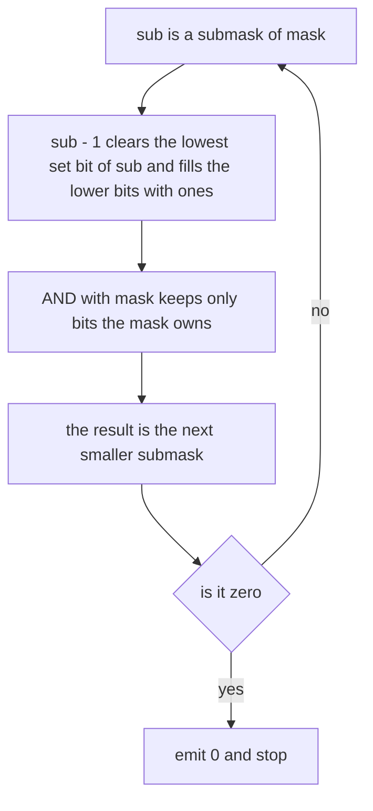
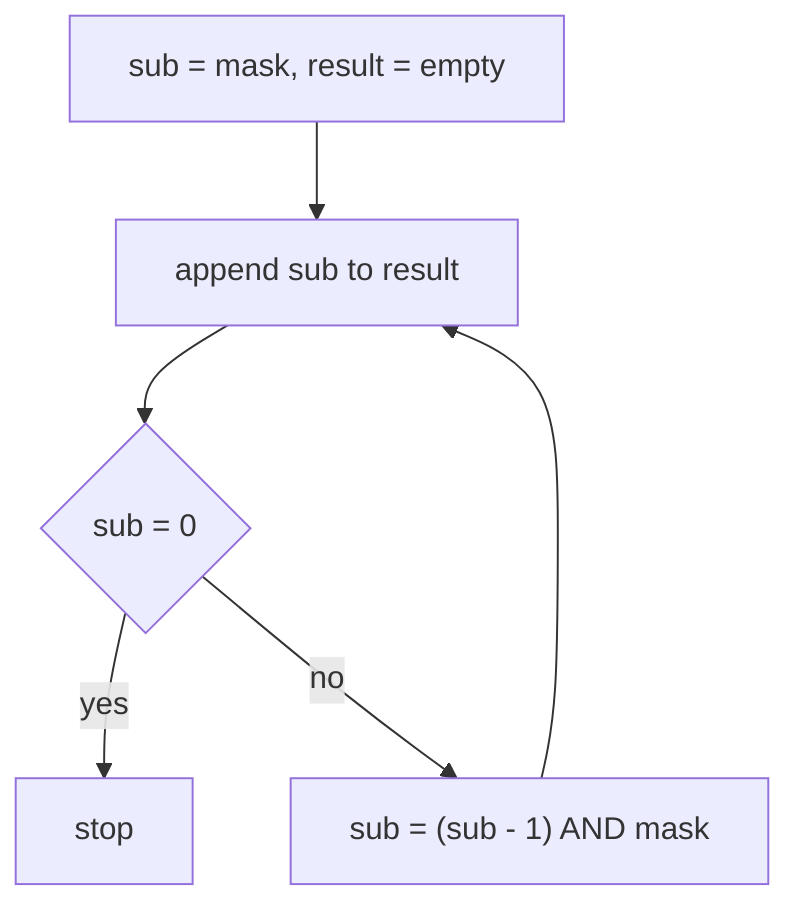
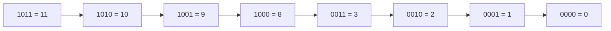

# 298 — Bitmask iterate subsets of mask.

> **Tier:** Intermediate · **CTCI chapter:** Ch 5 — Bit Manipulation
> **Task spec:** [298-bitmask-iterate-subsets-of-mask.md](../../../tasks/intermediate/298-bitmask-iterate-subsets-of-mask.md)
> **Solutions:** [Python](../../../solutions/python/intermediate/298-bitmask-iterate-subsets-of-mask/solution.py) ·
> [Java](../../../solutions/java/intermediate/298-bitmask-iterate-subsets-of-mask/Solution.java) ·
> [JavaScript](../../../solutions/javascript/intermediate/298-bitmask-iterate-subsets-of-mask/solution.js) ·
> [C#](../../../solutions/csharp/intermediate/298-bitmask-iterate-subsets-of-mask/Solution.cs)

## 1. Problem restatement

**Input:** a non-negative integer `mask`, treated as a set of bit positions. Bit `i` is set in
`mask` exactly when element `i` belongs to the set.

**Output:** every **submask** of `mask` — every integer `sub` with `sub & ~mask == 0`, i.e. every
set that can be formed by switching some of `mask`'s bits off — in **strictly descending numeric
order**, starting with `mask` itself and ending with `0`. The empty submask `0` is always included,
so the result length is `2^k`, where `k = popcount(mask)` is the number of set bits.

The behaviour is pinned by the assertions in the four solution files:

| Call | Result | Why |
| --- | --- | --- |
| `enumerate_submasks(0)` | `[0]` | the empty set has exactly one subset |
| `enumerate_submasks(1)` | `[1, 0]` | one set bit gives two submasks |
| `enumerate_submasks(0b1011)` | `[11, 10, 9, 8, 3, 2, 1, 0]` | the hand-checked example: `3 = 0b0011` skips the missing bit 2 |
| `enumerate_submasks(0b11111)` | `31, 30, ..., 0` | a fully-populated mask degenerates to a plain countdown |

Beyond those fixed cases, each file builds 46 masks — six hard-coded (`0`, `1`, `0b1011`,
`0b11111`, `0b1000`, `0b101010`) plus 40 from the shared LCG `seed = (seed * 75 + 74) % 65537`
reduced `mod 4096` — and checks five properties of every answer:

1. `length == 2^popcount(mask)`,
2. all entries are distinct,
3. every entry satisfies `sub & ~mask == 0` (it really is a submask),
4. `first == mask` and `last == 0`,
5. the sequence is strictly descending,

and then compares the whole list against an independent oracle: a descending sweep over
`mask, mask - 1, ..., 0` that keeps exactly the values satisfying `value & ~mask == 0`.

## 2. Intuition

The naive way to enumerate submasks is to count down from `mask` and filter:

```text
procedure submask_scan(mask)
    result ← empty list
    for value ← mask down to 0 do
        if value & ~mask = 0 then
            append value to result
        end
    end
    return result
end
```

This is correct but wasteful: the loop examines `mask + 1` candidates to find only `2^k` of them.
For `mask = 0b100000000000` (one set bit, `k = 1`) it inspects 4097 numbers to return two. The
wasted work factor is `(mask + 1) / 2^k`, which is unbounded.

The insight is that the submasks form a chain that can be walked directly. Subtracting one from a
number flips its lowest set bit to `0` and turns all lower bits to `1`; AND-ing that with `mask`
throws away every bit the mask does not own, keeping only the bits *below* the cleared one that
the mask has. The result is the next smaller submask — no candidate is ever inspected twice.



Two facts make the walk total: the sequence is strictly decreasing (each step clears at least one
bit of the current value), and it visits exactly the integers that are submasks — the skipped
values are precisely those needing a bit `mask` does not have. Because the loop stops at `0`, the
empty submask is the last element rather than an omitted one.

## 3. Algorithm

1. Start with `sub = mask` and an empty result list.
2. Append `sub` to the result.
3. If `sub == 0`, stop — the empty submask has just been emitted.
4. Otherwise set `sub = (sub - 1) & mask` and go to step 2.

```text
procedure enumerate_submasks(mask)
    result ← empty list
    sub ← mask
    while true do
        append sub to result
        if sub = 0 then
            break
        end
        sub ← (sub - 1) & mask
    end
    return result
end
```

The `while true` plus the explicit break is what makes zero part of the output; the classical
`for (sub = mask; sub; sub = (sub - 1) & mask)` idiom stops one value early because the zero
submask is falsy.



The loop body is three operations — a decrement, an AND and an append — so each submask costs
`O(1)`. Nothing depends on the *magnitude* of `mask`, only on how many bits it has.

## 4. Worked example

Trace `enumerate_submasks(0b1011)`, i.e. `mask = 11`. Bits 0, 1 and 3 are present, bit 2 is not,
so the answer should contain all eight combinations of bits `0`, `1`, `3` and nothing else.

| Step | `sub` (decimal) | `sub` (binary) | `sub - 1` | `(sub - 1) & mask` | emitted |
| --- | --- | --- | --- | --- | --- |
| 1 | 11 | `1011` | 10 | `1010 & 1011 = 1010` = 10 | `[11]` |
| 2 | 10 | `1010` | 9 | `1001 & 1011 = 1001` = 9 | `[11, 10]` |
| 3 | 9 | `1001` | 8 | `1000 & 1011 = 1000` = 8 | `[11, 10, 9]` |
| 4 | 8 | `1000` | 7 | `0111 & 1011 = 0011` = 3 | `[11, 10, 9, 8]` |
| 5 | 3 | `0011` | 2 | `0010 & 1011 = 0010` = 2 | `[..., 3]` |
| 6 | 2 | `0010` | 1 | `0001 & 1011 = 0001` = 1 | `[..., 2]` |
| 7 | 1 | `0001` | 0 | `0000 & 1011 = 0000` = 0 | `[..., 1]` |
| 8 | 0 | `0000` | — | stop | `[11, 10, 9, 8, 3, 2, 1, 0]` |

Row 4 is the interesting one: the step from `1000` cannot produce `0111` (bit 3 would vanish and
bit 2 is not in the mask), so the AND collapses the borrow chain down to `0011`. That single line
is why the walk skips `7, 6, 5, 4` — none of them is a submask of `0b1011`.



Eight values out of twelve candidates; the scan variant would have inspected `12` integers and
filtered out four. The ratio grows as the mask spreads out: for `0b101010` the walk emits the
eight submasks while the scan tests 43 values.

## 5. Complexity

Let `k = popcount(mask)` and let `b` be the index of the highest set bit, so `2^b ≤ mask < 2^(b+1)`.

| Measure | Bound | Why it holds |
| --- | --- | --- |
| Time, walk | O(2^k) | the loop body runs once per submask and there are exactly `2^k` of them |
| Time per step | O(1) | one subtraction, one AND, one append — no inner loop, no carry propagation visible to the caller |
| Space | O(2^k) | the result list itself; the algorithm uses two scalars besides it |
| Time, scan variant | O(mask) = O(2^b) | every integer from `mask` down to `0` is inspected |
| Space, scan variant | O(2^k) | the filtered output is the same list |

The two bounds diverge exactly where it matters. For a contiguous mask (`mask = 0b111...1`,
`k = b + 1`) they are within a constant factor of each other, which is why the naive filter looks
acceptable on small tests; for a sparse mask (`0b1000...0`, `k = 1`, `b` large) the walk is
`O(1)` while the scan is `O(2^b)`. Every solution file exercises both extremes, and the
`0b101010` case (three set bits, highest bit 5) shows the gap at a scale where both are still fast.

## 6. Pitfalls and edge cases

- **The zero submask.** `mask == 0` returns `[0]` — one element, not an empty list. All four files
  assert this, and the `if sub == 0 then break` placed *after* the append is what makes it work;
  testing the loop condition first would return `[]`.
- **Termination.** `(sub - 1) & mask` on `sub = 0` would give `0` again, so the explicit break is
  also the loop's only exit. Writing `while sub > 0` and appending at the top silently loses the
  empty set.
- **Strict descent.** Because each transition clears at least one set bit of `sub`, the sequence
  strictly decreases and cannot revisit a value. The files assert both `submasks[i] >
  submasks[i + 1]` and, in the Java and C# versions, that the seen-set contains no duplicates.
- **Sorted order is not the same as descending order.** The output is descending numerically, not
  ordered by popcount; `10` precedes `9` precedes `8` even though all three have popcount 2, 2 and
  1. The independent oracle in the tests reproduces the walk with a descending filter, so any
  ordering change is caught.
- **Length identity.** `2^popcount(mask)` is asserted for all 46 masks. A common bug is to emit
  `sub - 1` unfiltered for the last step, which adds one extra element.
- **Language-level integer widths.** Java's `~mask` flips all 32 bits of an `int`, so it is a
  negative number, and `sub & ~mask` still works because both operands are 32-bit. JavaScript's
  `&` converts to signed 32-bit integers, so masks above `2^31 - 1` would need `BigInt` or `>>>`
  care; every test mask fits in 12 bits, well inside the safe range. C# and Python use arbitrary
  or 64/32-bit two's complement integers with the same `~mask` semantics.
- **Not a subset generator.** This routine enumerates submasks of a *given* mask; it does not
  generate the power set of `n` elements, which would require a loop over all `2^n` masks — see
  [130-generate-all-subsets-power-set-iterative.md](../../../tasks/beginner/130-generate-all-subsets-power-set-iterative.md).
  The distinction is the same one that makes SOS DP fast.

## 7. Variants and follow-ups

- **Sum over subsets.** The walk is the inner loop of the naive `O(3^n)` version of
  [299-dp-over-subsets-sos-dp-simple-task.md](./299-dp-over-subsets-sos-dp-simple-task.md); that
  task replaces the per-mask enumeration with `n · 2^n` relaxations.
- **Superset enumeration.** Replacing `(sub - 1) & mask` with a complement walk enumerates the
  supersets of a mask — the bits you flip are the ones the mask lacks. The Möbius transform on the
  subset lattice in [540-implement-m-bius-transform-on-subset-lattice-sos.md](../../../tasks/advanced/540-implement-m-bius-transform-on-subset-lattice-sos.md)
  is built from that direction.
- **Bitmask DP.** Problems whose state is a set use this enumeration inside the transition, e.g.
  [220-implement-bitmask-dp-for-tsp-small-n.md](../../../tasks/intermediate/220-implement-bitmask-dp-for-tsp-small-n.md),
  where each mask iterates its submasks to split a path.
- **Bitset subset techniques.** [416-implement-bitset-dp-optimizations-for-subset-problems.md](../../../tasks/advanced/416-implement-bitset-dp-optimizations-for-subset-problems.md)
  pushes the same bit tricks into machine words.
- The chapter walkthrough [Bit Manipulation](../../ctci/05-bit-manipulation.md) develops this loop
  alongside the other bit-hacking idioms used throughout the tier.

## 8. Check yourself

1. Why does `(sub - 1) & mask` never produce a value that fails the submask property?

<details><summary>Show answer</summary>

Because the AND is applied last. Whatever `sub - 1` looks like, every bit of the result that is
set must also be set in `mask`, so `result & ~mask == 0` holds by construction. Subtracting one
only decides *which* bits below the cleared bit are candidates; the mask decides which survive.

</details>

2. How many elements does `enumerate_submasks(0b101010)` return, and how many candidates does the
   scan variant inspect?

<details><summary>Show answer</summary>

Three set bits, so `2^3 = 8` submasks. `0b101010` is 42, so the descending filter walks 43 values
to keep eight of them. The direct walk touches all 43 values never — it visits exactly the eight
outputs.

</details>

3. What does the test oracle do, and why is it independent?

<details><summary>Show answer</summary>

It sweeps `value` from `mask` down to `0` and keeps every value satisfying `value & ~mask == 0`.
It uses the *definition* of a submask — nothing from the `(sub - 1) & mask` trick — so agreement
between the walk and the filter on 46 masks checks both the completeness and the ordering of the
fast routine.

</details>

4. Does the routine handle a mask with bits set above bit 30?

<details><summary>Show answer</summary>

In Python, yes — unbounded integers. In Java and C#, `int` is 32-bit two's complement: bit 31 is
the sign bit, `~mask` is negative, and the AND still behaves bitwise, so the arithmetic survives
but printing and comparisons of the values as signed numbers can surprise. In JavaScript, `&` and
`~` coerce to signed 32-bit values, so anything above `2^31 - 1` needs `BigInt` or `>>>` handling.
The tests stay far below these limits.

</details>

5. Why is the output length `2^popcount(mask)` rather than `mask + 1`?

<details><summary>Show answer</summary>

A submask is obtained by choosing, independently for each set bit of `mask`, whether to keep it.
That is `k` binary choices with `k = popcount(mask)`, hence `2^k` submasks. Bits that are not in
`mask` are never available, so `mask`'s magnitude only matters for how expensive the *filtering*
approach is, not for how many answers exist.

</details>
