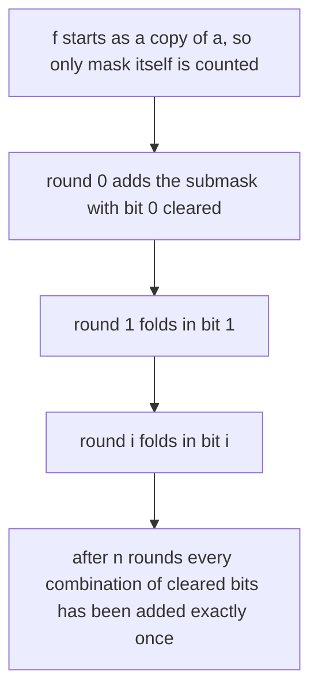
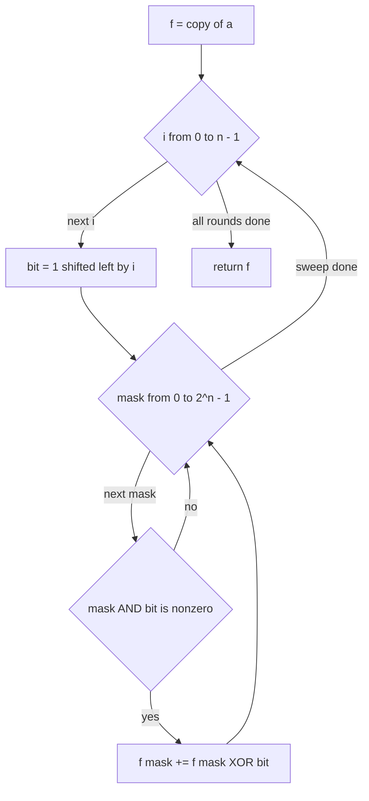
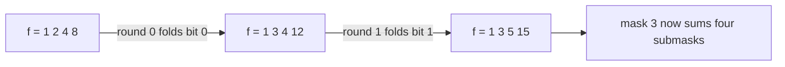

# 299 — DP over subsets (SOS DP simple task).

> **Tier:** Intermediate · **CTCI chapter:** Beyond — Networking, OS & Real-Time
> **Task spec:** [299-dp-over-subsets-sos-dp-simple-task.md](../../../tasks/intermediate/299-dp-over-subsets-sos-dp-simple-task.md)
> **Solutions:** [Python](../../../solutions/python/intermediate/299-dp-over-subsets-sos-dp-simple-task/solution.py) ·
> [Java](../../../solutions/java/intermediate/299-dp-over-subsets-sos-dp-simple-task/Solution.java) ·
> [JavaScript](../../../solutions/javascript/intermediate/299-dp-over-subsets-sos-dp-simple-task/solution.js) ·
> [C#](../../../solutions/csharp/intermediate/299-dp-over-subsets-sos-dp-simple-task/Solution.cs)

## 1. Problem restatement

**Input:** an array `a` of length `2^n` (`n` bits), indexed by bitmask. The length must be a power
of two; the Python version asserts it, Java throws `IllegalArgumentException`, JavaScript throws
`Error`, C# throws `ArgumentException`.

**Output:** the array `f` of the same length, where

    f[mask] = sum of a[sub] over every sub ⊆ mask  (that is, every sub with sub & ~mask == 0)

This transform is the *zeta transform* on the subset lattice — "sum over subsets", shortened to
SOS DP. Every mask sums itself and all of its submasks.

| Call | Result | Why |
| --- | --- | --- |
| `sum_over_subsets([1, 2, 4, 8])` | `[1, 3, 5, 15]` | `n = 2`: mask 3 sees all four entries |
| `sum_over_subsets([7])` | `[7]` | `n = 0`: a single mask with only itself as a subset |

Each file then runs `n ∈ {1, 2, 3, 4, 10}` with an LCG-filled array of length `2^n` and checks two
things: the result equals the `O(3^n)` brute-force enumeration of all submasks, and the global
identity

    sum of f[mask] over all mask = sum of a[mask] · 2^(n - popcount(mask))

which says each `a[sub]` is contributed once for every superset of `sub`, and there are exactly
`2^(n - popcount(sub))` of those. The two checks are genuinely different: the first validates each
entry, the second validates the aggregate.

## 2. Intuition

The definition suggests a double loop: for every mask, walk its submasks with the
`(sub - 1) & mask` trick (task 298) and add them up.

```text
procedure brute_sos(a)
    for mask ← 0 to length(a) - 1 do
        total ← 0
        sub ← mask
        while true do
            total ← total + a[sub]
            if sub = 0 then
                break
            end
            sub ← (sub - 1) & mask
        end
        result[mask] ← total
    end
    return result
end
```

Counting the work gives `sum over mask of 2^popcount(mask)`, which by the binomial theorem is
`sum over k of C(n, k) · 2^k = (1 + 2)^n = 3^n`. The four files use exactly this routine as their
oracle, and the docstrings state the cost plainly: for `n = 20` the naive loop needs about `3^20`,
roughly 3.5 billion operations, while the intended algorithm needs about 20 million — a factor of
about 170.

The insight is the standard one-dimensional-DP trick applied to a lattice rather than a line: **do
not sum all subsets at once, add one bit at a time.** After round `i`, `f[mask]` holds the sum of
`a[sub]` over all `sub ⊆ mask` that may differ from `mask` only in bits `0..i`. Round `i` handles
bit `i` by folding a mask's partner — the same mask with bit `i` cleared — into it.



Said differently: for any pair `(mask, sub)` with `sub ⊆ mask`, look at the *highest bit* where
they differ. That bit is set in `mask` and clear in `sub`, and it is added in exactly one round —
the round that handles that bit — at exactly one mask. No pair is counted twice, and no pair is
missed. That is the entire correctness argument, and it is why the complexity drops from `3^n` to
`n · 2^n`.

## 3. Algorithm

1. Let `n = log2(length(a))`; validate that `length(a) == 2^n`.
2. Initialise `f` as a copy of `a` — before any round, the only subset known for each mask is the
   mask itself.
3. For each bit index `i` from `0` to `n - 1`:
   1. Let `bit = 1 << i`.
   2. For every `mask` with `mask & bit != 0` (bit `i` present), add `f[mask ^ bit]` into `f[mask]`.
      The partner `mask ^ bit` is the same mask with bit `i` cleared; it already contains the sums
      over the lower bits, so the addition propagates whole groups of subsets at once.
4. Return `f`.

```text
procedure sum_over_subsets(a)
    n ← number of bits, so that length(a) = 2^n
    if length(a) is not a power of two then
        report an error
    end
    f ← copy of a
    for i ← 0 to n - 1 do
        bit ← 1 << i
        for mask ← 0 to length(a) - 1 do
            if mask & bit is not zero then
                f[mask] ← f[mask] + f[mask ^ bit]
            end
        end
    end
    return f
end
```

The inner loop is written as a scan over all masks with a guard rather than iterating only over
masks that hold the bit; the four solutions all use the guarded form. The result is the same, and
the guard keeps the code short.



An important detail: the update reads `f[mask ^ bit]`, a cell that is *not* modified in this
round, because `mask ^ bit` has bit `i` clear and the guard only writes to cells that have it set.
Each round is therefore a set of independent updates, and no in-place ordering hazard exists.

## 4. Worked example

Trace `sum_over_subsets([1, 2, 4, 8])`. Here `n = 2`, so `a[0] = 1`, `a[1] = 2`, `a[2] = 4` and
`a[3] = 8`; mask 3 (`11`) is a superset of every other mask.

Start: `f = [1, 2, 4, 8]`.

Round `i = 0`, `bit = 1`:

| mask | `mask & 1` | partner `mask ^ 1` | update | `f` afterwards |
| --- | --- | --- | --- | --- |
| 0 | 0 | — | skipped | `[1, 2, 4, 8]` |
| 1 | 1 | 0 | `f[1] += f[0]` → `2 + 1 = 3` | `[1, 3, 4, 8]` |
| 2 | 0 | — | skipped | `[1, 3, 4, 8]` |
| 3 | 1 | 2 | `f[3] += f[2]` → `8 + 4 = 12` | `[1, 3, 4, 12]` |

Round `i = 1`, `bit = 2`:

| mask | `mask & 2` | partner `mask ^ 2` | update | `f` afterwards |
| --- | --- | --- | --- | --- |
| 0 | 0 | — | skipped | `[1, 3, 4, 12]` |
| 1 | 0 | — | skipped | `[1, 3, 4, 12]` |
| 2 | 2 | 0 | `f[2] += f[0]` → `4 + 1 = 5` | `[1, 3, 5, 12]` |
| 3 | 2 | 1 | `f[3] += f[1]` → `12 + 3 = 15` | `[1, 3, 5, 15]` |

Final answer `[1, 3, 5, 15]`, matching the assertion. Check the last cell by hand: `mask = 3` has
submasks `3, 2, 1, 0` with values `8 + 4 + 2 + 1 = 15`. ✓ The path mattered: `f[3]` picked up bit
1's contribution only after `f[1]` already carried bit 0's, so it never needed to add `a[0]` twice.



The superset identity gives a second reading of the same run: `sum(f) = 1 + 3 + 5 + 15 = 24`, and
`sum of a[mask] · 2^(2 - popcount(mask))` is `1·4 + 2·2 + 4·2 + 8·1 = 4 + 4 + 8 + 8 = 24`. ✓

## 5. Complexity

Let `n` be the number of bits, so `2^n = length(a)`.

| Measure | Bound | Why it holds |
| --- | --- | --- |
| Time, SOS rounds | O(n · 2^n) | `n` rounds, each a single sweep of `2^n` cells with one addition per cell whose bit is set |
| Time, inner step | O(1) | one XOR, one array read and one array write |
| Space | O(2^n) | the array `f` itself; `a` is copied once and no auxiliary structure is used |
| Time, naive enumeration | O(3^n) | `sum of 2^popcount(mask)` over all masks equals `3^n` |
| Space, naive enumeration | O(2^n) | the output is the same size; the cost is entirely time |
| Ratio at `n = 20` | about 170× | the docstring compares 20M operations with `3^20 ≈ 3.5 billion` |

The two transforms are logically identical — they compute the same `f` — which is exactly what the
cross-check asserts on `n = 1, 2, 3, 4, 10`. At `n = 10` the naive version performs `3^10 = 59049`
inner additions; at `n = 20` it would perform roughly 3.5 billion while the DP performs about 20
million, which is the practical reason SOS DP exists.

## 6. Pitfalls and edge cases

- **Length must be a power of two.** The array is indexed by mask, so a length like 6 would leave
  masks with no defined interpretation. Python asserts, Java throws `IllegalArgumentException`,
  JavaScript throws `Error`, C# throws `ArgumentException` — all four fail loudly rather than
  silently computing something under-specified.
- **`n = 0`.** A one-element array has no bits and no rounds; `sum_over_subsets([7])` returns
  `[7]`. All four files assert this case, and it falls out of the loop bounds without special
  handling.
- **`n = 1`.** The tests include it precisely because a single round is where an off-by-one in the
  bit loop would show up.
- **Clear the bit, do not subtract.** The partner of `mask` is `mask ^ bit`, not `mask - bit`: for
  `mask = 3` and `bit = 1`, `mask - bit = 2` happens to work, but for `mask = 2` there is no
  partner at all and for larger masks the subtraction borrows through other bits. XOR flips the
  bit without touching the rest.
- **In-place updates are safe here.** Because the guard skips masks without bit `i`, the partner
  cell is never mutated in the same round. Iterating masks in the wrong direction (descending) is
  equally safe for the same reason — but only for *this* pivot; a different loop would need the
  usual care.
- **Overflow.** Each `f[mask]` is the sum of at most `2^n` inputs, so with values bounded by `V`
  the result is bounded by `V · 2^n`. The Java and C# files use `int` arrays for values in `0..49`
  and promote to `long` only for the aggregate identity check; the Python version is unbounded and
  JavaScript stays inside the exact-integer range for these sizes.
- **The zeros of the array are real contributions.** `a[0]` participates in every `f[mask]`; there
  is no "empty product is one" convention here, so a zero entry contributes nothing.
- **Order of the rounds does not matter for the result.** Folding high bits first gives the same
  `f`, because each round only ever reads cells with that bit clear. The fixed ascending order in
  the solutions is a readability choice, not a correctness requirement.

## 7. Variants and follow-ups

- **Submask enumeration.** [298-bitmask-iterate-subsets-of-mask.md](./298-bitmask-iterate-subsets-of-mask.md)
  is the inner loop of the naive version; that tutorial's walk is the `while` body the oracle here
  repeats for every mask.
- **Superset (zeta) and Möbius transforms.** The same bit-at-a-time sweep computes sums over
  *supersets* if the partner is `mask | bit` instead, and inverting the transform (subtraction
  instead of addition) gives the Möbius transform of
  [540-implement-m-bius-transform-on-subset-lattice-sos.md](../../../tasks/advanced/540-implement-m-bius-transform-on-subset-lattice-sos.md).
- **Bitmask DP.** Problems whose state is a set, such as
  [220-implement-bitmask-dp-for-tsp-small-n.md](../../../tasks/intermediate/220-implement-bitmask-dp-for-tsp-small-n.md),
  use the same `mask → submask` reasoning inside their transitions; SOS DP is the case where the
  transition is a plain sum.
- **GF(2) convolutions.** [539-implement-bitset-convolution-using-fwht-xor-convolution-small-n.md](../../../tasks/advanced/539-implement-bitset-convolution-using-fwht-xor-convolution-small-n.md)
  swaps OR/AND for XOR/FWHT and shows how far the same lattice idea stretches.
- The chapter walkthrough for the tier, [Advanced topics](../../ctci/x-advanced-topics.md),
  introduces the subset lattice next to the other transforms used at this level.

## 8. Check yourself

1. Why is the naive enumeration `3^n` and not `4^n` or `n · 2^n`?

<details><summary>Show answer</summary>

For a fixed `mask` with `k` set bits there are `2^k` submasks, so the total work is
`sum over masks of 2^popcount(mask) = sum over k of C(n, k) · 2^k`. That is the binomial expansion
of `(1 + 2)^n = 3^n`. Each mask either has a given bit clear (contributing factor 1) or set
(contributing factor 2, for keep-or-drop), over `n` independent bits.

</details>

2. After round `i`, what exactly does `f[mask]` hold?

<details><summary>Show answer</summary>

The sum of `a[sub]` over every `sub ⊆ mask` such that `sub` and `mask` differ only in bits
`0, 1, ..., i`. Bits above `i` must already agree, because they have not been processed yet. After
round `n - 1` all bits may differ, which is the full definition.

</details>

3. Why can the updates inside one round be done in place in any order?

<details><summary>Show answer</summary>

Because the guard only writes to cells whose bit `i` is set, while every cell read as a partner
(`mask ^ bit`) has bit `i` clear. Reads and writes never overlap within a round, so no cell's value
changes between the time it is read and the time it is used.

</details>

4. What does the identity `sum(f) = sum over mask of a[mask] · 2^(n - popcount(mask))` say, and why
   is it true?

<details><summary>Show answer</summary>

Each `a[sub]` is added into `f[mask]` for every superset `mask` of `sub`. A superset is built by
choosing independently what to do with each of the `n - popcount(sub)` bits that `sub` lacks, so
it appears `2^(n - popcount(sub))` times. Summing over all masks therefore produces exactly that
weighted sum — a global check that no pair was added twice or missed.

</details>

5. The four solutions validate the input length. What goes wrong on a length of 6?

<details><summary>Show answer</summary>

`n = log2(6)` is not an integer, so there is no consistent bit count: masks 0..5 cannot be
interpreted as all subsets of a 3-bit universe, and the rounds would either skip masks or index
out of range. That is why the check is a hard error rather than a warning — the input contract is
"array indexed by mask", and only powers of two satisfy it.

</details>
