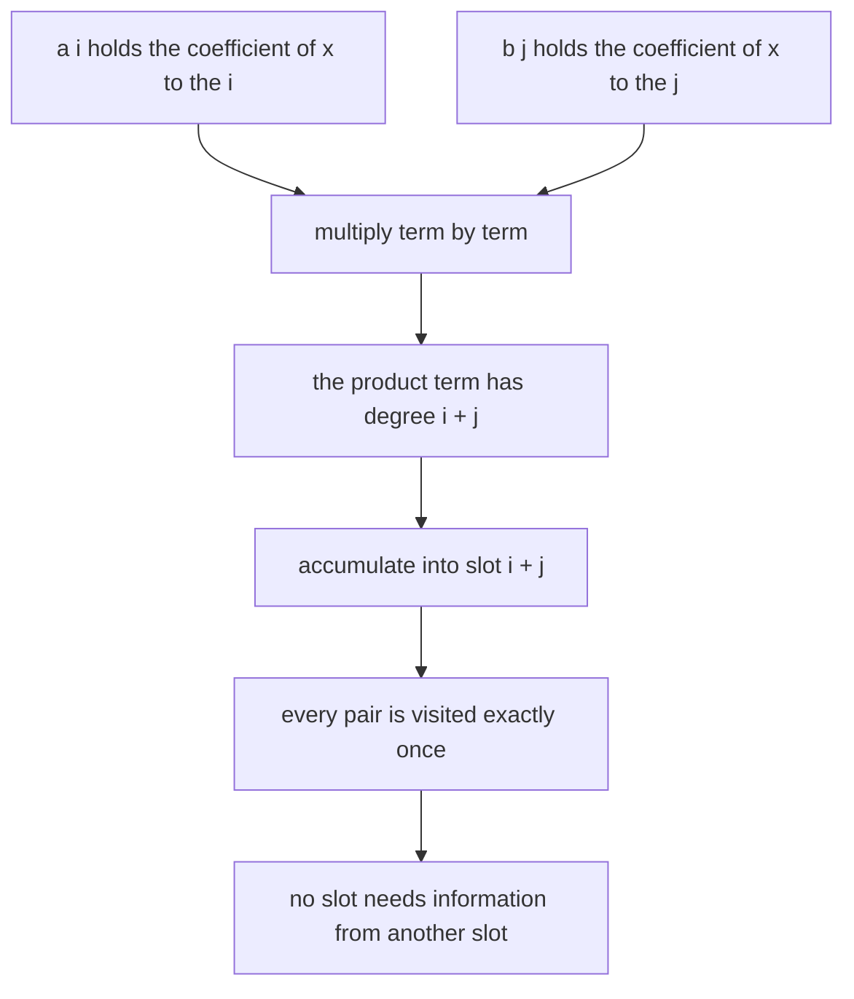
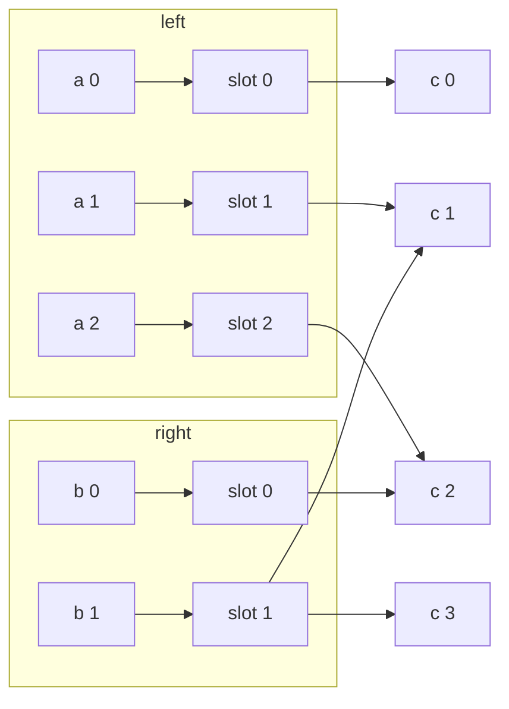
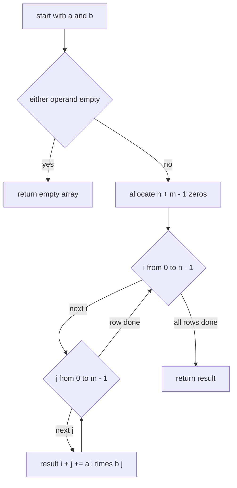
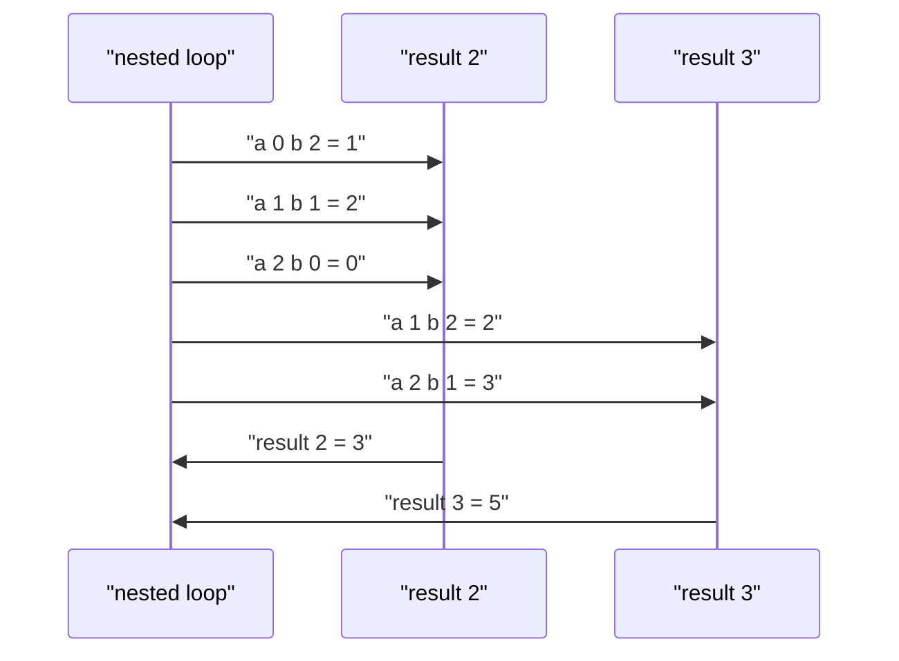

# 300 — Implement convolution (naive) for polynomials.

> **Tier:** Intermediate · **CTCI chapter:** Beyond — Numerical & Scientific Computing
> **Task spec:** [300-implement-convolution-naive-for-polynomials.md](../../../tasks/intermediate/300-implement-convolution-naive-for-polynomials.md)
> **Solutions:** [Python](../../../solutions/python/intermediate/300-implement-convolution-naive-for-polynomials/solution.py) ·
> [Java](../../../solutions/java/intermediate/300-implement-convolution-naive-for-polynomials/Solution.java) ·
> [JavaScript](../../../solutions/javascript/intermediate/300-implement-convolution-naive-for-polynomials/solution.js) ·
> [C#](../../../solutions/csharp/intermediate/300-implement-convolution-naive-for-polynomials/Solution.cs)

## 1. Problem restatement

**Input:** two coefficient arrays `a` (length `n`) and `b` (length `m`). Index `i` holds the
coefficient of `x^i`, so `a = [1, 2, 3]` means `1 + 2x + 3x²`. Either array may be empty. The four
languages differ only in the number type: Python uses arbitrary-precision integers, Java and C#
use `long`, JavaScript uses `number`.

**Output:** the coefficient array `c` of the product polynomial, of length `n + m - 1`, with

    c[k] = sum of a[i] · b[k - i] for i = 0 .. n - 1, so that 0 ≤ k - i ≤ m - 1

Empty input wins: if either operand is empty the product is empty, and `n + m - 1` is not used.

| Call | Result | Why |
| --- | --- | --- |
| `convolve([1, 2, 3], [0, 1, 1])` | `[0, 1, 3, 5, 3]` | the sample: `(1 + 2x + 3x²)(x + x²)` |
| `convolve([5], [7])` | `[35]` | two constants |
| `convolve([5], [0])` | `[0]` | the zero polynomial, still a length-1 result |
| `convolve([], [1, 2])` / `convolve([1, 2], [])` | `[]` | empty in, empty out |
| `convolve(a, [1])` and `convolve([1], a)` | `a` | `1` is the multiplicative identity |
| `convolve([0, 0, 1], [1, 2, 3])` | `[0, 0, 1, 2, 3]` | a delta at offset 2 shifts the other factor |
| `convolve([1, 0, 0], [3, 4])` | `[3, 4, 0, 0]` | trailing zeros are preserved, not trimmed |

Commutativity and associativity are asserted on the fixed inputs `a = [4, 1, 2, 3]`, `b = [2, 0,
5]`, `c = [1, 1, 0, 2]`. Then 120 randomized trials (LCG coefficients in `0..9`, lengths in `1..6`)
check three algebraic properties, and the last one is the strongest:

1. `length(product) == n + m - 1`,
2. `convolve(left, right) == convolve(right, left)`,
3. `evaluate(product, x) == evaluate(left, x) · evaluate(right, x)` for `x ∈ {2, 3, 5}`,

where `evaluate` is Horner evaluation — an independent oracle that never looks at the coefficient
loop.

## 2. Intuition

For each pair of terms `a[i] · x^i` and `b[j] · x^j` the product contributes `a[i] · b[j]` to the
coefficient of `x^(i+j)`. Adding every pair into the slot `i + j` is the whole algorithm.



There is no clever trick hiding here — and that is the point of the task. Naive convolution is
`O(n · m)` and does not care about the values; the interesting part is knowing precisely what it
computes, because every faster algorithm in this area (FFT, NTT, Karatsuba) is validated against
exactly this routine. Tasks [301](./301-fft-outline-and-small-convolution-using-library-conceptual.md)
and [302](./302-implement-convolution-using-number-theoretic-transform-outline-t.md) both
cross-check their transforms against the naive loop on randomized inputs, which only works if the
naive loop's contract is nailed down: the output length is `n + m - 1`, trailing zeros are kept,
and an empty operand yields an empty result rather than `[]`-vs-`[0]` ambiguity.

The second thing worth seeing before coding is *why* the accumulator is indexed by `i + j` and not
by anything else. Degree addition is the reason: the coefficient of `x^k` in the product collects
every pair whose degrees sum to `k`, and there is exactly one such pair per choice of `i`. The
diagonal structure of the nested loop is the polynomial multiplication.



The crossing lines in the middle are the pairs `(i, j)` that meet in a slot; the number of lines
into slot `k` grows toward the middle of the output, which is why the middle coefficients of a
product usually have the largest magnitude.

## 3. Algorithm

1. If either `a` or `b` is empty, return an empty array.
2. Allocate `result` of length `n + m - 1`, filled with zeros.
3. For each `i` from `0` to `n - 1` and each `j` from `0` to `m - 1`, add `a[i] · b[j]` to
   `result[i + j]`.
4. Return `result`.

```text
procedure convolve(a, b)
    if length(a) = 0 or length(b) = 0 then
        return empty array
    end
    result ← array of length(a) + length(b) - 1 zeros
    for i ← 0 to length(a) - 1 do
        for j ← 0 to length(b) - 1 do
            result[i + j] ← result[i + j] + a[i] * b[j]
        end
    end
    return result
end
```

That is the entire implementation in all four languages; the shipped files add `evaluate` (Horner)
and an LCG vector generator purely for the tests.



The output slot is written by every pair, so the loop is a scatter: each source pair touches
exactly one destination slot and every destination slot is touched at most `min(n, m)` times.

## 4. Worked example

Trace `convolve([1, 2, 3], [0, 1, 1])`. Here `n = 3`, `m = 2`, so the output has length
`3 + 2 - 1 = 4`… but the assertion says `[0, 1, 3, 5, 3]`, which has **five** entries. Check the
length rule again: `n + m - 1 = 3 + 2 - 1 = 4`. The second operand is `[0, 1, 1]`, which has
`m = 3`: `1 + 2x + 3x²` times `x + x²`, so `n + m - 1 = 3 + 3 - 1 = 5`. That matches.

| Step | `i`, `a[i]` | `j`, `b[j]` | product | slot | `result` |
| --- | --- | --- | --- | --- | --- |
| start | — | — | — | — | `[0, 0, 0, 0, 0]` |
| 1 | 0, `1` | 0, `0` | `0` | 0 | `[0, 0, 0, 0, 0]` |
| 2 | 0, `1` | 1, `1` | `1` | 1 | `[0, 1, 0, 0, 0]` |
| 3 | 0, `1` | 2, `1` | `1` | 2 | `[0, 1, 1, 0, 0]` |
| 4 | 1, `2` | 0, `0` | `0` | 1 | `[0, 1, 1, 0, 0]` |
| 5 | 1, `2` | 1, `1` | `2` | 2 | `[0, 1, 3, 0, 0]` |
| 6 | 1, `2` | 2, `1` | `2` | 3 | `[0, 1, 3, 2, 0]` |
| 7 | 2, `3` | 0, `0` | `0` | 2 | `[0, 1, 3, 2, 0]` |
| 8 | 2, `3` | 1, `1` | `3` | 3 | `[0, 1, 3, 5, 0]` |
| 9 | 2, `3` | 2, `1` | `3` | 4 | `[0, 1, 3, 5, 3]` |

Nine pair-products in `3 · 3` steps, all accumulated into the five output slots. The result is
`x + 3x² + 5x³ + 3x⁴`, matching the assertion exactly.

The independent check agrees. At `x = 2`: `evaluate(left, 2) = 1 + 4 + 12 = 17` and
`evaluate(right, 2) = 0 + 2 + 4 = 6`, so the product must evaluate to `102`. Horner on the result
gives `0 + 2·(1 + 2·(3 + 2·(5 + 2·3))) = 2·(1 + 2·(3 + 22)) = 2·(1 + 50) = 102`. ✓



Slot 2 receives three contributions and slot 3 receives two, which is the ramp-up, plateau and
ramp-down pattern of the pair count as `k` moves from `0` to `n + m - 2`.

## 5. Complexity

Let `n = length(a)` and `m = length(b)`.

| Measure | Bound | Why it holds |
| --- | --- | --- |
| Time, best | O(n · m) | the loops do not depend on the values, so even `[0] ⊗ [0]` runs the full nest |
| Time, average | O(n · m) | one multiply and one add per pair |
| Time, worst | O(n · m) | exactly `n · m` additions in total |
| Space | O(n + m) | the output of length `n + m - 1`; the algorithm itself needs two counters |
| Time of the Horner oracle | O(len) per call | used in the tests as an independent check |
| Time of the FFT route | O(N log N) | `N` is the next power of two above `n + m - 1`, see task 301 |
| Time of the NTT route | O(N log N) | same shape with exact modular arithmetic, see task 302 |

The nested loop is optimal for tiny inputs and gets replaced by transform methods once `n` and `m`
both exceed a few hundred coefficients, where `N log N` beats `n · m`. Every assertion in this
task stays in the regime where the naive loop is the reference implementation: lengths at most 6 in
the random trials, and fixed inputs of length 3 or 4.

## 6. Pitfalls and edge cases

- **Empty operands.** `convolve([], [1, 2])` and `convolve([1, 2], [])` both return `[]`. Note that
  the length formula `n + m - 1` would give `0 + 2 - 1 = 1` for the first case, so the empty check
  must come *before* the allocation — every solution file guards it explicitly and asserts both
  orders.
- **The zero polynomial is not the empty polynomial.** `convolve([5], [0])` is `[0]`, length 1: a
  constant zero is still a polynomial. Returning `[]` here would break the length rule and every
  algebraic identity.
- **Trailing zeros survive.** `convolve([1, 0, 0], [3, 4])` is `[3, 4, 0, 0]`, not `[3, 4]`. The
  files never trim, and the length assertion `length == n + m - 1` depends on that.
- **Output length.** It is `n + m - 1`, the degree sum plus one — the classic off-by-one is to
  allocate `n + m`. Allocating too much yields trailing zeros that fail the length assertion;
  allocating too little loses the highest coefficients.
- **In-place aliasing.** If a caller passed the same array as both output and input, the scatter
  would corrupt the source. The solutions always allocate a fresh result, so this cannot happen,
  but it is worth stating: convolution is not in place.
- **Overflow.** Java, C# and JavaScript compute in fixed-width integers. Coefficients up to `C`
  give products up to `C²` summed `min(n, m)` times, so the safe bound is roughly
  `min(n, m) · C² < 2^63`. The tests stay small (LCG values in `0..9`, up to 6 terms worth of
  accumulation) precisely so the checks measure the algorithm, not the word size.
- **Ignoring the empty check on one side only.** `if not a` with no matching test for `b` is a
  common typo; the JavaScript and C# files test both `a.length === 0` and `b.length === 0`, and the
  assertions cover both orders.
- **`evaluate` is Horner.** A naive power-by-power evaluation would still be correct but would add
  its own cost and rounding behaviour to the oracle; Horner keeps it to one multiply and one add
  per coefficient, matching the concern that motivates task 300 itself.

## 7. Variants and follow-ups

- **Fast convolution.** [301-fft-outline-and-small-convolution-using-library-conceptual.md](./301-fft-outline-and-small-convolution-using-library-conceptual.md)
  replaces the double loop with a Fast Fourier Transform and, crucially, uses this exact naive
  routine as its oracle; [302-implement-convolution-using-number-theoretic-transform-outline-t.md](./302-implement-convolution-using-number-theoretic-transform-outline-t.md)
  swaps floating point for arithmetic modulo `998244353` so the result is exact.
- **Transform-based products.** [585-implement-modular-fft-for-polynomial-multiplication-ntt-small-pr.md](../../../tasks/advanced/585-implement-modular-fft-for-polynomial-multiplication-ntt-small-pr.md)
  and [875-implement-high-performance-fft-tuned-for-cache-and-threading-par.md](../../../tasks/master/875-implement-high-performance-fft-tuned-for-cache-and-threading-par.md)
  push the same problem into the performance-engineering regime.
- **Convolution over other semirings.** [539-implement-bitset-convolution-using-fwht-xor-convolution-small-n.md](../../../tasks/advanced/539-implement-bitset-convolution-using-fwht-xor-convolution-small-n.md)
  keeps the shape `c[k] = Σ a[i] · b[k XOR i]` but replaces addition of indices with XOR.
- **Polynomial identities as tests.** The identity element, the shift property and the
  evaluation-agreement property used here are the same three lemmas that any other multiplication
  routine is checked against.
- The chapter tutorial [Advanced topics](../../ctci/x-advanced-topics.md) introduces transforms as
  the packaging of this naive `O(n · m)` work into `O(N log N)`.

## 8. Check yourself

1. Why is the result length `n + m - 1`?

<details><summary>Show answer</summary>

The highest degree in the product comes from `a[n - 1] · b[m - 1]`, contributing to the coefficient
of `x^((n - 1) + (m - 1))`. Degrees run from `0` to `n + m - 2` inclusive, which is `n + m - 1`
coefficients. Trap: `n + m - 1` is also the answer to "how many pairs sum to a given index" in the
middle of the output, which is a different quantity.

</details>

2. How does the test suite catch an implementation that drops trailing zeros?

<details><summary>Show answer</summary>

Three ways. The fixed case `convolve([1, 0, 0], [3, 4]) == [3, 4, 0, 0]` pins it directly; the
randomized trials assert `length(product) == n + m - 1`; and the evaluation identity would still
hold for a trimmed result, which is why the length assertion is needed as well.

</details>

3. What is the exact contract for an empty operand, and why is it not `[0]`?

<details><summary>Show answer</summary>

Empty. The empty list is the additive identity of the coefficient-vector representation, and the
task's assertions state `convolve([], [1, 2]) == []` and `convolve([1, 2], []) == []`. Returning
`[0]` would claim a degree-0 zero polynomial and break associativity when one factor is the empty
polynomial: `([] ⊗ [1]) ⊗ [2]` would become `[0] ⊗ [2] = [0]` instead of `[]`.

</details>

4. Why is `evaluate` called with `x ∈ {2, 3, 5}` and not `x = 1`?

<details><summary>Show answer</summary>

`x = 1` evaluates to the sum of coefficients, so two very different polynomials with the same sum
would both pass — the check would be weak. Larger `x` makes the polynomial's structure weigh in:
the digit-like growth means agreement at `2`, `3` and `5` is strong evidence that the coefficient
vectors themselves match, not just their sums.

</details>

5. Naive convolution is symmetric in its two arguments. Does the implementation make that obvious?

<details><summary>Show answer</summary>

Not syntactically: the loops visit `n · m` pairs in lexicographic order, so swapping `a` and `b`
changes the order of the additions but not the set of `(i, j)` pairs nor their slots `i + j`.
Since integer addition is associative and commutative, `convolve(a, b) == convolve(b, a)` holds
exactly — and floating-point implementations rely on that being *approximately* true, which is one
reason the modular variant in task 302 is attractive.

</details>
