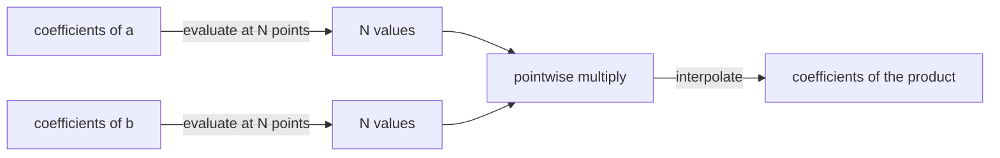
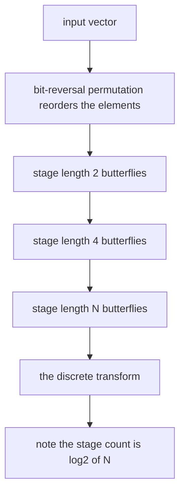
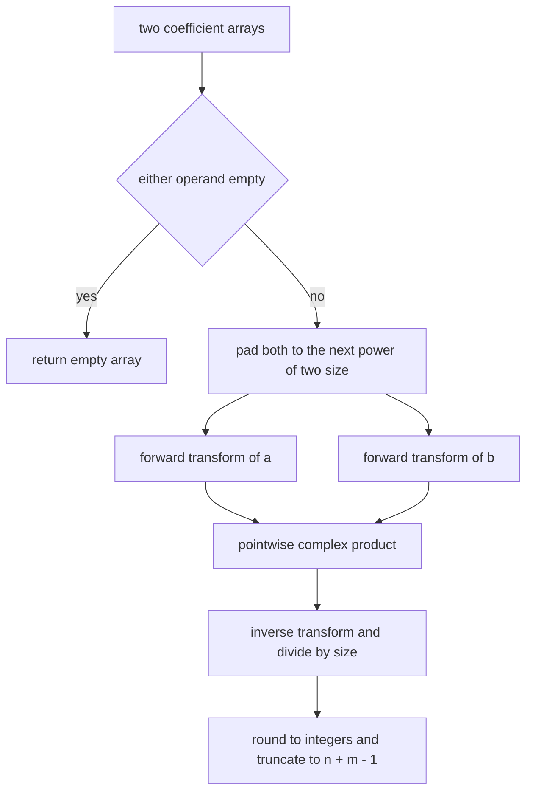
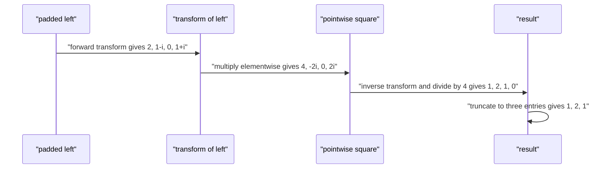

# 301 — FFT outline and small convolution using library (conceptual).

> **Tier:** Intermediate · **CTCI chapter:** Beyond — Numerical & Scientific Computing
> **Task spec:** [301-fft-outline-and-small-convolution-using-library-conceptual.md](../../../tasks/intermediate/301-fft-outline-and-small-convolution-using-library-conceptual.md)
> **Solutions:** [Python](../../../solutions/python/intermediate/301-fft-outline-and-small-convolution-using-library-conceptual/solution.py) ·
> [Java](../../../solutions/java/intermediate/301-fft-outline-and-small-convolution-using-library-conceptual/Solution.java) ·
> [JavaScript](../../../solutions/javascript/intermediate/301-fft-outline-and-small-convolution-using-library-conceptual/solution.js) ·
> [C#](../../../solutions/csharp/intermediate/301-fft-outline-and-small-convolution-using-library-conceptual/Solution.cs)

## 1. Problem restatement

**Input:** two integer coefficient arrays `a` (length `n`) and `b` (length `m`), indexed by degree
as in task 300.

**Output:** the same coefficient array that naive convolution returns — length `n + m - 1`, with
`c[k] = sum of a[i] · b[k - i]` — but computed by transforming, multiplying pointwise and
transforming back, in `O(N log N)` arithmetic operations instead of `O(n · m)` multiplications.

This task is explicitly **conceptual**. The spec calls for an outline plus "small convolution using
library"; the solution files spell out the compromise in their headers: *"Production code would
call a library; the self-contained iterative Cooley-Tukey implementation below keeps the exercise
runnable in every language."* So each file ships a complete, runnable radix-2 FFT plus a naive
convolution used as its oracle, and the tutorial describes that implementation.

| Call | Result | Why |
| --- | --- | --- |
| `convolution_fft([1, 2, 3], [0, 1, 1])` | `[0, 1, 3, 5, 3]` | identical to the naive answer |
| `convolution_fft([1, 1], [1, 1])` | `[1, 2, 1]` | `(1 + x)²` |
| `convolution_fft([7], [9])` | `[63]` | size-1 operands |
| `convolution_fft([], [1, 2])` | `[]` | empty operand short-circuits |
| `convolution_fft([4, 5], [6])` | `[24, 30]` | padding of factor 2 |
| `convolution_fft([1], [3, 4, 5])` | `[3, 4, 5]` | `1` is the identity |

Then each file generates 40 LCG vectors of length `1..6` whose entries may be **negative**
(`seed % 11 - 5`, so the range is `-5..5`) and asserts, for every consecutive pair `(a, b)`:

    convolution_fft(a, b) == convolution_naive(a, b)
    convolution_fft(b, a) == convolution_naive(a, b)

Negative coefficients matter: they are what would expose a rounding or sign bug that a test set of
non-negative inputs hides.

## 2. Intuition

The convolution theorem says that multiplication of polynomials becomes pointwise multiplication of
values: if you evaluate both polynomials at `N` distinct points, multiply the two lists element by
element, and interpolate back to coefficients, you get the product. Coefficients → values is the
transform; values → coefficients is its inverse.



Evaluating at `N` arbitrary points costs `O(N²)` — worse than the naive convolution. The insight is
to choose the points cleverly: the `N`-th roots of unity, `w^k = e^(2πik/N)`. Those points have two
properties that together give the Fast Fourier Transform:

- **Symmetry.** `w^(k + N/2) = -w^k`, so the two halves of a transform of size `N` are transforms
  of size `N/2` with opposite signs. This is what makes the recursion logarithmic instead of
  quadratic.
- **Closure.** The even-indexed and odd-indexed inputs of a size-`N` transform each form a size-`N/2`
  transform of the *same* points, so the problem splits cleanly in half.

Splitting repeatedly produces `log2(N)` stages, each doing `N/2` butterflies — `O(N log N)` work in
total. The iterative version the solutions ship performs the bit-reversal permutation first, which
makes the recursion bottom-up: after the permutation each contiguous block of `2^k` entries already
holds the elements that belong together at stage `k`.



The "use a library" framing in the task title is about the *concept*: production code would call a
tested FFT library, while these files implement the butterfly explicitly so the exercise runs
everywhere — and validate it against naive convolution rather than trusting it.

## 3. Algorithm

1. If either operand is empty, return an empty array.
2. Compute `size`, the smallest power of two that is `≥ n + m - 1`.
3. Pad `a` and `b` into real-valued arrays of length `size`; the imaginary parts start at zero.
4. Apply the forward FFT to both padded arrays:
   1. Reorder the array by bit-reversing the index (the iterative substitute for recursion).
   2. For `length = 2, 4, ..., size`: for every block of that length, take the rotation
      `w = e^(±2πi/length)` and combine each pair `(u, v · w)` as `(u + v·w, u - v·w)`.
5. Multiply pointwise: for each index `i`, `(x + iy)(p + iq) = (xp - yq) + i(xq + yp)`.
6. Apply the same loop with the opposite sign of the angle (the inverse transform) and divide every
   entry by `size`.
7. Round the real parts to the nearest integer and truncate to length `n + m - 1`.

```text
procedure fft(real, imag, invert)
    n ← length(real)
    j ← 0
    for i ← 1 to n - 1 do
        bit ← n >> 1
        while j & bit is not zero do
            j ← j XOR bit
            bit ← bit >> 1
        end
        j ← j OR bit
        if i < j then
            swap real[i] with real[j]
            swap imag[i] with imag[j]
        end
    end
    length ← 2
    while length ≤ n do
        angle ← 2 · pi / length, negated when invert is true
        wlen_real ← cosine(angle)
        wlen_imag ← sine(angle)
        half ← length >> 1
        for start ← 0 to n - 1 step length do
            w_real ← 1
            w_imag ← 0
            for k ← 0 to half - 1 do
                u_real ← real[start + k]
                u_imag ← imag[start + k]
                v_real ← real[start + k + half] · w_real - imag[start + k + half] · w_imag
                v_imag ← real[start + k + half] · w_imag + imag[start + k + half] · w_real
                real[start + k] ← u_real + v_real
                imag[start + k] ← u_imag + v_imag
                real[start + k + half] ← u_real - v_real
                imag[start + k + half] ← u_imag - v_imag
                w_real, w_imag ← w_real · wlen_real - w_imag · wlen_imag, w_real · wlen_imag + w_imag · wlen_real
            end
        end
        length ← length << 1
    end
    if invert is true then
        for i ← 0 to n - 1 do
            real[i] ← real[i] / n
            imag[i] ← imag[i] / n
        end
    end
end
```

```text
procedure convolution_fft(a, b)
    if a is empty or b is empty then
        return empty array
    end
    size ← smallest power of two that is at least length(a) + length(b) - 1
    pad a and b into real arrays of length size, imaginary parts zero
    fft(real_a, imag_a, false)
    fft(real_b, imag_b, false)
    for i ← 0 to size - 1 do
        multiply the two complex values pointwise
    end
    fft(real_a, imag_a, true)
    return the rounded real parts, truncated to length(a) + length(b) - 1
end
```



Rounding is not an accident of the design — it is how the implementation recovers exact integers
from floating-point arithmetic. The tests choose small coefficients and short vectors so that the
error stays far below `0.5`.

## 4. Worked example

Trace `convolution_fft([1, 1], [1, 1])`, the assertion that pins the square of `1 + x` to
`[1, 2, 1]`. `n = m = 2`, so the target length is `3` and `size = 4`.

Padded inputs: `left = [1, 1, 0, 0]` and `right = [1, 1, 0, 0]` (identical, so one trace covers
both transforms).

Bit-reversal permutation for `size = 4` maps positions `0, 1, 2, 3` to `0, 2, 1, 3`. Applying it
to `[1, 1, 0, 0]` swaps positions 1 and 2, giving `[1, 0, 1, 0]`.

| Stage | Action | `real` after the stage |
| --- | --- | --- |
| start | padded input | `[1, 1, 0, 0]` |
| permutation | bit-reversal of the indices | `[1, 0, 1, 0]` |
| `length = 2` | pairs `(0,1)` and `(2,3)`, `w = 1` | `[1, 1, 1, 1]` |
| `length = 4` | `w` runs over `1` and `i` | `[2, 1 - i, 0, 1 + i]` |

The last row is the discrete transform of `1 + x`: `X[0] = 2`, `X[1] = 1 + e^(-iπ/2) = 1 - i`,
`X[2] = 1 + e^(-iπ) = 0`, `X[3] = 1 + e^(-3iπ/2) = 1 + i`. The imaginary parts are the `imag` array
the code carries alongside `real`.

Multiplying the transform by itself pointwise and running the inverse transform (which divides by
`size = 4` after using conjugate twiddles):

| `k` | `X[k]` | `X[k] · X[k]` | inverse value before dividing by 4 | after dividing |
| --- | --- | --- | --- | --- |
| 0 | `2` | `4` | `4` | `1` |
| 1 | `1 - i` | `-2i` | `4 + 4` | `2` |
| 2 | `0` | `0` | `4` | `1` |
| 3 | `1 + i` | `2i` | `0` | `0` |

Rounding leaves the integers untouched, and truncating to `n + m - 1 = 3` yields `[1, 2, 1]`. ✓



The trailing zero in slot 3 is real data: the padded transform has length 4 while the product
polynomial needs only 3 coefficients, which is why the result is truncated.

## 5. Complexity

Let `n = length(a)`, `m = length(b)`, and let `N` be the smallest power of two with `N ≥ n + m - 1`
(so `N < 2(n + m)`).

| Measure | Bound | Why it holds |
| --- | --- | --- |
| Time, forward transforms | O(N log N) | two transforms, `log2(N)` stages of `N/2` butterflies each |
| Time, pointwise product | O(N) | one complex multiplication per index |
| Time, inverse transform | O(N log N) | the same loop with a negated angle, plus an O(N) scaling |
| Time, total | O(N log N) | dominated by the transforms; the padding and rounding are linear |
| Space | O(N) | four arrays of length `N` (real and imaginary parts of both operands) |
| Time of naive convolution | O(n · m) | the oracle used in every assertion |

With `n = m = 2` the transform does `4 · 2 = 8` butterflies per transform, which is more work than
the four multiplications of the naive loop — the asymptotics only pay off once the inputs are long.
The point of the task is the shape of the algorithm, and every assertion is written against the
naive routine so that the constant-factor disadvantage cannot hide a correctness bug.

## 6. Pitfalls and edge cases

- **`size` must be a power of two.** The radix-2 butterfly assumes it. It is the *next* power of two
  at or above `n + m - 1`, not the next strictly greater one: when `n + m - 1` is already a power of
  two, `[1] ⊗ [3, 4, 5]` uses `size = 4` directly and the answer `[3, 4, 5]` is asserted.
- **Bit-reversal must be a permutation.** The `if i < j` guard makes each swap happen once;
  dropping it reverses the array instead of permuting it, producing a plausible-looking wrong
  transform.
- **Sign of the angle.** The forward transform uses `+2πi/length` in the twiddle and the inverse
  uses the negation, then divides by `N`. Swapping the two signs produces a transform for a
  different problem, and the pointwise product still returns *something* — the naive cross-check is
  the only thing that catches it.
- **The division by `N` belongs to the inverse transform only.** Omitting it multiplies every result
  by `N`; applying it twice divides by `N²`. For the `[1, 1] ⊗ [1, 1]` trace, missing the division
  would return `[4, 8, 4]` instead of `[1, 2, 1]`.
- **Rounding and negative zero.** The final step rounds the real parts, and JavaScript additionally
  normalises `-0` to `0` so that a strict deep-equality assertion cannot fail on a signed zero.
- **Floating-point error grows with size.** The tests use coefficients in `-5..5` with product
  lengths under 11, where the error is far below the `0.5` rounding threshold; longer inputs need
  the exact modular transform of task 302. Everything between `n + m - 1` and `size - 1` is noise
  that must be discarded, not returned.
- **Negative inputs.** The LCG deliberately produces negatives (`seed % 11 - 5`), so an
  implementation that assumed non-negative coefficients would fail on half the 40 vectors.

## 7. Variants and follow-ups

- **Exact transform, no rounding.** [302-implement-convolution-using-number-theoretic-transform-outline-t.md](./302-implement-convolution-using-number-theoretic-transform-outline-t.md)
  keeps the identical butterfly structure but works modulo `998244353`, replacing cosines and sines
  with modular roots of unity so that the inverse transform is exact.
- **The oracle.** [300-implement-convolution-naive-for-polynomials.md](./300-implement-convolution-naive-for-polynomials.md)
  is the routine every assertion in this task compares against; this tutorial's whole
  verification story rests on it.
- **Bigger, tuned transforms.** [585-implement-modular-fft-for-polynomial-multiplication-ntt-small-pr.md](../../../tasks/advanced/585-implement-modular-fft-for-polynomial-multiplication-ntt-small-pr.md)
  and the cache-aware [875-implement-high-performance-fft-tuned-for-cache-and-threading-par.md](../../../tasks/master/875-implement-high-performance-fft-tuned-for-cache-and-threading-par.md)
  go further into the numerical and performance engineering of the same transform.
- **Convolution in other algebras.** [539-implement-bitset-convolution-using-fwht-xor-convolution-small-n.md](../../../tasks/advanced/539-implement-bitset-convolution-using-fwht-xor-convolution-small-n.md)
  shows the Walsh–Hadamard analogue where XOR replaces index addition, and the chapter tutorial
  [Advanced topics](../../ctci/x-advanced-topics.md) introduces the whole transform family.

## 8. Check yourself

1. Why must the transform length be a power of two?

<details><summary>Show answer</summary>

The iterative radix-2 butterfly halves the block length at every stage, which requires `size` to be
divisible by every power of two up to itself — that is, a power of two. The code doubles until
`size ≥ n + m - 1`: fewer points could not represent a coefficient vector of that length, and more
points waste work without changing the answer.

</details>

2. In the worked example the padded input `[1, 1, 0, 0]` becomes `[1, 0, 1, 0]` after the
   permutation. What is the purpose of that step?

<details><summary>Show answer</summary>

It is the iterative equivalent of the recursion's split into even and odd indices. Doing it up
front means the remaining stages can be a simple loop of expanding block lengths: after the
permutation, each contiguous block of `2^k` entries already contains the elements that belong
together at stage `k`.

</details>

3. What does the pointwise multiplication step do, and why is it O(N) instead of O(N²)?

<details><summary>Show answer</summary>

It multiplies the two transformed vectors element by element, `(x + iy)(p + iq) = (xp - yq) +
i(xq + yp)`, one index at a time, because the transform has already done the pairwise work. This is
the essence of the convolution theorem: the `N²` pair interactions are absorbed into two `O(N log N)`
transforms.

</details>

4. The result must be rounded to integers. Why does the solution not use the exact modular transform
   of task 302 instead?

<details><summary>Show answer</summary>

Because the task is framed as the FFT/conceptual exercise, and a complex transform with rounding is
the canonical first look at the technique. The files stay honest about the limitation: the oracle
comparison uses inputs whose floating-point error is far below the rounding threshold, and the
header points at library FFTs for production use. The exact alternative (NTT) is the next task.

</details>

5. Why does the JavaScript version normalise `-0` in its output?

<details><summary>Show answer</summary>

`Math.round(-0.0000001)` produces `-0`, which is `=== 0` numerically but not under `Object.is`, and
`assert.deepStrictEqual` distinguishes them, so the assertion would fail on a correct result.
Mapping `-0` to `0` is a one-line portability fix the other three languages do not need.

</details>
