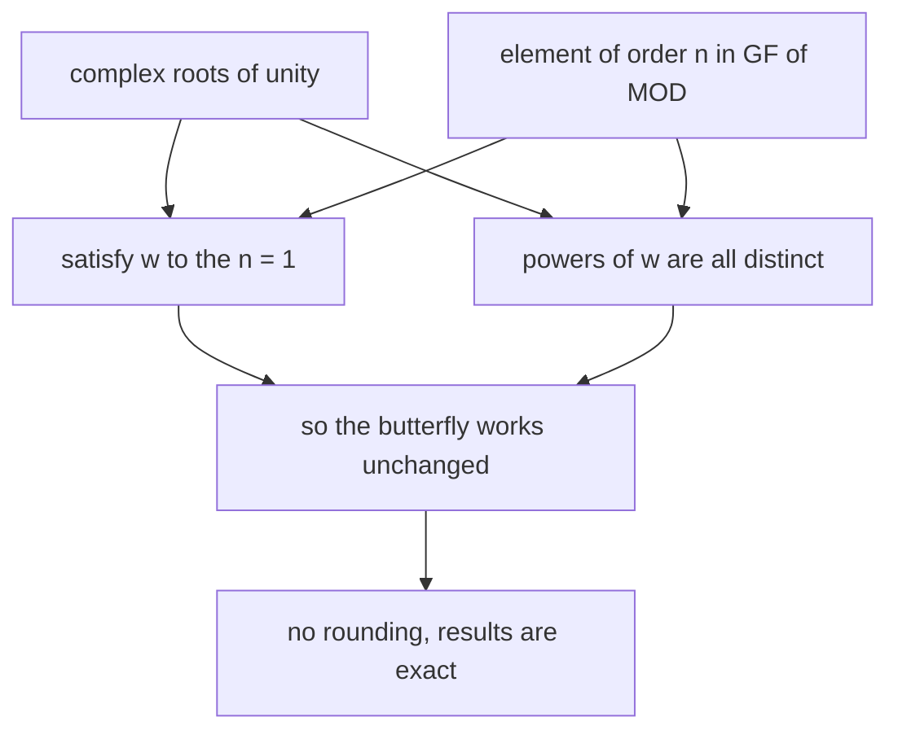
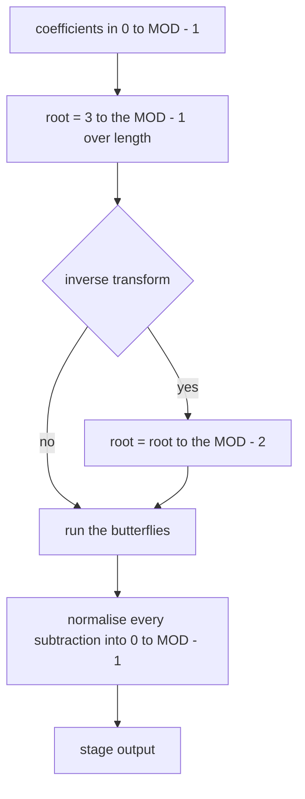
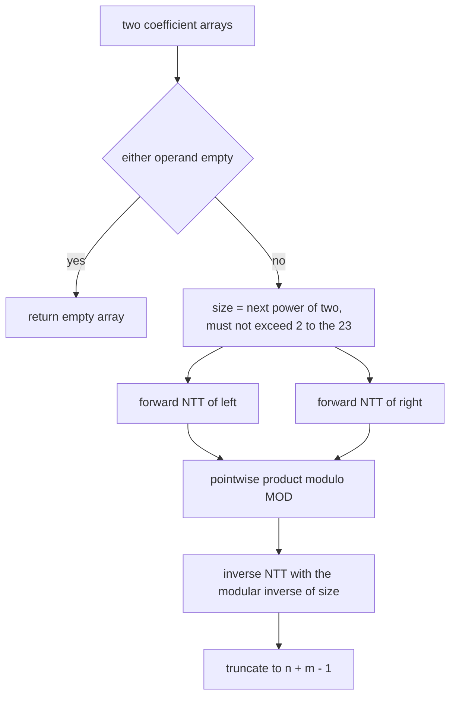
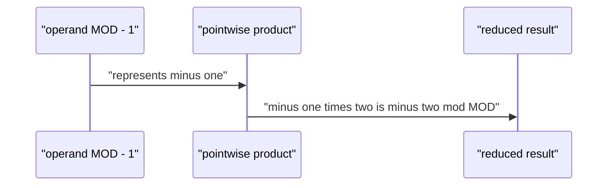

# 302 — Implement convolution using number theoretic transform (outline/test small primes).

> **Tier:** Intermediate · **CTCI chapter:** Beyond — Numerical & Scientific Computing
> **Task spec:** [302-implement-convolution-using-number-theoretic-transform-outline-t.md](../../../tasks/intermediate/302-implement-convolution-using-number-theoretic-transform-outline-t.md)
> **Solutions:** [Python](../../../solutions/python/intermediate/302-implement-convolution-using-number-theoretic-transform-outline-t/solution.py) ·
> [Java](../../../solutions/java/intermediate/302-implement-convolution-using-number-theoretic-transform-outline-t/Solution.java) ·
> [JavaScript](../../../solutions/javascript/intermediate/302-implement-convolution-using-number-theoretic-transform-outline-t/solution.js) ·
> [C#](../../../solutions/csharp/intermediate/302-implement-convolution-using-number-theoretic-transform-outline-t/Solution.cs)

## 1. Problem restatement

**Input:** two integer coefficient arrays `a` (length `n`) and `b` (length `m`), indexed by degree.

**Output:** the coefficients of the product polynomial, **each reduced modulo `998244353`**, with
the same length rule as before: `n + m - 1` entries, and an empty array when either operand is
empty. The reduction is part of the contract, not an implementation detail — `[MOD - 1] ⊗ [2]` is
asserted to be `[MOD - 2]`, because `(-1) · 2 = -2 ≡ MOD - 2` in this field.

The modulus and its primitive root are fixed constants in all four files:

    MOD = 998244353 = 119 · 2^23 + 1
    PRIMITIVE_ROOT = 3

The shape `k · 2^s + 1` is what makes a *number theoretic transform* possible: the multiplicative
group modulo `MOD` has order `MOD - 1`, so it contains an element of order `2^23` — a modular
"root of unity" — and the same butterfly that powers the FFT works over the field `GF(MOD)` instead
of the complex numbers. Two facts are asserted directly as the first lines of every `main`:

| Assertion | Meaning |
| --- | --- |
| `power(3, MOD - 1, MOD) == 1` | Fermat's little theorem: `3` survives exponentiation by `MOD - 1`, i.e. it generates a subgroup of the multiplicative group |
| `(MOD - 1) % 2^23 == 0` and `(MOD - 1) / 2^23 == 119` | the group order is divisible by `2^23`, so transforms of any power-of-two length up to `2^23` have the roots they need |

The sample results match task 300 exactly, because the coefficients never leave the safe range:

| Call | Result | Why |
| --- | --- | --- |
| `convolution_ntt([1, 2, 3], [0, 1, 1])` | `[0, 1, 3, 5, 3]` | small coefficients, no reduction visible |
| `convolution_ntt([1, 1], [1, 1])` | `[1, 2, 1]` | `(1 + x)²` |
| `convolution_ntt([7], [9])` | `[63]` | scalars |
| `convolution_ntt([], [1])` | `[]` | empty operand |
| `convolution_ntt([MOD - 1], [2])` | `[MOD - 2]` | wraparound made explicit |

Two further checks pin the transform itself: a round trip on the fixed vector `[3, 1, 4, 1, 5, 9,
2, 6]` (the forward transform must change it, the inverse must restore it exactly), and 40 LCG
vectors of length `1..7` with coefficients in `0..999`, each compared against a naive `O(n · m)`
convolution that reduces modulo `MOD` after every accumulation.

## 2. Intuition

The FFT of task 301 needed floating-point sines and cosines, and paid for that with rounding. The
observation behind the NTT is that the complex roots of unity are used for exactly two properties:
`w^n = 1` and the fact that the powers `w^0, w^1, ..., w^(n-1)` are all distinct. Any element of
multiplicative order `n` in any field gives both, and the integers modulo a prime `p` contain one
whenever `n` divides `p - 1`.



For `MOD = 998244353 = 119 · 2^23 + 1` and primitive root `3`, the element
`root = 3^((MOD - 1) / length)` has order exactly `length`, and it is computed at run time by
modular exponentiation rather than hard-coded. Everything else is identical to the FFT: reverse the
bits, run `log2(size)` stages of butterflies, multiply pointwise, run the inverse, scale.

Three arithmetic operations change shape compared to the floating-point version:

- the twiddle is `root = 3^((MOD - 1) / length)` for the forward transform, and `root^(MOD - 2)`
  (the modular inverse of `root`, by Fermat) for the inverse;
- the scaling at the end of the inverse is a multiplication by `size^(MOD - 2) mod MOD`, not a
  floating-point division;
- every subtraction is normalised back into `0..MOD - 1`, because a plain `% MOD` on a negative
  intermediate keeps the sign in most of the four languages.



## 3. Algorithm

1. If either operand is empty, return an empty array.
2. Compute `size`, the smallest power of two that is `≥ n + m - 1`, and require `size ≤ 2^23` (the
   Python version asserts it with the message *"transform length exceeds the supported root
   order"*).
3. Reduce every coefficient modulo `MOD` and pad both arrays to length `size` with zeros.
4. Forward-transform both arrays:
   1. Bit-reversal permutation.
   2. For `length = 2, 4, ..., size`: let `root = power(PRIMITIVE_ROOT, (MOD - 1) / length, MOD)`;
      for the inverse, replace it by `power(root, MOD - 2, MOD)`. For every block, walk
      `w = 1, root, root², ...` and set
      `values[start + k] = (u + v) mod MOD`,
      `values[start + k + half] = (u - v) mod MOD`, where `v = values[start + k + half] · w mod MOD`.
5. Multiply pointwise modulo `MOD`.
6. Apply the inverse transform to the product, then scale every entry by `power(size, MOD - 2, MOD)`.
7. Truncate to `n + m - 1` and return.

```text
procedure power(base, exponent, modulus)
    result ← 1
    base ← base mod modulus
    while exponent > 0 do
        if exponent is odd then
            result ← result * base mod modulus
        end
        base ← base * base mod modulus
        exponent ← exponent >> 1
    end
    return result
end

procedure ntt(values, invert)
    n ← length(values)
    apply the bit-reversal permutation to values
    length ← 2
    while length ≤ n do
        root ← power(PRIMITIVE_ROOT, (MOD - 1) / length, MOD)
        if invert then
            root ← power(root, MOD - 2, MOD)
        end
        half ← length >> 1
        for start ← 0 to n - 1 step length do
            w ← 1
            for k ← 0 to half - 1 do
                u ← values[start + k]
                v ← values[start + k + half] * w mod MOD
                values[start + k] ← (u + v) mod MOD
                values[start + k + half] ← ((u - v) mod MOD + MOD) mod MOD
                w ← w * root mod MOD
            end
        end
        length ← length << 1
    end
    if invert then
        inverse_n ← power(n, MOD - 2, MOD)
        for i ← 0 to n - 1 do
            values[i] ← values[i] * inverse_n mod MOD
        end
    end
end
```

```text
procedure convolution_ntt(a, b)
    if a is empty or b is empty then
        return empty array
    end
    size ← smallest power of two that is at least length(a) + length(b) - 1
    require size ≤ 2^23
    left ← coefficients of a reduced mod MOD, padded to size
    right ← coefficients of b reduced mod MOD, padded to size
    ntt(left, false)
    ntt(right, false)
    for i ← 0 to size - 1 do
        left[i] ← left[i] * right[i] mod MOD
    end
    ntt(left, true)
    return the first length(a) + length(b) - 1 entries of left
end
```



## 4. Worked example

Trace `convolution_ntt([1, 2, 3], [0, 1, 1])`. The target length is `3 + 3 - 1 = 5`, so
`size = 8`, which is far below the `2^23` limit.

Step 1 — reduce and pad (all coefficients are already smaller than `MOD`):

| Array | Value | Meaning |
| --- | --- | --- |
| `left` | `[1, 2, 3, 0, 0, 0, 0, 0]` | `1 + 2x + 3x²` |
| `right` | `[0, 1, 1, 0, 0, 0, 0, 0]` | `x + x²` |

Step 2 — the forward transform of `left` proceeds through three stages. Bit reversal for `size = 8`
moves index 1 to position 4, 2 to 2, 3 to 6, 4 to 1, 5 to 5, 6 to 3, 7 to 7, giving
`[1, 0, 2, 0, 3, 0, 0, 0]`:

| Stage | Block length | Roots used |
| --- | --- | --- |
| 1 | 2 | `w = 1` only, four adjacent pairs |
| 2 | 4 | `1` and `r4 = 3^((MOD-1)/4)`, two blocks |
| 3 | 8 | `1, r8, r8², r8³` with `r8 = 3^((MOD-1)/8)`, one block |

After stage 3 the array holds the eight values of `1 + 2x + 3x²` at the eighth roots of unity;
`right` is transformed the same way. The pointwise product is a single pass of eight modular
multiplications, and the inverse transform runs the same three stages with the conjugated roots,
followed by a multiplication by the modular inverse of 8.

Truncating to five entries gives `[0, 1, 3, 5, 3]`, exactly what the naive modular convolution
produces. The most instructive part of the trace is what the transform *never* does: at no point is
a coefficient compared against a rounding threshold, because every intermediate value is an integer
in `0..MOD - 1`.

The wraparound case `[MOD - 1] ⊗ [2]` is short enough to check by hand: both operands have length 1,
so the target length is 1 and `size = 1`; a length-1 transform is the identity, so the whole
computation is the single reduction `(-1) · 2 mod MOD = MOD - 2`.



The round-trip assertion works the same way on a longer vector: transforming `[3, 1, 4, 1, 5, 9, 2,
6]` produces a different vector (asserted), and transforming that result again with `invert` set
returns the original vector *exactly* (asserted) — no tolerance, no epsilon, because there is no
floating point.

## 5. Complexity

Let `n = length(a)`, `m = length(b)`, and let `N` be the smallest power of two with `N ≥ n + m - 1`.

| Measure | Bound | Why it holds |
| --- | --- | --- |
| Time, transforms | O(N log N) | `log2(N)` stages of `N/2` butterflies, twice forward and once inverse |
| Time, modular exponentiation | O(log exponent) per call | `power` squares the base `log2(exponent)` times; the roots are computed once per stage |
| Time, pointwise product | O(N) | one multiplication and one reduction per index |
| Time, total | O(N log N) | dominated by the three transforms |
| Space | O(N) | two arrays of length `N` — no real/imaginary pair is needed because the values are already in the field |
| Time of the naive modular loop | O(n · m) | the oracle used on the 40 random vectors |
| Supported sizes | `N ≤ 2^23` | the group order `MOD - 1 = 119 · 2^23` caps the root order |

The exponentiation inside the transform is a constant factor rather than a change of growth rate:
`log2(N)` roots, each costing `O(log MOD)` ~ 30 modular squarings, against `N/2 · log2(N)` butterfly
multiplications. Computing the roots at run time is also what makes the correctness argument (order
exactly `length`) testable rather than assumed.

## 6. Pitfalls and edge cases

- **Negative intermediate values.** `u - v` can be negative, and in most of the four languages
  `(-3) % MOD` is `-3` rather than `MOD - 3`. Python's `%` already returns a non-negative result, so
  it writes `(u - v) % MOD`, while Java, JavaScript and C# write `((u - v) % MOD + MOD) % MOD`. A
  port that keeps one form and drops the other silently produces negative "residues" that then fail
  the equality assertions.
- **The inverse root is not `-root`.** In the complex case the inverse twiddle is the conjugate,
  which is cheap; here it is `root^(MOD - 2) mod MOD` — Fermat's little theorem — and it costs
  another exponentiation per stage.
- **Scaling by the modular inverse.** The inverse transform ends with a multiplication by
  `size^(MOD - 2) mod MOD`. Replacing it with a division is wrong (integer division truncates) and
  omitting it leaves every coefficient multiplied by `size`.
- **Empty operands short-circuit before `size` is computed.** `convolution_ntt([], [1])` returns
  `[]`; the length formula would otherwise suggest a transform of length 0.
- **Coefficients larger than the modulus.** The Python version reduces with `x % MOD` while padding,
  so a caller may pass any integers; the function computes the product *in the field*, not the
  integer product followed by a reduction — for products that exceed `MOD` the two differ, which is
  why the oracle `convolution_naive_mod` also reduces after every accumulation.
- **Overflow in the products.** The butterfly multiplies two values below `MOD ≈ 2^30`, so a raw
  product needs about 60 bits: Java and C# use `long`, JavaScript uses `BigInt` with the `n` suffix
  on every constant (a `number` would lose precision above `2^53`), and Python's integers are exact.
- **The `2^23` ceiling is real.** A transform longer than `2^23` has no root of that order in this
  field. The Python version asserts the limit explicitly; the other files rely on the task's small
  sizes. Choosing a different prime moves the ceiling accordingly.
- **Beware of `MOD - 1` as a coefficient.** It is `-1` in the field, and the file asserts
  `[MOD - 1] ⊗ [2] == [MOD - 2]` so that a reader cannot mistake residues for plain integers.
- **Bit-reversal again.** The same permutation as the FFT, with the same trap: the `if i < j` guard
  is what makes it a permutation rather than a reversal.

## 7. Variants and follow-ups

- **The floating-point sibling.** [301-fft-outline-and-small-convolution-using-library-conceptual.md](./301-fft-outline-and-small-convolution-using-library-conceptual.md)
  is the same algorithm over the complex numbers; comparing the two traces shows exactly what the
  modular version buys — exactness, at the cost of a bounded transform length.
- **The naive oracle.** [300-implement-convolution-naive-for-polynomials.md](./300-implement-convolution-naive-for-polynomials.md)
  is the `O(n · m)` routine the random trials here compare against, with the same wrapping
  treatment (`convolution_naive_mod`).
- **Production modular transforms.** [585-implement-modular-fft-for-polynomial-multiplication-ntt-small-pr.md](../../../tasks/advanced/585-implement-modular-fft-for-polynomial-multiplication-ntt-small-pr.md)
  takes the same ideas through several primes and CRT reconstruction; the cache-tuned
  [875-implement-high-performance-fft-tuned-for-cache-and-threading-par.md](../../../tasks/master/875-implement-high-performance-fft-tuned-for-cache-and-threading-par.md)
  is the performance end of the family.
- **Convolution over XOR.** [539-implement-bitset-convolution-using-fwht-xor-convolution-small-n.md](../../../tasks/advanced/539-implement-bitset-convolution-using-fwht-xor-convolution-small-n.md)
  replaces addition of indices with XOR and the roots with ±1, giving the Walsh–Hadamard transform.
- The chapter tutorial [Advanced topics](../../ctci/x-advanced-topics.md) frames this as the
  field-arithmetic member of the transform family.

## 8. Check yourself

1. Why does the modulus have to be of the form `k · 2^s + 1`?

<details><summary>Show answer</summary>

Because the transform needs an element of multiplicative order `size` for every power-of-two `size`
it may use. The multiplicative group modulo a prime `p` has order `p - 1`, and for an element of
order `2^s` to exist, `2^s` must divide `p - 1`. `998244353 - 1 = 119 · 2^23` therefore supports
every transform length up to `2^23`.

</details>

2. Where does the modular version need care that the floating-point version does not?

<details><summary>Show answer</summary>

Every subtraction: `u - v` may be negative and must be normalised into `0..MOD - 1`, which Python's
`%` does automatically but Java, JavaScript and C# do not. The inverse twiddle and the final scaling
are also different: they use modular exponentiation by `MOD - 2` instead of conjugation and
floating-point division.

</details>

3. Why is `[MOD - 1] ⊗ [2] == [MOD - 2]` a useful assertion?

<details><summary>Show answer</summary>

It is the smallest possible test that exercises the field semantics end to end: the operands are
already in the canonical range, the transform is trivial, and the only interesting step is the
reduction of a negative product. It documents the wraparound that a reader might otherwise assume
away, and it would catch an implementation that returned `-2` or a truncated value.

</details>

5. Does `convolution_ntt` agree with the integer convolution when the true product exceeds `MOD`?

<details><summary>Show answer</summary>

No. Both `convolution_ntt` and `convolution_naive_mod` compute the product *in the field* — the
oracle reduces after every accumulation — so they agree with each other but not coefficientwise with
the integer product once a coefficient reaches `MOD`. Recovering the integer result needs several
primes and the Chinese remainder theorem, which is what task 585 addresses.

</details>
