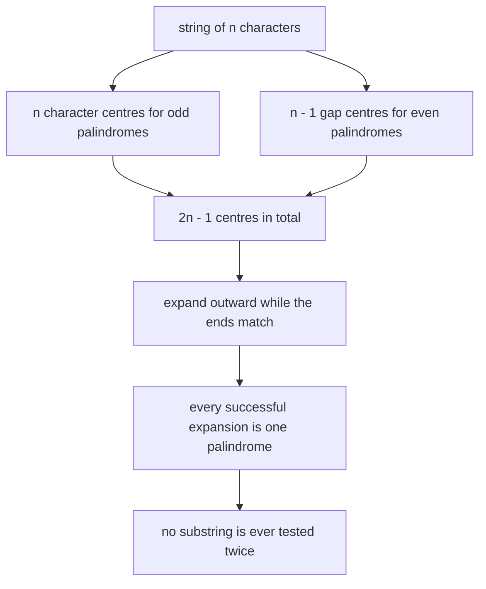
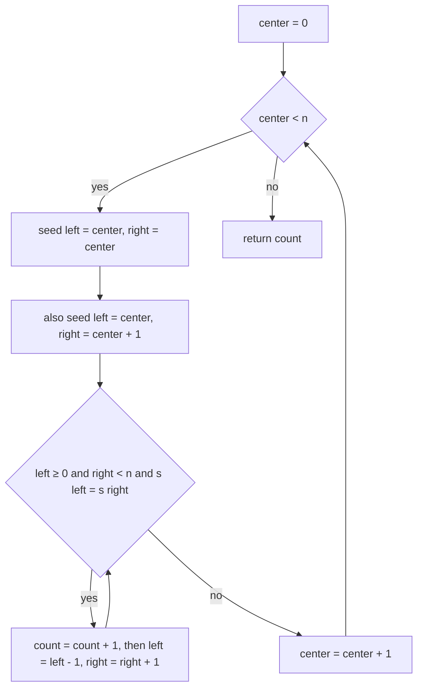
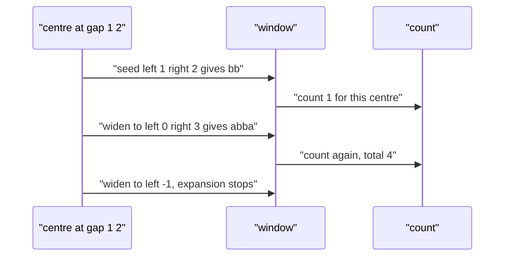

# 303 — Count palindromic substrings (DP).

> **Tier:** Intermediate · **CTCI chapter:** Ch 8 — Recursion and Dynamic Programming
> **Task spec:** [303-count-palindromic-substrings-dp.md](../../../tasks/intermediate/303-count-palindromic-substrings-dp.md)
> **Solutions:** [Python](../../../solutions/python/intermediate/303-count-palindromic-substrings-dp/solution.py) ·
> [Java](../../../solutions/java/intermediate/303-count-palindromic-substrings-dp/Solution.java) ·
> [JavaScript](../../../solutions/javascript/intermediate/303-count-palindromic-substrings-dp/solution.js) ·
> [C#](../../../solutions/csharp/intermediate/303-count-palindromic-substrings-dp/Solution.cs)

## 1. Problem restatement

**Input:** a string `s` of `n` characters. It may be empty; no assumption is made about the alphabet.

**Output:** the number of **substrings** of `s` that are palindromes. A substring is a contiguous
block; a single character counts, and so does the empty string nowhere — the answer for `""` is `0`.

The assertions in the four solution files fix the semantics:

| Call | Result | Why |
| --- | --- | --- |
| `count_palindromic_substrings("abc")` | `3` | the three single characters; no longer block is symmetric |
| `count_palindromic_substrings("aaa")` | `6` | `a`, `a`, `a`, `aa`, `aa`, `aaa` |
| `count_palindromic_substrings("abba")` | `6` | `a`, `b`, `b`, `a`, `bb`, `abba` |
| `count_palindromic_substrings("")` | `0` | nothing to count |
| `count_palindromic_substrings("a")` | `1` | a single character is a palindrome |

The same count is then checked against an all-substrings brute force on the fixed strings
`"aab"`, `"aba"`, `"abcba"`, `"abccba"`, `"aaaa"` and on 60 randomly generated strings of length 9
over the three-letter alphabet `abc` (LCG `seed = (seed * 75 + 74) % 65537`).

**A note on the title.** The task is filed under dynamic programming, but the algorithm the
repository actually implements is **expand around centre**, not a DP table; the solution header
describes it as *"expand around all 2n-1 centres (each centre is one character or one gap); every
successful expansion is one palindromic substring."* Section 7 sketches the DP formulation, which
computes the same quantity.

## 2. Intuition

The brute-force reading of the definition is: enumerate all `n(n + 1)/2` substrings and test each
one. Each test costs `O(n)` if done by slicing and reversing, so the total is `O(n³)`.

```text
procedure brute_force(s)
    total ← 0
    for i ← 0 to length(s) - 1 do
        for j ← i + 1 to length(s) do
            part ← s[i .. j - 1]
            if part is equal to reverse(part) then
                total ← total + 1
            end
        end
    end
    return total
end
```

That is exactly the oracle the solution files use, and it is fine for strings of length 9. It is not
fine in general: every palindrome is re-examined from scratch, and the `reverse` comparison hides
another full pass.

The key insight is that a palindrome is determined by its **centre** and its **radius**. A
palindrome of odd length `2r + 1` is symmetric about a character; one of even length `2r` is
symmetric about the gap *between* two characters. So instead of enumerating substrings and testing
them, walk the `2n - 1` centres and grow outward: as long as the two ends match, the current window
is a palindrome, count it, and widen by one on each side.



The saving is immediate: a substring is never tested twice, because it is discovered exactly once —
at its own centre, at the radius where its two ends first meet. The `"aaa"` case shows why the
counting must be per expansion rather than per centre: the centre `1` alone produces `a`, `aaa` and
(eventually) the full string, each as a separate successful step.

The gap centre is the part that beginners miss. For `"abba"` the palindrome `bb` is centred on the
gap between indices 1 and 2, and `abba` is centred on that same gap with a larger radius; with only
character centres you would find `a`, `b`, `b`, `a` and nothing else.

## 3. Algorithm

1. Let `n = length(s)` and `count = 0`.
2. For each `center` from `0` to `n - 1`:
   1. Consider the **odd** seed `(left, right) = (center, center)`.
   2. Consider the **even** seed `(left, right) = (center, center + 1)`.
   3. For each seed, while `left >= 0` and `right < n` and `s[left] == s[right]`: increment `count`,
      then `left = left - 1` and `right = right + 1`.
3. Return `count`.

```text
procedure count_palindromic_substrings(s)
    n ← length(s)
    count ← 0
    for center ← 0 to n - 1 do
        for each seed in the list of (center, center) and (center, center + 1) do
            left ← first element of seed
            right ← second element of seed
            while left ≥ 0 and right < n and s[left] = s[right] do
                count ← count + 1
                left ← left - 1
                right ← right + 1
            end
        end
    end
    return count
end
```

Each iteration of the inner `while` body corresponds to one palindrome: the window `s[left..right]`
has matching ends by the loop condition and matching interior by the previous iterations, so it is a
palindrome, and the count is incremented before the window widens.



The loop structure is deliberately boring: two seeds per centre and a `while` that stops at the
first mismatch. The whole algorithm is the observation that `2n - 1` centres exist and that
expansion never needs to revisit.

## 4. Worked example

Trace `count_palindromic_substrings("abba")`. Indices 0..3 hold `a`, `b`, `b`, `a`; `n = 4`, so
there are 4 odd seeds and 4 even seeds.

| `center` | seed | first expansion | second expansion | third expansion | `count` |
| --- | --- | --- | --- | --- | --- |
| 0 | `(0, 0)` | `a` matches → `1`; then `left = -1`, stop | — | — | 1 |
| 0 | `(0, 1)` | `a` vs `b` mismatch → stop | — | — | 1 |
| 1 | `(1, 1)` | `b` matches → `2`; then `a` vs `b` mismatch | — | — | 2 |
| 1 | `(1, 2)` | `b` vs `b` matches → `3`; window `bb` | `a` vs `a` matches → `4`; window `abba` | `left = -1`, stop | 4 |
| 2 | `(2, 2)` | `b` matches → `5`; then `b` vs `a` mismatch | — | — | 5 |
| 2 | `(2, 3)` | `b` vs `a` mismatch → stop | — | — | 5 |
| 3 | `(3, 3)` | `a` matches → `6`; then `right = 4`, stop | — | — | 6 |
| 3 | `(3, 4)` | `right = 4` is out of range → stop | — | — | 6 |

The final count is `6`, matching the assertion. The third row of centre 1 is the one that carries
the algorithm: the *same* centre produces two palindromes of different radii, `bb` and `abba`, and
both are counted because the counter is inside the expansion loop.



Two of the eight seeds do nothing at all (`(0, 1)` and `(2, 3)` mismatch immediately), which is the
normal case: most centres have a radius of zero or one. The `while` condition expresses the three
ways an expansion stops — running off the left end, running off the right end, or hitting a
mismatch — and all three occur in this trace.

## 5. Complexity

Let `n` be the length of `s`.

| Measure | Bound | Why it holds |
| --- | --- | --- |
| Time, best | O(n²) | every centre still runs its `while` at least once (or fails once), so `n` work is already `Ω(n)`; the bound for degenerate strings is quadratic |
| Time, average | O(n²) | the inner `while` advances `right` monotonically per centre, so each centre costs `O(n)` |
| Time, worst | O(n²) | a string of one repeated character expands to full radius at every centre |
| Space | O(1) | two integer indices and a counter; nothing proportional to the input |
| Time of brute force | O(n³) | `n²` substrings, each compared with its reverse in `O(n)` |
| Space of brute force | O(n) | one temporary substring per test |

The `O(n²)` bound is a genuine worst case rather than a loose one: the cross-check list includes
`"aaaa"`, whose count is `10 = 4 + 3 + 2 + 1`, and the number of successful expansions is exactly
the number of palindromic substrings, which can be `Θ(n²)`.

## 6. Pitfalls and edge cases

- **Even-length palindromes need gap seeds.** Using only `(center, center)` gives `4` for `"aaaa"`
  (which the cross-check list covers) and misses every even palindrome, so the count would not match
  the brute-force oracle. The two-element seed list is what makes the count correct.
- **The gap seed can be out of range.** For the last centre, `(center, center + 1)` starts with
  `right = n`, and the `while` condition rejects it immediately — no special case is needed, and the
  trace above shows row `(3, 4)` doing exactly that.
- **Empty string.** `n = 0` means no centres, no expansions, count `0`. All four files assert it,
  which rules out an "empty string is a palindrome" reading of the problem.
- **Single character.** `"a"` gives one odd seed that matches once, plus one even seed that is
  immediately out of range: exactly `1`. Also asserted in all four files.
- **Duplicates are counted separately.** In `"aaa"` the three `a` characters are three distinct
  palindromic substrings and so are the two `aa` blocks; the answer is `6`, not `3` or `2`. The
  brute-force oracle slices substrings, so it agrees by construction — the identity of the
  occurrences is the substring, not the value.
- **Count inside the loop, not after it.** Moving `count = count + 1` after the `while` would count
  one palindrome per centre, which is the number of *maximal* palindromic radii, not palindromes.
- **Alphabet size does not matter.** The check is `s[left] == s[right]` on characters; nothing in the
  algorithm assumes ASCII or a small alphabet. The Java and C# versions compare `char` values, so a
  non-BMP character in a `String` occupies two code units and a palindrome built from it is only
  detected if the arithmetic happens to line up — the tests use `abc` only.
- **Quadratic time is not the last word.** Manacher's algorithm computes the same structure in
  `O(n)`; the file here stays with the simpler expansion because the tests are short and the oracle
  comparison is the point. See section 7.

## 7. Variants and follow-ups

- **The DP formulation.** `pal[i][j]` can be filled by increasing interval length:
  `pal[i][j] = s[i] == s[j] and (j - i < 2 or pal[i + 1][j - 1])`, then the answer is the number of
  `true` cells. Same `O(n²)` time, but `O(n²)` space instead of `O(1)`, and a table that can be
  reused to answer interval queries. The same table is used by
  [171-minimum-cuts-for-palindrome-partitioning-dp.md](../../../tasks/beginner/171-minimum-cuts-for-palindrome-partitioning-dp.md).
- **Longest palindromic substring.** [230-longest-palindrome-substring-expand-center.md](../../../tasks/intermediate/230-longest-palindrome-substring-expand-center.md)
  uses the identical centre walk but keeps the widest window instead of counting;
  [231-manacher-s-algorithm-for-longest-palindromic-substring.md](../../../tasks/intermediate/231-manacher-s-algorithm-for-longest-palindromic-substring.md)
  turns the repeated expansion into a linear-time algorithm by reusing previously discovered radii.
- **Palindromic subsequences.** [307-longest-palindromic-subsequence-dp.md](./307-longest-palindromic-subsequence-dp.md)
  drops contiguity, which changes the problem completely: subsequences need an interval table
  because skipping characters is allowed.
- **Counting different structure.** [340-implement-palindrome-tree-eertree-overview-small-test.md](../../../tasks/intermediate/340-implement-palindrome-tree-eertree-overview-small-test.md)
  counts *distinct* palindromic substrings with an eertree, where repeated occurrences collapse.
- The chapter walkthrough [Recursion and DP](../../ctci/08-recursion-and-dp.md) puts this
  enumeration next to the interval DPs of the tier.

## 8. Check yourself

1. Why are there `2n - 1` centres rather than `n` or `2n`?

<details><summary>Show answer</summary>

Odd-length palindromes have a character centre (`n` of them) and even-length palindromes have a
centre in the gap between two adjacent characters (`n - 1` of them). Together that is
`n + (n - 1) = 2n - 1`. Each palindrome has exactly one centre and one radius, so the centres
partition the palindromic substrings.

</details>

2. What does the inner `while` loop count, precisely?

<details><summary>Show answer</summary>

Each iteration counts the window `s[left..right]` *before* widening it. The loop condition has just
proved `s[left] == s[right]`, and the invariant from earlier iterations is that the interior is
already a palindrome, so the window is one palindromic substring. The number of iterations is the
number of palindromes with that centre.

</details>

3. Why is the answer for `"aaa"` six and not three?

<details><summary>Show answer</summary>

Because substrings are counted as occurrences, not as distinct strings: the palindromic substrings
are `a` (index 0), `a` (index 1), `a` (index 2), `aa` (indices 0-1), `aa` (indices 1-2) and `aaa`.
The brute-force oracle enumerates slices `(i, j)` and never deduplicates, and the two counts are
asserted equal.

</details>

4. What is the space cost of the shipped solutions, and why is it lower than a DP table?

<details><summary>Show answer</summary>

`O(1)` beyond the input: two indices and a counter. The DP formulation stores `n²` booleans (or a
bit matrix) and then sums them, which is more memory for the same answer. Expansion trades the table
for repeated work at each centre — the standard space-time exchange, and here the repeated work is
only a factor of the same bound.

</details>

5. For which input does this algorithm do the most work, and how much?

<details><summary>Show answer</summary>

A string of a single repeated character, e.g. `"aaaa..."`. Every centre expands to the full radius
before failing at the boundary, so the expansions total `Θ(n²)`. The counts also grow that way: the
number of palindromic substrings of `n` equal characters is `n + (n - 1) + ... + 1 = n(n + 1)/2`.
Manacher's algorithm avoids this by reusing information, which is why it exists.

</details>
