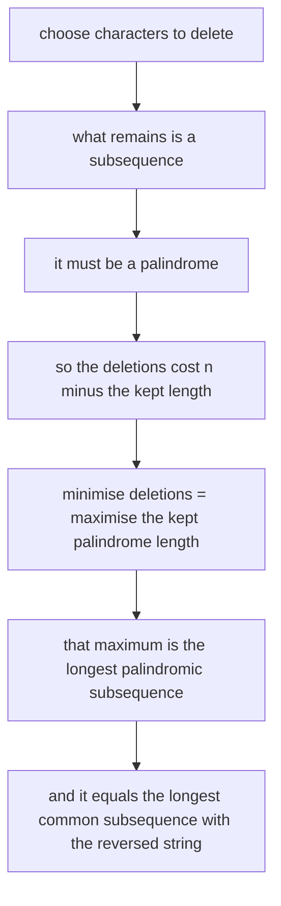
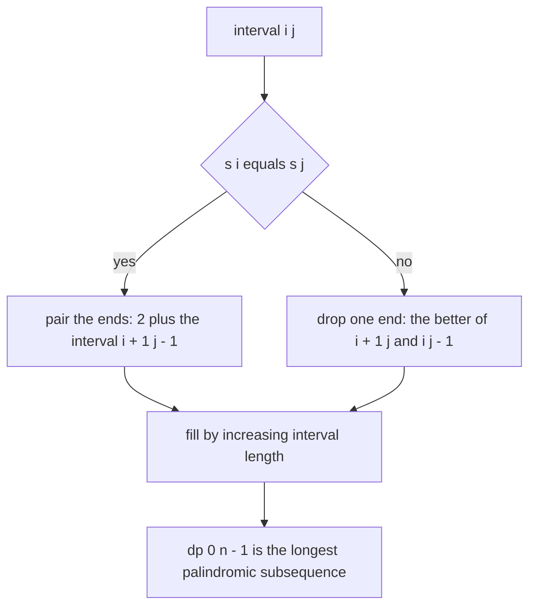
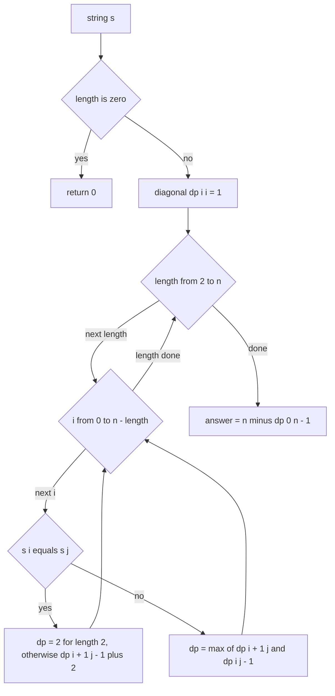
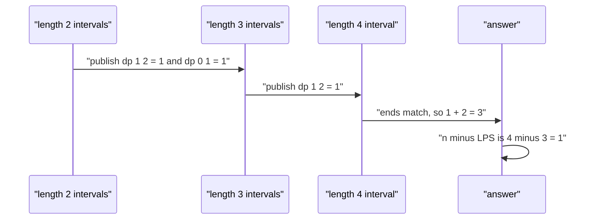

# 304 — Minimum deletion to make palindrome (LCS trick).

> **Tier:** Intermediate · **CTCI chapter:** Ch 8 — Recursion and Dynamic Programming
> **Task spec:** [304-minimum-deletion-to-make-palindrome-lcs-trick.md](../../../tasks/intermediate/304-minimum-deletion-to-make-palindrome-lcs-trick.md)
> **Solutions:** [Python](../../../solutions/python/intermediate/304-minimum-deletion-to-make-palindrome-lcs-trick/solution.py) ·
> [Java](../../../solutions/java/intermediate/304-minimum-deletion-to-make-palindrome-lcs-trick/Solution.java) ·
> [JavaScript](../../../solutions/javascript/intermediate/304-minimum-deletion-to-make-palindrome-lcs-trick/solution.js) ·
> [C#](../../../solutions/csharp/intermediate/304-minimum-deletion-to-make-palindrome-lcs-trick/Solution.cs)

## 1. Problem restatement

**Input:** a string `s` of `n` characters; it may be empty. Deletions are allowed anywhere — a
deleted character is removed and the rest closes up, so the remaining characters keep their relative
order (a subsequence).

**Output:** the minimum number of characters to delete so that what is left reads the same forwards
and backwards.

The solution header states the identity the code is built on:

    deletions = length(s) - LPS(s),   where LPS(s) is the longest palindromic subsequence of s

and the files compute LPS **twice, independently**: `minimum_deletions` uses a direct interval DP,
while `lcs_length(s, reverse(s))` computes the longest common subsequence against the reversed
string. The two must agree, and the equality `LPS(s) == LCS(s, reverse(s))` is asserted on every
test string.

| Call | Result | Why |
| --- | --- | --- |
| `minimum_deletions("aebcbda")` | `2` | keep `a b c b a`, drop `e` and `d` |
| `minimum_deletions("abc")` | `2` | keep one character |
| `minimum_deletions("abcd")` | `3` | every character is distinct, so keep exactly one |
| `minimum_deletions("aa")` | `0` | already a palindrome |
| `minimum_deletions("racecar")` | `0` | already a palindrome |
| `minimum_deletions("")` | `0` | nothing to delete |
| `minimum_deletions("a")` | `0` | already a palindrome |

The cross-checks are `LPS(s) == LCS(s, reverse(s))` on `"aebcbda"`, `"geeksforgeeks"`, `"abca"`,
`"abbc"` and `""`, and then on 60 random strings of length 10 over the alphabet `abcd`. The random
loop also asserts the range `0 <= n - LPS <= n`, which catches a DP that returns a value outside the
possible answer set.

## 2. Intuition

Think about what survives. Any set of deletions leaves a subsequence of `s`, and that subsequence
must be a palindrome. Conversely, any palindromic subsequence can be obtained by deleting everything
else. So minimising deletions is exactly maximising the length of a palindromic subsequence:

    min deletions = n - max length of a palindromic subsequence

The two-sided version of the same fact is the LCS trick: a palindrome reads the same in both
directions, so a palindromic subsequence of `s` is a common subsequence of `s` and its reverse.
Therefore

    LPS(s) = LCS(s, reverse(s))

Both halves of this identity are worth keeping in mind, because together they turn a palindrome
problem into the two most standard subsequence DPs.



The interval DP computes the maximum directly. For the interval `s[i..j]`:

- if `s[i] == s[j]`, the two ends can be paired: the answer is `2 + LPS(s[i+1..j-1])`;
- otherwise at least one end must be dropped from the palindrome, so the answer is the better of
  `LPS(s[i+1..j])` and `LPS(s[i..j-1])`.

That is the same "peel the ends" recurrence that drives the classic LCS table, with one structural
difference: here the two sequences are the two ends of the *same* string, so the state is an
interval `[i, j]` rather than a pair of pointers.



The fill order is the whole trick: an interval of length `len` only ever reads intervals of length
`len - 1` and `len - 2`, so processing lengths in increasing order guarantees the dependencies are
ready.

## 3. Algorithm

1. Handle `n = 0`: there is no interval, so `LPS = 0` and the answer is `0`.
2. Allocate `dp` with `n` rows and `n` columns; set `dp[i][i] = 1` for every single character
   (an interval of length 1 is always a palindrome).
3. For `length` from `2` to `n`, and for each `i` with `i + length - 1 < n`, let `j = i + length - 1`:
   - if `s[i] == s[j]`, set `dp[i][j] = 2` when `length == 2` (the whole interval is a two-character
     palindrome) and `dp[i + 1][j - 1] + 2` otherwise;
   - else set `dp[i][j] = max(dp[i + 1][j], dp[i][j - 1])`.
4. `LPS = dp[0][n - 1]`; return `n - LPS`.
5. Independently, for the cross-check, compute `LCS(s, reverse(s))` with two rolling rows: keep
   `previous` and fill `current[j] = previous[j - 1] + 1` on a match, otherwise
   `max(previous[j], current[j - 1])`.

```text
procedure longest_palindromic_subsequence(s)
    n ← length(s)
    if n = 0 then
        return 0
    end
    dp ← table of n rows and n columns, all zero
    for i ← 0 to n - 1 do
        dp[i][i] ← 1
    end
    for length ← 2 to n do
        for i ← 0 to n - length do
            j ← i + length - 1
            if s[i] = s[j] then
                if length = 2 then
                    dp[i][j] ← 2
                else
                    dp[i][j] ← dp[i + 1][j - 1] + 2
                end
            else
                dp[i][j] ← maximum(dp[i + 1][j], dp[i][j - 1])
            end
        end
    end
    return dp[0][n - 1]
end

procedure lcs_length(a, b)
    previous ← row of length(b) + 1 zeros
    for i ← 1 to length(a) do
        current ← row of length(b) + 1 zeros
        for j ← 1 to length(b) do
            if a[i - 1] = b[j - 1] then
                current[j] ← previous[j - 1] + 1
            else
                current[j] ← maximum(previous[j], current[j - 1])
            end
        end
        previous ← current
    end
    return previous[length(b)]
end

procedure minimum_deletions(s)
    return length(s) - longest_palindromic_subsequence(s)
end
```



## 4. Worked example

Trace the interval DP on `"abca"`, one of the cross-check strings. The assertion is
`minimum_deletions("abca") == 1`, so `LPS("abca")` must be `3`. Indices: 0 `a`, 1 `b`, 2 `c`, 3 `a`.

Diagonal first: `dp[i][i] = 1` for all four indices; empty intervals are `0`.

| Length | Interval | `s[i]` vs `s[j]` | Candidates | `dp[i][j]` |
| --- | --- | --- | --- | --- |
| 2 | `(0, 1)` `ab` | mismatch | `dp[1][1] = 1`, `dp[0][0] = 1` | 1 |
| 2 | `(1, 2)` `bc` | mismatch | `dp[2][2] = 1`, `dp[1][1] = 1` | 1 |
| 2 | `(2, 3)` `ca` | mismatch | `dp[3][3] = 1`, `dp[2][2] = 1` | 1 |
| 3 | `(0, 2)` `abc` | `a` vs `c` mismatch | `dp[1][2] = 1`, `dp[0][1] = 1` | 1 |
| 3 | `(1, 3)` `bca` | `b` vs `a` mismatch | `dp[2][3] = 1`, `dp[1][2] = 1` | 1 |
| 4 | `(0, 3)` `abca` | `a` == `a` match | `dp[1][2] + 2 = 1 + 2` | 3 |

The finished table, rows `i` and columns `j`:

| `dp` | `j = 0` | `j = 1` | `j = 2` | `j = 3` |
| --- | --- | --- | --- | --- |
| `i = 0` | 1 | 1 | 1 | **3** |
| `i = 1` | — | 1 | 1 | 1 |
| `i = 2` | — | — | 1 | 1 |
| `i = 3` | — | — | — | 1 |

`dp[0][3] = 3`, so `minimum_deletions("abca") = 4 - 3 = 1`: delete the `b` and keep `aca`, or
delete the `c` and keep `aba`. The bottom-right-of-the-interval cell is the answer, and it is the
last cell filled — the length loop guarantees it.



For the longer asserted case `"aebcbda"` the same recurrence yields `LPS = 5` (the subsequence
`a b c b a` at indices `0, 2, 3, 4, 6`), and `7 - 5 = 2` deletions — the `e` and the `d`. The LCS
route agrees: the longest common subsequence of `"aebcbda"` and `"adbcbea"` is also length 5, which
is exactly what the cross-check asserts.

## 5. Complexity

Let `n` be the length of `s`.

| Measure | Bound | Why it holds |
| --- | --- | --- |
| Time, interval DP | O(n²) | `n(n + 1)/2` intervals, each filled in constant time |
| Space, interval DP | O(n²) | the full `n × n` table; the DP reads `[i+1][j-1]`, `[i+1][j]` and `[i][j-1]` |
| Time, LCS route | O(n²) | `n` rows of `n` cells against the reversed string |
| Space, LCS route | O(n) | only two rows are kept — that is why the files write it that way |
| Time, brute force over subsequences | exponential | `2^n` subsets, which is why the DP is used |
| Boundary cases | O(1) for `n ≤ 1` | no interval of length 2 or more exists |

The two implementations of the same quantity deliberately have different space profiles: the
interval DP needs the whole table and `O(n²)` memory, while the LCS formulation keeps two rows and
uses `O(n)`. Both are `O(n²)` in time, and the tests assert that they return the same number on
every input, which is a check on the *identity* `LPS(s) = LCS(s, reverse(s))` as much as on the
implementations.

## 6. Pitfalls and edge cases

- **`length == 2` on a match.** When the interval has two characters and they are equal, the interior
  interval is empty, so `dp[i + 1][j - 1]` would index an out-of-range cell (or a zero cell in a
  padded table). The code branches on `length == 2` and assigns `2` directly; all four files do this
  and the `"aa"` assertion covers it.
- **The `n == 0` guard.** The interval DP indexes `dp[0][n - 1]`, which is meaningless for an empty
  string, so the function returns `0` first. `minimum_deletions("")` is asserted to be `0`.
- **Single character.** `dp[0][0] = 1`, hence `0` deletions. Asserted in all four files.
- **Already-palindromic input.** `"aa"` and `"racecar"` both give `0`; the recurrence pairs every
  matched end, and the DP value equals `n` exactly when the whole string is a palindrome.
- **All-distinct input.** `"abcd"` gives `3`: no end pair can be matched beyond the length-1
  diagonal, so the maximum palindromic subsequence is a single character. This is where an
  off-by-one in the deletion arithmetic shows up as `4` instead of `3`.
- **Deletions are not edits.** This task counts removals only; inserting or replacing characters
  would be the edit-distance problem of
  [297-multi-dimensional-dp-example-edit-distance-variants.md](./297-multi-dimensional-dp-example-edit-distance-variants.md),
  a different recurrence and a different answer.
- **Subsequence, not substring.** `"abca"` keeps `aca`, which is *not* a contiguous block of the
  input. Any implementation that slid a window instead of choosing a subsequence would still pass
  `"racecar"` and fail `"abca"`. Contiguous palindromes are counted by task 303.
- **The bound `0 ≤ n - LPS ≤ n`.** The random loop asserts it. A DP that over-counted (say by adding
  `2` for a matched pair without checking the interior) would exceed `n` and be caught here rather
  than by a value comparison.
- **Memory pressure.** The `O(n²)` table is fine for the test lengths but not for long strings; the
  rolling-row LCS version in the same file is the template for an `O(n)` variant.
- **`reverse` semantics across languages.** Python uses `s[::-1]`, Java `new StringBuilder(s).reverse()`,
  C# `s.Reverse().ToArray()`, JavaScript `[...s].reverse().join("")`. Only the JavaScript form
  iterates code points; the others reverse UTF-16 code units, which matters for non-BMP characters.

## 7. Variants and follow-ups

- **The DP-table sibling.** [307-longest-palindromic-subsequence-dp.md](./307-longest-palindromic-subsequence-dp.md)
  is the same interval DP exposed directly as the answer, rather than used as `n` minus deletions.
- **Longest common subsequence.** [121-longest-common-subsequence-lcs-dp.md](../../../tasks/beginner/121-longest-common-subsequence-lcs-dp.md)
  builds the two-sequence table the trick relies on; the same `previous`/`current` rolling rows
  appear here in `lcs_length`.
- **Contiguous palindromes.** [303-count-palindromic-substrings-dp.md](./303-count-palindromic-substrings-dp.md)
  counts palindromic substrings, which is a completely different counting problem from keeping a
  subsequence.
- **Palindromic partitions.** [171-minimum-cuts-for-palindrome-partitioning-dp.md](../../../tasks/beginner/171-minimum-cuts-for-palindrome-partitioning-dp.md)
  and [290-palindrome-partitioning-all-partitions-backtracking.md](../../../tasks/intermediate/290-palindrome-partitioning-all-partitions-backtracking.md)
  reuse the interval table to cut the string into palindromic pieces.
- The chapter walkthrough [Recursion and DP](../../ctci/08-recursion-and-dp.md) develops interval
  DPs alongside the linear ones used elsewhere in the tier.

## 8. Check yourself

1. Why is `min deletions` equal to `n - LPS(s)` and not, say, `n - LCS(s, reverse(s))` in a
   different sense?

<details><summary>Show answer</summary>

Because the two quantities are the same thing: `LPS(s) = LCS(s, reverse(s))`. Any palindromic
subsequence of `s` reads forwards equal to its reverse, so it is a common subsequence of `s` and
`reverse(s)`; conversely a common subsequence of those two can be arranged into a palindrome.
Minimising deletions is maximising what is kept, and what is kept must be a palindrome.

</details>

2. What is `dp[i][j]` in the interval DP, and why does the fill order matter?

<details><summary>Show answer</summary>

`dp[i][j]` is the length of the longest palindromic subsequence *inside* the interval `s[i..j]`. The
recurrence reads `dp[i + 1][j - 1]`, `dp[i + 1][j]` and `dp[i][j - 1]`, all strictly shorter
intervals, so filling by increasing interval length guarantees every dependency is already computed.
The answer is `dp[0][n - 1]`.

</details>

3. Why does the code special-case `length == 2`?

<details><summary>Show answer</summary>

Because the interior of a two-character interval is empty and `dp[i + 1][j - 1]` would refer to an
invalid cell. When `s[i] == s[j]` on a length-2 interval, the whole interval is a palindrome of
length `2`, so the code assigns exactly that instead of adding `2` to a nonexistent interior. Every
other matched interval is at least length 3 and has a valid interior.

</details>

4. Which of the two implementations uses less memory, and what does the test do with that fact?

<details><summary>Show answer</summary>

`lcs_length` uses `O(n)`: two rows of `n + 1` entries, replaced in place. The interval DP uses
`O(n²)` for the full table. The tests do not compare memory; they assert that both produce the same
number, which is what makes the LCS formulation a usable substitute for the interval DP.

</details>

5. What does the random test loop assert besides the LPS/LCS equality?

<details><summary>Show answer</summary>

That `0 <= len(s) - lps <= len(s)`, i.e. the deletion count is a legal number of deletions: it cannot
be negative (which would imply keeping more characters than exist) and cannot exceed the string
length. It is a cheap sanity bound that catches a DP that overshoots, independent of the value
comparison.

</details>
