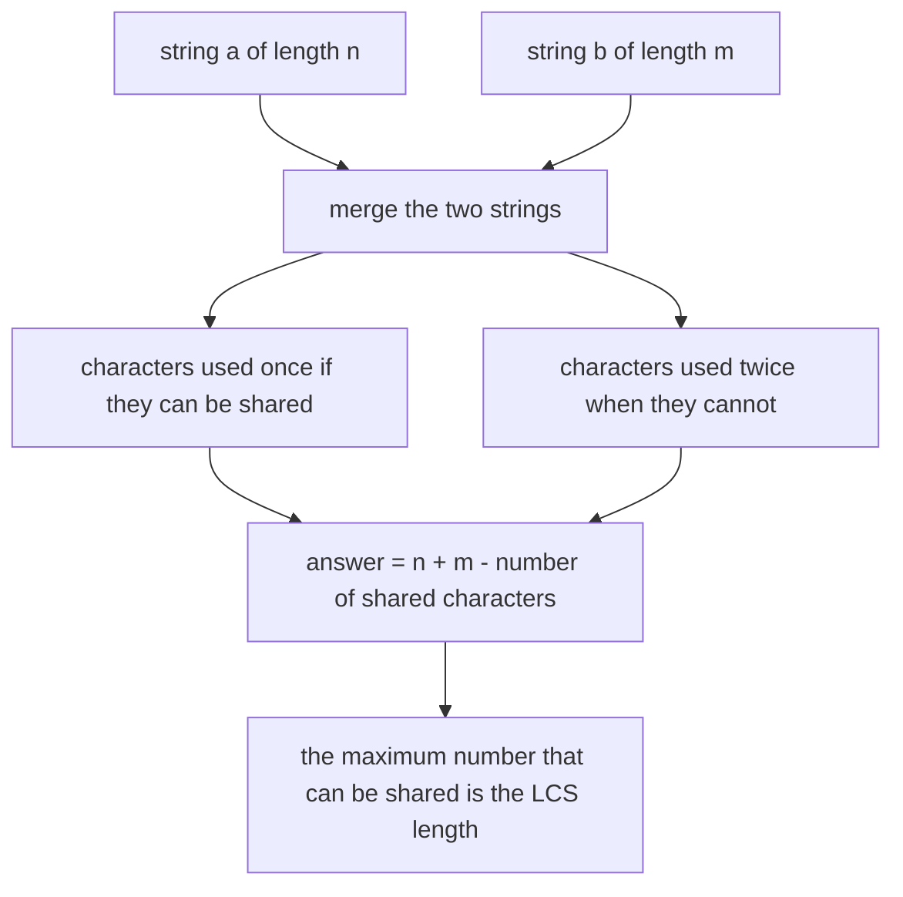
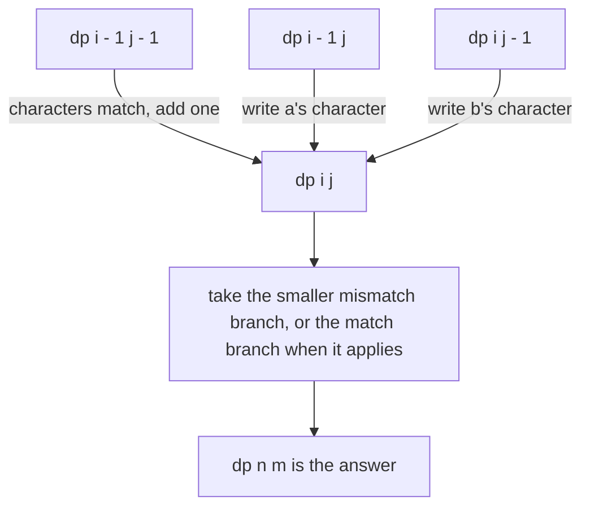
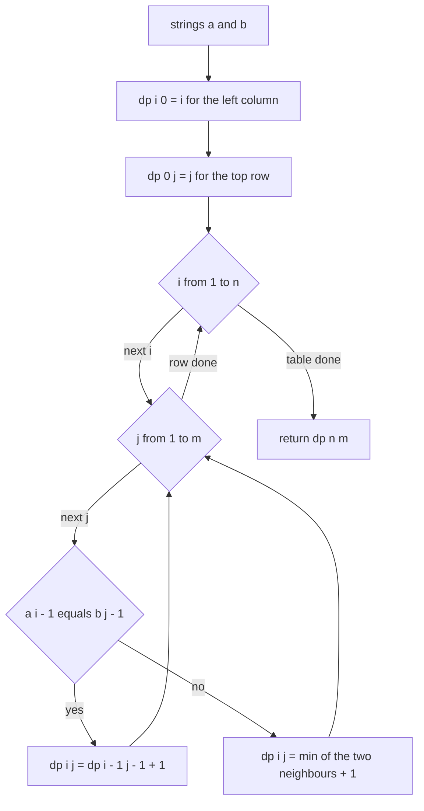
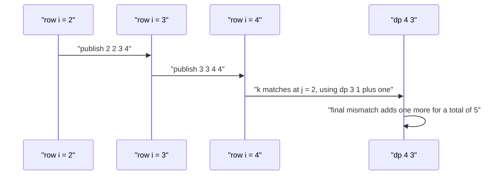

# 305 — Shortest common supersequence length (DP).

> **Tier:** Intermediate · **CTCI chapter:** Ch 11 — Testing
> **Task spec:** [305-shortest-common-supersequence-length-dp.md](../../../tasks/intermediate/305-shortest-common-supersequence-length-dp.md)
> **Solutions:** [Python](../../../solutions/python/intermediate/305-shortest-common-supersequence-length-dp/solution.py) ·
> [Java](../../../solutions/java/intermediate/305-shortest-common-supersequence-length-dp/Solution.java) ·
> [JavaScript](../../../solutions/javascript/intermediate/305-shortest-common-supersequence-length-dp/solution.js) ·
> [C#](../../../solutions/csharp/intermediate/305-shortest-common-supersequence-length-dp/Solution.cs)

## 1. Problem restatement

**Input:** two strings `a` (length `n`) and `b` (length `m`). Either may be empty.

**Output:** the **length** of the shortest string that contains both `a` and `b` as subsequences.
The string itself is not returned — that is task
[306](./306-reconstruct-shortest-common-supersequence.md); this task returns only the number.

The solution header records the identity the tests are built around:

    SCS(a, b) = |a| + |b| - LCS(a, b)

*"every shared character is written once instead of twice"* — and the files compute both sides,
asserting that they agree.

| Call | Result | Why |
| --- | --- | --- |
| `scs_length("AGGTAB", "GXTXAYB")` | `9` | the classic textbook pair, length `6 + 7 - 4` |
| `scs_length("ab", "b")` | `2` | `"ab"` already contains `b` |
| `scs_length("", "abc")` | `3` | one side empty: the answer is the other side |
| `scs_length("abc", "")` | `3` | symmetric |
| `scs_length("", "")` | `0` | nothing to contain |
| `scs_length("abc", "abc")` | `3` | identical strings share everything |
| `scs_length("geek", "eke")` | `5` | the docstring's comment gives `"geeke"` as an example supersequence |

Two families of cross-checks follow the fixed cases:

1. `scs_length(a, b) == len(a) + len(b) - lcs_length(a, b)` on the pairs
   `("AGGTAB", "GXTXAYB")`, `("geek", "eke")`, `("ab", "b")`, and then on 20 disjoint pairs drawn
   from 40 LCG strings of length 6 over the alphabet `abc`;
2. `scs_length(a, b) >= max(len(a), len(b))` — the supersequence cannot be shorter than either
   input, so a DP that under-counts is caught directly.

The Python file also defines an `is_subsequence` helper; the length task does not need it, but the
reconstruction task in the same tier uses it to verify its output.

## 2. Intuition

Building the shortest supersequence by hand is a merge: walk both strings and, whenever the next
characters differ, decide which one to consume. Consuming a character appends it to the result, so
the goal is to consume as many *pairs of equal characters* as possible from the shared positions.
Every such shared character is written once instead of twice, which is exactly the LCS.



That gives the closed form `n + m - LCS(a, b)`. The direct DP is the merge written out as a table:
`dp[i][j]` is the length of the shortest supersequence of the prefixes `a[:i]` and `b[:j]`. Filling
it needs exactly the same decision the merge makes:

- if `a[i - 1] == b[j - 1]`, that character can be shared, so
  `dp[i][j] = dp[i - 1][j - 1] + 1`;
- otherwise one of the two last characters must be written on its own, so
  `dp[i][j] = min(dp[i - 1][j], dp[i][j - 1]) + 1`.

The base cases say the same thing in the degenerate direction: a supersequence of `a[:i]` and the
empty string is `a[:i]` itself, so `dp[i][0] = i`, and symmetrically `dp[0][j] = j`.



Compare this with the edit-distance recurrence in
[297](./297-multi-dimensional-dp-example-edit-distance-variants.md): the shapes are identical, but
here a match *costs* one (the shared character is still written) instead of being free, and a
mismatch always costs one, so no substitution operation exists. This is a "merge two sequences"
DP, not a "transform one into the other" DP.

## 3. Algorithm

1. Allocate `dp` with `n + 1` rows and `m + 1` columns.
2. Base cases: `dp[i][0] = i` for all `i` and `dp[0][j] = j` for all `j`.
3. For `i` from `1` to `n` and `j` from `1` to `m`:
   - if `a[i - 1] == b[j - 1]`, `dp[i][j] = dp[i - 1][j - 1] + 1`;
   - otherwise `dp[i][j] = min(dp[i - 1][j], dp[i][j - 1]) + 1`.
4. Return `dp[n][m]`.
5. For the cross-check, compute `LCS(a, b)` with two rolling rows and assert
   `dp[n][m] == n + m - LCS(a, b)`.

```text
procedure scs_length(a, b)
    n ← length(a)
    m ← length(b)
    dp ← table of n + 1 rows and m + 1 columns
    for i ← 0 to n do
        dp[i][0] ← i
    end
    for j ← 0 to m do
        dp[0][j] ← j
    end
    for i ← 1 to n do
        for j ← 1 to m do
            if a[i - 1] = b[j - 1] then
                dp[i][j] ← dp[i - 1][j - 1] + 1
            else
                dp[i][j] ← minimum(dp[i - 1][j], dp[i][j - 1]) + 1
            end
        end
    end
    return dp[n][m]
end
```

```text
procedure lcs_length(a, b)
    previous ← row of length(b) + 1 zeros
    for i ← 1 to length(a) do
        current ← row of length(b) + 1 zeros
        for j ← 1 to length(b) do
            if a[i - 1] = b[j - 1] then
                current[j] ← previous[j - 1] + 1
            else
                current[j] ← maximum(previous[j], current[j - 1])
            end
        end
        previous ← current
    end
    return previous[length(b)]
end
```



## 4. Worked example

Trace `scs_length("geek", "eke")`, asserted to be `5`. `n = 4`, `m = 3`; indices `i` run over
`g e e k` and `j` over `e k e`.

Base cases: `dp[i][0] = i` gives the column `0, 1, 2, 3, 4`; `dp[0][j] = j` gives the row
`0, 1, 2, 3`.

| `i` | `a[i-1]` | `j` | `b[j-1]` | match? | candidates | `dp[i][j]` |
| --- | --- | --- | --- | --- | --- | --- |
| 1 | `g` | 1 | `e` | no | `dp[0][1] = 1`, `dp[1][0] = 1` | 2 |
| 1 | `g` | 2 | `k` | no | `dp[0][2] = 2`, `dp[1][1] = 2` | 3 |
| 1 | `g` | 3 | `e` | no | `dp[0][3] = 3`, `dp[1][2] = 3` | 4 |
| 2 | `e` | 1 | `e` | **yes** | `dp[1][0] + 1 = 2` | 2 |
| 2 | `e` | 2 | `k` | no | `dp[1][2] = 3`, `dp[2][1] = 2` | 3 |
| 2 | `e` | 3 | `e` | **yes** | `dp[1][2] + 1 = 4` | 4 |
| 3 | `e` | 1 | `e` | **yes** | `dp[2][0] + 1 = 3` | 3 |
| 3 | `e` | 2 | `k` | no | `dp[2][2] = 3`, `dp[3][1] = 3` | 4 |
| 3 | `e` | 3 | `e` | **yes** | `dp[2][2] + 1 = 4` | 4 |
| 4 | `k` | 1 | `e` | no | `dp[3][1] = 3`, `dp[4][0] = 4` | 4 |
| 4 | `k` | 2 | `k` | **yes** | `dp[3][1] + 1 = 4` | 4 |
| 4 | `k` | 3 | `e` | no | `dp[3][3] = 4`, `dp[4][2] = 4` | **5** |

The finished table:

| `dp` | `j = 0` | `j = 1` (`e`) | `j = 2` (`k`) | `j = 3` (`e`) |
| --- | --- | --- | --- | --- |
| `i = 0` | 0 | 1 | 2 | 3 |
| `i = 1` (`g`) | 1 | 2 | 3 | 4 |
| `i = 2` (`e`) | 2 | 2 | 3 | 4 |
| `i = 3` (`e`) | 3 | 3 | 4 | 4 |
| `i = 4` (`k`) | 4 | 4 | 4 | **5** |

`dp[4][3] = 5`. The identity agrees: `LCS("geek", "eke") = 2` (the shared subsequence `ek`), so
`4 + 3 - 2 = 5`. ✓



Every cell is decided by two neighbours and a character comparison, which is why the answer is
`O(n · m)` even though the number of candidate supersequences is exponential.

## 5. Complexity

Let `n = length(a)` and `m = length(b)`.

| Measure | Bound | Why it holds |
| --- | --- | --- |
| Time, direct DP | O(n · m) | every cell is filled once from constant-time comparisons |
| Space, direct DP | O(n · m) | the full table is kept; the reconstruction task needs it |
| Time, LCS route | O(n · m) | `n` rows of `m` cells against `b` |
| Space, LCS route | O(n) | two rolling rows of `m + 1` entries |
| Time, brute-force search | exponential | trying supersequence candidates is not viable |
| Boundary cases | O(1) | when either string is empty the answer is the other length |

The closed form and the DP are both `O(n · m)`, so the formula is not asymptotically better — its
value is as a *test oracle*. Two independent derivations of the same number, agreeing on fixed
inputs and on 20 randomized pairs, is stronger evidence than either one alone, and it is the reason
this task's file contains both implementations.

## 6. Pitfalls and edge cases

- **Base cases are lengths, not zeros.** `dp[i][0] = i` and `dp[0][j] = j`, because a supersequence
  of a string with the empty string is the string. Leaving the first column and row at zero makes
  every answer too small by `min(n, m)`.
- **A match costs one.** Unlike edit distance, a matching pair still contributes one character to the
  supersequence (`dp[i - 1][j - 1] + 1`). Writing `+ 0` for a match — a habit from edit distance —
  gives the LCS length instead of the supersequence length.
- **A mismatch costs one, and you choose the branch.** `min(dp[i - 1][j], dp[i][j - 1]) + 1`; using
  `max` would compute the longest common *supersequence*-style quantity, which is not the problem.
- **Empty strings.** `("", "abc")` and `("abc", "")` both give `3`, `("", "")` gives `0`. All four
  files assert all three, and the recurrence degenerates to the base column or row.
- **Identical strings.** `("abc", "abc")` gives `3`: every character matches on the diagonal and the
  answer is just `n`. An implementation that always adds both characters on a match returns `6`.
- **The lower bound.** `scs_length(a, b) >= max(len(a), len(b))` is asserted on every random pair. It
  catches a DP that returns less than the longest input, which no legal merge can do.
- **Order matters.** A supersequence is not a multiset union: `"ab"` and `"ba"` both have length 2 as
  strings, and their shortest common supersequence has length `3` (`"aba"` or `"bab"`), not `2`.
  Returning `max(len(a), len(b))` in general is wrong for exactly this reason.
- **Cross-check independence.** `lcs_length` uses rolling rows and never touches the SCS table, so
  the assertion compares two different code paths rather than a table against itself.
- **Alphabet and case.** `"AGGTAB"` / `"GXTXAYB"` are uppercase and the random strings are lowercase;
  the comparison is a plain character equality, so no case folding is implied or performed.
- **What is *not* checked here.** The length is verified, not the string; whether a particular
  reconstruction is the *lexicographically smallest* supersequence is not asserted anywhere in this
  task, and task 306 documents its tie-breaking instead of claiming uniqueness.

## 7. Variants and follow-ups

- **Reconstruct the string.** [306-reconstruct-shortest-common-supersequence.md](./306-reconstruct-shortest-common-supersequence.md)
  adds the backward walk over this exact table and verifies the result by *containment* instead of by
  length alone.
- **Longest common subsequence.** [121-longest-common-subsequence-lcs-dp.md](../../../tasks/beginner/121-longest-common-subsequence-lcs-dp.md)
  is the quantity the closed form subtracts, and the rolling-row helper here is the same code.
- **Edit distance.** [297-multi-dimensional-dp-example-edit-distance-variants.md](./297-multi-dimensional-dp-example-edit-distance-variants.md)
  has the same grid shape with three weighted transitions; comparing the two tables side by side is
  the quickest way to see how the interpretation of a cell changes the recurrence.
- **Palindrome variants.** [304-minimum-deletion-to-make-palindrome-lcs-trick.md](./304-minimum-deletion-to-make-palindrome-lcs-trick.md)
  uses the mirrored version of the same trick: `LPS(s) = LCS(s, reverse(s))`.
- The chapter walkthrough [Testing](../../ctci/11-testing.md) is where the "two implementations must
  agree" style of check belongs.

## 8. Check yourself

1. Why is the answer `n + m - LCS(a, b)`?

<details><summary>Show answer</summary>

A supersequence writes every character of `a` and every character of `b`, except that a character
can serve both strings at once when the two occurrences can be aligned. The maximum number of such
shared writes is the length of a longest common subsequence, so at least `n + m - LCS` writes are
needed, and that bound is achievable by merging along an LCS. Hence equality.

</details>

2. What is `dp[i][j]`, and why is the match case different from edit distance?

<details><summary>Show answer</summary>

`dp[i][j]` is the length of a shortest common supersequence of `a[:i]` and `b[:j]`. On a match the
shared character is written once and covers both prefixes, so the cost is `dp[i - 1][j - 1] + 1`. In
edit distance a matching character is *free* (`+ 0`) because nothing is written; here something is
always written, so the `+ 1` never disappears.

</details>

3. What are the base cases and what would happen if they were zero?

<details><summary>Show answer</summary>

`dp[i][0] = i` and `dp[0][j] = j`: containing a string plus the empty string needs that string.
With zeros instead, every recurrence would start one step too cheaply and the answer would come out
`min(n, m)` short — for the classic pair, `9` would become `6`.

</details>

4. Why does the test suite compare against `lcs_length` rather than against known supersequences?

<details><summary>Show answer</summary>

Because the identity `SCS = n + m - LCS` is exact, and `lcs_length` is an independent implementation
(the classic two-row LCS) that shares no code with the SCS table. Comparison with known
supersequences would need a table of expected strings; the identity check scales to 20 random pairs
and catches any systematic error in either routine.

</details>

5. Why is `scs_length("ab", "ba")` equal to `3` and not `2`?

<details><summary>Show answer</summary>

Because a supersequence must contain each input as a *subsequence, in order*. `"ab"` and `"ba"`
cannot both be subsequences of a two-character string — the only two-character supersequences are
`"ab"` and `"ba"`, each of which misses the other input. `"aba"` (or `"bab"`) contains both, so the
answer is `3`. LCS(`"ab"`, `"ba"`) is `1`, and `2 + 2 - 1 = 3`. ✓

</details>
