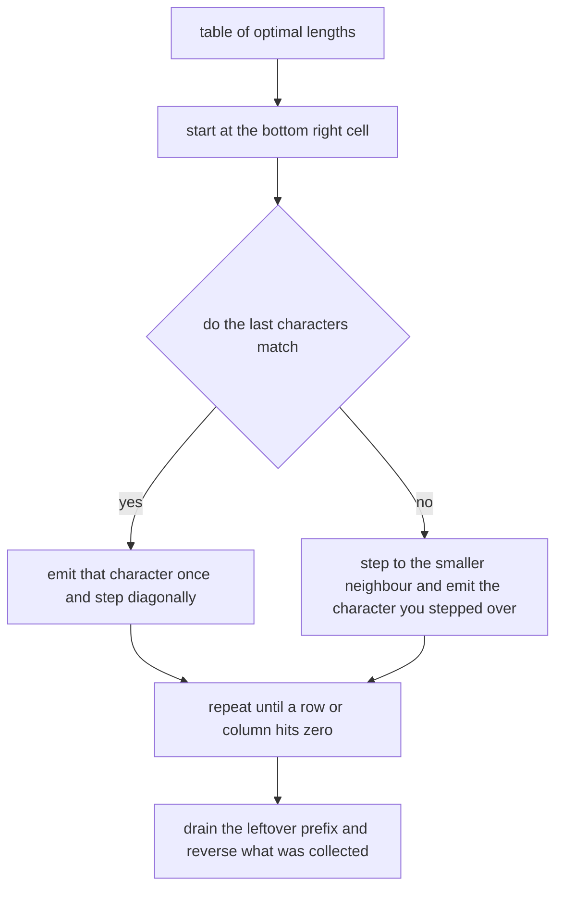
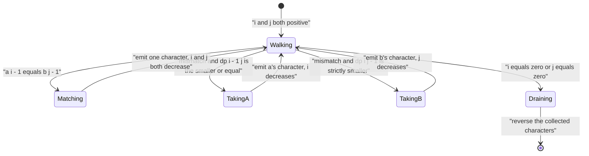
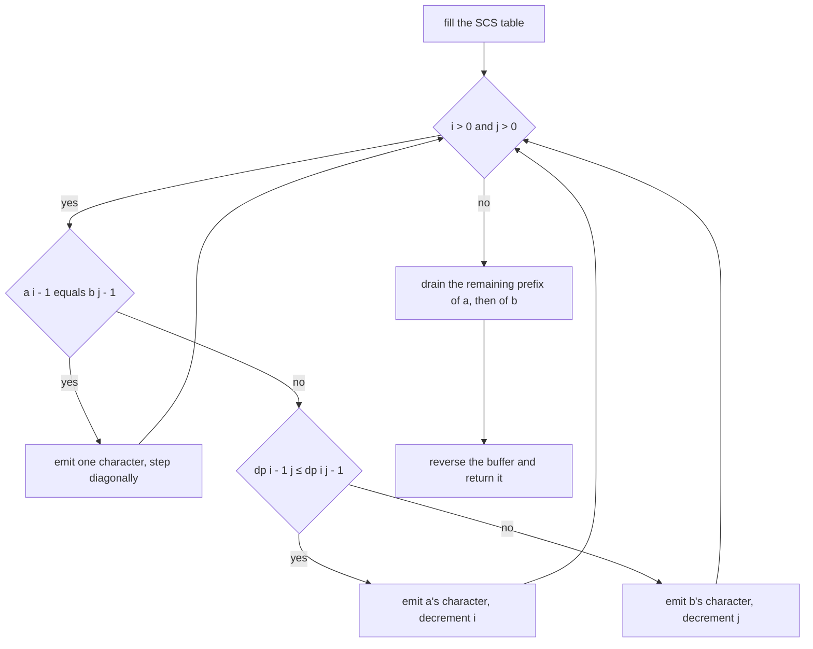
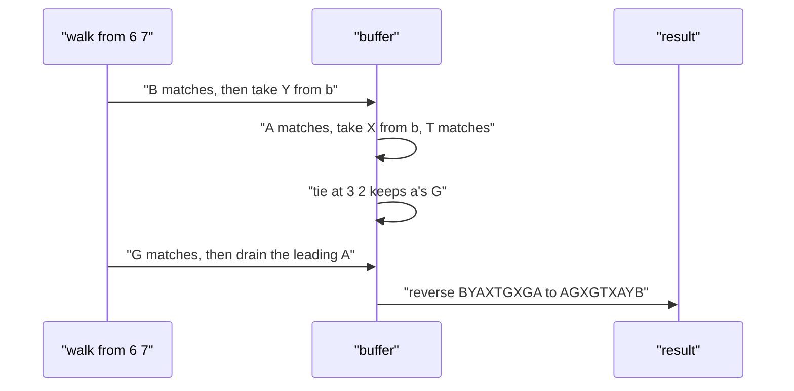

# 306 — Reconstruct shortest common supersequence.

> **Tier:** Intermediate · **CTCI chapter:** Ch 11 — Testing
> **Task spec:** [306-reconstruct-shortest-common-supersequence.md](../../../tasks/intermediate/306-reconstruct-shortest-common-supersequence.md)
> **Solutions:** [Python](../../../solutions/python/intermediate/306-reconstruct-shortest-common-supersequence/solution.py) ·
> [Java](../../../solutions/java/intermediate/306-reconstruct-shortest-common-supersequence/Solution.java) ·
> [JavaScript](../../../solutions/javascript/intermediate/306-reconstruct-shortest-common-supersequence/solution.js) ·
> [C#](../../../solutions/csharp/intermediate/306-reconstruct-shortest-common-supersequence/Solution.cs)

## 1. Problem restatement

**Input:** two strings `a` (length `n`) and `b` (length `m`). Either may be empty.

**Output:** a **string** — not just a length — that contains both `a` and `b` as subsequences and
has minimum possible length. The header of each solution states the method: *"Build the SCS length
table, then walk it backwards: equal characters are emitted once, otherwise follow the cheaper
neighbour. Ties prefer the side of `a` (documented)."*

The tie-break is part of the contract because it makes the output deterministic. It is documented in
a comment next to the comparison in every file, and the fully-pinned assertions are:

| Call | Result | Why |
| --- | --- | --- |
| `shortest_common_supersequence("ab", "b")` | `"ab"` | the whole first string already contains the second |
| `shortest_common_supersequence("abc", "abc")` | `"abc"` | identical strings share every character |
| `shortest_common_supersequence("", "abc")` | `"abc"` | one side is empty |
| `shortest_common_supersequence("abc", "")` | `"abc"` | symmetric case |
| `shortest_common_supersequence("", "")` | `""` | nothing to contain |

The remaining checks are *properties* rather than exact strings, which is the honest way to test an
answer that is not unique:

1. the length equals `len(a) + len(b) - LCS(a, b)`;
2. `a` is a subsequence of the result and so is `b`.

Both are asserted for the classic pair `("AGGTAB", "GXTXAYB")` (length 9) and for 20 disjoint pairs
drawn from 40 LCG strings of length 5 over the alphabet `ab`. The containment check is the
substantive one — the length check alone would accept a string that contains neither input.

## 2. Intuition

The length problem of [305](./305-shortest-common-supersequence-length-dp.md) fills a table of
optimal lengths; the reconstruction problem asks *which* choices produced that optimum. The standard
answer is to keep the table and walk it backwards: every cell knows the neighbour it came from, so
following the "parent" chain from `(n, m)` down to `(0, 0)` spells out the answer in reverse.



Reading the two rules off the recurrence:

- on a **match**, `dp[i][j] = dp[i - 1][j - 1] + 1`, so the character is emitted once and *both*
  indices move back — this is the shared write that made the supersequence short;
- on a **mismatch**, `dp[i][j] = min(dp[i - 1][j], dp[i][j - 1]) + 1`, so the walk steps toward the
  smaller neighbour and emits the character it stepped past. If the two neighbours are equal the
  choice is a genuine tie, and the code breaks it by preferring `a` — that is what makes the output
  deterministic instead of merely correct.

The tail is the mirror image of the base cases `dp[i][0] = i` and `dp[0][j] = j`: once one index
reaches zero, everything left in the other string must be written out verbatim.



Because the walk collects characters from the *end* of the answer backwards, the result is built by
appending and then reversing — which is also why three of the four languages can use the string
builder's own `reverse` (Python reverses the list before joining).

## 3. Algorithm

1. Fill the SCS table exactly as in task 305: `dp[i][0] = i`, `dp[0][j] = j`, and for `i, j ≥ 1`
   either `dp[i - 1][j - 1] + 1` on a match or `min(dp[i - 1][j], dp[i][j - 1]) + 1` otherwise.
2. Start the walk at `i = n`, `j = m` with an empty buffer.
3. While `i > 0` and `j > 0`:
   - if `a[i - 1] == b[j - 1]`: emit `a[i - 1]`, then `i = i - 1` and `j = j - 1`;
   - else if `dp[i - 1][j] <= dp[i][j - 1]`: emit `a[i - 1]`, then `i = i - 1`;
   - else: emit `b[j - 1]`, then `j = j - 1`.
4. While `i > 0`: emit `a[i - 1]`, `i = i - 1`.
5. While `j > 0`: emit `b[j - 1]`, `j = j - 1`.
6. Return the buffer reversed.

```text
procedure shortest_common_supersequence(a, b)
    n ← length(a)
    m ← length(b)
    dp ← table of n + 1 rows and m + 1 columns
    for i ← 0 to n do
        dp[i][0] ← i
    end
    for j ← 0 to m do
        dp[0][j] ← j
    end
    for i ← 1 to n do
        for j ← 1 to m do
            if a[i - 1] = b[j - 1] then
                dp[i][j] ← dp[i - 1][j - 1] + 1
            else
                dp[i][j] ← minimum(dp[i - 1][j], dp[i][j - 1]) + 1
            end
        end
    end

    i ← n
    j ← m
    characters ← empty buffer
    while i > 0 and j > 0 do
        if a[i - 1] = b[j - 1] then
            append a[i - 1] to characters
            i ← i - 1
            j ← j - 1
        else if dp[i - 1][j] ≤ dp[i][j - 1] then
            append a[i - 1] to characters
            i ← i - 1
        else
            append b[j - 1] to characters
            j ← j - 1
        end
    end
    while i > 0 do
        append a[i - 1] to characters
        i ← i - 1
    end
    while j > 0 do
        append b[j - 1] to characters
        j ← j - 1
    end
    return reversed(characters)
end
```



The walk is `O(n + m)`: every step decrements exactly one index, so it performs at most `n + m`
emissions after the `O(n · m)` table has been built. The table construction dominates.

## 4. Worked example

Trace `shortest_common_supersequence("AGGTAB", "GXTXAYB")`. The table is the same one task 305
builds; its bottom-right cell is `9`.

| `dp` | `j=0` | `j=1 G` | `j=2 X` | `j=3 T` | `j=4 X` | `j=5 A` | `j=6 Y` | `j=7 B` |
| --- | --- | --- | --- | --- | --- | --- | --- | --- |
| `i=0` | 0 | 1 | 2 | 3 | 4 | 5 | 6 | 7 |
| `i=1 A` | 1 | 2 | 3 | 4 | 5 | 5 | 6 | 7 |
| `i=2 G` | 2 | 2 | 3 | 4 | 5 | 6 | 7 | 8 |
| `i=3 G` | 3 | 3 | 4 | 5 | 6 | 7 | 8 | 9 |
| `i=4 T` | 4 | 4 | 5 | 5 | 6 | 7 | 8 | 9 |
| `i=5 A` | 5 | 5 | 6 | 6 | 7 | 7 | 8 | 9 |
| `i=6 B` | 6 | 6 | 7 | 7 | 8 | 8 | 9 | **9** |

The backward walk from `(6, 7)`:

| Step | `(i, j)` | comparison | decision | emitted | buffer so far |
| --- | --- | --- | --- | --- | --- |
| 1 | `(6, 7)` | `B` vs `B` match | step diagonally | `B` | `B` |
| 2 | `(5, 6)` | `A` vs `Y` mismatch, `dp[4][6] = 8 ≤ dp[5][5] = 7`? no | take `b` | `Y` | `BY` |
| 3 | `(5, 5)` | `A` vs `A` match | step diagonally | `A` | `BYA` |
| 4 | `(4, 4)` | `T` vs `X` mismatch, `dp[3][4] = 6 ≤ dp[4][3] = 5`? no | take `b` | `X` | `BYAX` |
| 5 | `(4, 3)` | `T` vs `T` match | step diagonally | `T` | `BYAXT` |
| 6 | `(3, 2)` | `G` vs `X` mismatch, `dp[2][2] = 3 ≤ dp[3][1] = 3`? yes (tie) | take `a` | `G` | `BYAXTG` |
| 7 | `(2, 2)` | `G` vs `X` mismatch, `dp[1][2] = 3 ≤ dp[2][1] = 2`? no | take `b` | `X` | `BYAXTGX` |
| 8 | `(2, 1)` | `G` vs `G` match | step diagonally | `G` | `BYAXTGXG` |
| 9 | `(1, 0)` | `i > 0`, `j = 0` | drain `a` | `A` | `BYAXTGXGA` |

Reversing the buffer gives `"AGXGTXAYB"`, of length 9 — the asserted length. Step 6 is the
documented tie: `dp[2][2] = 3` and `dp[3][1] = 3`, and the code keeps `a`'s character because the
comparison is `<=`. A different tie-break would produce a different valid string of the same length,
which is exactly why the assertions check containment and length rather than a literal value.



The fully pinned case is shorter: for `("ab", "b")` the walk starts at `(2, 1)`, finds `b == b`,
emits `b`, steps to `(1, 0)`, drains the leading `a`, and reverses `ba` to `"ab"` — the asserted
result. The classic pair satisfies the containment property too: `A G G T A B` sits at positions
`0, 1, 2, 4, 6, 8` of `AGXGTXAYB`, and `G X T X A Y B` at positions `1, 3, 4, 5, 6, 7, 8`.

## 5. Complexity

Let `n = length(a)` and `m = length(b)`.

| Measure | Bound | Why it holds |
| --- | --- | --- |
| Time, table | O(n · m) | identical to task 305's DP |
| Time, backward walk | O(n + m) | each step decrements `i` or `j`, and both are bounded |
| Time, reverse | O(n + m) | reversing a buffer of the answer's length |
| Time, total | O(n · m) | the table dominates the linear walk |
| Space, table | O(n · m) | kept in full so the parent chain is available |
| Space, output | O(n + m) | the answer can be at most `n + m` characters |
| Space, oracle helpers | O(m) | `lcs_length` keeps two rolling rows |
| Time, verification per test | O((n + m) · n) | containment is checked with a linear scan per string |

Reconstruction is the reason the full table is kept rather than the two rolling rows that suffice
for the length: a parent pointer needs the neighbouring cells, which a rolling row has already
overwritten. That is the classic space/time trade in DP reconstruction, and it costs a factor of
`min(n, m)`.

## 6. Pitfalls and edge cases

- **Emit before stepping.** In all three branches the character is appended *then* the index moves.
  Appending after the decrement emits the wrong character — the one that was skipped, not the one
  that was consumed.
- **Reversal is mandatory.** The walk produces the answer back to front. Forgetting the reverse
  turns the asserted `("ab", "b") -> "ab"` into `"ba"`, which is wrong on both length-2 order and
  containment (`"ba"` does not contain `"ab"`).
- **The tail loops.** When one index reaches zero the other still has characters left; they must be
  emitted in order. Skipping the tail yields a string that fails the containment check on that
  input, which the random pairs will hit quickly.
- **Tie-breaking must be documented and consistent.** `dp[i - 1][j] <= dp[i][j - 1]` prefers `a`; if
  the comparison were `<`, the other branch would win ties. Both are correct answers of the same
  length, but the files fix one behaviour, and the `("ab", "b")` assertion depends on the emitting
  order that results.
- **`("abc", "abc")` and the empty cases.** The first walks the whole diagonal emitting each
  character once; the empty cases skip the walk entirely and drain the other string. All four files
  assert these five fixed results.
- **The classic pair is checked by property, not by value.** `"AGXGTXAYB"` is what the documented
  tie-break produces, but the file asserts length 9 plus containment — so a different valid
  supersequence of length 9 with both inputs as subsequences would also pass.
- **Containment is directional.** `is_subsequence(candidate, text)` asks whether `candidate` is a
  subsequence of `text`; the tests call it as `is_subsequence(a, scs)`, i.e. "does the answer contain
  `a`". Swapping the arguments checks the wrong direction and passes trivially.
- **Alphabet size.** Random strings use `ab`, so the number of distinct supersequences is small and
  containment is easy to satisfy; the fixed `"AGGTAB"` pair is where the walk exercises all three
  branches, including a tie.
- **Building strings by concatenation.** Java and C# append to a `StringBuilder`/`List<char>` and
  reverse once, JavaScript pushes into an array and joins, Python appends to a list and reverses.
  Concatenating into a string in the loop would be quadratic in the answer length.
- **Surrogates.** Reversal happens on the collected units: Python and JavaScript store code points
  in their lists (JavaScript via `[...text]`-style character access on the input strings), while Java
  and C# store `char` values, so non-BMP characters can be split. The tests use ASCII.

## 7. Variants and follow-ups

- **The length version.** [305-shortest-common-supersequence-length-dp.md](./305-shortest-common-supersequence-length-dp.md)
  builds the same table and stops there; this task is the reconstruction half of the same solution.
- **Reconstruction in other DPs.** The identical "walk the table backwards" pattern recovers the
  edit script of [297-multi-dimensional-dp-example-edit-distance-variants.md](./297-multi-dimensional-dp-example-edit-distance-variants.md)
  and the partition sets of
  [291-partition-equal-subset-dp-with-reconstructing-sets.md](../../../tasks/intermediate/291-partition-equal-subset-dp-with-reconstructing-sets.md).
- **Longest common subsequence.** The classic table in
  [121-longest-common-subsequence-lcs-dp.md](../../../tasks/beginner/121-longest-common-subsequence-lcs-dp.md)
  is reconstructed the same way, and its length is what the supersequence length subtracts.
- **Sequence merging in practice.** The merge walk is the same shape used by diff tools when they
  emit a merged file from a common-subsequence alignment.
- The chapter walkthrough [Testing](../../ctci/11-testing.md) is where the property-based style of
  assertion used here — length plus containment — belongs.

## 8. Check yourself

1. Why does the walk emit a character on *every* step, not only on a mismatch?

<details><summary>Show answer</summary>

Because every step consumes one character from `a` or from `b` (or one from each, on a match), and
the supersequence must contain all of them. A match consumes two characters while emitting one —
that is the saving. So the number of emitted characters equals the number of steps `n + m` minus the
number of matches, which is `n + m - LCS`. ✓

</details>

2. Why is the answer not unique, and how do the tests handle that?

<details><summary>Show answer</summary>

Different tie-breaks (and, more generally, different alignments of equal characters) produce
different strings of the same minimal length. The tests therefore assert the length formula
`n + m - LCS` and containment of both inputs, plus a handful of fully pinned small cases where the
documented tie-break determines the output exactly.

</details>

3. What does `dp[i - 1][j] <= dp[i][j - 1]` decide, and which way does it break ties?

<details><summary>Show answer</summary>

It decides which of the two last characters to write when they differ: if `dp[i - 1][j]` is at most
`dp[i][j - 1]`, dropping `a[i - 1]` is at least as good, so the code emits `a`'s character and
decrements `i`. On an exact tie the `<=` favors `a` — the behaviour the comment in each file
documents.

</details>

4. Why is the length-only check insufficient for this task?

<details><summary>Show answer</summary>

A string of the right length can still be wrong: for `("AGGTAB", "GXTXAYB")` a length-9 string that
contains neither input would satisfy a length assertion. The containment check
(`is_subsequence(a, scs) and is_subsequence(b, scs)`) is what makes the test meaningful, and the two
checks together are a complete verification of the SCS output.

</details>

5. What is the space cost of reconstruction compared with computing only the length?

<details><summary>Show answer</summary>

The length-only version can use two rolling rows, `O(m)` extra space. Reconstruction needs
`dp[i - 1][j]` and `dp[i][j - 1]` along the parent chain, so the full `O(n · m)` table is retained.
That is the standard trade: a `min(n, m)` factor of memory in exchange for being able to name the
answer instead of just measuring it.

</details>
