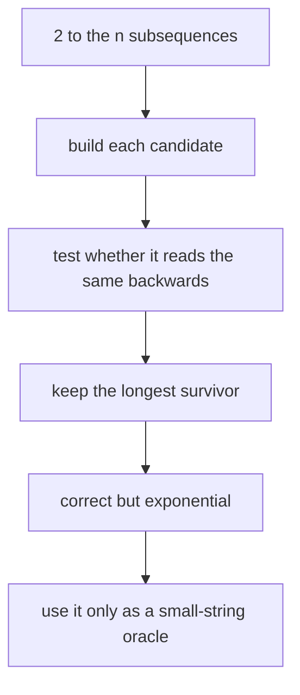
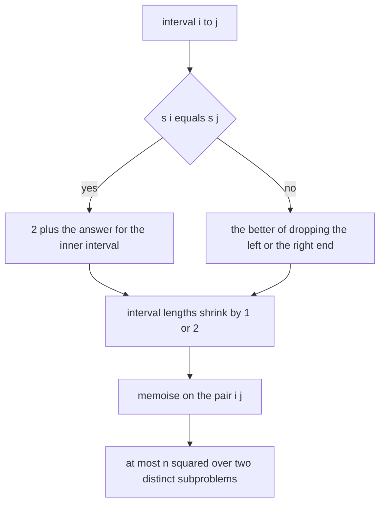
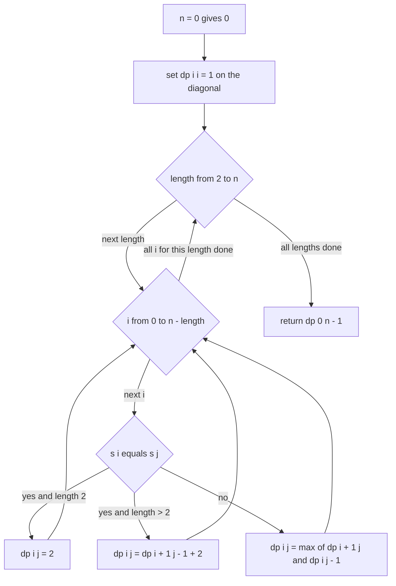
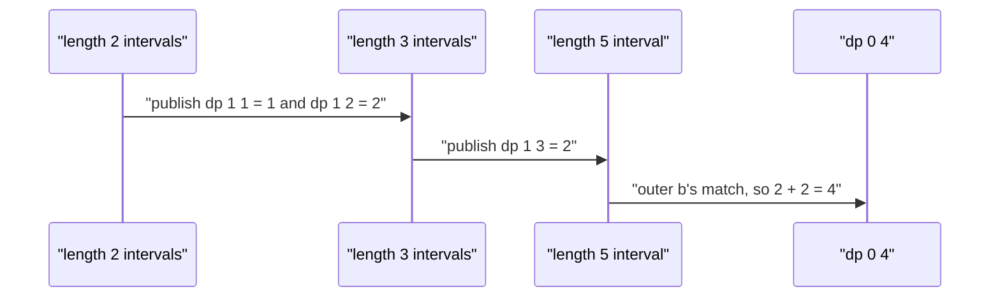

# 307 — Longest palindromic subsequence (DP).

> **Tier:** Intermediate · **CTCI chapter:** Ch 8 — Recursion and Dynamic Programming
> **Task spec:** [307-longest-palindromic-subsequence-dp.md](../../../tasks/intermediate/307-longest-palindromic-subsequence-dp.md)
> **Solutions:** [Python](../../../solutions/python/intermediate/307-longest-palindromic-subsequence-dp/solution.py) ·
> [Java](../../../solutions/java/intermediate/307-longest-palindromic-subsequence-dp/Solution.java) ·
> [JavaScript](../../../solutions/javascript/intermediate/307-longest-palindromic-subsequence-dp/solution.js) ·
> [C#](../../../solutions/csharp/intermediate/307-longest-palindromic-subsequence-dp/Solution.cs)

## 1. Problem restatement

**Input:** a string `s` of `n` characters. It may be empty.

**Output:** the length of the longest **subsequence** of `s` that is a palindrome. Subsequence, not
substring: the chosen characters keep their relative order but need not be contiguous.

The solution header describes the recurrence in one line: *"Interval DP: equal ends extend the inner
answer by 2, otherwise drop one end. Validated against an exhaustive subsequence enumeration on
short strings."*

| Call | Result | Why |
| --- | --- | --- |
| `longest_palindromic_subsequence("bbbab")` | `4` | keep `bbbb` |
| `longest_palindromic_subsequence("cbbd")` | `2` | keep `bb` |
| `longest_palindromic_subsequence("abcde")` | `1` | all characters distinct, so any single character |
| `longest_palindromic_subsequence("racecar")` | `7` | the whole string is a palindrome |
| `longest_palindromic_subsequence("")` | `0` | nothing to keep |
| `longest_palindromic_subsequence("a")` | `1` | a single character is a palindrome |

The oracle is exhaustive and therefore independent of the recurrence: `brute_force` iterates all
`2^n` bitmasks of `s`, builds the corresponding subsequence, and keeps the longest one that reads the
same forwards and backwards. It runs on 60 randomly generated strings of length 10 over the alphabet
`abc` (LCG `seed = (seed * 75 + 74) % 65537`), asserting agreement with the DP on every one.

## 2. Intuition

The brute-force reading is to try every subsequence. For `n = 10` that is `2^10 = 1024` candidates
per string, which the oracle does — and it is exactly why the oracle can only be used on short
strings: `2^n` grows far faster than any polynomial.



The insight that makes it polynomial is the same one as in
[304](./304-minimum-deletion-to-make-palindrome-lcs-trick.md): look at the two ends of an interval.
For the interval `s[i..j]`:

- if `s[i] == s[j]`, those two characters can be the outermost pair of a palindrome, and the best
  answer for the interval is `2 + LPS(s[i+1..j-1])`;
- if they differ, at least one of them must be left out of any palindromic subsequence, so the best
  answer is `max(LPS(s[i+1..j]), LPS(s[i..j-1]))`.

Both branches reduce the interval length, so the recursion terminates — and because the *only* thing
a subproblem depends on is the pair `(i, j)`, there are `n(n + 1)/2` distinct subproblems, each
solvable in constant time.



The reason this cannot be replaced by the simpler "expand around centre" walk of task 303 is that
subsequences may skip characters: the centre of a palindromic subsequence is not a fixed position of
the string, and there is no single window to expand. The interval DP pays `O(n²)` time and space to
handle the skipping.

## 3. Algorithm

1. If `n == 0`, return `0`.
2. Allocate `dp` with `n` rows and `n` columns. Set `dp[i][i] = 1` for every `i` — a one-character
   interval is always a palindrome.
3. For `length` from `2` to `n`, and for each `i` with `i + length - 1 < n`, let `j = i + length - 1`:
   - if `s[i] == s[j]`, set `dp[i][j] = 2` when `length == 2`, else `dp[i + 1][j - 1] + 2`;
   - otherwise set `dp[i][j] = max(dp[i + 1][j], dp[i][j - 1])`.
4. Return `dp[0][n - 1]`.

```text
procedure longest_palindromic_subsequence(s)
    n ← length(s)
    if n = 0 then
        return 0
    end
    dp ← table of n rows and n columns, all zero
    for i ← 0 to n - 1 do
        dp[i][i] ← 1
    end
    for length ← 2 to n do
        for i ← 0 to n - length do
            j ← i + length - 1
            if s[i] = s[j] then
                if length = 2 then
                    dp[i][j] ← 2
                else
                    dp[i][j] ← dp[i + 1][j - 1] + 2
                end
            else
                dp[i][j] ← maximum(dp[i + 1][j], dp[i][j - 1])
            end
        end
    end
    return dp[0][n - 1]
end
```

The `length == 2` branch exists because a two-character matched interval has an empty interior:
`dp[i + 1][j - 1]` would address the pair `(i + 1, j - 1)` with `j - 1 = i`, i.e. a single cell to the
*right* of `i`, which is not the interior of anything. The value is simply `2`.



## 4. Worked example

Trace `longest_palindromic_subsequence("bbbab")`, asserted to be `4`. `n = 5`; indices `0..4` hold
`b`, `b`, `b`, `a`, `b`.

The diagonal is `1` everywhere. Then, by increasing interval length:

| Length | Interval | `s[i]` vs `s[j]` | candidates | `dp[i][j]` |
| --- | --- | --- | --- | --- |
| 2 | `(0, 1)` `bb` | match | — | 2 |
| 2 | `(1, 2)` `bb` | match | — | 2 |
| 2 | `(2, 3)` `ba` | mismatch | `dp[3][3] = 1`, `dp[2][2] = 1` | 1 |
| 2 | `(3, 4)` `ab` | mismatch | `dp[4][4] = 1`, `dp[3][3] = 1` | 1 |
| 3 | `(0, 2)` `bbb` | match | `dp[1][1] + 2 = 3` | 3 |
| 3 | `(1, 3)` `bba` | mismatch | `dp[2][3] = 1`, `dp[1][2] = 2` | 2 |
| 3 | `(2, 4)` `bab` | match | `dp[3][3] + 2 = 3` | 3 |
| 4 | `(0, 3)` `bbba` | mismatch | `dp[1][3] = 2`, `dp[0][2] = 3` | 3 |
| 4 | `(1, 4)` `bbab` | match | `dp[2][3] + 2 = 3` | 3 |
| 5 | `(0, 4)` `bbbab` | match | `dp[1][3] + 2 = 2 + 2` | **4** |

The finished table (blank cells are intervals that do not exist):

| `dp` | `j=0 b` | `j=1 b` | `j=2 b` | `j=3 a` | `j=4 b` |
| --- | --- | --- | --- | --- | --- |
| `i=0 b` | 1 | 2 | 3 | 3 | **4** |
| `i=1 b` | — | 1 | 2 | 2 | 3 |
| `i=2 b` | — | — | 1 | 1 | 3 |
| `i=3 a` | — | — | — | 1 | 1 |
| `i=4 b` | — | — | — | — | 1 |

`dp[0][4] = 4`, realised by the subsequence `bbbb` (all four `b`s, skipping the `a`). The last step
is worth reading closely: the outer `b` at index 0 and the outer `b` at index 4 are paired, and the
inner interval `bbab` contributes `3`. The mismatch rows show the other half of the recurrence —
`dp[0][3]` cannot use both ends (`b` versus `a`) so it inherits the better of the two one-end-shorter
intervals.



Had the string been `"cbbd"` — the second asserted case — the same table would give `dp[1][2] = 2`
for the `bb` pair while both outer characters mismatch everything, so the answer is `2`. `"abcde"`
has no matching pair at all: every interval takes the `max` branch and the answer is the diagonal
value `1`.

## 5. Complexity

Let `n` be the length of `s`.

| Measure | Bound | Why it holds |
| --- | --- | --- |
| Time | O(n²) | `n(n + 1)/2` intervals, each filled in constant time |
| Space | O(n²) | the full table; a cell reads a shorter interval in the same row and the next row |
| Time, brute force | O(2^n · n) | `2^n` subsets, each built and compared in `O(n)` |
| Space, brute force | O(n) | one candidate string at a time |
| Time, LCS formulation | O(n²) | `LPS(s) == LCS(s, reverse(s))`, with two rolling rows instead |
| Boundary cases | O(1) | `n = 0` and `n = 1` skip the loops |

The `O(n²)` space can be reduced: filling by increasing interval length means only the two previous
diagonals (`length - 1` and `length - 2`) are ever read, so a rolling pair of diagonals suffices for
the length alone. Reconstructing an actual subsequence needs the whole table, and the file keeps it.
The oracle is exponential by construction, which is why it only ever sees strings of length 10 —
`2^10` candidates per string times 60 strings is a workload a test can afford, while length 30 would
not be.

## 6. Pitfalls and edge cases

- **The `length == 2` special case.** With two matching characters the interior is empty. An
  unguarded `dp[i + 1][j - 1] + 2` reads the wrong cell, and the assertion on `"bbbab"` — which
  starts with a length-2 match — is the first thing to break.
- **Empty string.** `n == 0` returns `0` before any indexing; `dp[0][n - 1]` would be `dp[0][-1]`
  otherwise. Asserted in all four files.
- **Single character.** `n == 1` returns the diagonal `1`; the length loop does not execute.
  Asserted in all four files.
- **All characters distinct.** `"abcde"` gives `1`: every interval takes the mismatch branch and the
  maximum propagates a single `1`. This is the case that catches a recurrence that accidentally
  counts something it did not choose.
- **Whole-string palindromes.** `"racecar"` gives `7`; the answer saturates at `n`, which the
  `length < n` loops achieve by building up from the inside.
- **Subsequence versus substring.** `"cbbd"` answers `2`, not `3`: `"bb"` is the longest *contiguous*
  palindrome as well, but a substring that spanned it (`"cbb"`, `"bbd"`) is not a palindrome, and the
  DP is free to skip `c` and `d`. The contiguous problem is task 303.
- **Fill order.** Intervals must be processed by increasing length; processing by increasing `i`
  alone would read unfilled cells. The nested loops in the files put `length` outermost precisely for
  this reason.
- **Do not confuse this with the deletion variant.** Task 304 exercises the same table but reports
  `n - LPS`, which is a different quantity; feeding `"bbbab"` to that function gives `1`, not `4`.
- **Memory for long strings.** `O(n²)` cells is 1M entries at `n = 1000`, which is where the LCS
  formulation with rolling rows becomes the better default — it computes the same number in `O(n)`
  space.
- **Index types.** The loops use signed indices with `i + length - 1 < n`; computing `j` for a
  length that overruns `n` would produce an out-of-range index in every language.

## 7. Variants and follow-ups

- **Minimum deletions.** [304-minimum-deletion-to-make-palindrome-lcs-trick.md](./304-minimum-deletion-to-make-palindrome-lcs-trick.md)
  is this table read as `n - LPS(s)`, and additionally cross-checks `LPS` against
  `LCS(s, reverse(s))`.
- **Longest common subsequence.** [121-longest-common-subsequence-lcs-dp.md](../../../tasks/beginner/121-longest-common-subsequence-lcs-dp.md)
  is the same recurrence with two different strings as the axes; the palindromic case is the
  specialisation where the two strings are reverses of each other.
- **Contiguous palindromes.** [303-count-palindromic-substrings-dp.md](./303-count-palindromic-substrings-dp.md)
  counts palindromic substrings with an expansion walk, and
  [231-manacher-s-algorithm-for-longest-palindromic-substring.md](../../../tasks/intermediate/231-manacher-s-algorithm-for-longest-palindromic-substring.md)
  does the linear-time version.
- **Distinct subsequences.** [308-distinct-subsequences-count-dp.md](./308-distinct-subsequences-count-dp.md)
  changes the objective from "longest" to "how many distinct ones", which needs a different
  recurrence because duplicates must be cancelled.
- The chapter walkthrough [Recursion and DP](../../ctci/08-recursion-and-dp.md) places this interval
  DP next to the two-sequence tables of the tier.

## 8. Check yourself

1. What is `dp[i][j]`, and why is the interval formulation necessary?

<details><summary>Show answer</summary>

`dp[i][j]` is the length of the longest palindromic subsequence inside `s[i..j]`. Subsequences may
skip characters, so a palindrome is not tied to a contiguous window and cannot be grown from a
single centre position the way task 303 grows substrings. The interval is the smallest state that
still records which characters are available.

</details>

2. Why does the match branch add `2`, and what happens at `length == 2`?

<details><summary>Show answer</summary>

Because both endpoints can be used as the outermost pair of the palindrome, so the inner interval
contributes its own best answer plus the two outer characters. With `length == 2` the inner interval
is empty, so the code assigns `2` directly instead of indexing a nonexistent cell.

</details>

3. Why is the brute-force oracle limited to short strings?

<details><summary>Show answer</summary>

It enumerates all `2^n` subsets and, for each, builds the subsequence and compares it with its
reverse — `O(2^n · n)` work. That is affordable for `n = 10` (about a thousand candidates per
string) and hopeless for `n = 30`. Its value is that it shares no logic with the recurrence, so
agreement on 60 random strings is real evidence.

</details>

4. What is the answer for `"cbbd"` and why is it not `3`?

<details><summary>Show answer</summary>

`2`. The longest palindromic *subsequence* is `bb`. A length-3 palindromic subsequence would need a
match between its ends, and `"cbbd"` has no character appearing at distance 2 or more in a way that
works out — `c` and `d` never repeat, so the best is the `bb` pair. Note that `"bb"` is also the
longest palindromic substring here, but that is a coincidence of this input, not of the problem.

</details>

5. Could the answer ever be `n` for a string that is not itself a palindrome?

<details><summary>Show answer</summary>

No. A length-`n` palindromic subsequence uses every character in order, which means the original
string is that palindrome. So `LPS(s) == n` exactly when `s` reads the same backwards — the
`"racecar"` assertion — and otherwise the answer is strictly smaller.

</details>
