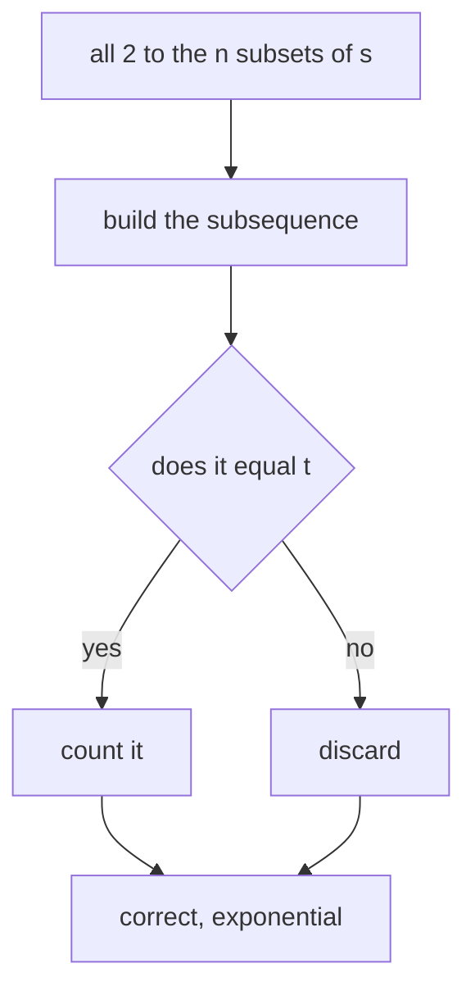
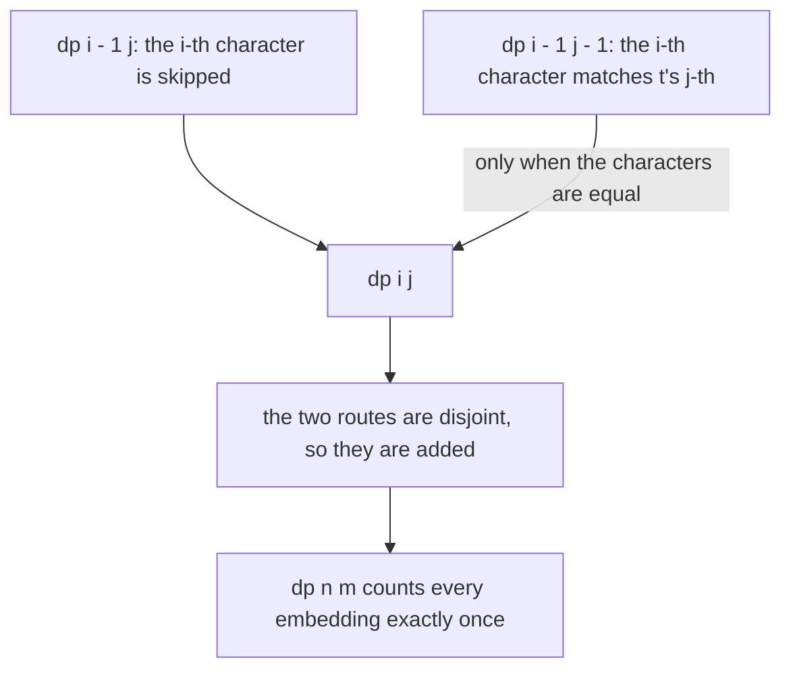
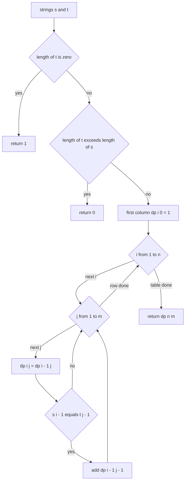
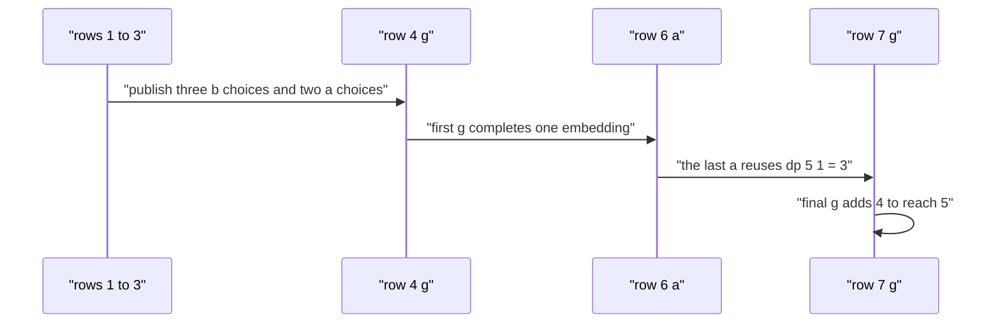

# 308 — Distinct subsequences count (DP).

> **Tier:** Intermediate · **CTCI chapter:** Ch 8 — Recursion and Dynamic Programming
> **Task spec:** [308-distinct-subsequences-count-dp.md](../../../tasks/intermediate/308-distinct-subsequences-count-dp.md)
> **Solutions:** [Python](../../../solutions/python/intermediate/308-distinct-subsequences-count-dp/solution.py) ·
> [Java](../../../solutions/java/intermediate/308-distinct-subsequences-count-dp/Solution.java) ·
> [JavaScript](../../../solutions/javascript/intermediate/308-distinct-subsequences-count-dp/solution.js) ·
> [C#](../../../solutions/csharp/intermediate/308-distinct-subsequences-count-dp/Solution.cs)

## 1. Problem restatement

**Input:** a source string `s` (length `n`) and a target string `t` (length `m`). Either may be
empty. The header of each file states the state definition: *"`dp[i][j]` = ways to build the first
`j` characters of `t` from the first `i` characters of `s`; if `s[i] == t[j]` the character may be
used (`dp[i-1][j-1]`) or skipped (`dp[i-1][j]`)."*

**Output:** the number of ways to pick character *positions* of `s` that spell `t` in order. This is
a count of distinct index selections, so repeated letters in `s` that could each play the same role
are counted separately — which is exactly what makes the problem interesting.

| Call | Result | Why |
| --- | --- | --- |
| `count_distinct_subsequences("rabbbit", "rabbit")` | `3` | three choices of which `b` to leave out |
| `count_distinct_subsequences("babgbag", "bag")` | `5` | five embeddings of `bag` |
| `count_distinct_subsequences("abc", "")` | `1` | the empty target has one embedding: choose nothing |
| `count_distinct_subsequences("", "a")` | `0` | nothing to choose from |
| `count_distinct_subsequences("aaa", "a")` | `3` | each of the three `a`s is a separate embedding |
| `count_distinct_subsequences("aaa", "aa")` | `3` | three ways to choose two of the three positions |
| `count_distinct_subsequences("abc", "abcd")` | `0` | the target is longer than the source |

Two early exits are visible in the code and confirmed by these rows: `m == 0` returns `1` (the empty
target is matched once), and `n < m` returns `0` (no embedding can exist). Both are asserted.

The oracle enumerates all `2^n` subsets of `s`, builds each subsequence, and counts the masks whose
result equals `t` — a direct phrasing of the definition that shares no logic with the DP. It runs on
20 pairs drawn from 40 LCG strings of length 8 over the alphabet `ab`, with the target taken as the
first four characters of the following string.

## 2. Intuition

The definition invites enumeration: for every subset of positions, build the subsequence and compare
it with `t`. That is `2^n` candidates, which the oracle does for `n = 8` and which is hopeless in
general.



The prefix formulation replaces the subsets with two counters. Let `dp[i][j]` be the number of ways
to match the first `j` characters of `t` using only the first `i` characters of `s`. Then the last
character of `s`'s prefix is either

- **skipped**: every embedding counted by `dp[i - 1][j]` survives, or
- **used as the match for `t[j - 1]`**, which is only possible when `s[i - 1] == t[j - 1]`, and then
  each way of matching the remaining prefix `t[:j-1]` inside `s[:i-1]` — counted by
  `dp[i - 1][j - 1]` — extends it.



Disjointness is the whole correctness argument: an embedding either uses position `i - 1` or it does
not, and the two families cannot overlap. Adding them therefore counts each embedding once, no matter
how many repeated letters the string has.

## 3. Algorithm

1. If `m == 0`, return `1`: the empty target is matched by choosing nothing.
2. If `n < m`, return `0`: a shorter source cannot contain the target.
3. Allocate `dp` with `n + 1` rows and `m + 1` columns and set `dp[i][0] = 1` for every `i` — the
   empty prefix of `t` is matched by the empty selection, exactly one way.
4. For `i` from `1` to `n` and `j` from `1` to `m`:
   - `dp[i][j] = dp[i - 1][j]` (skip `s[i - 1]`);
   - if `s[i - 1] == t[j - 1]`, add `dp[i - 1][j - 1]` (use `s[i - 1]` for `t[j - 1]`).
5. Return `dp[n][m]`.

```text
procedure count_distinct_subsequences(s, t)
    n ← length(s)
    m ← length(t)
    if m = 0 then
        return 1
    end
    if n < m then
        return 0
    end
    dp ← table of n + 1 rows and m + 1 columns, all zero
    for i ← 0 to n do
        dp[i][0] ← 1
    end
    for i ← 1 to n do
        for j ← 1 to m do
            dp[i][j] ← dp[i - 1][j]
            if s[i - 1] = t[j - 1] then
                dp[i][j] ← dp[i][j] + dp[i - 1][j - 1]
            end
        end
    end
    return dp[n][m]
end
```



The counts grow combinatorially — the number of embeddings of a repeated target into a repeated
source — which is why the numeric type matters. Python's integers are exact and unbounded; Java and
C# use `BigInteger`; JavaScript uses `BigInt` with the `n` suffix on every literal. The docstring
says it plainly: *"Counts are exact Python integers; Java/JS/C# use big integers where needed."*

## 4. Worked example

Trace `count_distinct_subsequences("babgbag", "bag")`, asserted to be `5`. `n = 7` over
`b a b g b a g`, `m = 3` over `b a g`.

Column `j = 0` is all ones. Then fill row by row (`skip` is `dp[i - 1][j]`, `use` is added only on a
character match):

| `i` (`s[i-1]`) | `j=1` (`b`) | `j=2` (`a`) | `j=3` (`g`) | note |
| --- | --- | --- | --- | --- |
| 0 | 0 | 0 | 0 | base row |
| 1 (`b`) | `0 + 1 = 1` | 0 | 0 | `b` matches `t[0]` |
| 2 (`a`) | 1 | `0 + 1 = 1` | 0 | `a` matches `t[1]`, reusing `dp[1][1]` |
| 3 (`b`) | `1 + 1 = 2` | 1 | 0 | the second `b` matches too |
| 4 (`g`) | 2 | 1 | `0 + 1 = 1` | first `g` completes one `bag` |
| 5 (`b`) | `2 + 1 = 3` | 1 | 1 | third `b` |
| 6 (`a`) | 3 | `1 + 3 = 4` | 1 | the extra `a` multiplies the `b` choices |
| 7 (`g`) | 3 | 4 | `1 + 4 = 5` | the final `g` completes the fifth |

Each row's `use` term is the *previous row's* left neighbour, so the growth is compounding rather
than additive: row 6 sees `dp[5][1] = 3` and adds all three to the single `a` it can pair with, which
is why `dp[6][2]` jumps to `4`.

The finished table:

| `dp` | `j=0` | `j=1 b` | `j=2 a` | `j=3 g` |
| --- | --- | --- | --- | --- |
| `i=0` | 1 | 0 | 0 | 0 |
| `i=1 b` | 1 | 1 | 0 | 0 |
| `i=2 a` | 1 | 1 | 1 | 0 |
| `i=3 b` | 1 | 2 | 1 | 0 |
| `i=4 g` | 1 | 2 | 1 | 1 |
| `i=5 b` | 1 | 3 | 1 | 1 |
| `i=6 a` | 1 | 3 | 4 | 1 |
| `i=7 g` | 1 | 3 | 4 | **5** |

`dp[7][3] = 5`. Reading the fifth embedding off the table: `b` at index 0 or 3 or 5 for `t[0]`, `a`
at index 1 or 5 for `t[1]`, and `g` at index 6 — the fifth comes from pairing the last `a` with the
last `g`, which row 6 enabled.



The shorter asserted case `("aaa", "aa")` shows the same compounding at its simplest: every row
after the first matches both targets, and the count reaches `3` — the three ways to choose two of the
three positions.

## 5. Complexity

Let `n = length(s)` and `m = length(t)`.

| Measure | Bound | Why it holds |
| --- | --- | --- |
| Time, best | O(1) | the `m == 0` and `n < m` guards return immediately |
| Time, average/worst | O(n · m) | every cell is a constant number of additions |
| Space | O(n · m) | the full table; a rolling row of `m + 1` entries would also work since each cell reads only the row above |
| Space of the rolling variant | O(m) | each row is computed from the previous one, left to right |
| Time of brute force | O(2^n · n) | `2^n` masks, each built and compared in `O(n)` |
| Size of the answer | up to `C(n, m)` | the count can be exponentially large, hence exact big integers |

Two practical notes follow from the table. First, the counts themselves can be astronomically large —
for `s` of 30 equal characters and `t` of 15 equal characters the answer is the binomial coefficient
`C(30, 15)`, past what a 32-bit counter holds — so exact arithmetic is not optional here, it is the
contract. Second, because every cell reads only `dp[i - 1][*]`, the table compresses to a single
rolling row of length `m + 1` without changing the recurrence.

## 6. Pitfalls and edge cases

- **The empty target.** `("abc", "")` is `1`, not `0`: there is exactly one way to choose nothing.
  Returning `0` would make the multiplication semantics of the recurrence inconsistent for longer
  targets.
- **Target longer than source.** `("abc", "abcd")` is `0`, and the early return handles it; without
  it the loops would still produce `0`, but the guard also prevents pointless work.
- **Empty source.** `("", "a")` is `0`; the first column is `1` (empty target) but the answer cell is
  in row `0` and column `1`, which stays `0`.
- **Repeated characters are counted separately.** `("aaa", "a")` is `3` and `("aaa", "aa")` is `3`.
  An implementation that deduplicated subsequences by *value* would answer `1` and `1`; that is a
  different problem, and the brute-force oracle here counts distinct masks, so it pins the intended
  reading.
- **Adding the wrong neighbour.** The `use` term is `dp[i - 1][j - 1]`, not `dp[i][j - 1]`. The
  latter would count embeddings that reuse `s[i - 1]` for two different target positions.
- **The skip term is unconditional.** `dp[i][j] = dp[i - 1][j]` is applied on every cell, before the
  optional addition — a cell that omits it loses all embeddings that ignore `s[i - 1]`.
- **Overflow is real.** `rabbbit`/`rabbit` is only `3`, but a long alternating string can produce
  counts far beyond 64 bits. Java and C# use `BigInteger`, JavaScript `BigInt`, and the Python
  solution relies on unbounded integers; an `int`-typed port would silently wrap.
- **`BigInteger` defaults.** In the C# version the array element type is `BigInteger`, whose default
  value is zero, so only the first column is initialised explicitly — worth knowing when porting,
  since a `long`-based port would need the same treatment.
- **Answer type across languages.** The Python function returns an `int`; Java and C# return
  `BigInteger`; JavaScript returns a `BigInt`. Comparisons in the tests use the matching literal
  form (`3n`, `BigInteger.valueOf(3)`).
- **The oracle's short strings.** `brute_force` is `O(2^n)`; the tests keep `n = 8`, where it is
  trivially fast, and the targets are truncated to four characters so that the count stays small and
  the comparison is meaningful.

## 7. Variants and follow-ups

- **Distinct subsequences of one string.** Counting *all* distinct subsequences of `s` (ignoring a
  target) uses a cancellation recurrence instead, because two different index sets can spell the same
  string; that is the classic `dp[i] = 2·dp[i-1] - dp[last occurrence - 1]` formulation.
- **Longest common subsequence.** [121-longest-common-subsequence-lcs-dp.md](../../../tasks/beginner/121-longest-common-subsequence-lcs-dp.md)
  has the same prefix state but maximises a length instead of counting embeddings.
- **Supersequences.** [305-shortest-common-supersequence-length-dp.md](./305-shortest-common-supersequence-length-dp.md)
  and [306-reconstruct-shortest-common-supersequence.md](./306-reconstruct-shortest-common-supersequence.md)
  walk the same grid from the other direction, merging instead of matching.
- **Longest palindromic subsequence.** [307-longest-palindromic-subsequence-dp.md](./307-longest-palindromic-subsequence-dp.md)
  is a counting-free cousin where both axes are the same string.
- The chapter walkthrough [Recursion and DP](../../ctci/08-recursion-and-dp.md) introduces the
  prefix-pair state that all four of these tasks share.

## 8. Check yourself

1. Why is `dp[i][0] = 1` for every `i`, and what does it mean?

<details><summary>Show answer</summary>

Because the empty prefix of `t` is matched by exactly one selection: choose no characters at all.
This is independent of `i`, so the whole first column is ones. Returning `0` there would break the
recurrence — every `use` term would collapse and the answer would be wrong for targets of length
greater than one.

</details>

2. Why can the two terms simply be added?

<details><summary>Show answer</summary>

Because they describe disjoint families of embeddings: those that use position `i - 1` of `s` and
those that do not. Every embedding belongs to exactly one family, so no embedding is counted twice
and the sum is the total.

</details>

3. What is the difference between counting *distinct subsequences equal to* `t` and counting distinct
   *strings* equal to `t`?

<details><summary>Show answer</summary>

The first counts index selections: `("aaa", "aa") = 3` because three different pairs of positions
spell `aa`. The second counts distinct values: `aa` is one string, so that count would be `1`. The
task and its oracle implement the first reading (masks are counted individually), which is why the
repeated-letter assertions read `3`.

</details>

4. Why do the four implementations use big integers?

<details><summary>Show answer</summary>

Because the count is combinatorial and grows like a binomial coefficient: many repeated characters
produce answers far beyond 64 bits. Exactness is part of the contract — the tests compare against a
brute-force count — so Python uses native unbounded ints, Java and C# use `BigInteger`, and
JavaScript uses `BigInt`.

</details>

5. How could the space be reduced, and what would that cost?

<details><summary>Show answer</summary>

Every cell reads only `dp[i - 1][j]` and `dp[i - 1][j - 1]`, i.e. the previous row, so a single
rolling row of `m + 1` entries suffices — `O(m)` instead of `O(n · m)`. The cost is that the table is
no longer available for reconstruction (there is nothing to reconstruct here anyway) and the code
must be careful to read the old value of the left neighbour before overwriting it.

</details>
