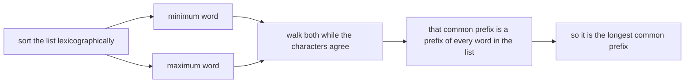
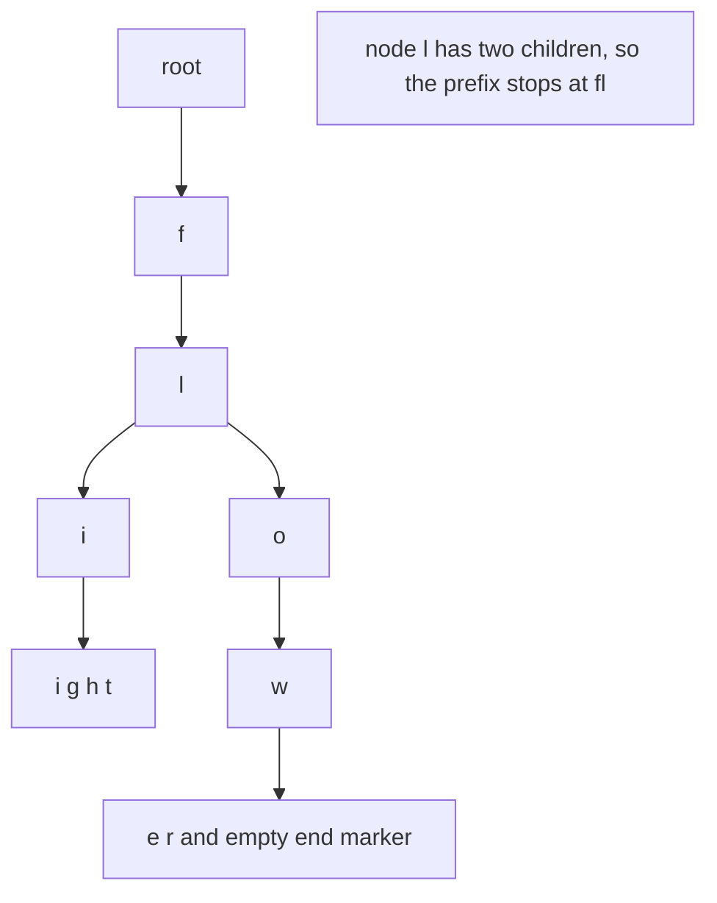
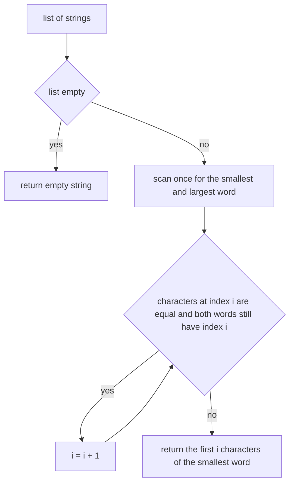
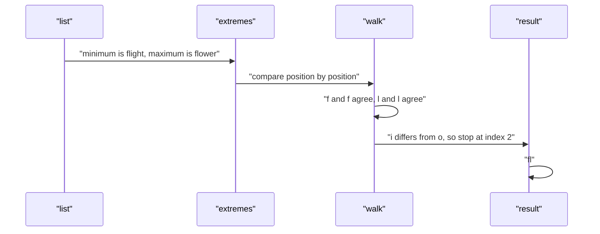

# 309 — Longest common prefix among many strings (trie or divide & conquer).

> **Tier:** Intermediate · **CTCI chapter:** Ch 4 — Trees and Graphs
> **Task spec:** [309-longest-common-prefix-among-many-strings-trie-or-divide-conquer.md](../../../tasks/intermediate/309-longest-common-prefix-among-many-strings-trie-or-divide-conquer.md)
> **Solutions:** [Python](../../../solutions/python/intermediate/309-longest-common-prefix-among-many-strings-trie-or-divide-conquer/solution.py) ·
> [Java](../../../solutions/java/intermediate/309-longest-common-prefix-among-many-strings-trie-or-divide-conquer/Solution.java) ·
> [JavaScript](../../../solutions/javascript/intermediate/309-longest-common-prefix-among-many-strings-trie-or-divide-conquer/solution.js) ·
> [C#](../../../solutions/csharp/intermediate/309-longest-common-prefix-among-many-strings-trie-or-divide-conquer/Solution.cs)

## 1. Problem restatement

**Input:** a list `strs` of strings — possibly empty, possibly containing empty strings, with no
alphabet restriction.

**Output:** the longest string that is a prefix of *every* string in the list.

The files ship **three** implementations, and the header explains why: *"Only the lexicographic
minimum and maximum of the list can bound the common prefix, so the answer is instantly
prefix(min, max). Validated against an independent vertical scan and a trie-based
implementation."*

| Function | Role |
| --- | --- |
| `longest_common_prefix_sorted` | the primary algorithm: prefix of the lexicographic extremes |
| `longest_common_prefix_vertical` | first oracle: column-by-column scan |
| `longest_common_prefix_trie` | second oracle: build a trie, walk down while the path is forced |

The assertions pin the contract:

| Call | Result | Why |
| --- | --- | --- |
| `["flower", "flow", "flight"]` | `"fl"` | the classic case: they diverge at index 2 |
| `["dog", "racecar", "car"]` | `""` | no common first character |
| `["abc", "abc"]` | `"abc"` | duplicates collapse to the word itself |
| `["a"]` | `"a"` | a single word is its own common prefix |
| `[]` | `""` | no strings, no prefix |
| `["", "b"]` | `""` | an empty string forces the empty prefix |
| `["abab", "aba", "ababbb"]` | `"aba"` | one word is a prefix of the others, so the answer is that word |

Every fixed case and every one of 80 generated lists is checked against **both** oracles. The lists
come from an LCG (`seed = (seed * 75 + 74) % 65537`) and contain 1 to 3 words of length 1 to 4 over
the alphabet `abc`, which mixes shared and diverging prefixes.

## 2. Intuition

The textbook approach is the vertical scan: take the first string, walk its columns, and for each
column check that every other string has the same character there; return the prefix built so far at
the first disagreement or exhaustion. That is `O(N · L)` character comparisons, and it is what the
first oracle does.

The insight that makes the *primary* implementation shorter and cheaper is a property of
lexicographic order: once the list is sorted, every string lies between the minimum and the maximum,
and the common prefix of the extremes is a prefix of everything in between. So the answer is just

    prefix_of(min(strs), max(strs))

— one comparison of two strings, not a scan over all of them.



Why is it enough to look at the extremes? Suppose `p` is the common prefix of the minimum `lo` and
the maximum `hi`. For any other word `w`, `lo ≤ w ≤ hi` in lexicographic order. A word that agrees
with `lo` on `|p|` characters and with `hi` on `|p|` characters must itself start with `p` — if it
disagreed at some position `k < |p|`, it would have to be either below `lo` or above `hi` at that
position. So `p` is a prefix of `w`, and since `p` is maximal for `lo` and `hi`, it is maximal for
the whole list.

The trie implementation is the same idea in tree form: insert every word, then descend from the root
as long as the current node has exactly one child and is not a word end. A node with two children
means two words diverge exactly there; a `$` marker means some word ends exactly there, so the
prefix can grow no further.



## 3. Algorithm

Primary (lexicographic extremes):

1. If the list is empty, return `""`.
2. Find `smallest` and `largest`, the lexicographic minimum and maximum of the list.
3. Walk an index `i` while `i < len(smallest)`, `i < len(largest)` and
   `smallest[i] == largest[i]`.
4. Return the first `i` characters of `smallest`.

```text
procedure longest_common_prefix_sorted(strs)
    if strs is empty then
        return ""
    end
    smallest ← first element of strs
    largest ← first element of strs
    for each word in strs do
        if word < smallest then
            smallest ← word
        end
        if word > largest then
            largest ← word
        end
    end
    i ← 0
    while i < length(smallest) and i < length(largest) and smallest[i] = largest[i] do
        i ← i + 1
    end
    return first i characters of smallest
end
```

Oracle 1 (vertical scan):

```text
procedure longest_common_prefix_vertical(strs)
    if strs is empty then
        return ""
    end
    for column ← 0 to length(strs[0]) - 1 do
        character ← strs[0][column]
        for k ← 1 to length(strs) - 1 do
            if column ≥ length(strs[k]) or strs[k][column] ≠ character then
                return first column characters of strs[0]
            end
        end
    end
    return strs[0]
end
```

Oracle 2 (trie walk):

```text
procedure longest_common_prefix_trie(strs)
    root ← empty node
    for each word in strs do
        node ← root
        for each character in word do
            node ← child of node for that character, created if absent
        end
        mark node as the end of a word
    end
    prefix ← empty
    node ← root
    while node has exactly one child and is not a word end do
        character ← that child
        append character to prefix
        node ← the child node
    end
    return prefix
end
```



## 4. Worked example

Trace `longest_common_prefix_sorted(["flower", "flow", "flight"])`, asserted to be `"fl"`.

Step 1 — find the extremes. Lexicographic order of the three words puts `"flight"` first (at the
third character, `i` < `o`) and `"flower"` last (`"flow"` is a prefix of `"flower"`, and a proper
prefix sorts before the longer word). So `smallest = "flight"`, `largest = "flower"`.

Step 2 — walk the two extremes:

| `i` | `smallest[i]` | `largest[i]` | equal? | action |
| --- | --- | --- | --- | --- |
| 0 | `f` | `f` | yes | `i = 1` |
| 1 | `l` | `l` | yes | `i = 2` |
| 2 | `i` | `o` | no | stop |

The answer is the first `i = 2` characters of `smallest`: `"fl"`. Note that `"flow"` — the middle
word — was never compared against anything: it is bounded by the extremes and inherits the prefix.

The trie for the same list confirms the same stopping point, and shows the two reasons a descent can
end:

| Node | Children | Word ends here? | Descend? |
| --- | --- | --- | --- |
| root | `f` | no | yes |
| `f` | `l` | no | yes |
| `fl` | `i`, `o` | no | **stop** — two children |

The prefix collected is `"fl"`.



The second asserted case `["abab", "aba", "ababbb"]` shows the *other* stopping condition. Here
`smallest = "aba"` and `largest = "ababbb"`; the walk advances while both words still have a
character at index `i`, so it stops when `i` reaches `len("aba") = 3`. The answer is `"aba"` — one of
the words. In the trie the same situation appears as a node marked as a word end: the descent stops
because `$` is present, not because the path branches. Both implementations return `"aba"`, and the
agreement is asserted.

## 5. Complexity

Let `N` be the number of strings, `L` the length of the shortest string (an upper bound on the
answer), and `S` the total number of characters over all strings.

| Measure | Bound | Why it holds |
| --- | --- | --- |
| Time, extremes | O(N · L) | finding the min and max costs one comparison per string, each up to `L` characters |
| Time, final walk | O(L) | at most `L` character comparisons |
| Time, total (primary) | O(N · L) | the scan dominates |
| Space (primary) | O(1) extra | two string references and one index |
| Time, vertical scan | O(N · L) | same order, but it compares every column against every word |
| Time, trie | O(S) build + O(L) walk | each character of each word is inserted once |
| Space, trie | O(S) | one node per distinct prefix — the whole point of the structure |
| Empty list | O(1) | returns immediately |

The primary and the vertical scan share the same asymptotic bound, which is why the header calls the
vertical scan an *oracle* rather than an optimisation: a different route to the same answer. The trie
pays `O(S)` memory and earns it only when other prefix operations are needed too.

## 6. Pitfalls and edge cases

- **Empty list.** Returns `""`. All four files assert it, and both oracles guard it too; without the
  guard the vertical scan would index `strs[0]` out of range.
- **A word that is a prefix of another.** `["abab", "aba", "ababbb"]` is `"aba"`, not `"abab"`: the
  shorter word ends, so the prefix cannot extend past it. The primary version handles this through
  the `i < len(smallest)` half of the loop condition; the trie handles it through the word-end
  marker it stores at each terminal node (`"$"` in the dictionary-based implementations).
- **Empty strings in the list.** `["", "b"]` is `""`; the empty string is the lexicographic minimum
  of every list that contains it, so the walk stops at index 0 immediately.
- **Single string, and all strings identical.** `["a"]` returns `"a"` and `["abc", "abc"]` returns
  `"abc"`: the walk is capped by word length, not by a mismatch.
- **No common first character.** `["dog", "racecar", "car"]` returns `""`; the walk fails at index 0.
- **Case sensitivity.** Lexicographic order is by code unit and the algorithms never normalise case,
  so `["Flower", "flower"]` returns `""`. The tests keep a single case per list.
- **The extremes argument needs a total order.** It relies on `min ≤ w ≤ max` for every `w` in the
  list. With a comparator that is not a total order (for example one that ignores case but is
  inconsistent), the argument breaks and the extremes no longer bound the answer.
- **Encoding.** Java and C# index UTF-16 code units while Python and JavaScript index code points, so
  a shared prefix that splits a surrogate pair compares differently — consistently within a language,
  not identically across them. The generated tests use `abc` only.
- **Trie sentinel collisions.** The word-end marker is a separate key (`"$"`), never a character
  value, so no input alphabet can collide with it. The walk condition is `single child AND not a word
  end`, and both halves are required: dropping the second half makes `["abab", "aba", "ababbb"]`
  return `"abab"` instead of `"aba"`.

## 7. Variants and follow-ups

- **Two-string version.** [094-find-longest-common-prefix-in-array-of-strings.md](../../../tasks/beginner/094-find-longest-common-prefix-in-array-of-strings.md)
  is the beginner formulation of the same question; the pairwise walk used here is the same loop.
- **Tries in earnest.** [115-implement-a-basic-trie-for-lowercase-words.md](../../../tasks/beginner/115-implement-a-basic-trie-for-lowercase-words.md)
  and [116-insert-and-search-in-trie.md](../../../tasks/beginner/116-insert-and-search-in-trie.md)
  build the structure the third implementation relies on, and
  [117-autocomplete-top-k-prefix-suggestions-trie.md](../../../tasks/beginner/117-autocomplete-top-k-prefix-suggestions-trie.md)
  adds the query that makes a trie worth its memory.
- **Compressed tries.** [253-implement-compressed-trie-radix-tree-basics.md](../../../tasks/intermediate/253-implement-compressed-trie-radix-tree-basics.md)
  collapses chains of single-child nodes — exactly the nodes this task's walk traverses.
- **String sorting.** The extremes approach is a direct application of lexicographic order, the same
  primitive used by the suffix-array construction in
  [310-implement-suffix-array-naive-sorting-suffixes.md](./310-implement-suffix-array-naive-sorting-suffixes.md).
- The chapter walkthrough [Trees and Graphs](../../ctci/04-trees-and-graphs.md) develops the trie
  family that the third implementation belongs to.

## 8. Check yourself

1. Why does the common prefix of the lexicographic minimum and maximum equal the common prefix of the
   whole list?

<details><summary>Show answer</summary>

Every word `w` in the list satisfies `min ≤ w ≤ max`. If `p` is the common prefix of `min` and `max`
and `w` disagreed with `p` at some position `k`, then at that position `w`'s character would be either
smaller than both (putting `w` below `min`) or larger than both (putting `w` above `max`) — a
contradiction. So every `w` starts with `p`, and `p` cannot be extended without breaking `min` or
`max`.

</details>

2. What are the two ways the trie walk can stop?

<details><summary>Show answer</summary>

The current node has more than one child — two or more words diverge exactly there — or the current
node is marked as the end of a word, meaning some string in the list is exactly the prefix collected
so far. The condition is therefore `one child AND no word-end marker`; both halves are needed.

</details>

3. Which implementation uses the least memory and which the most?

<details><summary>Show answer</summary>

The primary (extremes) version keeps only two string references and a counter: `O(1)` extra. The
vertical scan keeps the index and one character: also `O(1)` extra. The trie stores one node per
distinct prefix, `O(S)` for `S` total characters — by far the largest, and the reason the task title
pairs "trie" with the cheaper bound-based method.

</details>

4. What does `["", "b"]` return and why?

<details><summary>Show answer</summary>

`""`. The empty string is a prefix of every string, so it is always in the running, and it is also
the lexicographic minimum here. The walk between the extremes stops at index 0 because
`len(smallest) == 0`, so the answer is empty. The same result comes from the vertical scan, since the
first word has no columns.

</details>

5. Why does the test suite compare the three implementations rather than testing them separately?

<details><summary>Show answer</summary>

Because the three rest on different reasoning — a lexicographic bound, a column-wise scan, and a
prefix tree — so agreement on 4 fixed samples plus 80 generated lists is strong evidence that all
three are right. A bug in the bound argument would not be visible from fixed examples alone, but it
would show up as a disagreement with the vertical scan on one of the generated lists.

</details>
