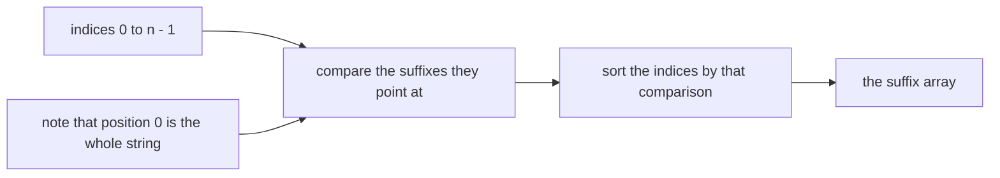
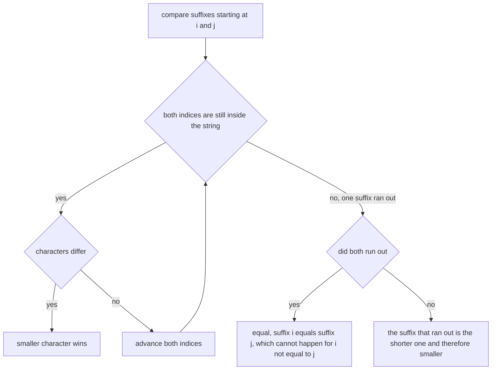
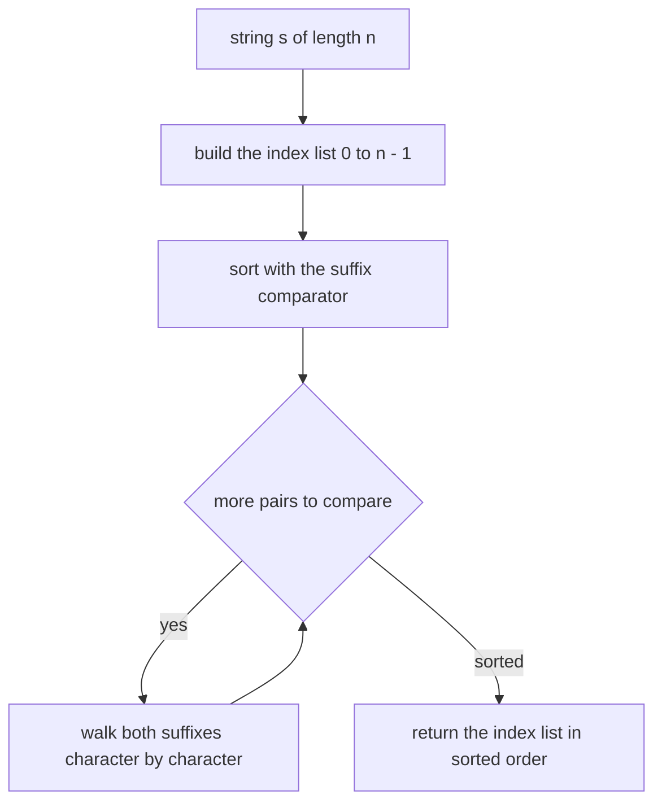
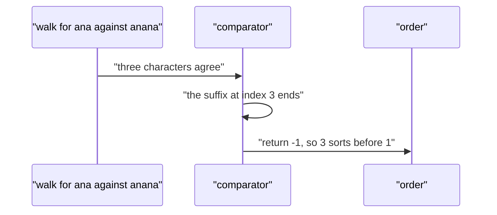

# 310 — Implement suffix array naive (sorting suffixes).

> **Tier:** Intermediate · **CTCI chapter:** Beyond — Advanced Data Structures & Algorithms
> **Task spec:** [310-implement-suffix-array-naive-sorting-suffixes.md](../../../tasks/intermediate/310-implement-suffix-array-naive-sorting-suffixes.md)
> **Solutions:** [Python](../../../solutions/python/intermediate/310-implement-suffix-array-naive-sorting-suffixes/solution.py) ·
> [Java](../../../solutions/java/intermediate/310-implement-suffix-array-naive-sorting-suffixes/Solution.java) ·
> [JavaScript](../../../solutions/javascript/intermediate/310-implement-suffix-array-naive-sorting-suffixes/solution.js) ·
> [C#](../../../solutions/csharp/intermediate/310-implement-suffix-array-naive-sorting-suffixes/Solution.cs)

## 1. Problem restatement

**Input:** a string `s` of `n` characters. It may be empty.

**Output:** the **suffix array** of `s`: the list of starting indices `0..n-1` sorted so that the
suffixes `s[i:]` appear in lexicographic order. Equivalently, `order[k]` is the start of the `k`-th
smallest suffix.

The header of each file states the approach and its cost: *"`O(n^2 log n)` baseline: sort the start
indices by comparing the suffixes directly. The test suite re-checks the ordering with a hand-written
character-by-character comparator."*

| Call | Result | Sorted suffixes |
| --- | --- | --- |
| `suffix_array("banana")` | `[5, 3, 1, 0, 4, 2]` | `a`, `ana`, `anana`, `banana`, `na`, `nana` |
| `suffix_array("mississippi")` | `[10, 7, 4, 1, 0, 9, 8, 6, 3, 5, 2]` | the standard `mississippi` order |
| `suffix_array("")` | `[]` | no suffixes |
| `suffix_array("a")` | `[0]` | one suffix |
| `suffix_array("aaaa")` | `[3, 2, 1, 0]` | shorter suffixes sort first |
| `suffix_array("abab")` | `[2, 0, 3, 1]` | `ab`, `abab`, `b`, `bab` |

Verification is twofold and independent of the sort:

1. `is_valid_suffix_array` checks that the output is a permutation of `0..n-1` **and** that every
   adjacent pair satisfies `compare_suffixes(s, order[k], order[k+1]) < 0`, where `compare_suffixes`
   is a hand-written character-by-character comparator that never builds a substring;
2. the Python file additionally compares the list of suffixes in the computed order with
   `sorted(s[i:] for i in range(n))` — the definition of the answer, computed by a different route.

Both checks run on the fixed strings and on 60 LCG strings of length 12 over the alphabet `ab`.

## 2. Intuition

A suffix array is nothing more than a sorted list of the suffixes, with the suffixes replaced by
their start positions. The naive way to produce it is therefore to produce it literally: take the `n`
indices, compare the suffixes they point at, and sort.



The comparison is the only subtle part, and it is ordinary lexicographic order with one extra rule:
**when one suffix is a prefix of the other, the shorter one is smaller.** That rule is what makes
`"a"` come before `"ana"` and `"aaa"` before `"aaaa"`, and it is why the naive implementation cannot
simply compare fixed-length keys.



The cost is where the "naive" in the title comes from. Sorting `n` items needs `O(n log n)`
comparisons, and a single comparison can scan up to `n` characters; the product is `O(n² log n)`
character comparisons. Every file also pays for the comparison in allocations: Java, JavaScript and
C# build a substring per comparison, while Python's `key=` form builds all `n` suffixes up front.

## 3. Algorithm

1. If `s` is empty, return the empty array.
2. Build the list of indices `0, 1, ..., n - 1`.
3. Sort the indices with the comparator `compare_suffixes(s, i, j)`:
   1. walk `i` and `j` forward while both are inside the string and the characters agree;
   2. at the first differing character, the smaller character decides;
   3. if one index reaches `n` first, that suffix is the shorter one and sorts first;
   4. if both reach `n` at the same time the suffixes are equal.
4. Return the sorted indices.

```text
procedure compare_suffixes(s, i, j)
    n ← length(s)
    while i < n and j < n do
        if s[i] ≠ s[j] then
            return -1 when s[i] < s[j], otherwise 1
        end
        i ← i + 1
        j ← j + 1
    end
    if i = j then
        return 0
    end
    if i = n then
        return -1
    end
    return 1
end

procedure suffix_array(s)
    n ← length(s)
    indices ← list of 0 to n - 1
    sort indices using the comparison compare_suffixes(s, left, right)
    return indices
end
```



The comparator is a strict weak ordering — it is transitive and antisymmetric by construction from
lexicographic order — so every language's sort routine can use it directly.

## 4. Worked example

Trace `suffix_array("banana")`. The suffixes, listed by their start index:

| `i` | `s[i:]` |
| --- | --- |
| 0 | `banana` |
| 1 | `anana` |
| 2 | `nana` |
| 3 | `ana` |
| 4 | `na` |
| 5 | `a` |

Sorting them lexicographically:

| Step | Comparison | Result | Why |
| --- | --- | --- | --- |
| 1 | `a` vs `ana` | `a` first | shorter suffix, and `a` is a prefix of `ana` |
| 2 | `ana` vs `anana` | `ana` first | again a prefix relation |
| 3 | `anana` vs `banana` | `anana` first | `a` < `b` at the first character |
| 4 | `banana` vs `na` | `banana` first | `b` < `n` |
| 5 | `na` vs `nana` | `na` first | prefix relation |

The final order is `a`, `ana`, `anana`, `banana`, `na`, `nana`, i.e. start indices
`5, 3, 1, 0, 4, 2` — the asserted value.

Two of those comparisons are worth reading character by character. Comparing index 3 (`ana`) with
index 1 (`anana`):

| Position | `s[3 + k]` | `s[1 + k]` | equal? |
| --- | --- | --- | --- |
| 0 | `a` | `a` | yes |
| 1 | `n` | `n` | yes |
| 2 | `a` | `a` | yes |
| 3 | — (index 3 is past the end) | `n` | one suffix ran out |

The suffix at index 3 exhausted first, so `compare_suffixes` returns `-1` and `3` precedes `1`. That
is the "shorter suffix is smaller" rule in action, and it is exactly the branch the independent
oracle checks.



The `"aaaa"` assertion shows the same rule at its most visible: all four suffixes are prefixes of
each other, so the order is strictly by length, `3, 2, 1, 0`. And `"abab"` gives `2, 0, 3, 1` because
`ab` < `abab` < `b` < `bab` — the first character decides the last two.

## 5. Complexity

Let `n` be the length of `s`.

| Measure | Bound | Why it holds |
| --- | --- | --- |
| Time, worst | O(n² log n) | `O(n log n)` comparisons, each scanning up to `n` characters |
| Time, best | O(n log n) | when the first characters already separate the suffixes, most comparisons stop immediately |
| Time, typical | O(n² log n) | repetitive strings like `"aaaa"` make every comparison run long |
| Space, output | O(n) | the index array |
| Space, Python key form | O(n²) transient | the `key=` form materialises all `n` suffixes before sorting |
| Space, substring comparators | O(n) per comparison, freed at once | Java, JavaScript and C# build a substring per pair compared |
| Better construction | O(n log n) or O(n) | doubling or SA-IS, see task 401 |

The quadratic factor is not incidental — it is what the "naive" in the task title refers to. The
standard fixes replace character-by-character comparison with *rank* comparison: after sorting by
pairs of characters, each suffix has a rank, and comparing two suffixes can then be done in constant
time by comparing their ranks, giving the `O(n log n)` doubling construction. The files here stay
naive on purpose, and the validation focuses on *correctness* of the order rather than speed:
`compare_suffixes` is a second, independent implementation of lexicographic comparison, so
agreement on 60 random strings checks the comparator as well as the sort.

## 6. Pitfalls and edge cases

- **Empty string.** `suffix_array("")` is `[]`: there are no suffixes. Asserted in all four files.
- **Single character.** `suffix_array("a")` is `[0]`.
- **A suffix that is a prefix of another.** `"aaaa"` must give `[3, 2, 1, 0]`; any comparator that
  pads with a character treated as larger than every real character gets this backwards and produces
  `[0, 1, 2, 3]`. The explicit "the suffix that ran out is smaller" branch is what prevents that.
- **Equal suffixes are impossible, equal prefixes are common.** For `i ≠ j` the two suffixes have
  different lengths, so they can never compare equal; the `i == j` branch in the comparator is a
  guard for the implementation, not a case the sort will hit on valid input.
- **Permutation check.** `is_valid_suffix_array` first asserts that the output is a permutation of
  `0..n-1`. A comparator that is not a strict weak ordering can make a sort drop or duplicate
  elements, and the permutation check catches that before any ordering claim is made.
- **Adjacency is enough.** Checking only adjacent pairs is sufficient because lexicographic order is
  transitive: if every adjacent pair is strictly increasing, the whole array is sorted. This keeps the
  verification at `O(n²)` character work instead of `O(n² log n)`.
- **Substring allocation.** The Java, JavaScript and C# comparators call `substring`/`slice` inside
  the comparison, which allocates `O(n)` characters per comparison. The result is correct but the
  constant factor and the garbage volume are the reason the hand-written comparator exists in the
  same files: it walks indices and allocates nothing, and the tests use it to double-check.
- **Case and encoding.** Ordering is by code unit; uppercase letters sort before lowercase ones, and
  Java/C# compare UTF-16 code units while Python compares code points. The generated strings are
  lowercase `ab`, so the checks do not probe that boundary.
- **Sentinel-free versus sentinel conventions.** Many implementations append a sentinel `$` smaller
  than every character, which makes the prefix rule automatic and gives `n + 1` entries. These files
  use no sentinel: the output has exactly `n` entries and the shorter-suffix rule is explicit. Mixing
  the two conventions silently shifts every index by one.
- **Repetitive strings.** `"aaaa"` and `"mississippi"` are in the fixed test set precisely because
  they maximise the number of long comparisons — the adversarial cases for the quadratic bound.

## 7. Variants and follow-ups

- **Fast construction.** [401-implement-suffix-array-sa-is-or-doubling-for-medium-n.md](../../../tasks/advanced/401-implement-suffix-array-sa-is-or-doubling-for-medium-n.md)
  builds the same array in `O(n log n)` by ranking pairs of suffixes, which is the direct answer to
  this task's complexity.
- **Using the array.** [312-find-substring-occurrences-with-suffix-array-lcp.md](./312-find-substring-occurrences-with-suffix-array-lcp.md)
  searches for patterns with the sorted suffixes, and
  [402-build-lcp-array-from-suffix-array-kasai.md](../../../tasks/advanced/402-build-lcp-array-from-suffix-array-kasai.md)
  builds the LCP array that makes the search logarithmic.
- **Longest repeated substring.** [403-use-suffix-array-lcp-for-longest-repeated-substring.md](../../../tasks/advanced/403-use-suffix-array-lcp-for-longest-repeated-substring.md)
  reads the answer off adjacent LCP values.
- **Automaton alternative.** [311-build-suffix-automaton-basic-conceptual-small-cases.md](./311-build-suffix-automaton-basic-conceptual-small-cases.md)
  answers substring queries with a different structure entirely.
- The chapter tutorial [Advanced topics](../../ctci/x-advanced-topics.md) places the suffix array
  next to the other string-index structures of the tier.

## 8. Check yourself

1. How many characters can a single suffix comparison scan, and what does that do to the total cost?

<details><summary>Show answer</summary>

Up to `n`: two suffixes can agree on every character of the shorter one before a decision or an
exhaustion. The sort performs `O(n log n)` comparisons, so the worst-case total is `O(n² log n)`
character comparisons — the bound the file header quotes.

</details>

2. Why must the shorter suffix sort first when one is a prefix of the other?

<details><summary>Show answer</summary>

Because that is what lexicographic order says: in `a` versus `ana`, the comparison ends when the
first string is exhausted, and a sequence that ends is smaller than one that continues. It is the
same rule that makes `"ab"` come before `"abc"` in a dictionary. Without it, `"aaaa"` could be
ordered as `0, 1, 2, 3` instead of `3, 2, 1, 0`.

</details>

3. Why is checking only adjacent pairs sufficient for verification?

<details><summary>Show answer</summary>

Because the comparison is transitive. If `order[k]` is strictly less than `order[k+1]` for every
`k`, then by induction the sequence is strictly increasing throughout, which is exactly the
definition of a sorted suffix array. Plus the permutation check, that fully validates the output at
`O(n²)` character comparisons instead of re-sorting.

</details>

4. What does `suffix_array("abab")` return, and why does index 2 come first?

<details><summary>Show answer</summary>

`[2, 0, 3, 1]`. The suffixes are `abab` (0), `bab` (1), `ab` (2) and `b` (3); in order they are
`ab` < `abab` < `b` < `bab`, so the starts are 2, 0, 3, 1. The leading `a` beats the leading `b`, and
within the `a` group the shorter suffix comes first.

</details>

5. Why does the same file contain a hand-written comparator when the language already provides
   string comparison?

<details><summary>Show answer</summary>

Two reasons. It is an *independent* implementation of the ordering rule — character-by-character on
indices, with no substring allocation — so agreement with the sort is meaningful evidence rather
than a tautology. And it is cheaper: the sort's own comparison allocates a substring per pair, while
the verification comparator allocates nothing.

</details>
