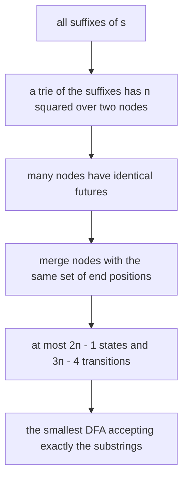
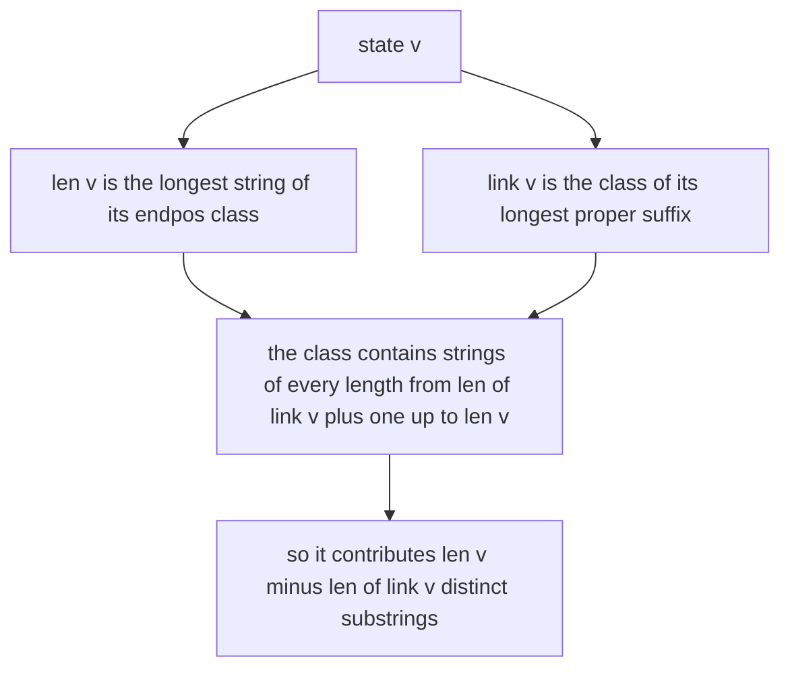
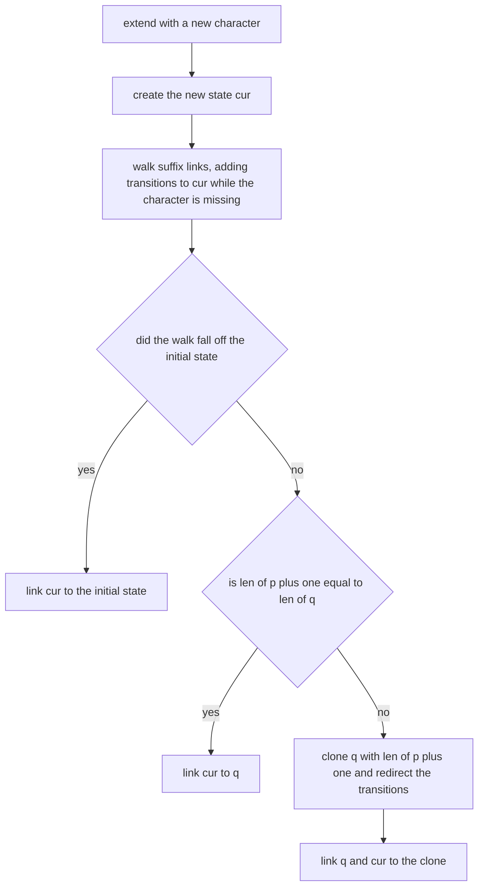
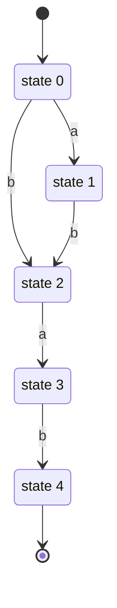

# 311 — Build suffix automaton basic (conceptual / small cases).

> **Tier:** Intermediate · **CTCI chapter:** Beyond — Advanced Data Structures & Algorithms
> **Task spec:** [311-build-suffix-automaton-basic-conceptual-small-cases.md](../../../tasks/intermediate/311-build-suffix-automaton-basic-conceptual-small-cases.md)
> **Solutions:** [Python](../../../solutions/python/intermediate/311-build-suffix-automaton-basic-conceptual-small-cases/solution.py) ·
> [Java](../../../solutions/java/intermediate/311-build-suffix-automaton-basic-conceptual-small-cases/Solution.java) ·
> [JavaScript](../../../solutions/javascript/intermediate/311-build-suffix-automaton-basic-conceptual-small-cases/solution.js) ·
> [C#](../../../solutions/csharp/intermediate/311-build-suffix-automaton-basic-conceptual-small-cases/Solution.cs)

## 1. Problem restatement

**Input:** a string `s` of `n` characters, possibly empty. The tests keep `n` small on purpose.

**Output:** a **suffix automaton** of `s` — the smallest deterministic finite automaton that accepts
exactly the substrings of `s` — plus two derived answers the tests check. The header states the
contract precisely: *"Each state `v` keeps `len[v]` (longest string of its endpos class), `link[v]`
(suffix link) and a transition map. Each state contributes `len[v] - len[link[v]]` new distinct
substrings, so the total number of distinct substrings is `sum(len[v] - len[link[v]])` over
`v != init`. Construction is the textbook online extension (amortised `O(n)` states and
transitions); the tests keep strings small so the bookkeeping can be cross-checked against a
brute-force substring set."*

The interface is a small class: `extend(char)`, `accepts(word)`, `distinct_substrings()`.

| Call | Result | Why |
| --- | --- | --- |
| `build("abab").distinct_substrings()` | `7` | `a`, `b`, `ab`, `ba`, `aba`, `bab`, `abab` |
| `build("aaaa").distinct_substrings()` | `4` | `a`, `aa`, `aaa`, `aaaa` |
| `build("banana").distinct_substrings()` | `15` | matches `len(brute_substrings("banana"))` |
| `build("").distinct_substrings()` | `0` | the initial state contributes nothing |
| `build("").accepts("")` | `True` | the empty word is accepted vacuously |
| `build("abab").accepts("bab")` | `True` | `bab` is a substring |
| `build("abab").accepts("bb")`, `"baa"`, `"baab"` | `False` | explicitly asserted rejections |

Four checks run for every string in the test set — `"a"`, `"ab"`, `"abab"`, `"banana"`,
`"mississippi"`, 12 LCG strings of length 10 over `ab`, and 8 of length 9 over `abc`:

1. `distinct_substrings()` equals `len(brute_substrings(s))`, where the oracle is a set built from
   all `O(n²)` slices;
2. every substring of `s` is accepted by walking the automaton;
3. every word over the alphabet up to length 4 is accepted **iff** it is a substring (the empty word
   excepted, since the brute-force set holds only non-empty substrings);
4. the state count stays within the textbook bound `2n + 1`.

Check 3 is the strong one: it verifies rejection as well as acceptance, so an automaton that accepts
too much cannot pass — which is also why the test strings are kept short.

## 2. Intuition

Every substring of `s` is a prefix of some suffix of `s`, so a machine that walks prefixes of
suffixes accepts exactly the substrings. The suffix automaton compresses that set of `n` suffix
tries into a DAG by merging states that behave identically.



A state is an *endpos class*: the set of positions where the strings it represents end. Two strings
belong to the same state exactly when they occur in the same set of positions — `ab` and `bab` in
`"abab"` both always end together, for instance. Each state is therefore characterised by the
longest string in its class, `len[v]`, and by a suffix link `link[v]` pointing to the state of the
next-shorter class (the longest proper suffix of the class's strings that lives in another class).
The number of distinct strings in a state's class is `len[v] - len[link[v]]`, which is where the
counting formula comes from.



Construction is online: process `s` one character at a time, and after each character the automaton
accepts exactly the substrings of the prefix read so far. Three cases arise, and they are the whole
of `extend`:

- walk the suffix links from the previous state while the new character has no transition; if the
  walk reaches the initial state, link the new state to the initial state;
- otherwise the transition already exists, leading to a state `q`. If `len[p] + 1 == len[q]` the new
  state simply links to `q`;
- otherwise `q` is too long for its own class and must be **cloned**: a copy with
  `len = len[p] + 1` is created, the transitions pointing at `q` along the link chain are redirected
  to the clone, and both `q` and the new state link to it.



## 3. Algorithm

`extend(char)`:

1. Create state `cur` with `len[cur] = len[last] + 1` and an empty transition map.
2. Set `p = last`. While `p != -1` and the transition for the character is missing from `p`, add a
   transition `p --char--> cur` and move `p = link[p]`.
3. If `p == -1`, set `link[cur] = 0` (the initial state) and finish.
4. Otherwise let `q` be the target of `p`'s transition on the character. If `len[p] + 1 == len[q]`,
   set `link[cur] = q` and finish.
5. Otherwise clone: create `clone` with `len[clone] = len[p] + 1` and a copy of `q`'s transitions,
   set `link[clone] = link[q]`; walk the suffix links from `p` while the character's transition
   targets `q`, redirecting it to `clone`; then set `link[q] = clone` and `link[cur] = clone`.
6. Set `last = cur`.

```text
procedure extend(character)
    cur ← new state
    len[cur] ← len[last] + 1
    p ← last
    while p ≠ -1 and transition for character is missing at p do
        add transition p --character--> cur
        p ← link[p]
    end
    if p = -1 then
        link[cur] ← 0
    else
        q ← target of p's transition on character
        if len[p] + 1 = len[q] then
            link[cur] ← q
        else
            clone ← new state
            len[clone] ← len[p] + 1
            link[clone] ← link[q]
            copy q's transitions into clone
            while p ≠ -1 and p's transition on character targets q do
                retarget it to clone
                p ← link[p]
            end
            link[q] ← clone
            link[cur] ← clone
        end
    end
    last ← cur
end
```

```text
procedure distinct_substrings()
    total ← 0
    for each state v other than the initial state do
        total ← total + len[v] - len[link[v]]
    end
    return total
end

procedure accepts(word)
    state ← 0
    for each character in word do
        if state has no transition on character then
            return false
        end
        state ← that transition's target
    end
    return true
end
```

`accepts` is a plain DFA walk, and it accepts the empty word vacuously — the initial state is the
state reached by "nothing", and the empty string is a substring of every string, so the test suite
treats `""` as an expected acceptance separately from the brute-force set.

## 4. Worked example

Trace the construction of the automaton for `"abab"`. It needs no clones, so all five states are
visible from the start; `len` and `link` are the two numbers that matter.

| After reading | New state | What happens |
| --- | --- | --- |
| `a` | 1 | `len[1] = 1`, the initial state gains `a --> 1`, `link[1] = 0` |
| `b` | 2 | `len[2] = 2`, states 1 and 0 gain `b --> 2`, `link[2] = 0` |
| `a` | 3 | `len[3] = 3`, state 2 gains `a --> 3`; `q = 1` has `len[1] + 1 = len[q]`, so `link[3] = 1` |
| `b` | 4 | `len[4] = 4`, state 3 gains `b --> 4`; the walk reaches state 1, whose `b` transition already leads to state 2, and `len[1] + 1 = len[2] = 2`, so `link[4] = 2` |

The finished automaton:

| State | `len` | `link` | Transitions |
| --- | --- | --- | --- |
| 0 (initial) | 0 | -1 | `a --> 1`, `b --> 2` |
| 1 | 1 | 0 | `b --> 2` |
| 2 | 2 | 0 | `a --> 3` |
| 3 | 3 | 1 | `b --> 4` |
| 4 | 4 | 2 | — |

The counting formula then reads off the answer directly:

| State `v` | `len[v]` | `len[link[v]]` | Contribution |
| --- | --- | --- | --- |
| 1 | 1 | 0 | 1 (`a`) |
| 2 | 2 | 0 | 2 (`b`, `ab`) |
| 3 | 3 | 1 | 2 (`ba`, `aba`) |
| 4 | 4 | 2 | 2 (`bab`, `abab`) |
| total | | | **7** |

Seven distinct substrings, matching the asserted value and the oracle set
`{a, b, ab, ba, aba, bab, abab}`.

A trace of the acceptance walk explains the explicit rejections. From state 0, `b` leads to state 2
and there is no second `b` transition (`accepts("bb")` is `False`). `ba` walks `b` then `a` to state
3, but state 3 has no `a` transition (`accepts("baa")` is `False`). And `bab` walks `b`, `a`, `b` to
state 4 — accepted, as asserted.



The clone branch does not appear in `"abab"`, so here is the smallest case that needs it, `"abb"`.
After reading `a` and then `b`, the state for `b` has `len = 2`. The final `b` walks the suffix links
and finds that state 0 already has a `b` transition, leading to that state 2 — but
`len[0] + 1 = 1 ≠ 2 = len[2]`, so state 2 cannot serve as the link target. The algorithm clones it:
new state 4 gets `len = 1`, the copy of state 2's transitions, and `link = 0`; the transition from
state 0 is redirected to the clone; and both state 2 and the new state 3 link to the clone. The
result has five states for a three-character string and still reports the correct `5` distinct
substrings (`a`, `b`, `ab`, `bb`, `abb`).

## 5. Complexity

Let `n` be the length of `s`.

| Measure | Bound | Why it holds |
| --- | --- | --- |
| States | at most `2n - 1` | asserted in the tests as `2n + 1` for the empty-string case included |
| Transitions | at most `3n - 4` | the textbook count for the minimal automaton |
| Time, construction | amortised O(n) | each `extend` walks and shortens suffix links, and the walks total linear work |
| Time, `accepts(word)` | O(len(word)) | one transition per character |
| Time, `distinct_substrings` | O(states) | one subtraction per state |
| Space | O(n) | the state lists and transition maps |
| Verification cost | O(n³) | each of the `O(n²)` substrings is walked in `O(n)`, plus `O(alphabet⁴)` words in check 3 |

The linear bound on construction is amortised: a single `extend` can walk many links, but they are
links it added earlier, so the total over the whole run is linear. The tests attack the part easiest
to get wrong — the `len` and `link` bookkeeping — by comparing against a brute-force set on short
strings, where `O(n³)` verification is free.

## 6. Pitfalls and edge cases

- **The initial state's link is `-1`.** It is the sentinel that stops the link walk; using `0` there
  makes the walk loop forever. The loop condition `p != -1` in every file exists for exactly this.
- **The clone's `len` and `link`.** `len[clone] = len[p] + 1` (not `len[q]`, not `len[q] + 1`), and
  the clone inherits `link[q]`, because it is a proper suffix class of `q`'s original class. Getting
  either wrong breaks the endpos classes and shows up later as a wrong substring count.
- **Redirect only while the transition targets `q`.** The redirection loop stops as soon as a state's
  transition on the character leads somewhere else. Dropping the condition rewires unrelated
  transitions and corrupts the automaton.
- **Both `q` and `cur` link to the clone.** Missing either one leaves a state with the wrong suffix
  class, and the counting formula then over- or under-counts.
- **The empty string.** `build("")` has only the initial state, so `distinct_substrings()` is `0` and
  `accepts("")` is `True`. Both are asserted; the empty word is accepted *vacuously* and is
  deliberately excluded from the brute-force comparison because the oracle set holds only non-empty
  substrings.
- **The empty word in check 3.** `all_words` starts from `""`, and the test handles it as a special
  case before comparing membership; treating it like the others would compare `True` against a
  `False` membership lookup.
- **Counting excludes the initial state.** The sum runs over `v != init`; including state 0 would add
  `len[0] - len[link[0]] = 0 - (-1) = 1`, an off-by-one that quietly makes every count too large
  by one.
- **Alphabet representation.** Transitions are hash maps keyed by character, so the automaton works
  for any alphabet without assuming a size. The generated tests use `ab` and `abc`; the fixed cases
  use `ban` and `mips` so that the alphabet is exactly the distinct characters of the string.
- **`accepts` is a DFA walk, not a search.** Since the automaton is deterministic, the walk either
  reaches the end of the word (accepted) or hits a missing transition (rejected); no backtracking
  and no suffix-link traversal is involved.

## 7. Variants and follow-ups

- **Suffix array instead.** [310-implement-suffix-array-naive-sorting-suffixes.md](./310-implement-suffix-array-naive-sorting-suffixes.md)
  sorts suffixes explicitly, and
  [312-find-substring-occurrences-with-suffix-array-lcp.md](./312-find-substring-occurrences-with-suffix-array-lcp.md)
  answers substring queries with that order.
- **Advanced suffix automata.** [404-implement-suffix-automaton-and-count-different-substrings.md](../../../tasks/advanced/404-implement-suffix-automaton-and-count-different-substrings.md),
  [431-implement-suffix-automaton-for-distinct-substring-queries.md](../../../tasks/advanced/431-implement-suffix-automaton-for-distinct-substring-queries.md)
  and [526-implement-suffix-automaton-with-endpos-count-advanced.md](../../../tasks/advanced/526-implement-suffix-automaton-with-endpos-count-advanced.md)
  add occurrence counts, endpos sizes and query structures on top of the same core.
- **Other substring structures.** [340-implement-palindrome-tree-eertree-overview-small-test.md](../../../tasks/intermediate/340-implement-palindrome-tree-eertree-overview-small-test.md)
  is the eertree, and [528-implement-karp-rabin-for-many-patterns-with-automaton.md](../../../tasks/advanced/528-implement-karp-rabin-for-many-patterns-with-automaton.md)
  builds a different automaton for many-pattern matching.
- **Tries for prefix structure.** [253-implement-compressed-trie-radix-tree-basics.md](../../../tasks/intermediate/253-implement-compressed-trie-radix-tree-basics.md)
  compresses prefix paths the way this automaton compresses suffix classes.
- The chapter tutorial [Advanced topics](../../ctci/x-advanced-topics.md) places the automaton next
  to the suffix array as the two canonical string indexes.

## 8. Check yourself

1. What does a state represent, and why is `len[v]` its defining number?

<details><summary>Show answer</summary>

A state is an endpos class: the set of strings that occur at exactly the same positions of `s`. The
class is a contiguous range of lengths (each the longest string minus the lengths of its suffixes),
so recording its longest string `len[v]` and the class of the next shorter suffix `link[v]` describes
it completely — and gives the count `len[v] - len[link[v]]` of distinct strings in it.

</details>

2. Why does the total number of distinct substrings come out of the `len`/`link` bookkeeping?

<details><summary>Show answer</summary>

Every distinct substring of `s` belongs to exactly one endpos class, and within a class of longest
length `len[v]` the strings are precisely the suffixes of the longest one with lengths
`len[link[v]] + 1` through `len[v]` — that is `len[v] - len[link[v]]` strings. Summing over the
non-initial states counts each distinct substring exactly once.

</details>

3. When is a clone needed, and what breaks without one?

<details><summary>Show answer</summary>

A clone is needed when the transition found during the link walk leads to a state `q` with
`len[q] > len[p] + 1`: `q`'s class would then contain strings that do not share the new state's end
positions. The clone splits the class — it takes the shorter part — and the transitions along the
link chain are redirected to it. Without the clone the automaton accepts strings that are not
substrings, which check 3 in the test suite detects.

</details>

4. Why are the test strings short?

<details><summary>Show answer</summary>

Because the verification, not the construction, is the expensive part: check 3 enumerates every word
over the alphabet up to length 4, and check 2 walks every substring, so verification is roughly
`O(n³)` plus the enumeration. Short strings keep that free while still exercising the clone branch —
`"abb"`-style inputs and `"banana"`, `"mississippi"` among the fixed cases.

</details>
