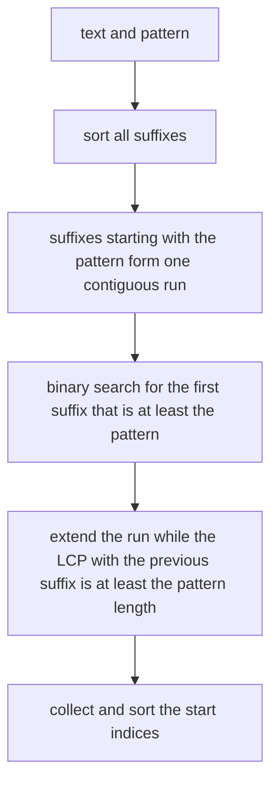
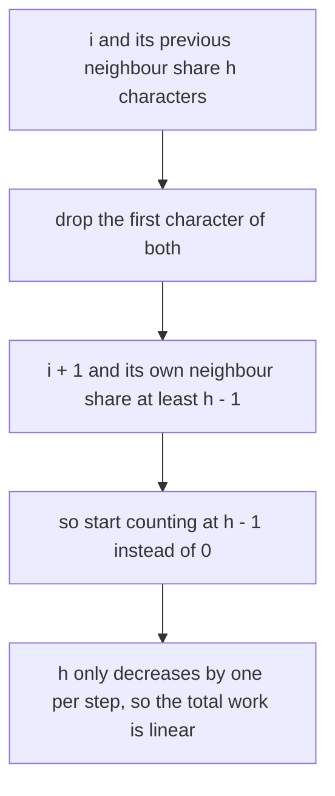
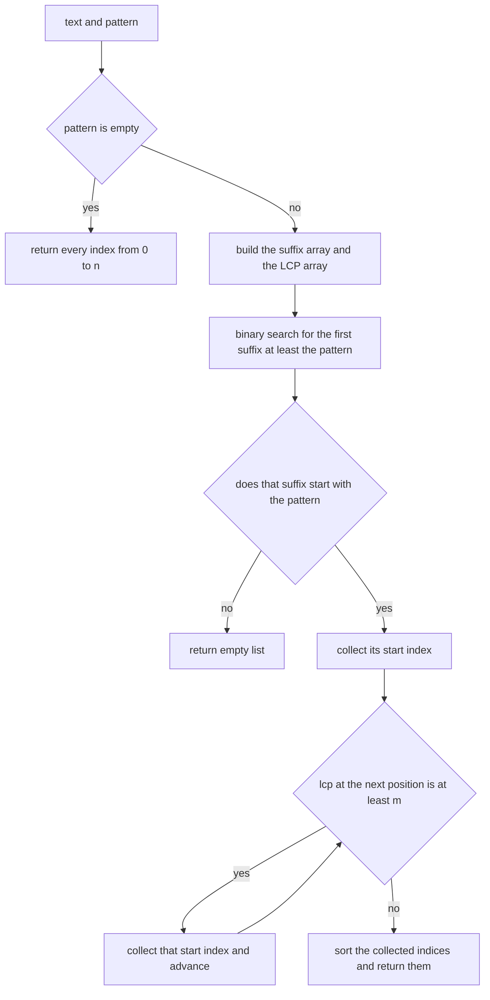
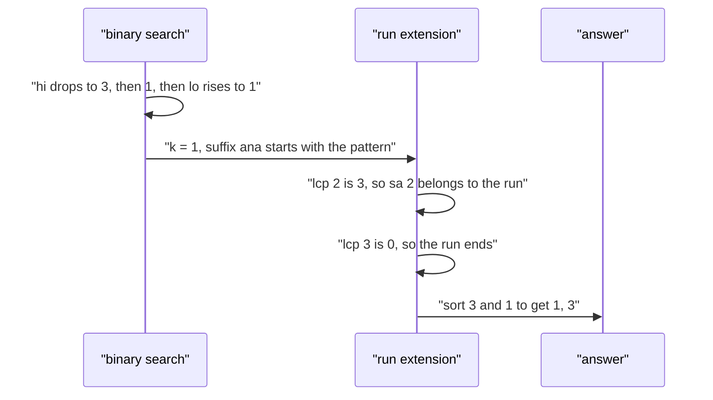

# 312 — Find substring occurrences with suffix array + LCP.

> **Tier:** Intermediate · **CTCI chapter:** Beyond — Advanced Data Structures & Algorithms
> **Task spec:** [312-find-substring-occurrences-with-suffix-array-lcp.md](../../../tasks/intermediate/312-find-substring-occurrences-with-suffix-array-lcp.md)
> **Solutions:** [Python](../../../solutions/python/intermediate/312-find-substring-occurrences-with-suffix-array-lcp/solution.py) ·
> [Java](../../../solutions/java/intermediate/312-find-substring-occurrences-with-suffix-array-lcp/Solution.java) ·
> [JavaScript](../../../solutions/javascript/intermediate/312-find-substring-occurrences-with-suffix-array-lcp/solution.js) ·
> [C#](../../../solutions/csharp/intermediate/312-find-substring-occurrences-with-suffix-array-lcp/Solution.cs)

## 1. Problem restatement

**Input:** a text `s` of `n` characters (possibly empty) and a pattern of `m` characters (possibly
empty).

**Output:** every start index where the pattern occurs in `s`, in ascending order, overlapping
matches included. The header describes the machinery: *"Build the suffix array (naive sort, as in
task 310), then the Kasai LCP array where `lcp[i] = LCP(sa[i-1], sa[i])` and `lcp[0] = 0`.
Occurrences of a pattern form a contiguous run of the suffix array, so binary search finds the first
suffix `>= pattern` and the run is extended with the LCP array (any neighbour sharing
`lcp >= |pattern|` starts with the pattern too)."*

| Call | Result | Why |
| --- | --- | --- |
| `occurrences("banana", "ana")` | `[1, 3]` | both occurrences, overlapping logic not needed here |
| `occurrences("banana", "a")` | `[1, 3, 5]` | every `a` |
| `occurrences("banana", "n")` | `[2, 4]` | both `n`s |
| `occurrences("banana", "ba")` | `[0]` | one match |
| `occurrences("banana", "banana")` | `[0]` | the whole string |
| `occurrences("banana", "ab")`, `"xy"`, `"bananas"` | `[]` | absent — including a pattern longer than the text |
| `occurrences("banana", "")` | `[0, 1, 2, 3, 4, 5, 6]` | the empty pattern matches at all `n + 1` positions |
| `occurrences("", "a")` | `[]` | nothing to search |

Supporting assertions pin the two arrays the search depends on: the suffix array of `"banana"` is
`[5, 3, 1, 0, 4, 2]`, its LCP array is `[0, 1, 3, 0, 0, 2]` (commented as *"hand-checked: a|ana,
ana|anana, na|nana"*), and every `lcp[i]` is re-derived with `lcp_of_suffixes`, a direct
character-by-character comparison. Then the search is checked against `naive_occurrences` — a scan
of every position — on the fixed texts plus 30 LCG strings of length 20 over `ab` and 10 of length
16 over `abc`, with every substring of length 1 to 3 plus the probes `zz`, `z`, `ababab`, `""`,
`bbbb`, `ccc`.

## 2. Intuition

The suffix array sorts all suffixes. A pattern occurs at position `i` exactly when the suffix `s[i:]`
*starts with* the pattern, so the occurrences are precisely those suffixes of the array that begin
with the pattern — and because the array is sorted, those suffixes sit next to each other.



That gives the search its shape: a binary search to *find* the run, then a linear walk to *extend*
it. The binary search needs `O(log n)` comparisons of the pattern against a suffix, and the walk
emits one index per occurrence.

The remaining question is why the extension can use the LCP array instead of comparing the full
pattern at every step. Since the array is sorted, two adjacent suffixes both start with the pattern
exactly when their common prefix is at least `m` characters long. So `lcp[t] >= m` is a complete test
— one integer comparison instead of `m` character comparisons — and every suffix whose `lcp` with its
predecessor is below `m` lies outside the run.

The LCP array itself is built with Kasai's trick, which turns the naive `O(n²)` pairwise comparison
into linear time. The trick: if the suffix at position `i` shares `h` characters with its array
neighbour, then the suffix at position `i + 1` shares at least `h - 1` characters with *its*
neighbour. So the comparison can start from `h - 1` instead of zero, and the total work over the
whole run is linear.



## 3. Algorithm

Suffix array (as in task 310): sort the indices `0..n-1` by comparing the suffixes directly.

Kasai LCP:

1. Build `rank`, where `rank[start] = i` means the suffix starting at `start` is the `i`-th smallest.
2. Walk `i` from `0` to `n - 1`, keeping a running `h`:
   - if `rank[i] == 0` (the smallest suffix), reset `h = 0`;
   - otherwise let `j = sa[rank[i] - 1]`, the previous suffix in the array; extend `h` while
     `s[i + h] == s[j + h]`, then set `lcp[rank[i]] = h` and, if `h > 0`, decrement it by one for the
     next iteration.
3. `lcp[0] = 0` by convention (the smallest suffix has no predecessor).

Search:

1. If the pattern is empty, return every index `0..n`.
2. Binary search for the smallest `k` with `s[sa[k]:] >= pattern`; if `k == n`, or the suffix at `k`
   does not start with the pattern, return an empty list.
3. Start the result with `sa[k]`, then walk `t = k + 1` upward while `t < n` and `lcp[t] >= m`,
   appending `sa[t]`.
4. Sort the collected indices ascending and return them.

```text
procedure kasai_lcp(s, sa)
    n ← length(s)
    rank ← array of n entries
    for index ← 0 to n - 1 do
        rank[sa[index]] ← index
    end
    lcp ← array of n zeros
    h ← 0
    for i ← 0 to n - 1 do
        if rank[i] > 0 then
            j ← sa[rank[i] - 1]
            while i + h < n and j + h < n and s[i + h] = s[j + h] do
                h ← h + 1
            end
            lcp[rank[i]] ← h
            if h > 0 then
                h ← h - 1
            end
        else
            h ← 0
        end
    end
    return lcp
end

procedure occurrences(s, pattern)
    n ← length(s)
    m ← length(pattern)
    if m = 0 then
        return every index from 0 to n
    end
    sa ← suffix_array(s)
    lcp ← kasai_lcp(s, sa)
    lo ← 0
    hi ← n
    while lo < hi do
        mid ← (lo + hi) / 2
        if suffix sa[mid] is smaller than pattern then
            lo ← mid + 1
        else
            hi ← mid
        end
    end
    k ← lo
    if k = n or suffix sa[k] does not start with pattern then
        return empty list
    end
    result ← list containing sa[k]
    t ← k + 1
    while t < n and lcp[t] ≥ m do
        append sa[t] to result
        t ← t + 1
    end
    sort result ascending
    return result
end
```



## 4. Worked example

Trace the search for `"ana"` in `"banana"`. The suffix array and LCP array are the asserted ones:

| `k` | `sa[k]` | suffix | `lcp[k]` |
| --- | --- | --- | --- |
| 0 | 5 | `a` | 0 |
| 1 | 3 | `ana` | 1 |
| 2 | 1 | `anana` | 3 |
| 3 | 0 | `banana` | 0 |
| 4 | 4 | `na` | 0 |
| 5 | 2 | `nana` | 2 |

The binary search narrows `[lo, hi)` = `[0, 6)` by asking whether each probed suffix is below the
pattern:

| Step | `lo`, `hi` | `mid` | `sa[mid]` | suffix vs `"ana"` | action |
| --- | --- | --- | --- | --- | --- |
| 1 | 0, 6 | 3 | 0 | `"banana" > "ana"` | `hi = 3` |
| 2 | 0, 3 | 1 | 3 | `"ana" = "ana"`, not below | `hi = 1` |
| 3 | 0, 1 | 0 | 5 | `"a" < "ana"` | `lo = 1` |
| done | 1, 1 | — | — | — | `k = 1` |

The suffix at `k = 1` is `"ana"`, which starts with the pattern, so the result starts with `sa[1] = 3`.
Then the run is extended:

| `t` | `lcp[t]` | `lcp[t] >= 3`? | action |
| --- | --- | --- | --- |
| 2 | 3 | yes | append `sa[2] = 1` |
| 3 | 0 | no | stop |

The collected indices are `[3, 1]`, sorted to `[1, 3]` — the asserted answer. The extension needed
*two* integer comparisons, not two full pattern comparisons.



Two more cases from the same table make the mechanics clear. Searching `"a"` finds `k = 0` (the
suffix `"a"` itself), then extends while `lcp[t] >= 1`: `lcp[1] = 1`, `lcp[2] = 3`, then `lcp[3] = 0`
stops it, giving `[5, 3, 1]` → sorted `[1, 3, 5]`. Searching `"xy"` fails in the binary search: every
suffix is smaller than `"xy"`, so `lo` reaches `n = 6` and the function returns immediately.

## 5. Complexity

Let `n = length(s)` and `m = length(pattern)`.

| Measure | Bound | Why it holds |
| --- | --- | --- |
| Time, suffix array | O(n² log n) | the naive construction of task 310, kept for clarity |
| Time, Kasai LCP | O(n) | `h` decreases by at most one per step, so the total extension work is linear |
| Time, binary search | O(m log n) | `log n` probes, each comparing up to `m` characters |
| Time, run extension | O(occurrences) | one integer comparison and one append per member |
| Time, sorting the answer | O(r log r) | `r` occurrences; the array order is not index order |
| Space | O(n) | two arrays of length `n` plus the result |
| Time, naive scan | O(n · m) | the oracle: every position compared against the pattern |

The interesting numbers are the last two rows of the search: the binary search costs `O(m log n)`
regardless of how many occurrences exist, and the run extension costs one comparison per occurrence.
The naive scan costs `O(n · m)` for every query. The suffix array version trades an `O(n² log n)`
one-time construction for much cheaper repeated queries — the right choice when the same text is
searched many times, which is why the tests reuse a single `sa`/`lcp` pair across all the patterns
generated for a text.

## 6. Pitfalls and edge cases

- **`lcp[0] = 0` by convention.** The smallest suffix has no left neighbour, so the first entry is
  zero. The extension loop starts at `k + 1`, which never reads it.
- **The empty pattern.** It matches at every one of the `n + 1` positions (including `n` itself), and
  the function returns `range(n + 1)` before building anything. Asserted for `"banana"` and used as
  an oracle comparison for every random text.
- **An empty text.** `occurrences("", "a")` is `[]`; with `n = 0` the binary search finds `k = 0 = n`
  and returns an empty list.
- **Absent patterns.** Both failure modes are covered: `"xy"` is larger than every suffix, so the
  binary search falls off the end (`k == n`), while `"ab"` in `"banana"` sits in the middle of the
  order — `k` lands on a suffix that does not start with the pattern. The explicit `startswith` check
  is what rejects the second case.
- **A pattern longer than the text.** `"bananas"` returns `[]`; the binary search may position `k`
  anywhere, and the prefix test fails.
- **Overlapping matches.** The oracle scans every position, and the suffix-array route counts every
  suffix, so overlaps are naturally included. `"aaa"`-style inputs are covered by the fixed text
  `["a", "aa", "aaaa"]`.
- **The result is sorted at the end.** Suffix-array order is lexicographic, not positional, so the
  collected indices must be sorted before returning. The asserted `occurrences("banana", "ana") ==
  [1, 3]` would otherwise read `[3, 1]`.
- **Kasai's `h` reset.** When `rank[i] == 0` the code sets `h = 0` rather than decrementing; the
  suffix with rank 0 has no predecessor, and carrying a stale `h` into the next iteration would
  over-count.
- **The LCP definition is between neighbours.** `lcp[i]` is the common prefix of `sa[i-1]` and
  `sa[i]`, not of `sa[0]` and `sa[i]`. The tests re-derive every entry with `lcp_of_suffixes` on the
  adjacent pair, which is the only way to pin the convention down.
- **Extension is one-directional.** The run starts at the first suffix `>= pattern` and is extended
  to the right only. That relies on the binary search returning the *lower bound*, not just any
  match.
- **Repeated characters.** `"a"`, `"aa"` and `"aaaa"` are in the fixed list because they make the LCP
  values large and the runs long — where an off-by-one in `lcp[t] >= m` shows up.

## 7. Variants and follow-ups

- **The construction.** [310-implement-suffix-array-naive-sorting-suffixes.md](./310-implement-suffix-array-naive-sorting-suffixes.md)
  is the `O(n² log n)` suffix array used here, and
  [401-implement-suffix-array-sa-is-or-doubling-for-medium-n.md](../../../tasks/advanced/401-implement-suffix-array-sa-is-or-doubling-for-medium-n.md)
  replaces it with the near-linear doubling or SA-IS construction.
- **The LCP array.** [402-build-lcp-array-from-suffix-array-kasai.md](../../../tasks/advanced/402-build-lcp-array-from-suffix-array-kasai.md)
  develops Kasai's algorithm as its own topic, and
  [403-use-suffix-array-lcp-for-longest-repeated-substring.md](../../../tasks/advanced/403-use-suffix-array-lcp-for-longest-repeated-substring.md)
  reads a different answer off the same array.
- **Alternative string indexes.** [311-build-suffix-automaton-basic-conceptual-small-cases.md](./311-build-suffix-automaton-basic-conceptual-small-cases.md)
  answers the same kind of query with an automaton, and
  [313-implement-z-function-for-pattern-matching.md](./313-implement-z-function-for-pattern-matching.md)
  plus [184-implement-prefix-function-kmp-for-pattern-matching.md](../../../tasks/beginner/184-implement-prefix-function-kmp-for-pattern-matching.md)
  search a single pattern in linear time without building an index.
- **Hashing.** [315-rolling-hash-double-hash-to-reduce-collisions.md](../../../tasks/intermediate/315-rolling-hash-double-hash-to-reduce-collisions.md)
  answers substring-equality queries with much less machinery and a probabilistic guarantee.
- The chapter tutorial [Advanced topics](../../ctci/x-advanced-topics.md) places this search next to
  the other suffix structures of the tier.

## 8. Check yourself

1. Why do the occurrences of a pattern form a contiguous run of the suffix array?

<details><summary>Show answer</summary>

A suffix starts with the pattern iff it is `>= pattern` and `< pattern` followed by any character
larger than the end of string. Within the sorted order, all strings in that interval are
consecutive, and any suffix between two matching suffixes must also start with the pattern — if it
did not, it would sort outside the interval.

</details>

2. What exactly does `lcp[t] >= m` prove during the extension?

<details><summary>Show answer</summary>

That the suffix `sa[t]` and its predecessor `sa[t-1]` share at least `m` leading characters. Since
`sa[t-1]` already starts with the pattern (the run starts at `k` and grows to the right), sharing `m`
characters with it means `sa[t]` starts with the same `m` characters — the pattern. One integer
comparison replaces up to `m` character comparisons.

</details>

3. Why is Kasai's algorithm linear?

<details><summary>Show answer</summary>

Because `h` is decremented by at most one per outer-loop step: when the suffix at `i` shares `h`
characters with its neighbour, the suffix at `i + 1` shares at least `h - 1` with its own neighbour,
so the character comparisons can resume from `h - 1`. The total number of increments of `h` is
therefore bounded by `n`, plus at most `n` decrements — linear.

</details>

4. What is the cost of one query, and when is the suffix-array index the wrong tool?

<details><summary>Show answer</summary>

`O(m log n)` for the search plus `O(r)` for `r` occurrences, after an `O(n² log n)` construction here
(or `O(n log n)` with a better builder). It is the wrong tool for a single search in a text that will
never be searched again — KMP or the Z-function do that in `O(n + m)` without building an index —
and it is the right tool when the same text is queried many times.

</details>
