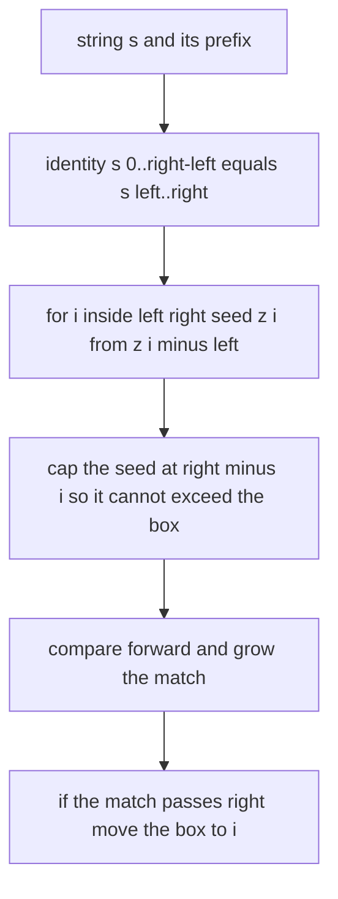
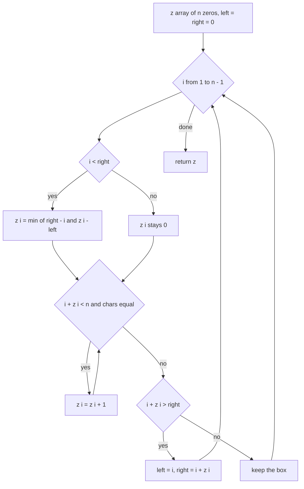
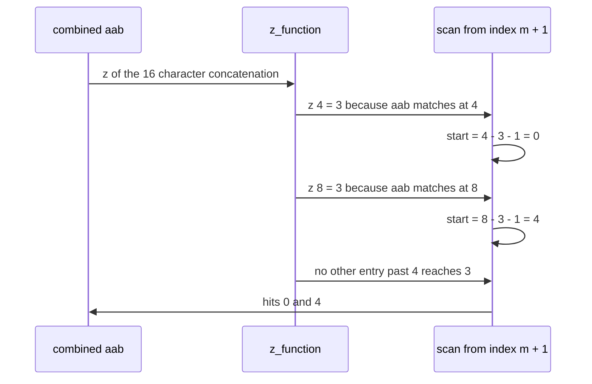

# 313 — Implement Z-function for pattern matching.

> **Tier:** Intermediate · **CTCI chapter:** Beyond — Advanced Data Structures & Algorithms
> **Task spec:** [313-implement-z-function-for-pattern-matching.md](../../../tasks/intermediate/313-implement-z-function-for-pattern-matching.md)
> **Solutions:** [Python](../../../solutions/python/intermediate/313-implement-z-function-for-pattern-matching/solution.py) ·
> [Java](../../../solutions/java/intermediate/313-implement-z-function-for-pattern-matching/Solution.java) ·
> [JavaScript](../../../solutions/javascript/intermediate/313-implement-z-function-for-pattern-matching/solution.js) ·
> [C#](../../../solutions/csharp/intermediate/313-implement-z-function-for-pattern-matching/Solution.cs)

## 1. Problem restatement

**Input:** a string `s` of `n` characters, plus a pattern `p` of `m` characters for the search
routine. Both may be empty; the solutions assume `"#"` does not occur in either (it is the
sentinel they splice between them).

**Output:** two things.

1. The **Z-array** of `s`: `z[i]` is the length of the longest common prefix of `s` and the
   suffix `s[i..]`. The solutions set `z[0] = 0` by convention, so every other entry obeys
   `0 ≤ z[i] ≤ n - i`.
2. The **search result**: every start index `i` of `text` where `pattern` occurs, in ascending
   order, computed from the Z-array of `pattern + "#" + text`.

The contract is pinned down by the assertions in the solution files:

| Call | Result | Why |
| --- | --- | --- |
| `z_function("aabcaabxaaaz")` | `[0, 1, 0, 0, 3, 1, 0, 0, 2, 2, 1, 0]` | hand-checked worked example |
| `z_function("aaaa")` | `[0, 3, 2, 1]` | suffix lengths cap each value |
| `z_function("abab")` | `[0, 0, 2, 0]` | index 2 shares the `ab` prefix, index 1 does not |
| `z_function("")` / `z_function("a")` | `[]` / `[0]` | `z[0]` is excluded from the loop |
| `z_search("aabcaabxaaaz", "aab")` | `[0, 4]` | two occurrences |
| `z_search("aabcaabxaaaz", "aa")` | `[0, 4, 8, 9]` | overlaps at 8 and 9 |
| `z_search("aabcaabxaaaz", "zz")` | `[]` | absent pattern |
| `z_search("abc", "")` | `[0, 1, 2, 3]` | the empty pattern matches everywhere |
| `z_search("", "a")` | `[]` | nothing to search |

## 2. Intuition

The naive way to compute the Z-array is the definition itself: for every `i`, compare `s[0..]`
against `s[i..]` character by character and count how far the two stay equal.

```text
function z_naive(s)
    for i ← 1 to length(s) - 1 do
        z[i] ← 0
        while i + z[i] < length(s) and s[z[i]] = s[i + z[i]] do
            z[i] ← z[i] + 1
        end
    end
    return z
end
```

That is `O(n²)` for degenerate inputs: `"aaaa...a"` restarts a long comparison at every position,
and each comparison runs to the end of the string.

The insight is the same one that powers KMP and Manacher: **a previous Z-value is a copy you have
not been billed for yet.** Keep the rightmost interval `[left, right)` that is known to equal a
prefix of `s` — the "Z-box". If the current index `i` lies inside that box, then position `i` sits
at offset `i - left` of a region that is *literally identical* to the prefix of `s`. So the answer
starts at `z[i - left]`, the already-known value for that offset. The only work left is to check
whether the match can spill past the right edge of the box, and to slide the box forward when it
does.



Each character comparison either fails immediately or advances `right`; since `right` never moves
backwards and never exceeds `n`, the total number of comparisons over the whole run is bounded by
`2n`. The amortised argument is the entire story of the algorithm.

## 3. Algorithm

1. Allocate `z` of `n` zeros; `z[0] = 0` by convention.
2. Keep the half-open interval `[left, right)` of the rightmost match seen so far, initially
   `left = right = 0` (empty).
3. For `i` from `1` to `n - 1`:
   1. If `i < right`, the index is inside the current box, so set
      `z[i] ← min(right - i, z[i - left])` — the seed is a copy, capped by the box edge.
   2. Extend by direct comparison: while `i + z[i] < n` and `s[z[i]] = s[i + z[i]]`, increment
      `z[i]`.
   3. If the match now reaches past `right` (`i + z[i] > right`), move the box to `left ← i`,
      `right ← i + z[i]`.
4. For searching, build `combined ← pattern + "#" + text`, compute its Z-array once, and report
   `i - m - 1` for every `i > m` with `z[i] ≥ m`.

```text
procedure z_function(s)
    n ← length(s)
    z ← array of n zeros
    left ← 0
    right ← 0
    for i ← 1 to n - 1 do
        if i < right then
            z[i] ← minimum(right - i, z[i - left])
        end
        while i + z[i] < n and s[z[i]] = s[i + z[i]] do
            z[i] ← z[i] + 1
        end
        if i + z[i] > right then
            left ← i
            right ← i + z[i]
        end
    end
    return z
end

procedure z_search(text, pattern)
    if pattern is empty then
        return every index from 0 to length(text)
    end
    m ← length(pattern)
    combined ← pattern + "#" + text
    z ← z_function(combined)
    hits ← empty list
    for i ← m + 1 to length(combined) - 1 do
        if z[i] ≥ m then
            append i - m - 1 to hits
        end
    end
    return hits
end
```

The two entry points of the shipped code are `z_function` / `zFunction` and `z_search` /
`zSearch`; each file also carries `z_function_naive` and `naive_search`, which exist purely as
independent oracles for the assertions.



## 4. Worked example

Trace `z_function("aabcaabxaaaz")`, the hand-checked example the Python file asserts first. The
string has `n = 12` characters, indices `0..11`.

| Step | `i` | box `[left, right)` before | seed used | forward comparisons | `z[i]` | box after |
| --- | --- | --- | --- | --- | --- | --- |
| 1 | 1 | `[0, 0)` | none | `s[0]a` vs `s[1]a` ok, `s[1]a` vs `s[2]b` stop | 1 | `[1, 2)` |
| 2 | 2 | `[1, 2)` | outside | `a` vs `b` stop | 0 | `[1, 2)` |
| 3 | 3 | `[1, 2)` | outside | `a` vs `c` stop | 0 | `[1, 2)` |
| 4 | 4 | `[1, 2)` | outside | `aab` matches, then `a` vs `x` stop | 3 | `[4, 7)` |
| 5 | 5 | `[4, 7)` | `min(2, z[1]) = 1` | `a` vs `a` ok, then `a` vs `b` stop | 1 | `[4, 7)` |
| 6 | 6 | `[4, 7)` | `min(1, z[2]) = 0` | `a` vs `x` stop | 0 | `[4, 7)` |
| 7 | 7 | `[4, 7)` | outside | `a` vs `x` stop | 0 | `[4, 7)` |
| 8 | 8 | `[4, 7)` | outside | `aa` matches, then `a` vs `z` stop | 2 | `[8, 10)` |
| 9 | 9 | `[8, 10)` | `min(1, z[1]) = 1` | `s[1]a` vs `s[10]a` ok, then `s[2]b` vs `s[11]z` stop | 2 | `[9, 11)` |
| 10 | 10 | `[9, 11)` | `min(1, z[1]) = 1` | `s[1]a` vs `s[11]z` stop | 1 | `[9, 11)` |
| 11 | 11 | `[8, 11)` | outside | `a` vs `z` stop | 0 | `[8, 11)` |

The result is exactly `[0, 1, 0, 0, 3, 1, 0, 0, 2, 2, 1, 0]`. Step 9 is the interesting one: the
seed said 1 because `z[1] = 1`, but the character after the box edge (`z` at index 10) still
matched, so the value grew to 2 and the box extended. Step 5 shows the cap working — `z[i - left]`
was 1 and `right - i` was 2, so the answer kept the smaller value.

The search then reuses that same machinery. For `pattern = "aab"` and `text = "aabcaabxaaaz"`,
`combined` is `"aab#aabcaabxaaaz"` and `m = 3`, so the scan starts at index `4`:



The loop starts at `m + 1 = 4`, which skips the trivial self-match at index 1 and the sentinel
itself; `z[1] = 1` (the `a` of the pattern against itself) is far below `m = 3` anyway. The sentinel
guarantees that no match can cross the boundary, so `z[i] ≥ m` can only happen for genuine
occurrences of the pattern in the text. The Python assertions confirm `z_search(text, "aab")` is
`[0, 4]`, and the modules cross-check every result against `naive_search` on the hand-checked
strings plus 42 deterministic LCG strings.

## 5. Complexity

Let `n = length(s)` and `m = length(pattern)`.

| Measure | Bound | Why it holds |
| --- | --- | --- |
| Time, best | O(n) | the loop still visits every index; only the inner extensions get cheap |
| Time, average | O(n) | each comparison either fails once or advances `right`, which never decreases |
| Time, worst | O(n) | standard amortisation: `right` moves at most `n` steps in total |
| Space | O(n) | one `z` array of `n` integers plus the two box indices |
| Time, search (`Z` on the concatenation) | O(n + m) | `combined` has `n + m + 1` characters |
| Space, search | O(n + m) | the Z-array of `combined` |
| Time of the naive definition | O(n²) | `"aaaa…a"` restarts a long comparison at every index |
| Time of the naive search oracle | O(n · m) | slice comparison at each of the `n - m + 1` positions |

The improvement over the naive oracle is asymptotic, not a constant factor: on `"a" * 24` the naive
version performs about `24·25/2 = 300` character comparisons while the linear version performs fewer
than 48. The solution files assert only the *results*, not the comparison counts, so the numbers
here come from the algorithm's own accounting, not from a benchmark.

## 6. Pitfalls and edge cases

- **`z[0]` is 0, not `n`.** The definition would give the whole string, so every implementation sets
  it to zero by convention and starts the loop at `1`. The Python file asserts
  `z_function("a") == [0]`, which fails immediately if the loop starts at 0.
- **Empty string.** `n = 0`, the loop never runs and the result is `[]`. `z_search("", "a")` is `[]`.
- **Empty pattern.** `z_search("abc", "")` returns `[0, 1, 2, 3]` — the empty pattern matches at
  every position including the end. All four solutions special-case it before building `combined`,
  since `pattern + "#" + text` would otherwise lose the final position.
- **The sentinel must not occur in the inputs.** The Python module spells this out: `"#"` must not
  appear in the pattern or the text, or a match could straddle the boundary. The random test data
  is generated over `"ab"` and `"abc"`, which cannot contain it.
- **Off-by-one in the index mapping.** The reported start is `i - m - 1`, not `i - m`, because the
  sentinel occupies one slot.
- **Pattern longer than the text.** No index of `combined` past the sentinel can reach
  `z[i] ≥ m`, so the answer is `[]`; the bound `0 ≤ z[i] ≤ n - i` asserted in the tests guarantees
  it without a special case.
- **Unicode is fine here.** The algorithm only compares characters for equality and never uses
  arithmetic on them, so code points, UTF-16 units and bytes all behave identically.
- **Box tracking must be strict.** The update is `if i + z[i] > right`, not `≥`; using `>` keeps
  `left` at the *oldest* position of the rightmost box, which the seeding step relies on.

## 7. Variants and follow-ups

- **Prefix function instead of Z-function.** KMP's prefix function stores the same information in a
  different coordinate system and turns a KMP failure into a single `pi` entry; comparing the two
  is the classic exercise.
- **Multiple patterns at once.** Running the Z-search once per pattern costs `O(k · n)`; the
  automaton in [314-implement-aho-corasick-for-multiple-pattern-match-outline.md](../../../tasks/intermediate/314-implement-aho-corasick-for-multiple-pattern-match-outline.md)
  replaces the repeated scans with one pass over the text.
- **Repeated substrings without a pattern.** The same "compare with a prefix" habit shows up in
  [317-longest-duplicate-substring-binary-search-hash.md](../../../tasks/intermediate/317-longest-duplicate-substring-binary-search-hash.md),
  which swaps Z-boxes for binary search plus hashing.
- **Fixed-length patterns over a tiny alphabet.** When the pattern length is a constant, the
  bit-packing trick of
  [316-find-repeated-dna-sequences-length-10-with-hashing.md](../../../tasks/intermediate/316-find-repeated-dna-sequences-length-10-with-hashing.md)
  is simpler than any string algorithm.
- **Longest palindrome in linear time.** Manacher's algorithm is the same "reuse the rightmost box"
  idea applied to palindromic radii rather than common prefixes.

## 8. Check yourself

1. Why is `z[0]` set to 0 instead of `n`?

<details><summary>Show answer</summary>

Because the whole string is trivially a common prefix of itself, which makes `z[0] = n`
uninformative and, worse, breaks the seeding step: `z[i - left]` with `i - left = 0` would copy a
value far larger than the box. Every solution sets it to zero by convention and starts the loop at
index 1; the test `z_function("a") == [0]` pins this down.

</details>

2. What exactly makes the inner `while` loop linear in total?

<details><summary>Show answer</summary>

Every successful comparison increases `i + z[i]`, and whenever that value passes `right` the box is
moved to `i`, so `right` is updated to the new value. `right` never decreases and never exceeds
`n`, hence at most `n` comparisons can ever succeed. All the remaining comparisons fail immediately,
one per iteration of the outer loop. Total work is therefore `O(n)`.

</details>

3. Why does the search loop start at `m + 1` in `combined`?

<details><summary>Show answer</summary>

`combined = pattern + "#" + text` has the pattern in positions `0..m-1` and the sentinel at `m`.
Z-values at indices `1..m` describe the pattern compared against itself, not against the text, and
the sentinel's own entry is meaningless. Index `m + 1` is the first text character, so scanning from
there and mapping `i → i - m - 1` reports exactly the text positions.

</details>

4. What happens if `"#"` really is part of the text?

<details><summary>Show answer</summary>

The sentinel stops being a separator. The boundary between pattern and text can then be "matched"
by a spurious Z-value, and the routine can report a start index of `-1` or a position that is not a
real occurrence. The Python module documents the assumption explicitly; a production version should
pick the sentinel dynamically (any character absent from both inputs) or use a length-prefixed
encoding.

</details>

5. `z_function("aaaa")` is `[0, 3, 2, 1]`. Which entry grows past its seed, and why?

<details><summary>Show answer</summary>

Entry `i = 1` starts outside the box (`left = right = 0`), so it is computed by pure comparison and
reaches 3, moving the box to `[1, 4)`. Entry `i = 2` is seeded with `min(right - i, z[i - left]) =
min(2, z[1]) = 2` and cannot extend because `i + z[i] = 4` is already the end. Entry `i = 3` is
seeded with `min(1, z[2]) = 1` and is likewise capped by the string end. So only the first entry
does comparisons; the other two are entirely free copies.

</details>
