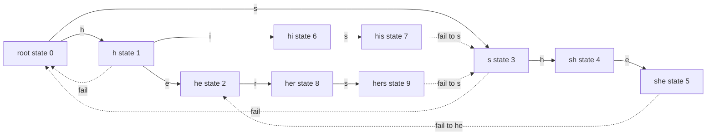
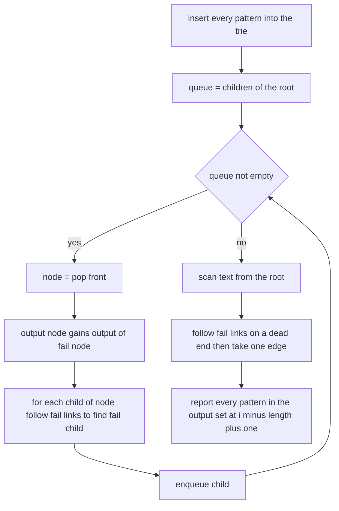
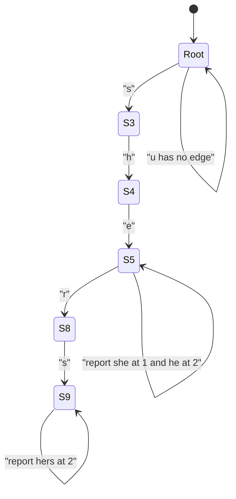

# 314 — Implement Aho-Corasick for multiple pattern match (outline).

> **Tier:** Intermediate · **CTCI chapter:** Beyond — Advanced Data Structures & Algorithms
> **Task spec:** [314-implement-aho-corasick-for-multiple-pattern-match-outline.md](../../../tasks/intermediate/314-implement-aho-corasick-for-multiple-pattern-match-outline.md)
> **Solutions:** [Python](../../../solutions/python/intermediate/314-implement-aho-corasick-for-multiple-pattern-match-outline/solution.py) ·
> [Java](../../../solutions/java/intermediate/314-implement-aho-corasick-for-multiple-pattern-match-outline/Solution.java) ·
> [JavaScript](../../../solutions/javascript/intermediate/314-implement-aho-corasick-for-multiple-pattern-match-outline/solution.js) ·
> [C#](../../../solutions/csharp/intermediate/314-implement-aho-corasick-for-multiple-pattern-match-outline/Solution.cs)

## 1. Problem restatement

**Input:** a list of `k` non-empty patterns and one text of `n` characters. The spec marks the task
as an *outline*: the shipped code builds the full automaton (trie plus failure links) but keeps the
goto function as a per-node map, so failure transitions are followed on demand during the scan
instead of being pre-compiled into a complete transition table.

**Output:** for every pattern, the ascending list of start indices where it occurs in the text,
including **overlapping** occurrences. Matches are reported while scanning, not afterwards.

| Call | Result | Why |
| --- | --- | --- |
| `search("ushers")` with `["he", "she", "his", "hers"]` | `he → [2]`, `she → [1]`, `hers → [2]`, `his → []` | the classic textbook example |
| `search("aaaa")` with `["aa", "aaa"]` | `aa → [0, 1, 2]`, `aaa → [0, 1]` | overlaps are all reported |
| `search("ab")` with `["a", "ab"]` | `a → [0]`, `ab → [0]` | a pattern that is a prefix of another |
| `search("")` with `["a", "ab"]` | `a → []`, `ab → []` | empty text, no reports |

Every solution cross-checks its output against `naive_search_all`, a per-pattern scan, on the
hand-written strings plus deterministic LCG strings over the alphabets `"ab"` and `"abc"`.

## 2. Intuition

The obvious approach runs one pattern scan per pattern: `k` independent passes over the text, each
`O(n · |pattern|)` in the worst case, for `O(k · n · m)` total. When `k` is large — think of a
spam filter with thousands of keywords — that is far too much, and it re-reads the text `k` times.

The insight is that a **single left-to-right pass** can serve all patterns at once, provided the
scanner always knows which pattern prefixes the text suffix it has just seen. A trie of the patterns
answers "what prefixes start here?" exactly: walking the trie character by character is the
multi-pattern generalisation of a single pattern match. The only missing piece is what to do when
the next character has no outgoing edge. A naive scanner would restart at the root and lose all
progress; instead each state stores a **failure link** — the longest proper suffix of its path that
is still a prefix of some pattern. On a dead end the scanner follows failure links until an edge
exists, which is exactly the behaviour that keeps the scan linear.



Solid edges are the goto function (the trie), dashed edges are the failure links. State `5` (`she`)
fails to state `2` (`he`) — the longest suffix of `she` that is also a pattern prefix. Every state
also carries an **output set**: the patterns that end there, plus everything its failure target
outputs. State `5` therefore outputs both `she` and `he`, which is why one arrival can produce two
matches.

## 3. Algorithm

**Phase 1 — build the trie (goto function).**

1. Start with a single root state `0`; its failure link is `0` and its output set is empty.
2. For each pattern, walk from the root, creating a state whenever the edge is missing, and add the
   pattern to the output set of the last state reached.

**Phase 2 — compute failure links by breadth-first search.**

3. Seed the queue with the root's children: their failure link is the root already, since a
   one-character suffix can only be a one-character prefix.
4. Pop state `node`; merge `output[fail[node]]` into `output[node]`.
5. For every child of `node` reached by character `char`, start `f ← fail[node]` and follow failure
   links while `f` is not the root and has no `char` edge; then set
   `fail[child] ← goto[f][char]` (or the root if the edge does not exist).
6. Repeat until the queue empties.

**Phase 3 — scan the text.**

7. Keep a current state `node`, starting at the root.
8. For each position `i` and character `char`: while `node` is not the root and has no `char` edge,
   follow `fail[node]`; then take the edge if it exists, otherwise stay at the root.
9. Report every pattern in `output[node]` at start index `i - length(pattern) + 1`.

```text
procedure build(patterns)
    goto ← one empty map for the root
    fail ← [0]
    output ← [empty set]
    for each pattern in patterns do
        node ← 0
        for each char in pattern do
            if goto[node] has no edge char then
                add a new state and connect goto[node][char] to it
            end
            node ← goto[node][char]
        end
        add pattern to output[node]
    end
    queue ← every child of the root
    while queue is not empty do
        node ← remove front of queue
        merge output[fail[node]] into output[node]
        for each char child in goto[node] do
            f ← fail[node]
            while f is not 0 and goto[f] has no edge char do
                f ← fail[f]
            end
            fail[child] ← goto[f][char] if it exists else 0
            append child to queue
        end
    end
    return automaton with goto, fail, output
end

procedure search(automaton, text)
    found ← empty list per pattern
    node ← 0
    for i ← 0 to length(text) - 1 do
        char ← text[i]
        while node is not 0 and goto[node] has no edge char do
            node ← fail[node]
        end
        node ← goto[node][char] if it exists else 0
        for each pattern in output[node] do
            append i - length(pattern) + 1 to found[pattern]
        end
    end
    return found
end
```



## 4. Worked example

Build the automaton for `["he", "she", "his", "hers"]` — ten states, numbered in creation order.
The table lists the failure link and output set of each state after phase 2.

| State | Path | `fail` | `output` after inheritance |
| --- | --- | --- | --- |
| 0 | root | 0 | — |
| 1 | `h` | 0 | — |
| 2 | `he` | 0 | `he` |
| 3 | `s` | 0 | — |
| 4 | `sh` | 1 (`h`) | — |
| 5 | `she` | 2 (`he`) | `she`, `he` |
| 6 | `hi` | 0 | — |
| 7 | `his` | 3 (`s`) | `his` |
| 8 | `her` | 0 | — |
| 9 | `hers` | 3 (`s`) | `hers` |

Now scan `"ushers"` (`u0 s1 h2 e3 r4 s5`):

| Step | `i` | char | state before | fail-link walk | state after | matches reported |
| --- | --- | --- | --- | --- | --- | --- |
| 1 | 0 | `u` | 0 | none needed | 0 (no edge) | — |
| 2 | 1 | `s` | 0 | none needed | 3 | — |
| 3 | 2 | `h` | 3 | none needed | 4 | — |
| 4 | 3 | `e` | 4 | none needed | 5 | `she` at 1, `he` at 2 |
| 5 | 4 | `r` | 5 | none needed | 8 | — |
| 6 | 5 | `s` | 8 | none needed | 9 | `hers` at 2 |



The assertion in every solution file is `{"he": [2], "she": [1], "hers": [2], "his": []}`, and
`his` stays empty because the text contains `sh…` but never the substring `his`. Note step 4: a
single state arrival produced two matches, because the failure link of `5` points at `2` and the
output sets were merged during phase 2. Had the merge been skipped, `he` would have been missed at
position 2 — the classic bug this task is built to expose.

## 5. Complexity

Let `n` be the text length, `k` the number of patterns, and `L` the total number of characters in
all patterns (`L = Σ|pattern|`).

| Measure | Bound | Why it holds |
| --- | --- | --- |
| Build time | `O(L)` trie insertions plus the BFS work | each character of every pattern creates or follows one edge |
| Build space | `O(L)` states | at most `L + 1` states, each with a map, a fail link and an output set |
| Scan time, best | `O(n)` | one character per step |
| Scan time, worst | `O(n + matches)` | each failure step decreases the current depth, and each character increases it by at most one |
| Scan space | `O(k)` for the result | the automaton is the only other state |
| Naive per-pattern scan | `O(k · n · m)` | each pattern rescans the text |
| Z-function per pattern | `O(k · (n + m))` | see [313](313-implement-z-function-for-pattern-matching.md) |

The amortised scan bound is the interesting one: the trie depth is a non-negative integer that the
`while` loop can only decrease and the single edge step can only increase by one, so over the whole
text the loop body runs at most `n` extra times in total. That argument — not a per-step constant —
is what the "linear in text plus matches" claim rests on.

## 6. Pitfalls and edge cases

- **Empty patterns.** All four solutions document "patterns are assumed non-empty". A `""` pattern
  would match at every position between `0` and `n`; the naive oracle has no special case for it
  either, so an empty pattern is simply not part of the contract.
- **Empty text.** `search("")` returns every pattern mapped to an empty list — the scan loop never
  runs. The Python and Java files assert this case.
- **Overlaps are matches.** `["aa", "aaa"]` on `"aaaa"` yields `[0, 1, 2]` and `[0, 1]`. A naive
  `find` loop that advances by the pattern length would miss half of them.
- **Prefix patterns.** `"a"` and `"ab"` on `"ab"` both match at 0. Output sets are per-state, so a
  pattern shorter than the current path is only reported through its failure target's output — which
  is why the merge in phase 2 is mandatory.
- **Duplicate patterns.** The output set is a `set` and the result dictionary is keyed by pattern,
  so a repeated pattern is reported once, not twice.
- **Failure links must be computed by BFS, not DFS.** A state's failure target is always shallower
  than the state itself, so processing by depth guarantees `output[fail[node]]` is already complete.
- **Multiple edges from the root.** Depth-1 states already fail to the root, so their failure links
  are never recomputed; the queue is seeded with them directly.
- **Per-node maps are slower than a dense table.** This is the outline-level simplification: every
  step may hash a character, and failure transitions are walked at match time. A compiled version
  would materialise a full `Σ × states` table and replace the `while` loop with one lookup.

## 7. Variants and follow-ups

- **One pattern only.** With `k = 1` the failure links become the KMP prefix function, and the
  scan is the same single pass. The Z-based search in
  [313-implement-z-function-for-pattern-matching.md](313-implement-z-function-for-pattern-matching.md)
  solves the same problem with a different pre-processing.
- **Substring hashes instead of an automaton.** For fixed-short patterns, per-position hashing
  ([316-find-repeated-dna-sequences-length-10-with-hashing.md](316-find-repeated-dna-sequences-length-10-with-hashing.md))
  is simpler; for varying lengths,
  [315-rolling-hash-double-hash-to-reduce-collisions.md](315-rolling-hash-double-hash-to-reduce-collisions.md)
  shows how to compare any two substrings in constant time.
- **Longest repeated substring at scale.** Once the text is fixed, the maximum duplicated length can
  be found with binary search plus hashing,
  [317-longest-duplicate-substring-binary-search-hash.md](317-longest-duplicate-substring-binary-search-hash.md),
  which reuses the automaton's "text position" mindset without any trie.
- **Dense transitions.** Replace the maps with an array indexed by character code when the alphabet
  is small, which turns failure following into a memoised table read.

## 8. Check yourself

1. Why is a failure link slower to compute than to follow?

<details><summary>Show answer</summary>

Following one during the scan is amortised `O(1)` because it lowers the current depth, and the depth
can rise at most `n` times over the whole text. Computing them is `O(L)` in total for the same
reason, but each one may need a walk up the failure chain, and those walks are only linear *in
aggregate* across the BFS. Neither operation is `O(1)` in the worst single case.

</details>

2. What goes wrong if the output sets are not inherited from the failure target?

<details><summary>Show answer</summary>

Arriving at state `5` (`she`) in `"ushers"` would report only `she`; the shorter pattern `he`, which
ends at the same text position, would never be reported. Inheritance is what makes one state arrival
able to emit several matches, and it is the reason `output` must be merged for every state, not only
for terminal ones.

</details>

3. `search("")` with patterns `["a", "ab"]` returns `{"a": [], "ab": []}`. Which loop guarantees it?

<details><summary>Show answer</summary>

The result is initialised with an empty list per pattern before the scan, so when the text is empty
the scan loop body never runs and the initialised map is returned unchanged. No special case is
needed; the Python file asserts exactly this shape.

</details>

4. Why does the queue start with the root's children rather than the root itself?

<details><summary>Show answer</summary>

A depth-1 state's only proper suffix is the empty string, which corresponds to the root — the failure
link is already correct at initialisation. Starting from the root would try to compute
`fail[root]`, which has no meaning. BFS then guarantees that whenever a state is processed, its
own failure target (always shallower) is fully settled, including its inherited output set.

</details>

5. When is the naive per-pattern scan the better choice?

<details><summary>Show answer</summary>

When `k` is tiny or the patterns are long relative to the text. Building the automaton costs `O(L)`
regardless of the text, while `k` independent scans cost `O(k · n)` plus the comparison work. For one
short pattern in a short text, the trie's memory and construction overhead buys nothing, and a
direct `find` or the Z-based search of task 313 is simpler and just as fast.

</details>
