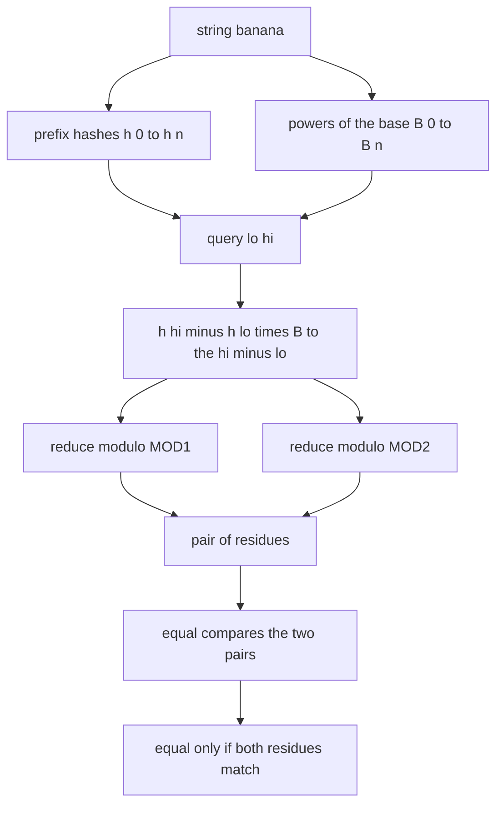
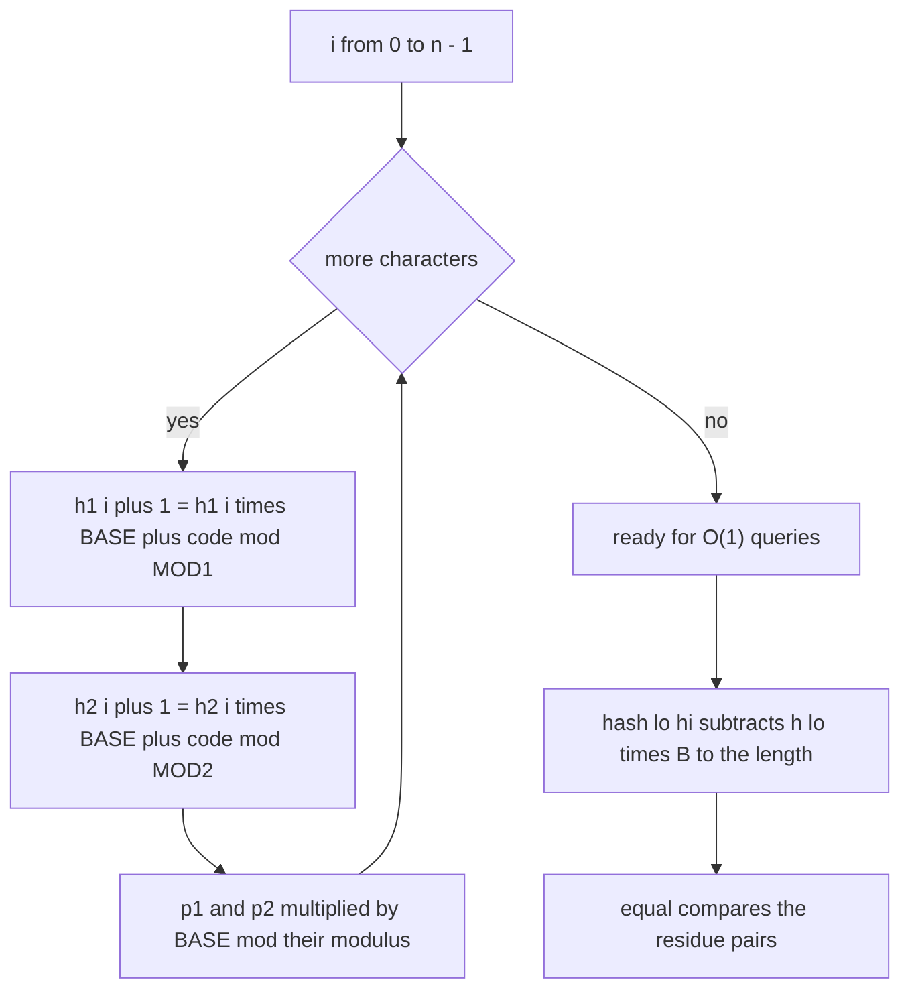
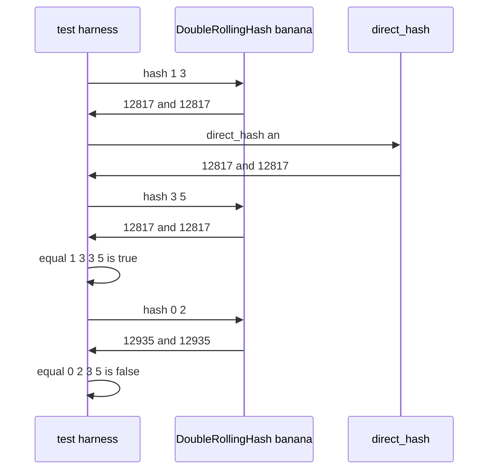

# 315 — Rolling hash double-hash to reduce collisions.

> **Tier:** Intermediate · **CTCI chapter:** Beyond — Advanced Data Structures & Algorithms
> **Task spec:** [315-rolling-hash-double-hash-to-reduce-collisions.md](../../../tasks/intermediate/315-rolling-hash-double-hash-to-reduce-collisions.md)
> **Solutions:** [Python](../../../solutions/python/intermediate/315-rolling-hash-double-hash-to-reduce-collisions/solution.py) ·
> [Java](../../../solutions/java/intermediate/315-rolling-hash-double-hash-to-reduce-collisions/Solution.java) ·
> [JavaScript](../../../solutions/javascript/intermediate/315-rolling-hash-double-hash-to-reduce-collisions/solution.js) ·
> [C#](../../../solutions/csharp/intermediate/315-rolling-hash-double-hash-to-reduce-collisions/Solution.cs)

## 1. Problem restatement

**Input:** a string `s` of `n` characters. The solutions build a *substring equality oracle* on top
of it: two prefix-hash arrays and two power arrays, one pair per modulus.

**Output:** `hash(lo, hi)` returns the pair `(h mod MOD1, h mod MOD2)` of the substring `s[lo..hi)`,
and `equal(lo1, hi1, lo2, hi2)` answers "are those two substrings identical?" in constant time.
The constants are the ones the solution files declare:

| Constant | Value | Role |
| --- | --- | --- |
| `MOD1` | `1_000_000_007` | first modulus |
| `MOD2` | `998_244_353` | second modulus |
| `BASE` | `131` | polynomial base, the same for both |
| `MOD_WEAK` | `65537` | modulus of the deliberately bad demo hash |
| `BASE_WEAK` | `65536` | `≡ -1 (mod 65537)`, so the demo hash is an alternating sum |

The assertions pin down the contract:

| Call | Result | Why |
| --- | --- | --- |
| `hash(1, 3)` on `"banana"` | `(12817, 12817)` = `direct_hash("an")` | `s[1..3)` is `"an"` |
| `equal(1, 3, 3, 5)` | true | `"an"` at 1 and `"an"` at 3 |
| `equal(0, 2, 3, 5)` | false | `"ba"` versus `"an"` |
| `weak_hash("ab")` | `1` | `97 · (-1) + 98 = 1` |
| `weak_hash("bc")` | `1` | `98 · (-1) + 99 = 1` — a real collision |
| `DoubleRollingHash("ab").hash(0, 2)` vs `DoubleRollingHash("bc").hash(0, 2)` | different | the second modulus separates the pair |

## 2. Intuition

Comparing two substrings costs `O(length)` with a loop or a slice. If an algorithm needs many such
comparisons — binary-searching a duplicated substring, checking a candidate window, deduplicating
blocks — that cost dominates and the whole thing degrades to `O(n²)`.

The classic fix is a **polynomial rolling hash**: read the string as a number in base `B`,
reduced modulo a large prime. It has two properties that make it useful. First, prefixes can be
built incrementally: `h[i + 1] = h[i] · B + code(s[i])`. Second, any substring hash can be
*derived* from two prefixes instead of recomputed, because the suffix of a prefix is exactly what
you subtracted away:

```text
h(lo, hi) = ( h[hi] - h[lo] · B^(hi - lo) ) mod M
```

where `h[i]` is the hash of `s[0..i)` and the power `B^(hi - lo)` is precomputed. One subtraction
and one multiplication per modulus — `O(1)` per query, `O(n)` to set up.

The catch is collisions: two different substrings can hash to the same value. A single modulus makes
that likely enough to matter, so the solutions hash **twice with two different primes** and call the
substrings equal only when *both* values match. A false match now requires a simultaneous collision
in `MOD1` and `MOD2`, which is exactly why the demo hash in the files is built to break: with
`BASE_WEAK = 65536 ≡ -1 (mod 65537)` the polynomial degenerates into an alternating sum, and
`"ab"` and `"bc"` both reduce to `1` while `"ba"` reduces to `65536`.



## 3. Algorithm

1. Allocate four arrays of `n + 1` slots: `h1`, `h2` for the prefix hashes and `p1`, `p2` for the
   powers of `BASE`, with `h[0] = 0` and `p[0] = 1`.
2. For each character index `i` with code `c`:
   - `h1[i + 1] = (h1[i] · BASE + c) mod MOD1` and `p1[i + 1] = p1[i] · BASE mod MOD1`;
   - the same for `h2` and `p2` with `MOD2`.
3. `hash(lo, hi)` returns
   `((h1[hi] - h1[lo] · p1[hi - lo]) mod MOD1, (h2[hi] - h2[lo] · p2[hi - lo]) mod MOD2)`.
4. `equal(a, b, c, d)` returns true exactly when the two pairs are equal.
5. `direct_hash(text)` rebuilds the same polynomial from scratch — no prefix arrays — and is used by
   the tests to cross-check every `O(1)` query. `weak_hash(text)` is the single-modulus version with
   the bad base, used to exhibit a collision the double hash does not share.

```text
function build(s)
    n ← length(s)
    h1 ← array of n + 1 zeros
    h2 ← array of n + 1 zeros
    p1 ← array of n + 1 ones
    p2 ← array of n + 1 ones
    for i ← 0 to n - 1 do
        c ← code of s[i]
        h1[i + 1] ← (h1[i] * BASE + c) mod MOD1
        h2[i + 1] ← (h2[i] * BASE + c) mod MOD2
        p1[i + 1] ← (p1[i] * BASE) mod MOD1
        p2[i + 1] ← (p2[i] * BASE) mod MOD2
    end
    return h1, h2, p1, p2
end

function substring_hash(lo, hi)
    a ← (h1[hi] - h1[lo] * p1[hi - lo]) mod MOD1
    b ← (h2[hi] - h2[lo] * p2[hi - lo]) mod MOD2
    return (a, b)
end

function equal(lo1, hi1, lo2, hi2)
    return substring_hash(lo1, hi1) equals substring_hash(lo2, hi2)
end
```

The subtraction is done modulo the modulus, so a negative intermediate wraps into range. Python and
C# rely on the language's remainder operator to do that; the JavaScript file multiplies through a
`mulmod` helper because `a · b` can exceed 2^53 and lose precision before the `%` is applied.



## 4. Worked example

Build the prefix arrays for `"banana"` with `BASE = 131`. Codes: `b = 98`, `a = 97`, `n = 110`.

| `i` | char | `h1[i + 1]` | `h2[i + 1]` | `p1[i + 1]` |
| --- | --- | --- | --- | --- |
| 0 | `b` | 98 | 98 | 131 |
| 1 | `a` | 12935 | 12935 | 17161 |
| 2 | `n` | 1694595 | 1694595 | 2248091 |
| 3 | `a` | 221992042 | 221992042 | 294499921 |
| 4 | `n` | 80957409 | 131871375 | 579489385 |
| 5 | `a` | 605420606 | 304996221 | 913108910 |

The two residue streams agree while the numbers are below `MOD2 = 998244353` and diverge at index 4,
where the first wrap-around happens in `MOD1` but not yet in `MOD2`. That divergence is harmless: the
substring formula uses each stream with its own modulus.

Now query the two-character windows:

| Query | Substring | `MOD1` value | `MOD2` value | Compared with |
| --- | --- | --- | --- | --- |
| `hash(1, 3)` | `an` | 12817 | 12817 | `direct_hash("an")` |
| `hash(0, 2)` | `ba` | 12935 | 12935 | `direct_hash("ba")` |
| `hash(3, 5)` | `an` | 12817 | 12817 | equal to `hash(1, 3)` |
| `hash(1, 6)` | `anana` | 815461275 | 864619587 | only the pair matters |

So `equal(1, 3, 3, 5)` is true because both residues match, and `equal(0, 2, 3, 5)` is false because
both differ — the decision needs only two integer comparisons, never a character scan.



The collision demo runs beside the real thing. With the weak base, `weak_hash("ab")` and
`weak_hash("bc")` are both `1`, so a single-modulus scheme would declare two different strings equal;
`weak_hash("ba")` is `65536`, showing the alternating sum really is what moves the collision into
place. Feeding `"ab"` and `"bc"` through `DoubleRollingHash` produces different pairs, and the files
also assert that `direct_hash("ab")[0] != direct_hash("bc")[0]` — with a *sane* base a single
modulus would have been enough for this particular pair, so the demo isolates the cause: the base,
not the modulus count.

## 5. Complexity

Let `n` be the string length and `q` the number of queries.

| Measure | Bound | Why it holds |
| --- | --- | --- |
| Build time | `O(n)` | four constant-work updates per character |
| Build space | `O(n)` | four arrays of `n + 1` integers |
| `hash` time | `O(1)` | two subtractions, two multiplications, two reductions |
| `equal` time | `O(1)` | two `hash` calls plus a pair comparison, independent of substring length |
| `q` queries | `O(q)` hashing work | versus `O(q · len)` for slice comparisons |
| Verification | `O(n)` per rebuilt substring | `direct_hash` is the oracle, not part of the query path |
| Collision probability | product of the two single-modulus probabilities | a false match needs a collision in *both* residues |

The setup cost is paid once; the whole point is that the per-query cost stops depending on the
substring length. The tests push this hard: the Python file asserts `checked > 1000` after comparing
every pair of equal-length windows of every test string against naive slicing, and every
`hash(lo, hi)` against `direct_hash(text[lo:hi])`.

## 6. Pitfalls and edge cases

- **Negative intermediates.** `h[hi] - h[lo] · p` can be negative; the result must be normalised into
  `[0, M)`. Python's `%` already returns a non-negative value, C# needs the same care, and the Java
  and C# files normalise explicitly.
- **Overflow in JavaScript.** `a · b` with `a, b < 10^9` reaches `10^18`, far beyond the 2^53 exact
  integer range of a JS number. The JavaScript file routes every such multiplication through
  `mulmod`, splitting the operand at `65536`; the other three languages use 64-bit integers.
- **Empty and single-character substrings.** `hash(lo, lo)` is `(0, 0)` for every `lo`, because the
  difference term vanishes; the tests sweep `hi` from `lo` upward and compare against the empty
  slice, which is also `(0, 0)`. Nothing special is needed, but the sweep is what proves it.
- **Base and modulus choices.** `BASE = 131` is small and coprime to both moduli. The weak demo has
  `BASE_WEAK ≡ -1`, the worst possible choice, which is the entire point of the demonstration: a bad
  base collides *by construction*, not by bad luck.
- **The equality answer is probabilistic.** A match of both residues is not a proof of equality. The
  solutions never claim otherwise; the test harness verifies against real slicing, and any
  production use should confirm a positive answer before trusting it.
- **Substrings are half-open.** `hash(lo, hi)` covers `s[lo..hi)`, matching Python slices and
  `s.substring` in Java. The off-by-one in `p[hi - lo]` — the length, not the index — is the usual
  bug.
- **Moduli must differ.** The files assert `MOD1 != MOD2`; two equal moduli give a scheme no stronger
  than a single hash while doubling the work.
- **Precomputed powers are mandatory.** Computing `BASE^(hi - lo)` per query with a loop would
  destroy the `O(1)` claim; it is the `p1`/`p2` arrays that make the subtraction legal.

## 7. Variants and follow-ups

- **Use the rolling hash for duplicate detection.**
  [316-find-repeated-dna-sequences-length-10-with-hashing.md](316-find-repeated-dna-sequences-length-10-with-hashing.md)
  replaces the whole hash by a collision-free base-4 key for fixed-length windows, which is possible
  only because the window length is a constant.
- **Binary search on the answer plus hashing.**
  [317-longest-duplicate-substring-binary-search-hash.md](317-longest-duplicate-substring-binary-search-hash.md)
  reuses exactly this `DoubleRollingHash` class and probes candidate lengths with the monotone
  predicate "some window of length L repeats".
- **Two substrings in `O(1)` also means two patterns.** Any exact string comparison built on top of
  a hash can be replaced by a pair of residue comparisons; the multi-pattern automaton of
  [314-implement-aho-corasick-for-multiple-pattern-match-outline.md](314-implement-aho-corasick-for-multiple-pattern-match-outline.md)
  takes the opposite approach and pre-processes the patterns instead.
- **Deterministic alternatives.** The
  [313](313-implement-z-function-for-pattern-matching.md) Z-function and its relatives answer the
  same equality questions with no collision risk at all, at the price of more pre-processing.
- **Suffix-array style comparison.** Sorting suffixes by rank removes hashing entirely; the hashing
  approach stays attractive when the text arrives as a stream.

## 8. Check yourself

1. Why does `equal` never look at the characters of the substrings?

<details><summary>Show answer</summary>

Because the polynomial hash of an interval is a function of two prefix hashes and a power, and the
scheme compares two such intervals by their residue pairs. If both residues agree, the code claims
equality; that is a probabilistic decision whose error probability is the chance of a simultaneous
collision in `MOD1` and `MOD2`. The test harness is what establishes that the decision is correct on
the checked inputs, using `direct_hash` and plain slicing.

</details>

2. Why is `BASE_WEAK = 65536` "deliberately bad"?

<details><summary>Show answer</summary>

Because `65536 ≡ -1 (mod 65537)`, so `BASE_WEAK^k` alternates between `1` and `-1` and the polynomial
degenerates into an alternating sum of character codes. Different strings with the same alternating
sum then collide by construction: `"ab"` and `"bc"` both give `1`. It is a demonstration of a
pathological base, not a random failure.

</details>

3. `hash(1, 3)` and `hash(3, 5)` on `"banana"` are both `(12817, 12817)`. What does that prove?

<details><summary>Show answer</summary>

That the two windows are "an" and "an" as far as the scheme is concerned, which happens to be true
here. It does not prove the substrings are equal in general; it shows the query agrees with the naive
slice comparison, which is exactly what the assertion `rolling.hash(1, 3) == direct_hash("an")` and
`rolling.equal(1, 3, 3, 5)` check.

</details>

4. Where can the JavaScript implementation still be wrong even though Python is not?

<details><summary>Show answer</summary>

In the modular multiplication. JavaScript numbers are exact only up to 2^53, so `h[lo] · p` with both
factors near 10^9 overflows the exact range and silently rounds. The file's `mulmod` splits the second
factor into high and low 16-bit halves and reduces after each partial product, which keeps every
intermediate value below 2^53. Porting that code without the helper is the classic silent corruption.

</details>

5. The double hash costs twice the memory and twice the arithmetic. What does it buy, precisely?

<details><summary>Show answer</summary>

A false positive now needs two independent residues to collide at once. With two different primes the
combined error probability is roughly the product of the single-modulus probabilities rather than
either one alone, so the same reliability can be reached with a smaller base string than a
single-modulus scheme would need. The files make the trade-off explicit by shipping both a
double-hash class and a single-modulus `weak_hash` that provably collides.

</details>
