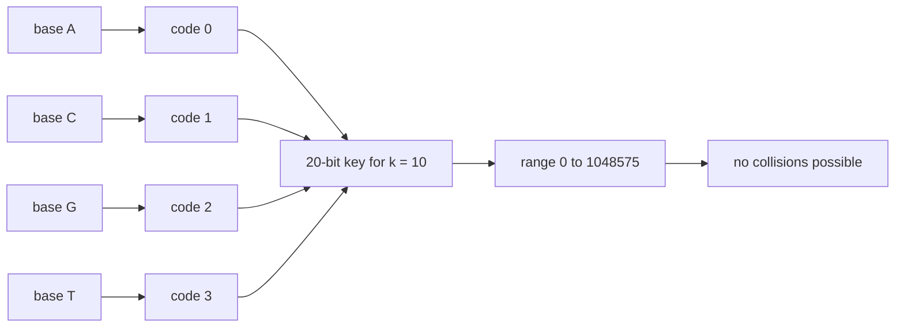
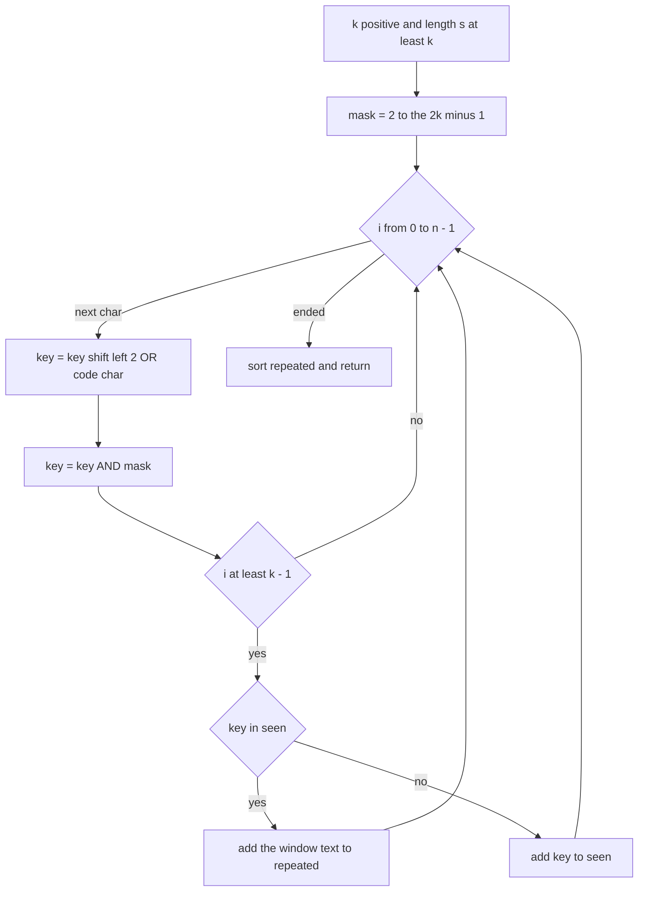
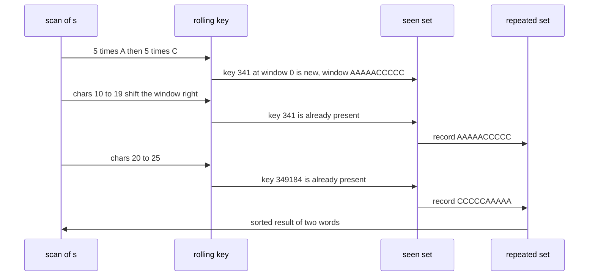

# 316 — Find repeated DNA sequences (length-10) with hashing.

> **Tier:** Intermediate · **CTCI chapter:** Beyond — Advanced Data Structures & Algorithms
> **Task spec:** [316-find-repeated-dna-sequences-length-10-with-hashing.md](../../../tasks/intermediate/316-find-repeated-dna-sequences-length-10-with-hashing.md)
> **Solutions:** [Python](../../../solutions/python/intermediate/316-find-repeated-dna-sequences-length-10-with-hashing/solution.py) ·
> [Java](../../../solutions/java/intermediate/316-find-repeated-dna-sequences-length-10-with-hashing/Solution.java) ·
> [JavaScript](../../../solutions/javascript/intermediate/316-find-repeated-dna-sequences-length-10-with-hashing/solution.js) ·
> [C#](../../../solutions/csharp/intermediate/316-find-repeated-dna-sequences-length-10-with-hashing/Solution.cs)

## 1. Problem restatement

**Input:** a DNA string `s` over the alphabet `ACGT`, plus a window length `k` that defaults to the
task's fixed `DNA_LENGTH = 10`.

**Output:** every `k`-letter substring that occurs **more than once** in `s`, sorted, with no
duplicates in the output. If nothing repeats — or if `k ≤ 0` or `len(s) < k` — the result is `[]`.

| Call | Result | Why |
| --- | --- | --- |
| `repeated_dna_sequences("AAAAACCCCCAAAAACCCCCCAAAAAGGGTTT")` | `["AAAAACCCCC", "CCCCCAAAAA"]` | the classic LeetCode example |
| `repeated_dna_sequences("A" * 11)` | `["AAAAAAAAAA"]` | two overlapping windows |
| `repeated_dna_sequences("A" * 10)` | `[]` | exactly one window: nothing repeats |
| `repeated_dna_sequences("ACGTACGTAC")` | `[]` | the 10-mer occurs once |
| `repeated_dna_sequences("ACGTACGTAC", k=4)` | `["ACGT", "CGTA", "GTAC"]` | shorter windows repeat |
| `repeated_dna_sequences("ACGTACGTAC", k=0)` / `k=20` | `[]` / `[]` | degenerate lengths |
| `repeated_dna_sequences("")` / `("ACGT")` | `[]` / `[]` | too short for a 10-mer |

The module also ships `repeated_dna_naive`, a `Counter` over every window, and
`overlapping_count`, which counts occurrences *with* overlaps — the assertions use both as oracles.

## 2. Intuition

The direct approach enumerates all `n - k + 1` windows, stores each `k`-character string in a
dictionary and returns the keys whose count exceeds one. That is `O(n · k)` time because each window
is copied, and it throws away the structure of the input: the alphabet has only four letters.

The insight is that **four letters fit in two bits**. Map `A → 0`, `C → 1`, `G → 2`, `T → 3`. A
`k`-letter window is then a `2k`-bit integer, and — this is the crucial part — consecutive windows
are related by a shift, not by independent construction:

```text
key ← ((key << 2) | code(new base)) & mask
```

Shifting left by two makes room for the next base, OR-ing puts it in, and the mask
`(1 << 2k) - 1` drops the base that just fell off the left end. One shift, one OR and one AND per
character, so every window key costs `O(1)` and the whole scan is `O(n)`.

Because the encoding is a bijection between `k`-letter strings and the range `[0, 4^k)`, the key is
**collision-free**: two different windows can never produce the same integer. For `k = 10` that is
`2^20 = 1_048_576` possible keys, comfortably inside a 32-bit integer, which is exactly why the task
fixes the window at ten.



## 3. Algorithm

1. Return `[]` immediately if `k ≤ 0` or `len(s) < k`.
2. `mask ← (1 << (2 * k)) - 1` keeps only the last `k` bases of the rolling key.
3. Keep two sets: `seen` holds the keys of windows encountered so far, `repeated` holds the words
   that have now been seen twice.
4. Scan the string left to right, maintaining `key`:
   1. `key ← ((key << 2) | code(s[i])) & mask`.
   2. Once `i ≥ k - 1` a full window has been consumed. Take its text
      `word ← s[i - k + 1 .. i + 1]`.
   3. If `key` is already in `seen`, add `word` to `repeated`; otherwise insert `key` into `seen`.
5. Return `sorted(repeated)`.

```text
procedure repeated_dna_sequences(s, k)
    if k ≤ 0 or length(s) < k then
        return empty list
    end
    mask ← (1 shifted left by 2 * k) - 1
    seen ← empty set
    repeated ← empty set
    key ← 0
    for i ← 0 to length(s) - 1 do
        key ← ((key shifted left by 2) OR code(s[i])) AND mask
        if i ≥ k - 1 then
            start ← i - k + 1
            word ← s[start .. i]
            if key is in seen then
                add word to repeated
            else
                add key to seen
            end
        end
    end
    return sorted(repeated)
end
```

Note the asymmetry in step 4.3: a first occurrence only records the key, and every *later* occurrence
re-adds the word to a set, which is idempotent. A window seen three or five times therefore ends up
in the result exactly once, and no occurrence counter is needed.



## 4. Worked example

Trace the classic string `"AAAAACCCCCAAAAACCCCCCAAAAAGGGTTT"`, which is 32 characters long, with
`k = 10` and `mask = 1048575`.

| Step (`i`) | char | rolling `key` (base 2 / value) | window start | action |
| --- | --- | --- | --- | --- |
| 0–4 | `A` | `0b0` | — | five zeros accumulate, `key = 0` |
| 5 | `C` | `0b1` | — | the first unit bit enters |
| 8 | `C` | `0b1010101` | — | four `C`s packed |
| 9 | `C` | `0b101010101` = 341 | 0 | window `AAAAACCCCC` is new → `seen` gains 341 |
| 10 | `A` | `0b10101010100` = 1364 | 1 | `AAAACCCCCA`, new |
| 11 | `A` | `0b1010101010000` = 5456 | 2 | `AAACCCCCAA`, new |
| 12 | `A` | `0b101010101000000` = 21824 | 3 | `AACCCCCAAA`, new |
| … | … | … | 4 … 9 | ten new windows in total |
| 19 | `A` | 341 | 10 | key 341 already seen at start 0 → repeat `AAAAACCCCC` |
| 25 | `T` | 349184 | 16 | key 349184 already seen at start 5 → repeat `CCCCCAAAAA` |

The scan ends with `repeated = {"AAAAACCCCC", "CCCCCAAAAA"}`, and sorting gives exactly the asserted
result. The moment at `i = 19` is what the whole task is about: the key sliding into position 10 was
produced by bits that were already in the register, with no re-encoding of the window text.



## 5. Complexity

Let `n = len(s)` and `k` the window length (`10` by default).

| Measure | Bound | Why it holds |
| --- | --- | --- |
| Time, all cases | `O(n)` | one shift, one OR, one AND and one hash-set probe per character |
| Space | `O(min(n, 4^k))` keys | at most `n - k + 1` distinct windows, capped by `4^k = 1_048_576` for `k = 10` |
| Key width | `2k` bits | 20 bits for `k = 10`, inside a 32-bit integer |
| Collisions | none | the base-4 encoding is injective on `k`-letter strings |
| Naive `Counter` approach | `O(n · k)` time | every window is materialised as a string |
| Hashing without bit packing | `O(n)` expected with collision risk | see [315](315-rolling-hash-double-hash-to-reduce-collisions.md) |

The `O(n · k)` versus `O(n)` difference is the reason the encoding matters: the naive oracle copies
`k` characters per step and hashes the result, so its constant factor grows with the window length
while the rolling key's does not.

## 6. Pitfalls and edge cases

- **`len(s) < k`.** No window exists, so the answer is `[]`. The Python file asserts
  `repeated_dna_sequences("ACGT") == []` and the empty-string case alongside it.
- **Exactly `k` characters.** `"A" * 10` yields a single window and therefore `[]`, while `"A" * 11`
  yields `["AAAAAAAAAA"]`. The difference between those two assert lines is the whole edge condition.
- **`k ≤ 0`.** Masking with `(1 << 0) - 1 = 0` would collapse every key to zero and report the whole
  string as repeated; the guard returns `[]` before any of that happens.
- **`k` larger than the alphabet-made key width.** `k = 20` on a ten-character string hits the length
  guard, not the mask guard. A very large `k` on a long string would need more than 32 bits, which is
  why the shipped default stays at ten bases.
- **Overlapping repeats.** In `"A" * 11` the two windows share nine bases. Occurrence counting that
  advances by `k` after a hit (like `str.count`) undercounts; the helper `overlapping_count` exists in
  every solution for precisely this reason.
- **The first occurrence must be recorded before the second is compared.** Adding the current key to
  `seen` and then checking would count every window once and return `[]`; the order in the loop,
  check first and insert only on a miss, is load-bearing.
- **Duplicates in the result.** Because `repeated` is a set keyed on the word, a word seen five times
  appears once. The tests assert `found == sorted(set(found))`.
- **Alphabet assumptions.** Any character outside `ACGT` has no code; the JavaScript version uses
  `BASES.indexOf(c)`, which returns `-1` and silently corrupts the key. The input alphabet is part of
  the contract.
- **Sorting.** The result is sorted lexicographically, not in order of first repeat, so dictionary
  iteration order never leaks into the output.

## 7. Variants and follow-ups

- **Rolling hash instead of bit packing.** When the alphabet is large or the window length varies,
  pack-free hashing is the general tool:
  [315-rolling-hash-double-hash-to-reduce-collisions.md](315-rolling-hash-double-hash-to-reduce-collisions.md).
- **Search for the longest repeat instead of listing short ones.**
  [317-longest-duplicate-substring-binary-search-hash.md](317-longest-duplicate-substring-binary-search-hash.md)
  binary-searches the length and uses the same "some window repeats" predicate.
- **Many patterns at once.** A multi-pattern automaton reports every occurrence of a pattern set in
  one pass, [314-implement-aho-corasick-for-multiple-pattern-match-outline.md](314-implement-aho-corasick-for-multiple-pattern-match-outline.md),
  which is the right tool when the patterns are not a fixed-length sliding window.
- **Fixed-length exact matching with Z-boxes.**
  [313-implement-z-function-for-pattern-matching.md](313-implement-z-function-for-pattern-matching.md)
  answers "where does this pattern occur" without any hash at all.
- **Windowed deduplication in other domains.** The same bit-packing trick applies to k-mer counting
  in bioinformatics, rolling checksums in `rsync`, and content-defined chunking fingerprints.

## 8. Check yourself

1. Why is the 20-bit key collision-free while the double rolling hash is not?

<details><summary>Show answer</summary>

The key is not a hash of the window, it is an *encoding*: two bits per base over a four-letter
alphabet maps `k`-letter strings bijectively onto the integers `[0, 4^k)`. Different strings give
different integers by construction. A polynomial rolling hash maps an unbounded set of strings into a
finite residue ring, so different strings can collide and the scheme leans on two moduli to make that
unlikely.

</details>

2. What does the mask `(1 << 2k) - 1` accomplish, and what breaks without it?

<details><summary>Show answer</summary>

It discards the bits of the base that just slid past the left edge of the window. Without it the key
would keep growing, accumulating every character seen so far: the key would encode a suffix of the
whole string rather than the last `k` bases, windows with identical last-`k` contents would no longer
share a key, and the answer would be wrong in both directions.

</details>

3. Why does the loop check `if key in seen` *before* inserting the key?

<details><summary>Show answer</summary>

Because the first occurrence must be recorded so that the second can be detected. Inserting first and
then testing would make the test always true, marking every window as repeated. The shipped code
therefore adds the word only on a hit and the key only on a miss; the word set keeps the output
deduplicated when a window occurs three or more times.

</details>

4. The naive `Counter` implementation is also correct. When would you prefer it?

<details><summary>Show answer</summary>

When `k` is not fixed, when the alphabet is large, or when readability matters more than the constant
factor. Its cost `O(n · k)` grows with the window length because it copies `k` characters per step,
while the packed key stays `O(1)` per step regardless of `k` — up to the width of the integer holding
the key. For the fixed ten-base window of this task, the packed version is strictly better.

</details>

5. `"A" * 12` has three windows of ten characters. How many of them are reported, and why?

<details><summary>Show answer</summary>

One: `AAAAAAAAAA`. Every window has the same content, so the first window inserts key `0` into `seen`
and the other two both hit; `repeated` is a set, so the word is stored once. The naive oracle agrees,
because `Counter` reports the single distinct 10-mer with a count greater than one.

</details>
