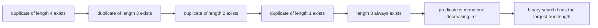
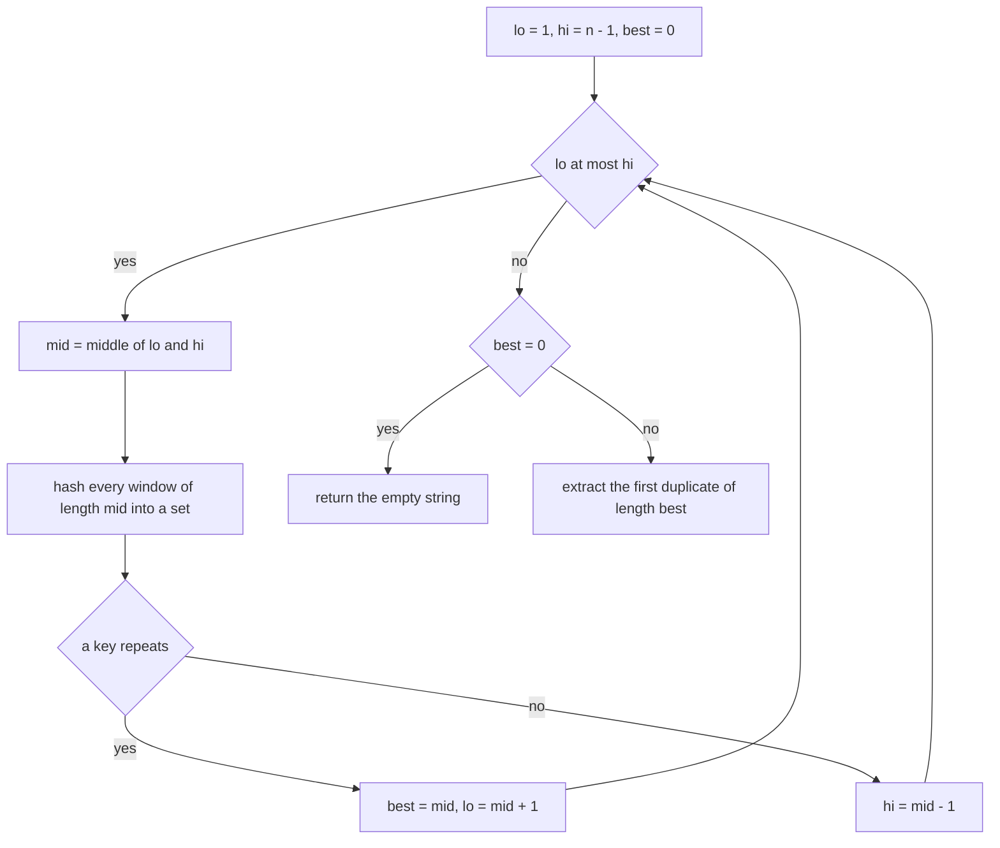
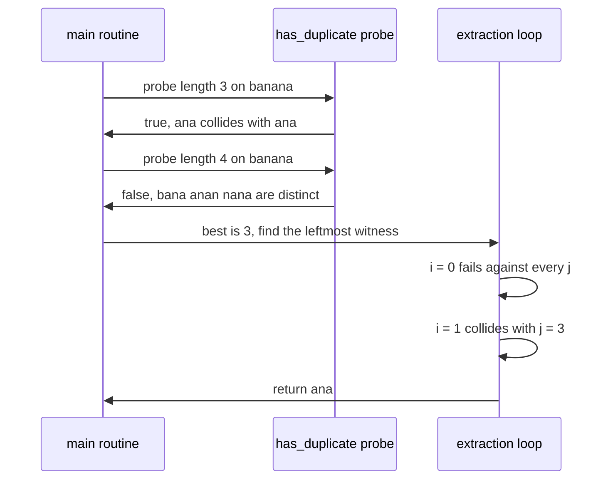

# 317 — Longest duplicate substring (binary search + hash).

> **Tier:** Intermediate · **CTCI chapter:** Beyond — Advanced Data Structures & Algorithms
> **Task spec:** [317-longest-duplicate-substring-binary-search-hash.md](../../../tasks/intermediate/317-longest-duplicate-substring-binary-search-hash.md)
> **Solutions:** [Python](../../../solutions/python/intermediate/317-longest-duplicate-substring-binary-search-hash/solution.py) ·
> [Java](../../../solutions/java/intermediate/317-longest-duplicate-substring-binary-search-hash/Solution.java) ·
> [JavaScript](../../../solutions/javascript/intermediate/317-longest-duplicate-substring-binary-search-hash/solution.js) ·
> [C#](../../../solutions/csharp/intermediate/317-longest-duplicate-substring-binary-search-hash/Solution.cs)

## 1. Problem restatement

**Input:** a string `s` of `n` characters; `n` may be `0` or `1`.

**Output:** the longest substring of `s` that occurs at least twice, or the empty string `""` when no
character repeats at all. The empty string is the documented sentinel for "no duplicate substring
exists", and the search routines return the duplicate that starts at the **smallest index** for the
maximal length, so the answer is deterministic.

Occurrences may overlap, which is what the helper `overlapping_count` verifies in the assertions.

| Call | Result | Why |
| --- | --- | --- |
| `longest_duplicate_substring("banana")` | `"ana"` | `"ana"` at indices 1 and 3 |
| `longest_duplicate_substring("aaaa")` | `"aaa"` | `"aaa"` at 0 and 1 |
| `longest_duplicate_substring("abab")` | `"ab"` | `"ab"` at 0 and 2 |
| `longest_duplicate_substring("abcabcabc")` | `"abcabc"` | at 0 and 3 |
| `longest_duplicate_substring("mississippi")` | `"issi"` | at 1 and 4 |
| `longest_duplicate_substring("abcd")` | `""` | every character is distinct |
| `longest_duplicate_substring("aa")` | `"a"` | a one-character duplicate |
| `longest_duplicate_substring("")` / `("a")` | `""` / `""` | nothing to duplicate |

## 2. Intuition

The brute-force answer enumerates every pair of start positions, extends the common prefix character
by character, and keeps the longest extension. That is `O(n²)` pairs before any extension work, and
it recomputes the same comparisons over and over.

The key structural observation is a **monotonicity property**. If some substring of length `L` occurs
twice, drop its last character: the same two positions now hold identical substrings of length
`L - 1`. So "a duplicate of length `L` exists" implies "a duplicate of length `L - 1` exists", and the
predicate is monotone in `L` — true for a prefix of the length range, false after it. A monotone
boolean predicate is exactly what binary search needs: `log n` probes pin down the maximum length.

Each probe still has to answer "does some window of length `L` repeat?" for every candidate `L`. With
a rolling hash that question becomes a set membership test: hash every window of length `L` and look
for a collision. Substring equality in `O(1)` (see
[315](315-rolling-hash-double-hash-to-reduce-collisions.md)) is what turns each probe into a single
`O(n)` pass — `O(n log n)` hashing work overall instead of `O(n²)` pair comparisons.



## 3. Algorithm

1. If `n ≤ 1`, return `""` — there is nothing to repeat.
2. Build a `DoubleRollingHash` over `s` once (`MOD1 = 1_000_000_007`, `MOD2 = 998_244_353`,
   `BASE = 131`).
3. Define `has_duplicate(L)`: insert `hash(i, i + L)` for every `i` in `[0, n - L]` into a set; return
   true as soon as a key repeats, false if the sweep completes.
4. Binary-search the largest `L`. Start `lo = 1`, `hi = n - 1`, `best = 0`; for each
   `mid = (lo + hi) / 2`, set `best = mid` and `lo = mid + 1` when the probe succeeds, else
   `hi = mid - 1`.
5. If `best == 0`, return `""`.
6. Extract the word: scan start positions `i` in increasing order, and for each `i` compare
   `hash(i, i + best)` with `hash(j, j + best)` for `j > i`; return `s[i .. i + best)` at the first
   match. If the scan finds nothing the assumption is broken, and the file raises an assertion error
   saying so.

```text
procedure longest_duplicate_substring(s)
    n ← length(s)
    if n ≤ 1 then
        return ""
    end
    rolling ← DoubleRollingHash(s)
    lo ← 1
    hi ← n - 1
    best ← 0
    while lo ≤ hi do
        mid ← (lo + hi) / 2
        if has_duplicate(rolling, mid) then
            best ← mid
            lo ← mid + 1
        else
            hi ← mid - 1
        end
    end
    if best = 0 then
        return ""
    end
    for i ← 0 to n - best do
        key ← rolling.hash(i, i + best)
        for j ← i + 1 to n - best do
            if rolling.hash(j, j + best) = key then
                return s[i .. i + best)
            end
        end
    end
    raise an error because binary search and extraction disagree
end

procedure has_duplicate(rolling, length)
    seen ← empty set
    for i ← 0 to n - length do
        key ← rolling.hash(i, i + length)
        if key is in seen then
            return true
        end
        add key to seen
    end
    return false
end
```



## 4. Worked example

Trace `longest_duplicate_substring("banana")` with `n = 6`, so `lo = 1` and `hi = 5`.

| Probe | `mid` | windows of that length | repeats? | `best` | bounds after |
| --- | --- | --- | --- | --- | --- |
| 1 | 3 | `ban`, `ana`, `nan`, `ana` | yes, `ana` at 1 and 3 | 3 | `lo = 4, hi = 5` |
| 2 | 4 | `bana`, `anan`, `nana` | no | 3 | `lo = 4, hi = 3` |

The loop ends with `lo = 4 > hi = 3`, so `best = 3` and the answer is three characters long. Length 5
was never probed, and it never needs to be: the second probe already proved that no window of length 4
repeats, and monotonicity then rules out every longer length as well.

Extraction then walks the start positions for windows of length 3:

| Outer `i` | window | inner `j` tried | comparison | outcome |
| --- | --- | --- | --- | --- |
| 0 | `ban` | 1 `ana`, 2 `nan`, 3 `ana` | keys differ at each `j` | no match, continue |
| 1 | `ana` | 2 `nan` | keys differ | continue |
| 1 | `ana` | 3 `ana` | keys equal | return `s[1..4)` = `ana` |

`i = 1` is the smallest start that has a partner, which is what makes the result deterministic — the
assertions can check the exact string rather than just its length.



## 5. Complexity

Let `n = len(s)`, and call the two moduli `M1` and `M2`.

| Measure | Bound | Why it holds |
| --- | --- | --- |
| Pre-processing | `O(n)` | four prefix/power arrays, built once |
| One probe | `O(n)` time, `O(n)` extra space | `n - L + 1` windows, each `O(1)` to hash |
| Number of probes | `O(log n)` | binary search over `[1, n - 1]` |
| Total search | `O(n log n)` | probes times per-probe cost |
| Extraction | `O(n)` best, `O(n²)` worst | returns at the first colliding pair, but may scan many pairs |
| Total space | `O(n)` | prefix arrays plus the probe set |
| Oracle (naive all-pairs LCP) | `O(n²)` pairs, each extended character by character | only used by the tests |

The `O(n log n)` figure counts hashing work, not character comparisons: the naive oracle's inner
extension compares actual characters, while every probe here compares two integers per modulus. With
a single modulus a probe could return a false positive, which is why the class carries two — see
[315](315-rolling-hash-double-hash-to-reduce-collisions.md) for the collision demonstration.

## 6. Pitfalls and edge cases

- **`""` is the sentinel for "no duplicate".** `best` starts at `0` and the routine returns `""`
  before extraction, so the caller sees exactly one representation of the empty answer. The tests
  assert `result == ""` whenever the naive oracle's best length is 0.
- **`n ≤ 1`.** Returning `""` early avoids the `hi = 0` case, where the binary search would not run
  at all. `longest_duplicate_substring("")` and `("a")` are both asserted.
- **`n = 2`.** `lo = 1`, `hi = 1`, a single probe of length 1 decides everything: `"aa"` gives `"a"`,
  `"ab"` gives `""`.
- **Overlapping duplicates count.** `"aaaa"` returns `"aaa"` from starts 0 and 1. Counting only
  non-overlapping occurrences would return `"aa"` and fail the assertion.
- **Hash collisions can make a probe lie.** A false positive makes binary search overshoot `best`;
  extraction then finds no witness and the file raises `AssertionError("binary search and extraction
  disagree")`. That assertion is the safety net for exactly this failure, and it documents that the
  answer is probabilistic.
- **Extraction is separate from the search.** Binary search finds the maximal *length*; the length
  alone does not name the substring. The second loop is what turns a number into a string, and the
  smallest-index rule is what makes that string unique.
- **The probe must not reuse state across calls.** A fresh set per probe keeps each one `O(n)`; a
  shared set would leak keys of the wrong length into later comparisons.
- **Unicode and case are untouched.** The hashes are computed on code units, and the routine never
  normalises or case-folds; `"Ab"` and `"ab"` are different windows.
- **Determinism.** The same input always returns the same string, which the tests assert by calling
  the function twice on every random string.

## 7. Variants and follow-ups

- **Drop the binary search.** A suffix-array-plus-LCP construction answers the question in one pass;
  sorting suffixes groups equal ones next to each other, and the maximum LCP is the answer.
- **The fixed-length sibling.** When the length is a constant rather than the quantity being searched
  for, the bit-packed keys of
  [316-find-repeated-dna-sequences-length-10-with-hashing.md](316-find-repeated-dna-sequences-length-10-with-hashing.md)
  are collision-free and simpler.
- **The hash itself.** The `DoubleRollingHash` used here is the one built in
  [315-rolling-hash-double-hash-to-reduce-collisions.md](315-rolling-hash-double-hash-to-reduce-collisions.md);
  swapping the modulus pair or the base changes the collision probability, not the algorithm.
- **Exact matching without hashing.**
  [313-implement-z-function-for-pattern-matching.md](313-implement-z-function-for-pattern-matching.md)
  has no collision risk at all; combining Z-boxes with the monotonicity argument is another way to
  find the maximal repeat.
- **Generalised repeats.** "Longest substring occurring at least `k` times" is the same predicate with
  a counter instead of a set, and the same binary search on top.

## 8. Check yourself

1. Why is the predicate "a duplicate of length `L` exists" monotone?

<details><summary>Show answer</summary>

Because a duplicate of length `L` at positions `i` and `j` can be shortened: the windows of length
`L - 1` at the same positions are also equal, being prefixes of equal strings. So a true answer at `L`
forces a true answer at every smaller length, and the set of true lengths is a prefix `1..best`.
Monotonicity is what justifies discarding half the range on each probe.

</details>

2. The binary search on `"banana"` never probes length 5 or 2. How can it still be certain the answer
   is 3?

<details><summary>Show answer</summary>

The probe of length 3 succeeded, proving some duplicate is at least 3 long. The probe of length 4
failed, proving no duplicate reaches 4. By monotonicity, every length above 4 fails as well, so 3 is
the maximum. The binary search does not need to visit a length to know its answer; it only needs one
witness above and one counterexample at the boundary.

</details>

3. Why is extraction a second loop rather than part of the binary search?

<details><summary>Show answer</summary>

The predicate returns a boolean, because binary search only needs to know whether a length is
achievable. The length is not the answer — the task asks for the substring. Extraction re-scans with
the known best length and returns the first colliding pair, which has the side benefit of being
deterministic, since the smallest starting index wins.

</details>

4. What does the `AssertionError("binary search and extraction disagree")` protect against?

<details><summary>Show answer</summary>

A hash collision that made `has_duplicate` return true when the windows were actually different. That
inflates `best`, and extraction then finds no real witness, so the loop falls through to the raise.
Without the assertion the routine would silently return the wrong string; with it, the failure is
loud and points at the assumption that broke.

</details>

5. How does the memory profile differ between this solution and the `Counter`-based oracle?

<details><summary>Show answer</summary>

This solution holds four `n + 1`-element arrays of hashes and powers for the whole string, plus one
set of `O(n)` keys per probe — `O(n)` throughout. The oracle holds a dictionary of however many
distinct windows of whatever length it is asked about, plus the substrings themselves, so its memory
grows with the number of distinct windows and with the window length. Neither is large in absolute
terms, but only the double-hash version has a bound that does not depend on the window size.

</details>
