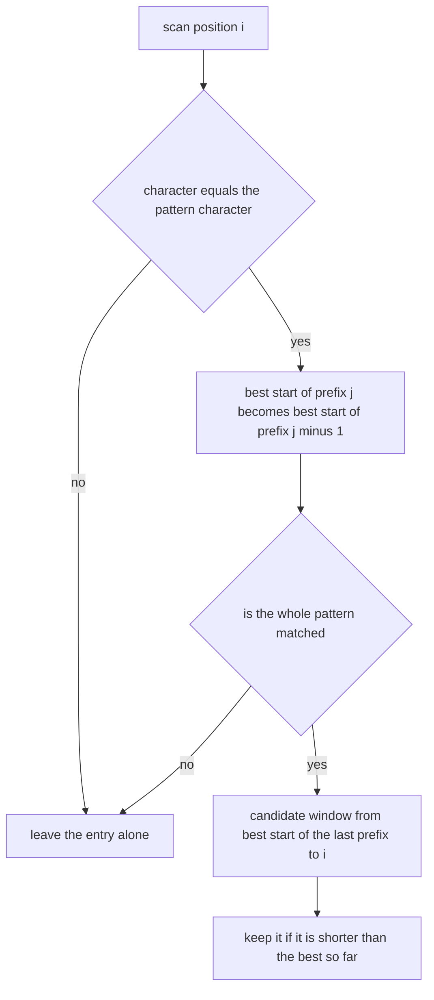
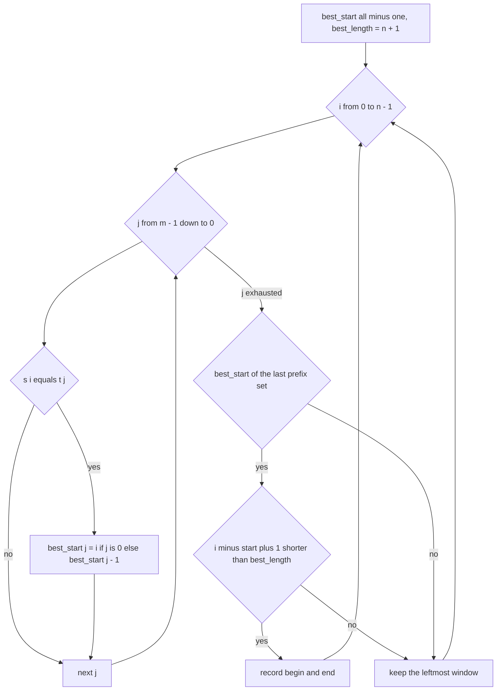
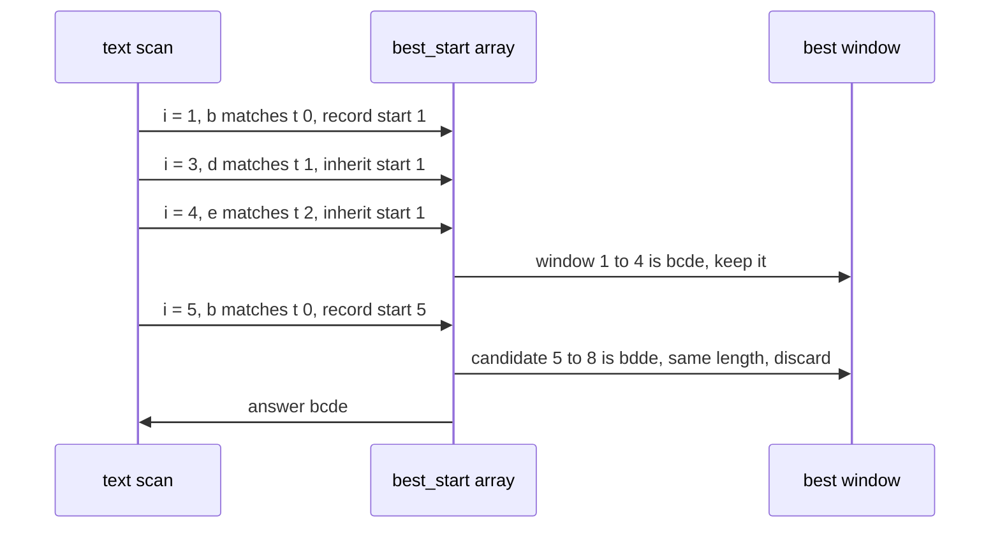

# 318 — Minimum window subsequence (not necessarily contiguous).

> **Tier:** Intermediate · **CTCI chapter:** Ch 1 — Arrays and Strings
> **Task spec:** [318-minimum-window-subsequence-not-necessarily-contiguous.md](../../../tasks/intermediate/318-minimum-window-subsequence-not-necessarily-contiguous.md)
> **Solutions:** [Python](../../../solutions/python/intermediate/318-minimum-window-subsequence-not-necessarily-contiguous/solution.py) ·
> [Java](../../../solutions/java/intermediate/318-minimum-window-subsequence-not-necessarily-contiguous/Solution.java) ·
> [JavaScript](../../../solutions/javascript/intermediate/318-minimum-window-subsequence-not-necessarily-contiguous/solution.js) ·
> [C#](../../../solutions/csharp/intermediate/318-minimum-window-subsequence-not-necessarily-contiguous/Solution.cs)

## 1. Problem restatement

**Input:** a text `s` of `n` characters and a pattern `t` of `m` characters.

**Output:** the shortest contiguous window `s[begin..end]` that contains `t` as a **subsequence** —
the characters of `t` must appear inside the window in order, but they need not be adjacent. If no
window contains `t`, the result is the empty string `""`. An empty pattern and a pattern longer than
the text both yield `""`, which the module documents explicitly.

On ties, the leftmost window wins, because the update is guarded by a strict inequality.

| Call | Result | Why |
| --- | --- | --- |
| `min_window_subsequence("abcdebdde", "bde")` | `"bcde"` | window `[1..4]` beats `[5..8]` = `"bdde"` |
| `min_window_subsequence("abc", "abc")` | `"abc"` | the whole text, contiguous by accident |
| `min_window_subsequence("bab", "ab")` | `"ab"` | window `[1..2]`, not `[0..1]` |
| `min_window_subsequence("a", "a")` | `"a"` | single character |
| `min_window_subsequence("abc", "d")` | `""` | `d` never appears |
| `min_window_subsequence("a", "aa")` | `""` | pattern longer than the text |
| `min_window_subsequence("", "a")` / `("", "")` / `("ab", "")` | `""` / `""` / `""` | degenerate inputs |

## 2. Intuition

The naive approach enumerates every window `[left..right]`, tests whether `t` is a subsequence of it
with a two-pointer scan, and keeps the smallest window that passes. That is `O(n²)` windows times up
to `O(n)` work per test, so `O(n³)` in the worst case — and it recomputes the same prefix relationships
over and over.

The useful question is not "is `t` a subsequence of this window?" but "**given that the window ends
here, where is the latest place it could have started?**" That single number is enough, because for a
fixed right end the shortest window is the one with the largest start.

So the solutions carry `m` numbers, one per prefix of `t`:

- `best_start[j]` = the largest start index `p` such that `s[p..i]` already contains `t[0..j]` — that
  is, the pattern prefix ending at character `j` is fully matched inside the window that starts at
  `p` and ends at the current position `i`.

The recurrence is beautifully short. When the current character `s[i]` equals `t[j]`, the best start
for prefix `j` is inherited from prefix `j - 1` (the same window that matched the shorter prefix), and
for `j = 0` it is simply `i`. Characters that match nothing change nothing.

Walking `j` from `m - 1` down to `0` is what makes the update legal: reading `best_start[j - 1]`
happens before that slot is overwritten with the current position's value, so the array still holds
the *previous* row's information for exactly the entries that have not been touched yet.



## 3. Algorithm

1. Let `n = len(s)` and `m = len(t)`. If `m == 0` or `m > n`, return `""`.
2. Initialise `best_start` with `m` entries of `-1`, `best_length = n + 1`, and the answer bounds
   `begin = end = -1`.
3. For each position `i` from `0` to `n - 1`, with character `c`:
   1. For `j` from `m - 1` down to `0`: if `c == t[j]`, set `best_start[j] ← i` when `j == 0`,
      otherwise `best_start[j] ← best_start[j - 1]`.
   2. If `best_start[m - 1] != -1`, a full match ends at `i`: let `start = best_start[m - 1]` and if
      `i - start + 1 < best_length`, update `best_length` and set `begin = start`, `end = i`.
4. If `begin == -1` no window exists, return `""`; otherwise return `s[begin..end]`.

```text
procedure min_window_subsequence(s, t)
    n ← length(s)
    m ← length(t)
    if m = 0 or m > n then
        return ""
    end
    best_start ← array of m entries set to -1
    best_length ← n + 1
    begin ← -1
    end ← -1
    for i ← 0 to n - 1 do
        for j ← m - 1 down to 0 do
            if s[i] = t[j] then
                if j = 0 then
                    best_start[j] ← i
                else
                    best_start[j] ← best_start[j - 1]
                end
            end
        end
        if best_start[m - 1] ≠ -1 then
            start ← best_start[m - 1]
            if i - start + 1 < best_length then
                best_length ← i - start + 1
                begin ← start
                end ← i
            end
        end
    end
    if begin = -1 then
        return ""
    end
    return s[begin .. end]
end
```

The companion functions in the files are the oracle `brute_min_window`, which tries every window with
an `is_subsequence` scan, plus the deterministic LCG string generator the fuzz tests use.



## 4. Worked example

Trace `min_window_subsequence("abcdebdde", "bde")`. The text is `a b c d e b d d e` at indices
`0..8`, `m = 3`, `best_length` starts at `10`.

| `i` | char | `best_start` after the inner loop | full match? | action |
| --- | --- | --- | --- | --- |
| 0 | `a` | `[-1, -1, -1]` | no | — |
| 1 | `b` | `[1, -1, -1]` | no | `t[0]` matched |
| 2 | `c` | `[1, -1, -1]` | no | — |
| 3 | `d` | `[1, 1, -1]` | no | `t[1]` inherits 1 |
| 4 | `e` | `[1, 1, 1]` | yes, start 1 | record `[1..4]` = `bcde`, `best_length = 4` |
| 5 | `b` | `[5, 1, 1]` | yes, start 1 | length 5, not shorter, keep |
| 6 | `d` | `[5, 5, 1]` | yes, start 1 | length 6, not shorter, keep |
| 7 | `d` | `[5, 5, 1]` | yes, start 1 | length 7, not shorter, keep |
| 8 | `e` | `[5, 5, 5]` | yes, start 5 | length 4, **not** shorter (tie) → keep `bcde` |

The tie at the end is the tie-break rule in action: window `[5..8]` = `bdde` has the same length as
`[1..4]` = `bcde`, and because the comparison is strictly less-than, the earlier window survives.
Note also how `best_start[0]` jumps from 1 to 5 at `i = 5` and takes the later prefixes with it —
the array always tracks the *latest* possible start for each prefix, which is precisely what makes the
recorded window the shortest.



## 5. Complexity

Let `n = len(s)` and `m = len(t)`.

| Measure | Bound | Why it holds |
| --- | --- | --- |
| Time, best | `O(n · m)` | the inner loop still scans all `m` pattern characters per position |
| Time, average | `O(n · m)` | no early exit; every position does exactly `m` comparisons |
| Time, worst | `O(n · m)` | independent of the contents, by construction |
| Space | `O(m)` | one array of `m` start indices, plus four scalars |
| Space, output | `O(n)` | the returned window itself |
| Brute force oracle | `O(n³)` | `O(n²)` windows × an `O(n)` subsequence check |
| Greedy two pointers from each left end | `O(n²)` | one forward scan per left end, no DP reuse |

The `O(m)` space is the pleasing part: the DP is not over a 2-D table but over a single row that is
updated in place, and the descending `j` order is what keeps the row consistent. A naive reading that
clones the row per position (`best_start[i][j]`, an `n × m` table) would use `O(n · m)` memory for the
same answers.

## 6. Pitfalls and edge cases

- **Empty pattern.** `m == 0` returns `""`, not the whole text. The module documents this; the Python
  file asserts `min_window_subsequence("ab", "") == ""` and `("", "") == ""`.
- **Pattern longer than the text.** `m > n` cannot be contained, so both guards are folded into one
  check at the top. `min_window_subsequence("a", "aa") == ""`.
- **No match at all.** `begin` stays `-1` and the routine returns `""`; the hand-verified case in the
  tests is a 50-character string with pattern `"ezu"`, where every `u` precedes every `z`, so the
  order can never be satisfied. The oracle confirms `(None, "")` for the same input.
- **Subsequence, not substring.** The characters of `t` may be separated by arbitrary text, but they
  must keep their order. `("bab", "ab")` must return `"ab"` — the window `[0..1]` = `"ba"` fails
  because the `a` comes first there.
- **Ties keep the leftmost window.** `("abcdebdde", "bde")` has two windows of length 4; the strict
  `<` comparison keeps `bcde`, which is what the assertion demands. Changing it to `<=` makes the
  result `bdde` and breaks the test.
- **Descending `j` is mandatory.** Ascending `j` would let `best_start[j]` be overwritten before
  `best_start[j - 1]` is read in the same iteration, mixing two text positions into one candidate.
- **Stale starts are harmless.** Entries left over from earlier positions are always `≤ i` and only
  ever produce windows that end at `i`; they cannot forge a match, because an entry is only trusted
  once the final prefix is set.
- **`best_length = n + 1` is a sentinel.** Every real window is shorter than that, so the first
  completion always records; an unset value of `0` would reject every candidate.
- **Duplicated characters in `t`.** `"aa"` in `"aaa"` works because each match shifts the whole array
  left by one prefix; the DP does not need the matches to be distinct positions.

## 7. Variants and follow-ups

- **Contiguous version.** The classic minimum window *substring* keeps a frequency map and shrinks
  greedily; see
  [319-sliding-window-with-variable-constraints-two-pointers-advanced.md](319-sliding-window-with-variable-constraints-two-pointers-advanced.md)
  for the two-pointer form of the same shrink-when-valid idea.
- **Fixed-length windows.** When the window length is given instead of minimised, the problem becomes
  a search: [316-find-repeated-dna-sequences-length-10-with-hashing.md](316-find-repeated-dna-sequences-length-10-with-hashing.md)
  and [317-longest-duplicate-substring-binary-search-hash.md](317-longest-duplicate-substring-binary-search-hash.md)
  both minimise or maximise a window length over hashed keys.
- **Subsequence matching without a window.** The plain "is `t` a subsequence of `s`" question is the
  `is_subsequence` helper every solution file ships, and it is the inner loop of the brute-force
  oracle.
- **Interval forms of the same problem.** The sweep-line and merge families in
  [323-insert-interval-and-merge-intervals.md](323-insert-interval-and-merge-intervals.md) and
  [326-meeting-rooms-required-interval-partitioning.md](326-meeting-rooms-required-interval-partitioning.md)
  deal with overlap rather than order, but they share the "keep the best interval so far" structure.

## 8. Check yourself

1. What exactly does `best_start[j]` mean, and why is the largest start the useful one?

<details><summary>Show answer</summary>

After processing position `i`, `best_start[j]` is the largest index `p` such that `s[p..i]` contains
`t[0..j]`. For a fixed right end `i`, the window length is `i - p + 1`, so maximising `p` minimises
the length. The DP therefore stores the optimal start rather than the optimal length, and the answer
falls out whenever the last entry becomes set.

</details>

2. Why must the inner loop run `j` downwards?

<details><summary>Show answer</summary>

Because `best_start[j]` is assigned from `best_start[j - 1]`. Walking downwards guarantees the source
entry still holds the value from the previous position `i - 1`, before it is overwritten for position
`i`. Walking upwards would copy a value that has already been updated with the current position,
effectively matching two pattern characters against the same text character.

</details>

3. In the `"abcdebdde"` / `"bde"` trace, why does the last candidate not replace the recorded window?

<details><summary>Show answer</summary>

Because `i - start + 1 = 8 - 5 + 1 = 4` is not strictly less than the recorded `best_length = 4`. The
comparison is `<`, not `<=`, so equal-length candidates are discarded and the first one — the leftmost
window `bcde` — is returned. The assertion pins this exact string, so the tie-break is part of the
contract.

</details>

4. The DP uses `O(m)` space, yet the problem looks two-dimensional. Where did the second dimension go?

<details><summary>Show answer</summary>

It is not needed. Only the current text position's row is ever read, and the update for a row can be
performed in place provided `j` descends. The "previous row" survives for exactly the entries the
update has not reached yet, so a single array of `m` entries is enough. Cloning the row per position
would give the same answers with `O(n · m)` memory.

</details>

5. What does the routine return for `s = "zzz"`, `t = "z"` and why?

<details><summary>Show answer</summary>

`"z"`. At `i = 0` the single pattern character matches, so `best_start[0]` becomes 0 and
`best_start[m - 1]` — the same slot — is set, giving the window `[0..0]` of length 1. No later window
can be shorter, so the answer stays `"z"`. The tests include `("zzz", "z")` in the fuzz corpus through
the `lcg_strings(1, 20, "abc")` pattern set.

</details>
