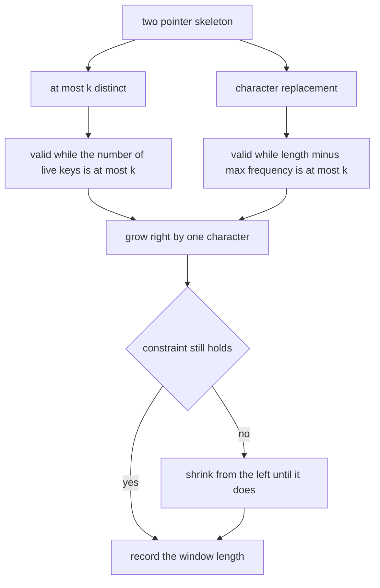
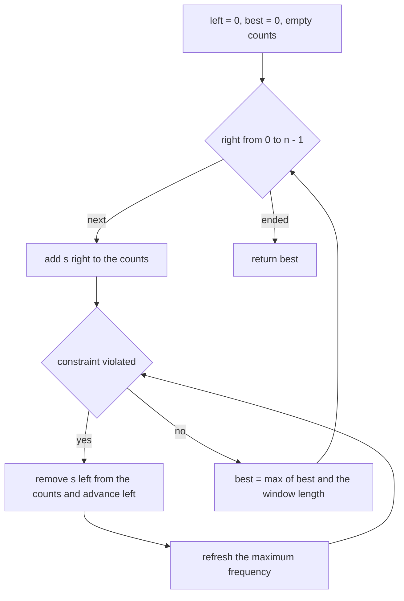
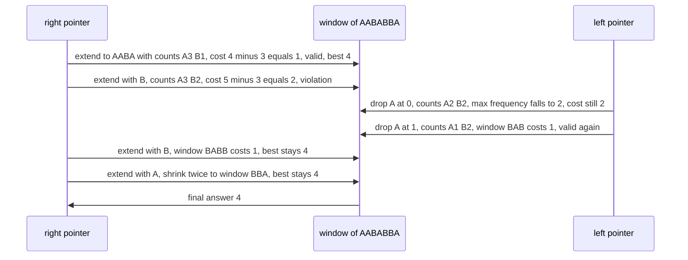

# 319 — Sliding window with variable constraints (two pointers advanced).

> **Tier:** Intermediate · **CTCI chapter:** Ch 1 — Arrays and Strings
> **Task spec:** [319-sliding-window-with-variable-constraints-two-pointers-advanced.md](../../../tasks/intermediate/319-sliding-window-with-variable-constraints-two-pointers-advanced.md)
> **Solutions:** [Python](../../../solutions/python/intermediate/319-sliding-window-with-variable-constraints-two-pointers-advanced/solution.py) ·
> [Java](../../../solutions/java/intermediate/319-sliding-window-with-variable-constraints-two-pointers-advanced/Solution.java) ·
> [JavaScript](../../../solutions/javascript/intermediate/319-sliding-window-with-variable-constraints-two-pointers-advanced/solution.js) ·
> [C#](../../../solutions/csharp/intermediate/319-sliding-window-with-variable-constraints-two-pointers-advanced/Solution.cs)

## 1. Problem restatement

**Input:** a string `s` and a non-negative budget `k`. One file, two objectives that share a skeleton:

- `longest_at_most_k_distinct(s, k)` — the length of the longest substring containing at most `k`
  **distinct** characters.
- `character_replacement(s, k)` — the length of the longest substring that can be turned into one
  repeated character by replacing at most `k` of its characters.

**Output:** a single integer, the length of the best window. `0` is returned for the empty string and
for a non-positive budget in the first variant.

| Call | Result | Why |
| --- | --- | --- |
| `longest_at_most_k_distinct("eceba", 2)` | `3` | `"ece"` |
| `longest_at_most_k_distinct("abcadcacacaca", 3)` | `11` | `"cadcacacaca"` |
| `longest_at_most_k_distinct("abcadcacacaca", 2)` | `8` | `"cacacaca"` |
| `longest_at_most_k_distinct("aa", 1)` | `2` | one distinct character |
| `longest_at_most_k_distinct("abc", 5)` | `3` | the whole string fits |
| `longest_at_most_k_distinct("abc", 0)` / `("", 2)` | `0` / `0` | degenerate budgets |
| `character_replacement("ABAB", 2)` | `4` | two replacements cover the mismatches |
| `character_replacement("AABABBA", 1)` | `4` | `"AABA"` |
| `character_replacement("ABCDE", 0)` | `1` | no replacements: the best run is one character |
| `character_replacement("", 0)` / `("A", 0)` | `0` / `1` | empty string and single character |

Both functions are fuzz-checked against `O(n²)` oracles — `brute_at_most_k_distinct` and
`brute_character_replacement` — on the hand-written strings plus LCG strings over `"abc"` and `"ab"`.

## 2. Intuition

Checking every window is easy and quadratic: for each left end, extend the right end while the
constraint holds and remember the best length. On a string of length `n` that is `O(n²)` windows, with
the constraint re-evaluated from scratch each time.

The two-pointer observation is that **the left end never needs to move backwards**. If the window
`[left..right]` violates the constraint, no longer window starting at `left` can satisfy it, so the
only sensible repair is to advance `left`. Conversely, when the window is valid, the best move is to
extend `right`. Both pointers therefore sweep forward exactly once, which makes the whole pass linear
even though the inner `while` loop can shrink many times in a row.

What differs between the two variants is only the **validity test**:

- At most `k` distinct characters: the window is valid while the number of live keys in the frequency
  map is `≤ k`.
- At most `k` replacements: the window is valid while
  `(window length - highest frequency in the window) ≤ k`. The expression counts the characters that
  would have to change if the window were to become one repeated character, so it is literally the
  cost of the operation.

Everything else — grow on the right, shrink on the left, record the best length — is shared code.



## 3. Algorithm

**Variant A — at most `k` distinct.**

1. If `k ≤ 0`, return `0` (no non-empty window can have zero distinct characters).
2. Keep `counts`, a map from character to occurrences inside the window, `left = 0` and `best = 0`.
3. For each `right` from `0` to `n - 1`: increment `counts[s[right]]`.
4. While `len(counts) > k`: decrement `counts[s[left]]`, delete the key if it reaches zero, and
   advance `left`.
5. Set `best = max(best, right - left + 1)`.

**Variant B — at most `k` replacements.**

6. Same skeleton, with a third number `max_count` tracking the highest frequency of any single
   character in the window.
7. After incrementing the count of `s[right]`, refresh `max_count`.
8. While `(right - left + 1) - max_count > k`: decrement `counts[s[left]]`, advance `left`, and
   recompute `max_count = max(counts.values())` because the shrink may have removed the character that
   was supplying the maximum.
9. Set `best = max(best, right - left + 1)`.

```text
procedure longest_at_most_k_distinct(s, k)
    if k ≤ 0 then
        return 0
    end
    counts ← empty map
    left ← 0
    best ← 0
    for right ← 0 to length(s) - 1 do
        counts[s[right]] ← counts[s[right]] + 1
        while size(counts) > k do
            counts[s[left]] ← counts[s[left]] - 1
            if counts[s[left]] = 0 then
                remove s[left] from counts
            end
            left ← left + 1
        end
        best ← maximum(best, right - left + 1)
    end
    return best
end

procedure character_replacement(s, k)
    counts ← empty map
    left ← 0
    best ← 0
    max_count ← 0
    for right ← 0 to length(s) - 1 do
        counts[s[right]] ← counts[s[right]] + 1
        max_count ← maximum(max_count, counts[s[right]])
        while (right - left + 1) - max_count > k do
            counts[s[left]] ← counts[s[left]] - 1
            left ← left + 1
            max_count ← maximum of the values in counts
        end
        best ← maximum(best, right - left + 1)
    end
    return best
end
```

The only asymmetry is the recomputation of `max_count` inside the shrink loop. Without it the stale,
too-large value would keep the window artificially "valid" and the routine would report windows that
need more than `k` replacements.



## 4. Worked example

Variant A on `"eceba"` with `k = 2`:

| `right` | char | counts after adding | distinct | shrink steps | `left` | window | length | `best` |
| --- | --- | --- | --- | --- | --- | --- | --- | --- |
| 0 | `e` | `e:1` | 1 | — | 0 | `e` | 1 | 1 |
| 1 | `c` | `e:1, c:1` | 2 | — | 0 | `ec` | 2 | 2 |
| 2 | `e` | `e:2, c:1` | 2 | — | 0 | `ece` | 3 | 3 |
| 3 | `b` | `e:2, c:1, b:1` | 3 | drop `e` at 0, then drop `c` at 1 | 2 | `eb` | 2 | 3 |
| 4 | `a` | `e:1, b:1, a:1` | 3 | drop `e` at 2 | 3 | `ba` | 2 | 3 |

The best window is `"ece"` at `[0..2]`. The two shrink steps at `right = 3` are what a correct
implementation must handle: after dropping the `e`, the map still has three live keys, so the loop
runs a second time.

Variant B on `"AABABBA"` with `k = 1`:

| `right` | char | counts | `max_count` | violation | `left` | window | length | `best` |
| --- | --- | --- | --- | --- | --- | --- | --- | --- |
| 0 | `A` | `A:1` | 1 | 1 − 1 = 0 ≤ 1 | 0 | `A` | 1 | 1 |
| 1 | `A` | `A:2` | 2 | 2 − 2 = 0 | 0 | `AA` | 2 | 2 |
| 2 | `B` | `A:2, B:1` | 2 | 3 − 2 = 1 | 0 | `AAB` | 3 | 3 |
| 3 | `A` | `A:3, B:1` | 3 | 4 − 3 = 1 | 0 | `AABA` | 4 | 4 |
| 4 | `B` | `A:3, B:2` | 3 | 5 − 3 = 2 > 1 | 2 | `BAB` | 3 | 4 |
| 5 | `B` | `A:1, B:3` | 3 | 4 − 3 = 1 | 2 | `BABB` | 4 | 4 |
| 6 | `A` | `A:2, B:3` | 3 | 5 − 3 = 2 > 1 | 4 | `BBA` | 3 | 4 |

At `right = 4` two characters are removed (`A` at 0 and `A` at 1); after the first removal the counts
are `A:2, B:2`, so `max_count` drops to 2 and the window `[1..4]` = `ABAB` still violates
(4 − 2 = 2 > 1), which is why the loop shrinks a second time. The answer is 4, matching
`character_replacement("AABABBA", 1) == 4`.



## 5. Complexity

Let `n = len(s)`.

| Measure | Bound | Why it holds |
| --- | --- | --- |
| Time, both variants | `O(n)` amortised | each index is added once and removed at most once |
| Time, worst | `O(n)` | the total number of shrink steps over the run is at most `n` |
| Time of variant B with per-shrink recomputation | `O(n · A)` | `max(counts.values())` rescans at most `A` distinct characters per shrink step |
| Space | `O(A)` | the frequency map, `A` the alphabet size |
| Brute force oracle | `O(n²)` | every window is tested from scratch |
| Oracle variant B | `O(n²)` plus a max recomputation per window | `max(counts.values())` inside the extension loop |

Variant B's recomputation is a deliberate implementation choice rather than an accident: keeping the
maximum frequency monotone (never decreasing) is the other common formulation, but it can leave the
window one character too long. Refreshing after every shrink keeps the invariant honest, at the cost
of a scan over the map — bounded by the alphabet size `A`, which is 2 or 3 in the tests.

## 6. Pitfalls and edge cases

- **`k = 0` in variant A.** Nothing but an empty window has zero distinct characters, so the routine
  returns `0` immediately. The Python file asserts `longest_at_most_k_distinct("abc", 0) == 0`.
- **`k = 0` in variant B.** The cost expression `length - max_count` is zero only for a window of a
  single repeated character, so the answer is the longest run of one character:
  `character_replacement("ABCDE", 0) == 1` and `("ABAB", 0) == 1`.
- **Empty string.** Both variants return `0`; there is no window at all.
- **`k` larger than the alphabet.** The window simply never violates the constraint:
  `longest_at_most_k_distinct("abc", 5) == 3`. The fuzz tests assert `longest_at_most_k_distinct(s, 4)
  == len(s)` for a corpus whose alphabet has at most three letters.
- **Deleting zero-count keys.** In variant A, leaving a key with a count of zero in the map would keep
  `len(counts)` from shrinking, and the `while` loop would strip the window down to nothing. The
  `delete when it reaches zero` step is essential.
- **Stale `max_count`.** Variant B must refresh the maximum inside the shrink loop; otherwise a
  window that used to have a dominant character is treated as if it still did, and the reported
  length is too large. This is the most common bug in this problem.
- **Ties and monotonicity.** Both objectives are non-decreasing in `k`, which the tests assert:
  `f(s, k) ≤ f(s, k + 1)` for every `k` in the corpus.
- **Unicode.** The counting map is keyed on characters; astral characters behave as single keys in
  Python and JavaScript but as surrogate pairs in Java and C#, where the map would count each half
  separately.
- **Windows are contiguous.** This is not the subsequence task; the characters must be adjacent. The
  non-contiguous sibling is
  [318-minimum-window-subsequence-not-necessarily-contiguous.md](318-minimum-window-subsequence-not-necessarily-contiguous.md).

## 7. Variants and follow-ups

- **Substring with a different constraint.** Swapping the validity test for another monotone predicate
  gives the rest of the sliding-window family: "at most `k` zeroes", "sum at most `k`", "at most `k`
  odd numbers" all reuse the same two pointers.
- **Non-contiguous version.** When the characters need not be adjacent, the window representation
  breaks and the prefix DP of
  [318-minimum-window-subsequence-not-necessarily-contiguous.md](318-minimum-window-subsequence-not-necessarily-contiguous.md)
  takes over.
- **Fixed-length windows over a small alphabet.** The bit-packed rolling key of
  [316-find-repeated-dna-sequences-length-10-with-hashing.md](316-find-repeated-dna-sequences-length-10-with-hashing.md)
  attacks a different question about windows — which fixed-length ones repeat — with the same
  left-to-right sweep.
- **Interval sweeps.** The "grow right, shrink left" habit reappears in interval form in
  [325-minimum-number-of-platforms-for-trains-sweep-line.md](325-minimum-number-of-platforms-for-trains-sweep-line.md)
  and [326-meeting-rooms-required-interval-partitioning.md](326-meeting-rooms-required-interval-partitioning.md),
  where the two pointers are the ends of sorted event lists.

## 8. Check yourself

1. Why is the sliding window linear if the inner `while` loop can run many times for one `right`?

<details><summary>Show answer</summary>

Because `left` only ever moves forward, and it stops at `n`. The total number of iterations of the
inner loop across the entire run is therefore at most `n`, no matter how they are distributed over
the outer loop. Amortised over the `n` outer steps, the inner loop costs `O(1)`.

</details>

2. What exactly does `(right - left + 1) - max_count` measure?

<details><summary>Show answer</summary>

The number of characters in the window that are not the most frequent character — that is, how many
characters must be replaced if the whole window is to become one repeated character. The window can be
made uniform with at most `k` replacements exactly when that number is `≤ k`, which is why the shrink
condition is `> k`.

</details>

3. Why must variant B recompute `max_count` after each shrink step?

<details><summary>Show answer</summary>

Because the step may have decremented the very character that supplied the maximum. If the maximum is
left stale, the window looks cheaper to fix than it is, the `while` loop exits early, and the reported
length exceeds the true answer. Recomputing `max(counts.values())` after each removal keeps the test
consistent with the current window; the price is a scan over the map, bounded by the alphabet size.

</details>

4. In variant A, what breaks if a character's count reaching zero is not deleted from the map?

<details><summary>Show answer</summary>

`len(counts)` would still count the dead key, so the window would look like it has more distinct
characters than it does and the `while` loop would keep shrinking past the point where the constraint
holds. In the worst case the window collapses to length 0 and the routine returns 0 for inputs where
it should find a window.

</details>

5. Why is it correct to advance `left` rather than to restart the scan when the constraint breaks?

<details><summary>Show answer</summary>

If the window `[left..right]` violates the constraint, every window `[left..right']` with
`right' ≥ right` also violates it, since extending a window cannot reduce its distinct count or its
replacement cost. So there is nothing to learn by extending further from this `left`; the only way
forward is to move `left`. That monotonicity is what licenses discarding rather than re-testing each
left end.

</details>
