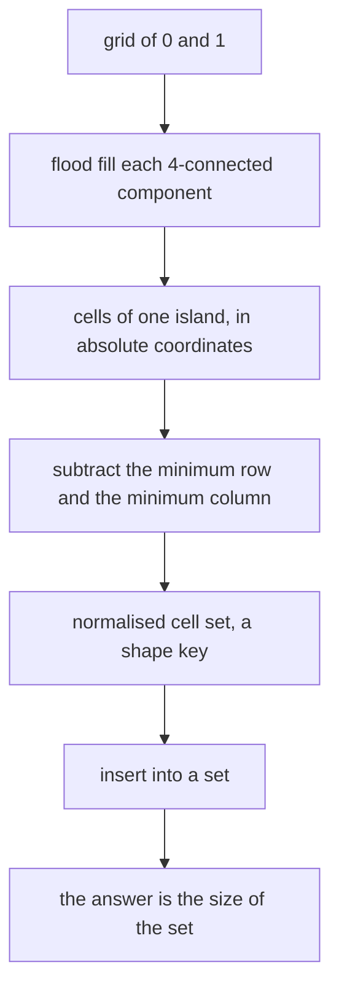
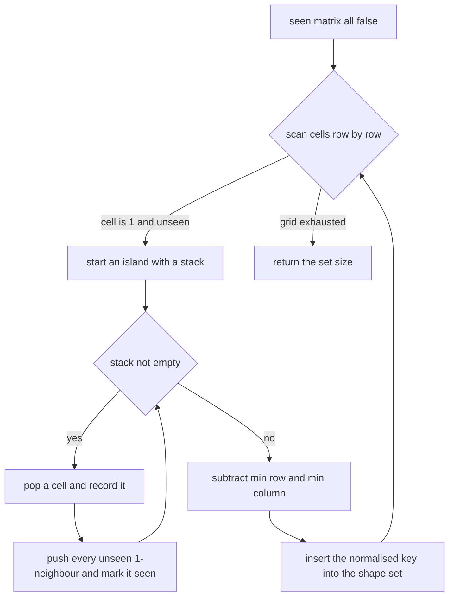
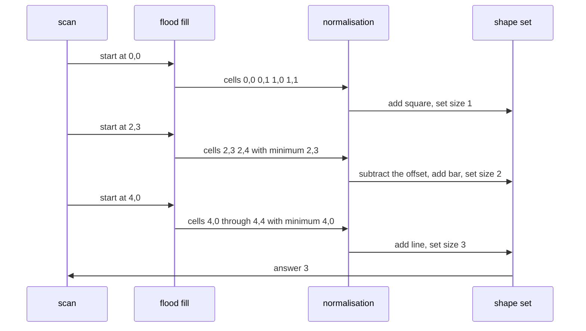

# 320 — Count distinct islands shapes in grid (normalized traversal).

> **Tier:** Intermediate · **CTCI chapter:** Beyond — Machine Learning & AI
> **Task spec:** [320-count-distinct-islands-shapes-in-grid-normalized-traversal.md](../../../tasks/intermediate/320-count-distinct-islands-shapes-in-grid-normalized-traversal.md)
> **Solutions:** [Python](../../../solutions/python/intermediate/320-count-distinct-islands-shapes-in-grid-normalized-traversal/solution.py) ·
> [Java](../../../solutions/java/intermediate/320-count-distinct-islands-shapes-in-grid-normalized-traversal/Solution.java) ·
> [JavaScript](../../../solutions/javascript/intermediate/320-count-distinct-islands-shapes-in-grid-normalized-traversal/solution.js) ·
> [C#](../../../solutions/csharp/intermediate/320-count-distinct-islands-shapes-in-grid-normalized-traversal/Solution.cs)

## 1. Problem restatement

**Input:** a rectangular grid of `0` and `1` values, indexed `grid[r][c]`. Cells are **4-connected**:
two `1` cells belong to the same island when they share an edge, not merely a corner. The grid may be
empty.

**Output:** the number of **distinct island shapes**, where two islands are the same shape when one is
a translation of the other. Rotations and reflections are *not* identified — a `1×2` bar and a `2×1`
bar are two different shapes, and so are an `L` and its mirror. The helper `collect_island_shapes`
returns the shape keys themselves, and `count_islands` returns the number of islands without
merging shapes.

| Call | Result | Why |
| --- | --- | --- |
| the 5×5 classic grid below | `3` | a `2×2` square, a `1×2` bar, a `1×5` line |
| `[[1, 1, 0], [0, 0, 0], [0, 0, 1], [0, 0, 1]]` | `2` | horizontal bar versus vertical bar |
| `[[1, 1, 0, 0], [1, 1, 0, 0], [0, 0, 1, 1], [0, 0, 1, 1]]` | `1` | two identical squares, far apart |
| `[[1, 0, 0], [1, 1, 0], [0, 0, 1], [0, 0, 1]]` | `2` | an `L` and its mirror |
| `[[1, 0], [0, 1]]` | `1` | two islands, both a single cell — but `count_islands` returns `2` |
| `[[1, 0, 0], [0, 1, 1], [0, 0, 0]]` | `2` | a single cell and a bar |
| `[[1]]` / `[[0, 0], [0, 0]]` / `[]` | `1` / `0` / `0` | degenerate grids |
| the classic grid padded with zeros | `3` | translation invariance |

## 2. Intuition

Counting islands is a flood fill: walk the grid, and whenever an unvisited `1` is found, mark its whole
4-connected component and increment a counter. Counting *shapes* is the same walk plus one extra
question: how do you tell whether two components have the same shape when they sit at different
coordinates?

The naive answer would compare components cell by cell. That fails immediately, because the same shape
can sit anywhere on the grid, and the comparison would need every possible offset. The insight is that a
shape is defined **up to translation only**, so every component can be given a canonical coordinate
system of its own: subtract the smallest row and the smallest column of its cells. After that
normalisation, the top row always contains a cell in column 0, the left column always contains a cell
in row 0, and two components are the same shape exactly when their normalised cell sets are equal.

Once every component is normalised, the answer is a set size: collect the normalised keys in a set and
count them. Identical islands — however far apart, however deeply embedded — collapse to one key.



## 3. Algorithm

1. Let `rows` and `cols` be the grid dimensions, with `cols = 0` for an empty grid.
2. Allocate a `seen` matrix of booleans, all false, and an empty set `shapes`.
3. Scan every cell `(r, c)` in row-major order. When `grid[r][c] == 1` and `seen[r][c]` is false, the
   cell starts a new island:
   1. Push `(r, c)` on an explicit stack and mark it seen.
   2. While the stack is not empty: pop `(cr, cc)`, append it to `cells`, and for each of the four
      offsets `(1, 0)`, `(-1, 0)`, `(0, 1)`, `(0, -1)` push every in-bounds neighbour that holds a `1`
      and is not yet seen, marking it seen at push time.
   3. Compute `min_r = min(row)` and `min_c = min(col)` over `cells`.
   4. Insert `{(row - min_r, col - min_c) for each cell}` into `shapes`.
4. Return `len(shapes)`.

Marking a cell as seen **when it is pushed**, not when it is popped, is what keeps the stack from
receiving the same cell twice through two different neighbours.

```text
procedure collect_island_shapes(grid)
    rows ← number of rows in grid
    cols ← number of columns, or 0 when grid is empty
    seen ← rows by cols matrix of false
    shapes ← empty set
    for r ← 0 to rows - 1 do
        for c ← 0 to cols - 1 do
            if grid[r][c] = 1 and not seen[r][c] then
                stack ← list containing (r, c)
                seen[r][c] ← true
                cells ← empty list
                while stack is not empty do
                    (cr, cc) ← remove last element of stack
                    append (cr, cc) to cells
                    for each offset (dr, dc) in the four neighbours do
                        nr ← cr + dr
                        nc ← cc + dc
                        if 0 ≤ nr < rows and 0 ≤ nc < cols
                           and grid[nr][nc] = 1 and not seen[nr][nc] then
                            seen[nr][nc] ← true
                            append (nr, nc) to stack
                        end
                    end
                end
                min_r ← smallest row in cells
                min_c ← smallest column in cells
                key ← set of (row - min_r, col - min_c) for each cell in cells
                add key to shapes
            end
        end
    end
    return shapes
end

procedure count_distinct_islands(grid)
    return size of collect_island_shapes(grid)
end
```

Each language stores the key its own way — Python a `frozenset` of pairs, Java and C# a sorted
`"dr,dc"` list joined by `;`, JavaScript a sorted joined string — but all four normalise identically
and all four ship the `canonicalize` / `islandShapesSortedTuples` pair the tests compare against.



## 4. Worked example

The classic grid the assertions start from:

| | c0 | c1 | c2 | c3 | c4 |
| --- | --- | --- | --- | --- | --- |
| r0 | 1 | 1 | 0 | 0 | 0 |
| r1 | 1 | 1 | 0 | 0 | 0 |
| r2 | 0 | 0 | 0 | 1 | 1 |
| r3 | 0 | 0 | 0 | 0 | 0 |
| r4 | 1 | 1 | 1 | 1 | 1 |

Scanning row-major, the first `1` is at `(0, 0)`, so a flood fill starts there. The stack order, with
neighbours inspected in the order `(1, 0)`, `(-1, 0)`, `(0, 1)`, `(0, -1)`:

| Stack pop | `cells` after recording | neighbours pushed | stack afterwards |
| --- | --- | --- | --- |
| `(0, 0)` | `(0,0)` | `(1, 0)`, `(0, 1)` | `[(1, 0), (0, 1)]` |
| `(0, 1)` | `(0,0), (0,1)` | `(1, 1)` | `[(1, 0), (1, 1)]` |
| `(1, 1)` | `…, (1,1)` | `(1, 0)` already seen, so none | `[(1, 0)]` |
| `(1, 0)` | `…, (1,0)` | none | `[]` |

`min_r = 0` and `min_c = 0`, so the normalised key is `{(0,0), (0,1), (1,0), (1,1)}` — the `2×2`
square. Scanning continues and finds `(2, 3)`: it fills `(2, 3)` and `(2, 4)`, both with `min_r = 2`
and `min_c = 3`, giving the key `{(0,0), (0,1)}` — the bar. Finally `(4, 0)` fills the whole bottom
row, whose minimum column is 0 and minimum row is 4, giving `{(0,0) … (0,4)}` — the line.

| Island | Absolute cells | `min_r`, `min_c` | Normalised key | Shape |
| --- | --- | --- | --- | --- |
| 1 | `(0,0), (0,1), (1,0), (1,1)` | 0, 0 | `{(0,0), (0,1), (1,0), (1,1)}` | square |
| 2 | `(2,3), (2,4)` | 2, 3 | `{(0,0), (0,1)}` | bar |
| 3 | `(4,0) … (4,4)` | 4, 0 | `{(0,0) … (0,4)}` | line |

Three keys, so the answer is 3, exactly as asserted. Note that the offset subtraction is doing all the
work: island 2 has absolute coordinates in the middle of the grid, and only the normalisation makes it
comparable to the bar in the assertion set.



## 5. Complexity

Let `R` and `C` be the grid dimensions and `I` the number of cells holding a `1`.

| Measure | Bound | Why it holds |
| --- | --- | --- |
| Time | `O(R · C)` | the scan visits every cell, and each `1` enters the stack at most once |
| Space, seen matrix | `O(R · C)` | one boolean per cell |
| Space, stack and cells | `O(I)` worst case | a single island may cover the whole grid |
| Space, shape set | `O(I)` | sum of island sizes, with one key per island |
| Recursive alternative | `O(R · C)` time, `O(I)` call stack | one frame per cell in a snake-like island, which is why the shipped code uses an explicit stack |
| Oracle | same bounds | it recurses, but only on the small fuzz grids |

The traversal cost is independent of the number of islands: every cell is examined once by the outer
scan and every `1` is pushed and popped exactly once. The shape set is the only structure whose size
depends on the answer rather than on the input dimensions.

## 6. Pitfalls and edge cases

- **4-connectivity, not 8.** `[[1, 0], [0, 1]]` has two islands, and `count_islands` returns `2`. The
  same grid has only **one** distinct shape, because both islands are a single cell — a nice reminder
  that the two counters answer different questions.
- **Rotations are distinguishable.** The file asserts that `[[1,1,0],[0,0,0],[0,0,1],[0,0,1]]` gives
  `2`, with keys `"0,0;0,1"` and `"0,0;1,0"`. A shape-canonicalisation that also sorted over rotations
  and reflections would return `1` and fail.
- **Mirrors are distinguishable too.** `[[1,0,0],[1,1,0],[0,0,1],[0,0,1]]` yields two keys: the `L`
  `{(0,0),(1,0),(1,1)}` and the column `{(0,0),(1,0)}`. The file's comment calls the pair "mirrored
  L-shapes" and asserts `2`; whichever way you name them, neither is a translation of the other, so a
  translation-only canonical form must keep them apart.
- **Empty grid.** `[]` has no rows, so `cols` is taken as 0 and the answer is `0`; the function must
  not index `grid[0]` before checking.
- **All-zero grid.** `[[0, 0], [0, 0]]` has no islands at all, hence `0` distinct shapes.
- **Single cell.** `[[1]]` gives the one-cell shape, count `1`.
- **Translation only.** The padded-grid assertion adds two zero rows on top and two zero columns on
  the left of the classic grid and still returns `3`. Any implementation that used absolute
  coordinates as keys would return `3` here too, but would fail whenever two identical islands sit at
  different offsets — which is the case in the `[[1,1,0,0],[1,1,0,0],[0,0,1,1],[0,0,1,1]]` assertion.
- **Mark on push.** Marking cells as seen when they are popped lets the same cell be pushed multiple
  times, which is slower but still correct for the shape set; the real danger is marking only in the
  outer scan, which can loop forever or double-count cells inside a component.
- **Key normalisation must use the minimum of both coordinates.** Subtracting only the minimum row
  leaves horizontally translated islands with different keys, and vice versa.
- **Normalised keys are non-empty and connected.** The fuzz loop asserts every key has at least one
  cell, that its minimum row and column are both 0, and that its cells form a connected island under
  4-connectivity — a property test on the output, not just a comparison with the oracle.

## 7. Variants and follow-ups

- **Count islands only.** `count_islands` is the same traversal without normalisation and without the
  set; it is the classic "number of islands" problem and it is what the `[[1, 0], [0, 1]]` assertion
  contrasts against the shape count.
- **Identify rotations and reflections.** Normalise further by generating all eight symmetries of each
  cell set and keeping the lexicographically smallest as the key. That turns the `1×2` bar and the
  `2×1` bar into one shape and makes the mirror assertion in the file fail — a deliberate difference.
- **Fixed-size shapes.** When islands are known to be small, a shape can be encoded as a bitmask over a
  bounding box, which is exactly the packing idea used for rolling keys in
  [316-find-repeated-dna-sequences-length-10-with-hashing.md](316-find-repeated-dna-sequences-length-10-with-hashing.md).
- **Grid traversal in general.** Depth-first and breadth-first fills differ only in the container; the
  companion tasks on interval sweeps
  ([325-minimum-number-of-platforms-for-trains-sweep-line.md](325-minimum-number-of-platforms-for-trains-sweep-line.md))
  show the other classic traversal style, a sweep over sorted events.
- **Larger shape spaces.** Hashing normalised keys instead of comparing them is what the double hash in
  [315-rolling-hash-double-hash-to-reduce-collisions.md](315-rolling-hash-double-hash-to-reduce-collisions.md)
  formalises when the keys are strings rather than cell sets.

## 8. Check yourself

1. Why does normalising by the minimum row and column identify exactly the translations?

<details><summary>Show answer</summary>

Subtracting `(min_r, min_c)` from every cell moves the shape so that its topmost row is row 0 and its
leftmost column is column 0. Two islands that are translations of each other have the same relative
cell set after this shift, and two islands that differ by a rotation, a reflection or a real shape
difference keep different relative sets. The map from an island to its normalised key is therefore a
canonical form for the "same shape up to translation" equivalence.

</details>

2. `[[1, 0], [0, 1]]` returns `count_islands == 2` but `count_distinct_islands == 1`. Explain both.

<details><summary>Show answer</summary>

The two `1`s touch only at a corner, so they are not 4-connected and form two islands — the first
function counts components. But each component is a single cell, and a single cell normalises to
`{(0,0)}` in both cases, so the set of shapes has one element and the second function returns 1.

</details>

3. Why is the flood fill written with an explicit stack instead of recursion?

<details><summary>Show answer</summary>

Because a snake-shaped island of `n` cells can drive the recursion depth to `O(n)`, which overflows the
call stack on large grids. The shipped Python, Java, JavaScript and C# routines all push onto an
explicit container; the recursive version survives only in the oracle, which runs on the small fuzz
grids where depth is bounded.

</details>

4. What breaks if a cell is marked seen when it is popped rather than when it is pushed?

<details><summary>Show answer</summary>

The same cell can be pushed by two different neighbours before either copy is popped, so it is recorded
twice in `cells`. The minimum row and column stay correct and the key is a set, so the shape happens to
survive — but the island's cell list is now inflated, and any consumer that counts cells, sums area or
builds a sorted tuple key would double-count. Marking at push time keeps the invariant "every cell is
queued once".

</details>

5. How would the answer change if islands were 8-connected?

<details><summary>Show answer</summary>

Diagonal neighbours would merge, so `[[1, 0], [0, 1]]` would become one island instead of two, and the
classic grid's shape set would grow: the single `(4, c)` row would still be separate, but the two
diagonal single cells in the fuzz grids would join. The shape keys would also change for any island that
gained a diagonal cell, since the normalised cell set is the same object either way but the islands
themselves are defined by connectivity.

</details>
