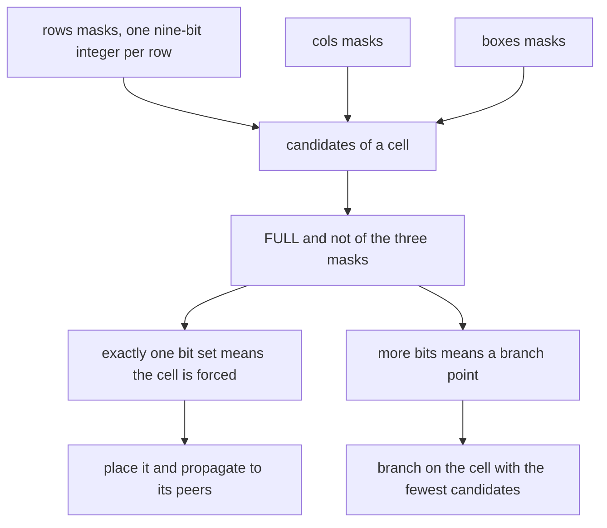
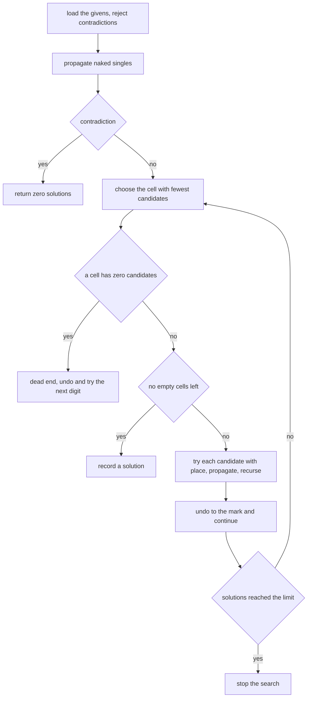
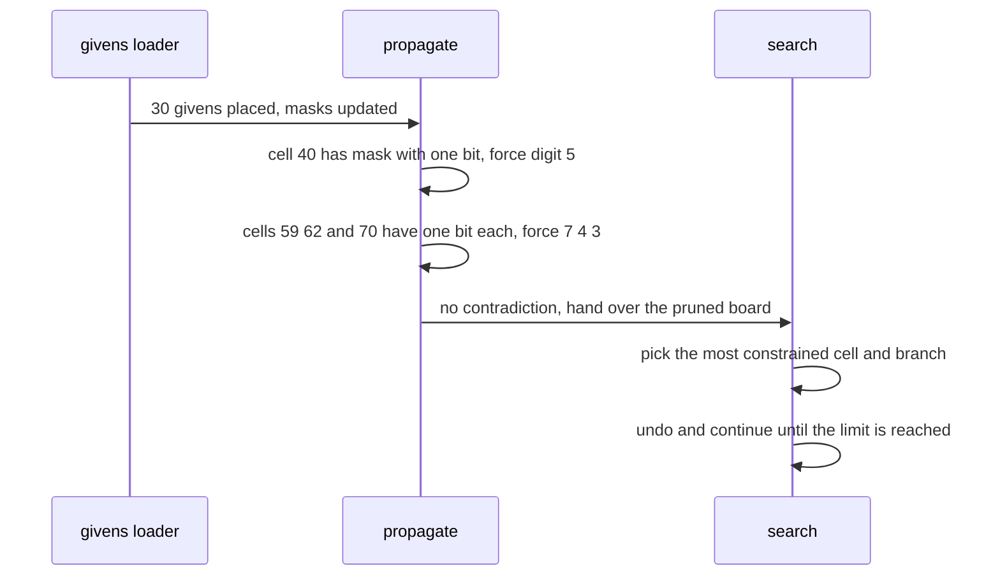

# 321 — Sudoku uniqueness check optimization.

> **Tier:** Intermediate · **CTCI chapter:** Ch 8 — Recursion and Dynamic Programming
> **Task spec:** [321-sudoku-uniqueness-check-optimization.md](../../../tasks/intermediate/321-sudoku-uniqueness-check-optimization.md)
> **Solutions:** [Python](../../../solutions/python/intermediate/321-sudoku-uniqueness-check-optimization/solution.py) ·
> [Java](../../../solutions/java/intermediate/321-sudoku-uniqueness-check-optimization/Solution.java) ·
> [JavaScript](../../../solutions/javascript/intermediate/321-sudoku-uniqueness-check-optimization/solution.js) ·
> [C#](../../../solutions/csharp/intermediate/321-sudoku-uniqueness-check-optimization/Solution.cs)

## 1. Problem restatement

**Input:** a 9×9 sudoku board flattened to 81 integers in row-major order, where `0` means "empty" and
`1..9` are the givens.

**Output:** how many completions the board has, **capped at a limit** — the default limit is 2, because
two is already enough to answer the question "is this puzzle unique?". The API the files expose is:

| Function | Returns |
| --- | --- |
| `count_solutions(board, limit = 2)` | the number of completions, capped at `limit` |
| `uniqueness(board)` | `0` unsatisfiable, `1` exactly one completion, `2` "many" |
| `first_solution(board)` | one completion as 81 integers, or `None` |
| `units(board)` | the 27 units (nine rows, nine columns, nine boxes), each a list of nine values |

| Call | Result | Why |
| --- | --- | --- |
| `count_solutions(EMPTY)` | `2` | the empty board has far more than two completions, and the cap stops the search |
| `count_solutions(EMPTY, limit=4)` | `4` | the cap is a parameter |
| `count_solutions(PUZZLE)` | `1` | the classic 30-given puzzle is proper |
| `first_solution(PUZZLE)` | the published completion | each of its 27 units is `1..9` |
| `count_solutions(UNSATISFIABLE)` | `0` | one clue altered; no unit has a duplicate, yet no completion exists |
| `count_solutions(conflicting)` | `0` | two `6`s in the same box: rejected while loading the givens |
| `uniqueness(sparse)` | `2` | nine clues of the known solution admit many completions |

## 2. Intuition

The obvious solver is brute force: find the first empty cell, try the digits `1..9`, recurse, and count
every complete board. It is correct and hopeless on an empty board, where the count is astronomically
large.

Three optimisations make the required cases fast, and all three are about *pruning before branching*.

1. **Bitmask candidate sets.** Instead of scanning a row, a column and a box for each digit, keep three
   arrays of nine-bit masks: `rows[r]`, `cols[c]`, `boxes[b]`. Bit `k` set means digit `k + 1` is already
   used there. The candidate set of a cell is then one expression —
   `FULL & ~(rows[r] | cols[c] | boxes[b])` — where `FULL = 0x1FF` is nine bits.
2. **Constraint propagation (naked singles).** If a cell has exactly one candidate, that digit is
   forced: no branch is needed, it can be written down immediately and its consequences propagated.
   `cand & (cand - 1) == 0` tests "exactly one bit set" arithmetically.
3. **Most-constrained-cell branching.** When a branch really is needed, take the cell with the *fewest*
   candidates. A cell with two candidates splits the search tree in two instead of probing a cell with
   seven candidates and generating seven subtrees that mostly die later.



## 3. Algorithm

1. Precompute `PEERS[cell]`: the cells sharing the row, the column or the box, for all 81 cells.
2. Maintain `grid` (the current board), three mask arrays `rows`, `cols`, `boxes`, and a `trail` of the
   placements made, so any prefix of them can be undone.
3. `place(cell, bit)` sets the bit in all three masks, writes the digit derived from the bit position
   (`bit.bit_length()`) into `grid[cell]`, and pushes `(cell, bit)` onto the trail.
4. `undo_to(mark)` pops the trail back to length `mark`, clearing each cell and XOR-ing the bit out of
   the three masks.
5. Load the givens: for each non-zero cell, if the digit's bit is not in its candidate set, the puzzle
   is internally inconsistent — return `(0, None)`. Otherwise `place` it.
6. Run `propagate` over all 81 cells: repeatedly take a cell that was just placed, and for each empty
   peer compute its candidates. Zero candidates means contradiction (`False`); exactly one candidate
   means the peer is forced, so `place` it and add it to the work list.
7. `search()`:
   1. Scan the empty cells and pick the one with the fewest candidates. If any empty cell has zero
      candidates, this branch is dead — return. Stop the scan early at size 2, since nothing can be more
      constrained than that except a forced cell, which propagation would already have placed.
   2. If there are no empty cells, record a copy of the grid as the newest solution.
   3. Otherwise iterate the candidates: `place` one, `propagate`, recurse, then `undo_to(mark)`, and
      return as soon as the number of recorded solutions reaches the limit.
8. `count_solutions` returns the recorded count, `uniqueness` returns it capped at 2, and
   `first_solution` returns the first recorded grid or `None`.

```text
procedure solve(board, limit)
    grid ← copy of board
    rows, cols, boxes ← three arrays of nine zero masks
    trail ← empty list
    found ← empty list

    procedure place(cell, bit)
        set bit inside rows[row of cell], cols[col of cell], boxes[box of cell]
        grid[cell] ← position of bit within the mask
        append (cell, bit) to trail
    end

    procedure undo_to(mark)
        while length(trail) > mark do
            (cell, bit) ← pop trail
            grid[cell] ← 0
            clear bit inside the three masks of cell
        end
    end

    function propagate(seeds)
        work ← copy of seeds
        while work is not empty do
            cell ← pop work
            for each empty peer of cell do
                cand ← FULL AND NOT (rows[row] OR cols[col] OR boxes[box]) of that peer
                if cand = 0 then
                    return false
                end
                if cand has exactly one bit then
                    place(peer, cand)
                    append peer to work
                end
            end
        end
        return true
    end

    for cell ← 0 to 80 do
        if grid[cell] ≠ 0 then
            bit ← 1 shifted left by grid[cell] - 1
            if the three masks of cell already contain bit then
                return (0, nothing)
            end
            place(cell, bit)
        end
    end
    if not propagate(all 81 cells) then
        return (0, nothing)
    end

    procedure search()
        best_cell ← -1
        best_candidates ← 0
        best_size ← 10
        for cell ← 0 to 80 do
            if grid[cell] = 0 then
                cand ← candidate mask of cell
                if cand = 0 then
                    return
                end
                size ← number of bits in cand
                if size < best_size then
                    best_cell, best_candidates, best_size ← cell, cand, size
                    if size = 2 then
                        stop the scan
                    end
                end
            end
        end
        if best_cell = -1 then
            append a copy of grid to found
            return
        end
        while best_candidates ≠ 0 do
            bit ← lowest set bit of best_candidates
            best_candidates ← best_candidates XOR bit
            mark ← length(trail)
            place(best_cell, bit)
            if propagate([best_cell]) then
                search()
            end
            undo_to(mark)
            if length(found) ≥ limit then
                return
            end
        end
    end

    search()
    return (length(found), first element of found if any)
end
```

The three public wrappers differ only in the limit and in what they return, so the caching and pruning
logic lives in exactly one place.



## 4. Worked example

The classic puzzle ships with the file as `PUZZLE` and its published completion as `KNOWN_SOLUTION`.
Loading the 30 givens and computing candidates for every empty cell yields four **naked singles** — cells
whose candidate mask has exactly one bit:

| Cell index | Row, column | Digit forced | Bit | Candidate mask |
| --- | --- | --- | --- | --- |
| 40 | row 4, column 4 | `5` | `1 << 4` = 16 | `0b10000` |
| 59 | row 6, column 5 | `7` | `1 << 6` = 64 | `0b1000000` |
| 62 | row 6, column 8 | `4` | `1 << 3` = 8 | `0b1000` |
| 70 | row 7, column 7 | `3` | `1 << 2` = 4 | `0b100` |

Cell 40 sits at the centre: its row holds `{4, 8, 3, 1}`, its column holds `{7, 9, 6, 2, 1, 8}` and its
box holds `{6, 2, 8}`. The union leaves exactly `5`, so bit 16 alone survives in the candidate mask and
`cand & (cand - 1) == 0` fires. All four forced digits agree with `KNOWN_SOLUTION`, which is what
`first_solution(PUZZLE) == KNOWN_SOLUTION` asserts at the end.



The two unsatisfiable cases show two different rejection paths. `UNSATISFIABLE` changes one clue of the
puzzle to a value that keeps every row, column and box duplicate-free — so the givens loader accepts it —
and only the global search discovers that no completion exists, returning `0`. The `conflicting` board
instead puts two `6`s in the top-left box, which the loader rejects immediately.

## 5. Complexity

Let `e` be the number of empty cells in the worst branch and `A = 9` the alphabet size.

| Measure | Bound | Why it holds |
| --- | --- | --- |
| Worst-case time | exponential | sudoku is NP-complete; the search can in principle try every cell-digit pair |
| Time, empty board with limit 2 | bounded by the limit | the search stops as soon as two completions are recorded |
| Time, proper puzzle | much smaller than `9^e` | propagation assigns every naked single before any branch, and MRV shrinks the branching factor |
| Space | `O(81)` | the grid, the three mask arrays and the 81 entries of the trail |
| Recursion depth | at most 81 | one frame per placement |
| Propagation cost | `O(20)` per placed cell | each of the 20 peers is examined once |

The optimisation is not asymptotic: it does not turn an exponential problem into a polynomial one, and
the files never claim otherwise. What it removes is the constant-factor and branching-factor waste that
makes a naive backtracker unusable when the limit is small.

## 6. Pitfalls and edge cases

- **The empty board has an astronomical number of completions.** `count_solutions(EMPTY)` is `2`, not a
  big number, because the limit caps the search. The file also asserts
  `count_solutions(EMPTY, limit=4) == 4`, showing the cap is respected exactly.
- **"Many" is encoded as 2.** `uniqueness` returns `0`, `1` or `2`, never the true count, which is the
  whole point of the optimisation.
- **A duplicate-free board can still be unsatisfiable.** `UNSATISFIABLE` alters one clue of the proper
  puzzle; the test loops over all 27 units and asserts no unit has a repeated value, then asserts
  `count_solutions(UNSATISFIABLE) == 0`. Only the global search sees the contradiction, which is why
  "check the units" is not a solution to this problem.
- **Undo must be exact.** `undo_to(mark)` reverses mask updates with XOR and clears the grid cell. An
  `OR`-only undo leaves stale bits in the masks and silently over-prunes later branches, and
  `mark = len(trail)` must be captured before each `place` so that a branch failing mid-propagation
  rewinds past every forced single it placed.
- **The MRV scan stops at size 2.** Nothing shorter than two bits except a forced cell can exist, and
  forced cells were already handled by propagation, so the scan can break early.
- **Sparse boards are not unique.** Nine clues taken from the known solution every ten indices give
  `uniqueness(sparse) == 2`; dropping more clues never restores uniqueness, since a superset of
  completions is always available.
- **`bit.bit_length()` is the digit.** For bit `1 << (d - 1)`, the bit length is exactly `d`, which is
  how the placement writes the value into the grid without a lookup table.

## 7. Variants and follow-ups

- **Solve instead of count.** `first_solution` uses the identical search with `limit = 1`; the recursion
  then stops at the first complete board instead of exhausting the tree.
- **Different propagation strengths.** Hidden singles (a digit that fits in only one cell of a unit) and
  box-line interaction are further forced placements that can be added to `propagate`.
- **Generalised constraint satisfaction.** The same shape — bitmask domains, propagation of forced
  values, and a most-constrained-variable branch rule — solves `n`-queens and graph colouring.
- **Counting versus deciding.** Capping a recursive count is the same trick the sliding window of
  [319-sliding-window-with-variable-constraints-two-pointers-advanced.md](319-sliding-window-with-variable-constraints-two-pointers-advanced.md)
  applies to a scan: stop as soon as you know enough.
- **Exact counting without search.** For boards that are almost solved the number of completions can be
  computed combinatorially; that is a different problem from this bounded search.

## 8. Check yourself

1. Why is `count_solutions(EMPTY)` equal to 2 rather than the true number of sudoku grids?

<details><summary>Show answer</summary>

Because `limit` defaults to 2 and the search returns as soon as it has recorded two completions. The
return value is a capped count — the contract is "how many up to the limit", which is exactly what
`uniqueness` needs: knowing that two different completions exist is enough to declare the puzzle not
unique.

</details>

2. How does `cand & (cand - 1) == 0` detect a forced cell?

<details><summary>Show answer</summary>

For any non-zero mask, clearing the lowest set bit gives `cand - 1` when only one bit is set, so the AND
is zero. If two or more bits are set, at least one bit remains after the subtraction and the AND is
non-zero. It is a branch-free "exactly one candidate" test, used on every peer during propagation.

</details>

3. Why branch on the most constrained cell instead of the first empty cell?

<details><summary>Show answer</summary>

Because the branching factor is the number of candidates. A cell with two candidates creates two
subtrees; a cell with seven creates seven, most of which die deeper in the tree after wasted work. The
most-constrained-variable rule minimises the number of subtrees at each level, which is why the code
stops scanning once it finds a cell with two candidates.

</details>

4. The `UNSATISFIABLE` board has no duplicate in any unit. Why is that significant?

<details><summary>Show answer</summary>

Because it proves that a shallow check is not enough. A sudoku solver cannot conclude "consistent" from
the 27 unit checks alone; those only catch local conflicts. Only a full search discovers that no
completion exists, and the test asserts both facts: every unit is duplicate-free, and `count_solutions`
is 0.

</details>

5. What does the `trail` buy, and what would break without it?

<details><summary>Show answer</summary>

It makes undo exact and cheap. Every placement pushes `(cell, bit)`; `undo_to(mark)` replays the tail in
reverse, clearing the cell and XOR-ing the bit out of the row, column and box masks. Without it the code
would have to recompute the masks after every failed branch, and a partial undo — clearing the grid but
not the masks — would leave the search operating on inconsistent state.

</details>
