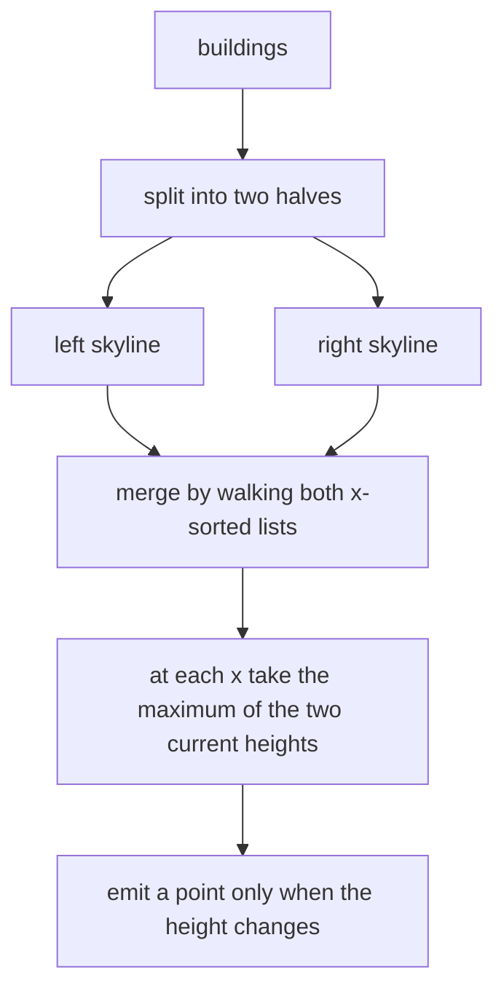
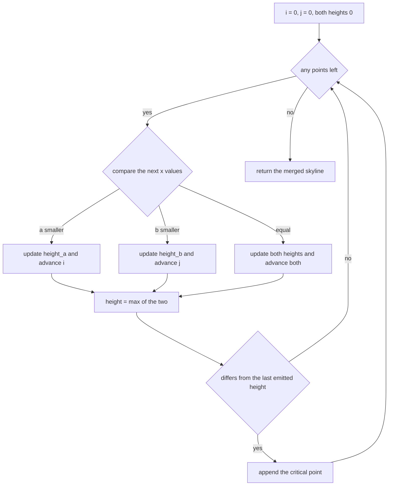
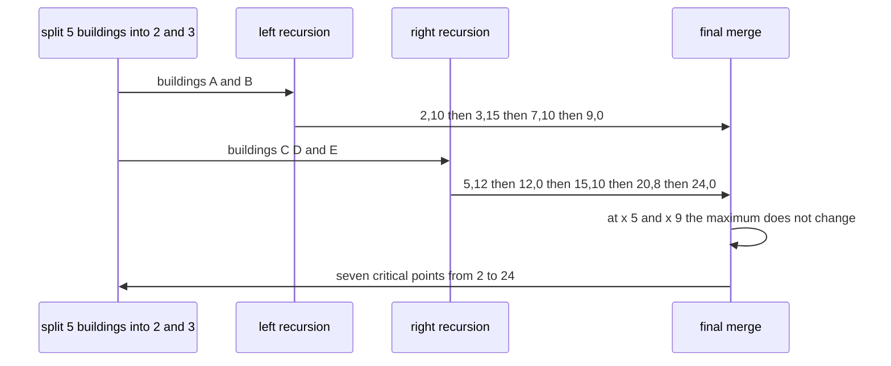

# 322 — Implement algorithm to find skyline (divide & conquer).

> **Tier:** Intermediate · **CTCI chapter:** Beyond — Graphics, Geometry & Robotics
> **Task spec:** [322-implement-algorithm-to-find-skyline-divide-conquer.md](../../../tasks/intermediate/322-implement-algorithm-to-find-skyline-divide-conquer.md)
> **Solutions:** [Python](../../../solutions/python/intermediate/322-implement-algorithm-to-find-skyline-divide-conquer/solution.py) ·
> [Java](../../../solutions/java/intermediate/322-implement-algorithm-to-find-skyline-divide-conquer/Solution.java) ·
> [JavaScript](../../../solutions/javascript/intermediate/322-implement-algorithm-to-find-skyline-divide-conquer/solution.js) ·
> [C#](../../../solutions/csharp/intermediate/322-implement-algorithm-to-find-skyline-divide-conquer/Solution.cs)

## 1. Problem restatement

**Input:** a list of buildings, each `[left, right, height]`. A building is active on `[left, right)`
— the left edge belongs to the building, the right edge does not.

**Output:** the skyline as a list of critical points `[x, height]`, in increasing `x`, containing
exactly the positions where the visible height **changes**. The list always starts with the first left
edge and ends with a height of 0, because nothing stands past the last right edge. An empty input
gives an empty list.

| Call | Result | Why |
| --- | --- | --- |
| `[[2,9,10],[3,7,15],[5,12,12],[15,20,10],[19,24,8]]` | `[[2,10],[3,15],[7,12],[12,0],[15,10],[20,8],[24,0]]` | the canonical example every file asserts |
| `[[1,3,4]]` | `[[1,4],[3,0]]` | one building: rise then fall to zero |
| `[[0,2,5],[2,4,7]]` | `[[0,5],[2,7],[4,0]]` | the taller neighbour takes over at the shared edge |
| `[[0,2,5],[5,8,3]]` | `[[0,5],[2,0],[5,3],[8,0]]` | a gap: the height drops to 0 before the next rise |
| `[]` | `[]` | nothing to draw |

The file also ships `skyline_sweep`, an independent event-sweep implementation, and the tests compare
the two on 300 randomly generated building sets of one to eight buildings.

## 2. Intuition

A single building already *is* a skyline: `[[left, height], [right, 0]]`. Two skylines can be combined
without ever looking at individual buildings, because at any `x` the visible height is simply the
**maximum** of the two heights at that `x`. That is the recursive insight: split the buildings in half,
solve each half, and merge.

The merge itself is a walk over two sorted lists of `x` positions. Neither list needs to be resampled
onto a common grid: pointer `i` walks the first skyline and `j` the second, each of them keeping track of
the last height seen in its own list. When the next `x` comes from list A, only A's height changes; when
it comes from list B, only B's height changes; when both lists have a point at the same `x`, both change.
After each step the merged value is `max(height_a, height_b)`, and a point is emitted **only when that
maximum differs from the last emitted height**. That last rule is what stops the output from filling up
with redundant points where the height does not actually change.



## 3. Algorithm

1. If the building list is empty, return an empty skyline.
2. If it holds exactly one building `[left, right, height]`, return `[[left, height], [right, 0]]`.
3. Otherwise split at `mid = len(buildings) / 2`, compute the skyline of each half recursively, and
   merge them.

The merge is a single linear walk:

4. Keep indices `i` and `j` into the two skylines and running heights `height_a`, `height_b`, both
   initially 0.
5. While either list still has points:
   1. If `a[i].x < b[j].x`, take `x = a[i].x` and update `height_a`; advance `i`.
   2. Else if `b[j].x < a[i].x`, take `x = b[j].x` and update `height_b`; advance `j`.
   3. Else both lists have this `x`: take it once, update both heights, advance both.
   4. Compute `height = max(height_a, height_b)` and append `[x, height]` only if the merged list is
      empty or its last height differs.
6. Return the merged list.

```text
procedure skyline(buildings)
    if buildings is empty then
        return empty list
    end
    if length(buildings) = 1 then
        left, right, height ← the single building
        return [[left, height], [right, 0]]
    end
    mid ← length(buildings) / 2
    left_skyline ← skyline(first mid buildings)
    right_skyline ← skyline(remaining buildings)
    return merge(left_skyline, right_skyline)
end

procedure merge(a, b)
    merged ← empty list
    i ← 0
    j ← 0
    height_a ← 0
    height_b ← 0
    while i < length(a) or j < length(b) do
        if j ≥ length(b) or (i < length(a) and a[i].x < b[j].x) then
            x ← a[i].x
            height_a ← a[i].height
            i ← i + 1
        else if i ≥ length(a) or b[j].x < a[i].x then
            x ← b[j].x
            height_b ← b[j].height
            j ← j + 1
        else
            x ← a[i].x
            height_a ← a[i].height
            height_b ← b[j].height
            i ← i + 1
            j ← j + 1
        end
        height ← maximum(height_a, height_b)
        if merged is empty or last height in merged ≠ height then
            append [x, height] to merged
        end
    end
    return merged
end
```

The oracle `skyline_sweep` takes the other classic route: collect every `left` and `right` as an event,
sort the events so that ends are processed before starts at the same `x` (which encodes the
half-open `[left, right)` convention), and maintain a count per height so the current maximum can be
recomputed by walking down from the previous one.



## 4. Worked example

Merge five buildings: `A[2,9,10]`, `B[3,7,15]`, `C[5,12,12]`, `D[15,20,10]`, `E[19,24,8]`. The split
at `mid = 2` gives `{A, B}` and `{C, D, E}`.

| Sub-problem | Result |
| --- | --- |
| `{A}` | `[[2,10],[9,0]]` |
| `{B}` | `[[3,15],[7,0]]` |
| merge `{A}` and `{B}` | `[[2,10],[3,15],[7,10],[9,0]]` |
| `{C}` | `[[5,12],[12,0]]` |
| `{D}` | `[[15,10],[20,0]]` |
| `{E}` | `[[19,8],[24,0]]` |
| merge `{D}` and `{E}` | `[[15,10],[20,8],[24,0]]` — the `19` point is dropped because the height is still 10 |
| merge `{C}` with `{D,E}` | `[[5,12],[12,0],[15,10],[20,8],[24,0]]` |
| merge `{A,B}` with `{C,D,E}` | `[[2,10],[3,15],[7,12],[12,0],[15,10],[20,8],[24,0]]` |

The final merge is worth reading step by step:

| Step | next `a` | next `b` | chosen `x` | `height_a` | `height_b` | max | emitted? |
| --- | --- | --- | --- | --- | --- | --- | --- |
| 1 | 2 | 5 | 2 | 10 | 0 | 10 | yes `[2,10]` |
| 2 | 3 | 5 | 3 | 15 | 0 | 15 | yes `[3,15]` |
| 3 | 7 | 5 | 5 | 15 | 12 | 15 | no (unchanged) |
| 4 | 7 | 12 | 7 | 10 | 12 | 12 | yes `[7,12]` |
| 5 | 9 | 12 | 9 | 0 | 12 | 12 | no (unchanged) |
| 6 | — | 12 | 12 | 0 | 0 | 0 | yes `[12,0]` |
| 7 | — | 15 | 15 | 0 | 10 | 10 | yes `[15,10]` |
| 8 | — | 20 | 20 | 0 | 8 | 8 | yes `[20,8]` |
| 9 | — | 24 | 24 | 0 | 0 | 0 | yes `[24,0]` |

Steps 3 and 5 are the ones that justify the "emit only on change" rule: at `x = 5` the left skyline is
still 15 high, so the arrival of `C` at height 12 is invisible, and at `x = 9` the left building ends
but the right skyline already provides 12. Both of those points would be noise in the output, and the
assertions pin the exact seven-point answer, so they must not appear.



## 5. Complexity

Let `k` be the number of buildings and `n` the total number of critical points in the final skyline.

| Measure | Bound | Why it holds |
| --- | --- | --- |
| Recurrence | `T(k) = 2·T(k/2) + O(k)` | the merge walks two lists whose lengths are bounded by the sub-problem sizes |
| Time | `O(k log k)` | the merge work is linear at each of the `log k` levels |
| Space, recursion | `O(log k)` depth | balanced splits |
| Space, output | `O(n)` | the skyline points themselves, `n ≤ 2k` |
| Time, sweep oracle | `O(k log k)` | sorting `2k` events dominates |
| Space, sweep oracle | `O(k + H)` | the event list plus a counter per height `H` |

The merge is what makes this attractive: it never sorts, never allocates an intermediate grid, and its
cost is proportional to the two lists it consumes. The price is that each level re-walks its own
sub-skyline, hence the extra `log k` factor over a single sweep — the divide-and-conquer version is
chosen for parallelism and simplicity of the merge, not for beating the sweep asymptotically.

## 6. Pitfalls and edge cases

- **Half-open intervals.** A building `[left, right)` releases its edge at `right`, so
  `[[0,2,5],[2,4,7]]` must give `[[0,5],[2,7],[4,0]]`: at `x = 2` the second building is already up and
  the height rises rather than passing through zero. The sweep oracle encodes the same convention by
  processing all ends before all starts at the same coordinate.
- **Duplicate `x` values in a merge.** When both skylines carry a point at the same `x`, the code must
  take it once — that is the third branch of the merge. Handling them in two separate steps would emit
  an intermediate height that no input justifies.
- **Emit on change only.** A point is appended only when the running maximum differs from the previous
  emitted height. Dropping that check produces correct maxima with redundant points, and the exact
  list assertions fail.
- **Empty input.** `skyline([])` is `[]`, and the sweep oracle has the same guard; both are asserted.
- **Single building.** The base case returns two points, `[left, height]` and `[right, 0]`, which is
  what `[[1,3,4]]` asserts.
- **Gaps.** `[[0,2,5],[5,8,3]]` returns to 0 between the buildings, so the skyline contains `[2,0]` and
  `[5,3]`. A merge that only looked at building edges without tracking "no active building" would miss
  the zero.
- **Trailing zero.** The last right edge always emits a height of 0 in this formulation; the canonical
  answer ends with `[24,0]` and the assertions expect it.
- **Edges that do not change the height disappear.** Building `C[5,12,12]` starts at `x = 5`, but
  building `B[3,7,15]` is taller there, so the merged skyline has no point at 5 at all; `C`'s right
  edge at `x = 12` does appear, because that is where the height finally drops to 0. A correct output
  keeps only the positions where something is actually visible changing.
- **Negative or zero heights** are not exercised by the shipped tests. The sweep oracle allocates
  `max_height + 1` counters, so a negative height would index outside that array and a height of 0 would
  simply be invisible to it, while the divide-and-conquer merge would still behave sensibly.
- **Sorting is not required in the divide-and-conquer path.** The buildings may arrive in any order;
  the recursion never compares two building coordinates directly, only skyline `x` values.

## 7. Variants and follow-ups

- **The sweep-line relative.** [328-skyline-problem-heap-sweep-line.md](328-skyline-problem-heap-sweep-line.md)
  solves the same problem with a priority queue over events, which is the standard `O(k log k)`
  alternative and needs no recursion.
- **Event sweeps in general.** [325-minimum-number-of-platforms-for-trains-sweep-line.md](325-minimum-number-of-platforms-for-trains-sweep-line.md)
  and [327-car-pooling-capacity-check-difference-array-sweep.md](327-car-pooling-capacity-check-difference-array-sweep.md)
  use the same "sort the boundaries, sweep left to right" pattern with counting instead of maximum.
- **Interval merging.** [323-insert-interval-and-merge-intervals.md](323-insert-interval-and-merge-intervals.md)
  works on intervals rather than heights, and answers questions like "what is the union of these
  ranges".
- **Rectangles instead of bars.** Generalising the skyline to arbitrary rectangles makes the problem
  the union area of rectangles, where the sweep plus a segment tree replaces the simple maximum.
- **Parallelism.** The divide-and-conquer structure is the reason this variant stays popular: the two
  halves are independent and the merge is a linear scan, so it maps cleanly onto multiple threads.

## 8. Check yourself

1. Why does the merge take the maximum of the two current heights rather than comparing buildings?

<details><summary>Show answer</summary>

Because each recursive call has already collapsed its half into the visible outline, and the visible
outline of the union of two disjoint building sets is pointwise `max` of the two outlines. Every
building in the left half is entirely described by the left skyline, so no individual building is ever
needed once the recursion returns. That is what makes the merge independent of the sub-structure.

</details>

2. The canonical merge skips the point at `x = 5`. Is that a bug?

<details><summary>Show answer</summary>

No. At `x = 5` the left skyline is still at height 15 because building `B[3,7,15]` is taller than
`C[5,12,12]`. The maximum is unchanged from the previous emitted point, so the merged skyline has no
critical point there. Emitting `[5,15]` as well would be harmless for a rendering but would break the
"only where the height changes" contract the assertions encode.

</details>

3. What does the half-open interval convention `[left, right)` change in the answer?

<details><summary>Show answer</summary>

It decides the tie at a shared edge. With `[0,2,5]` and `[2,4,7]`, the first building is already gone at
`x = 2`, so the height jumps from 5 to 7 rather than dipping to 0. The sweep oracle implements the same
choice by sorting ends before starts at equal `x`; the recursive merge gets it for free because the
right sub-skyline contributes `[2,7]` while the left contributes `[2,0]` and the maximum wins.

</details>

4. What is the merge's complexity, and why is the whole algorithm `O(k log k)` instead of `O(k)`?

<details><summary>Show answer</summary>

The merge is linear in the two lists it consumes, `O(k)` at the top level. There are `log k` levels of
recursion, each doing linear work over its own sub-problems, so the total is `O(k log k)`. A single
sweep achieves the same order with less machinery, which is why the divide-and-conquer version is
valued for its mergeability rather than its asymptotics.

</details>

5. How many points can the output have for `k` buildings, and why?

<details><summary>Show answer</summary>

At most `2k`: each building contributes at most its two edges, and every edge can appear at most once
because the merge only advances each pointer forward through lists whose points come from edges. The
canonical example with five buildings has seven points, and the assertions for the two-building cases
show four.

</details>
