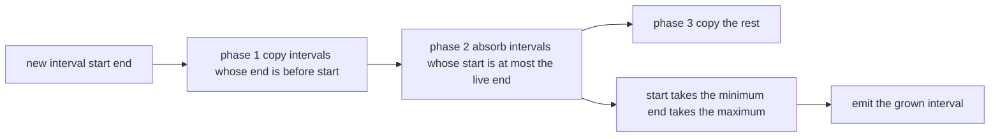
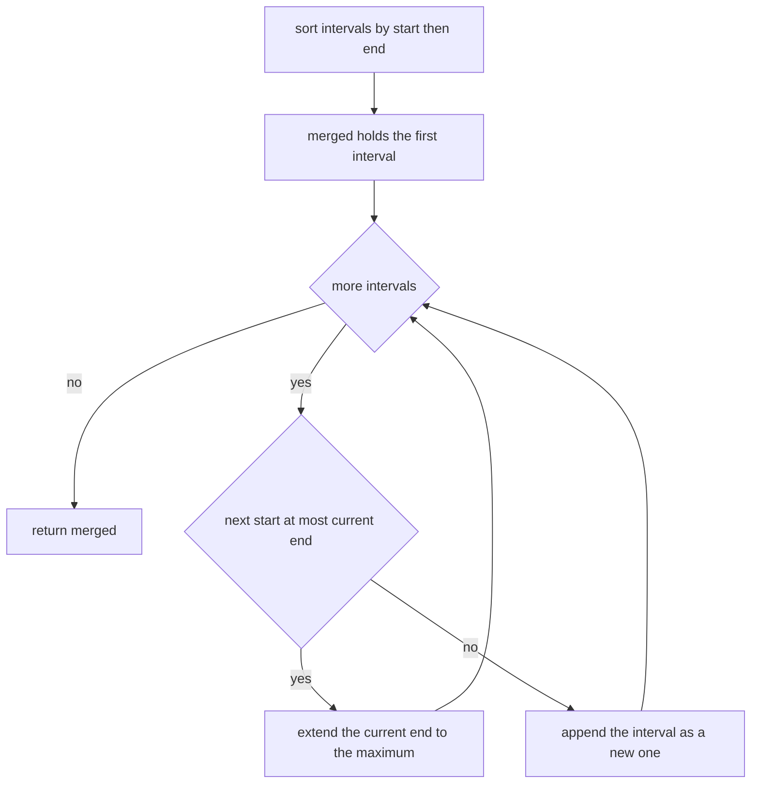
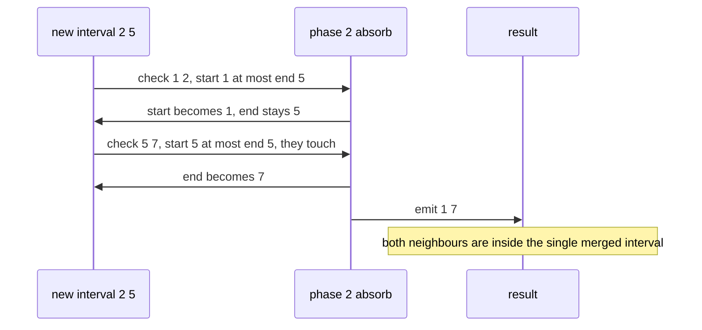

# 323 — Insert interval and merge intervals.

> **Tier:** Intermediate · **CTCI chapter:** Ch 1 — Arrays and Strings
> **Task spec:** [323-insert-interval-and-merge-intervals.md](../../../tasks/intermediate/323-insert-interval-and-merge-intervals.md)
> **Solutions:** [Python](../../../solutions/python/intermediate/323-insert-interval-and-merge-intervals/solution.py) ·
> [Java](../../../solutions/java/intermediate/323-insert-interval-and-merge-intervals/Solution.java) ·
> [JavaScript](../../../solutions/javascript/intermediate/323-insert-interval-and-merge-intervals/solution.js) ·
> [C#](../../../solutions/csharp/intermediate/323-insert-interval-and-merge-intervals/Solution.cs)

## 1. Problem restatement

**Input:** a list of closed intervals `[start, end]`, plus — for the insert routine — one new interval
and a list that is already sorted and non-overlapping.

**Output:** the union of the intervals, again as a sorted, non-overlapping list.

The two routines are `merge_intervals(intervals)`, which works on an arbitrary list, and
`insert_interval(intervals, new_interval)`, which exploits the sortedness of its input. **Touching
intervals merge**: `[1, 2]` and `[2, 3]` share the endpoint `2` and become `[1, 3]`, so the merge
condition is `next.start <= current.end`, with `<=` rather than `<`.

| Call | Result | Why |
| --- | --- | --- |
| `merge_intervals([[1,3],[2,6],[8,10],[15,18]])` | `[[1,6],[8,10],[15,18]]` | the classic overlapping pair |
| `merge_intervals([[1,2],[2,3]])` | `[[1,3]]` | the touching-merge policy |
| `merge_intervals([[1,10],[2,3],[4,5]])` | `[[1,10]]` | both inner intervals are contained |
| `merge_intervals([[5,5]])` | `[[5,5]]` | a degenerate interval survives |
| `merge_intervals([])` | `[]` | nothing to merge |
| `insert_interval([[1,2],[5,7]], [2,5])` | `[[1,7]]` | the new interval touches both sides |
| `insert_interval([[1,2],[3,5],[6,7],[8,10],[12,16]], [9,10])` | unchanged | `[9,10]` is contained in `[8,10]` |
| `insert_interval([[1,2],[3,5],[6,7],[8,10],[12,16]], [4,4])` | unchanged | a single point inside `[3,5]` |
| `insert_interval([[1,2],[3,5],[6,7],[8,10],[12,16]], [0,0])` | `[[0,0], …]` | prepended before everything |
| `insert_interval([[3,4]], [1,2])` | `[[1,2],[3,4]]` | disjoint, so the new interval is inserted |
| `insert_interval([], [4,6])` | `[[4,6]]` | the empty base |

## 2. Intuition

The naive way to merge intervals is to look for overlap pair by pair and to keep restarting after every
change, which is why interval merging is a classic quadratic trap. The structural insight is that **once
the intervals are sorted by start, the union can be built in one pass**. The current output interval
either absorbs the next one — which it must, if the next start is at or before the current end — or the
next one begins a fresh interval, and nothing later can overlap what came before.

That single rule also clarifies what "overlap" means here. With the policy "touching counts", the test is
`next.start <= current.end`: `[1,2]` and `[2,3]` merge because they share a point. A strict `<` would
keep them apart and produce `[[1,2],[2,3]]`, which the assertions reject.

Inserting into an already sorted list needs no sorting at all, so the routine is linear and splits the
input into three parts:

1. intervals entirely **before** the new one — everything with `end < new.start`;
2. intervals that **overlap or touch** the new one — everything with `start <= new.end`, and note that
   this test uses the *live* `end`, which grows as intervals are absorbed;
3. intervals entirely **after** — copied through unchanged.



## 3. Algorithm

**Merge (unsorted input).**

1. If the list is empty, return an empty list.
2. Sort the intervals by `(start, end)`.
3. Start the result with the first interval. For every following interval: if its start is `<=` the end
   of the last result interval, extend that interval's end to the maximum of the two ends; otherwise
   append it as a new interval.

**Insert (sorted, non-overlapping input).**

4. Read `start`, `end` from the new interval and set `i = 0`.
5. While `i` is in range and `intervals[i].end < start` (strictly before, so *not even touching*), copy
   the interval into the result and advance `i`.
6. While `i` is in range and `intervals[i].start <= end`, absorb the interval:
   `start = min(start, intervals[i].start)`, `end = max(end, intervals[i].end)`, advance `i`. Because
   `end` grows inside the loop, intervals that were not reachable by the original end are still caught.
7. Append the accumulated `[start, end]`.
8. Copy the remaining intervals unchanged.

```text
procedure merge_intervals(intervals)
    if intervals is empty then
        return empty list
    end
    ordered ← intervals sorted by start then end
    merged ← list containing the first interval of ordered
    for each interval in ordered after the first do
        if interval.start ≤ last(merged).end then
            last(merged).end ← maximum(last(merged).end, interval.end)
        else
            append interval to merged
        end
    end
    return merged
end

procedure insert_interval(intervals, new_interval)
    start ← new_interval.start
    end ← new_interval.end
    result ← empty list
    i ← 0
    while i < length(intervals) and intervals[i].end < start do
        append a copy of intervals[i] to result
        i ← i + 1
    end
    while i < length(intervals) and intervals[i].start ≤ end do
        start ← minimum(start, intervals[i].start)
        end ← maximum(end, intervals[i].end)
        i ← i + 1
    end
    append [start, end] to result
    while i < length(intervals) do
        append a copy of intervals[i] to result
        i ← i + 1
    end
    return result
end
```

The oracle `merge_intervals_sweep` takes the endpoint view instead of the interval view: every start
becomes an event `(x, 0)` and every end an event `(x, 1)`, sorting puts starts before ends at the same
coordinate, and a running `depth` opens a merged interval when it rises from zero and closes one when it
returns to zero. That encoding is what makes the touching policy fall out for free.



## 4. Worked example

Merging `[[1,3],[2,6],[8,10],[15,18]]`: the list is already sorted, so the pass goes straight through.

| Step | Interval | Last result interval | `start ≤ end`? | Result so far |
| --- | --- | --- | --- | --- |
| 1 | `[1,3]` | — | — | `[[1,3]]` |
| 2 | `[2,6]` | `[1,3]` | `2 ≤ 3` yes | `[[1,6]]` (end becomes 6) |
| 3 | `[8,10]` | `[1,6]` | `8 ≤ 6` no | `[[1,6],[8,10]]` |
| 4 | `[15,18]` | `[8,10]` | `15 ≤ 10` no | `[[1,6],[8,10],[15,18]]` |

Now insert `[2, 5]` into `[[1,2],[5,7]]`, which is the touching case in both directions:

| Phase | `i` | Interval | Test | `start`, `end` after | Result |
| --- | --- | --- | --- | --- | --- |
| 1 | 0 | `[1,2]` | `end 2 < start 2`? no | 2, 5 | `[]` |
| 2 | 0 | `[1,2]` | `start 1 ≤ end 5`? yes | `min(2,1)=1`, `max(5,2)=5` | `[]` |
| 2 | 1 | `[5,7]` | `start 5 ≤ end 5`? yes | `min(1,5)=1`, `max(5,7)=7` | `[]` |
| 3 | — | — | — | — | append `[1,7]` |

Phase 1 refuses to consume `[1,2]` because its end is exactly the new start — the intervals touch, and
touching means they will be merged in phase 2 rather than copied. Phase 2 then absorbs both neighbours,
and the growing `end` is what lets the second absorption happen: the test uses `end = 5`, which is
already the start of `[5,7]`.



The contained case behaves differently. Inserting `[9, 10]` into
`[[1,2],[3,5],[6,7],[8,10],[12,16]]` copies the first three intervals in phase 1, absorbs `[8,10]` in
phase 2 with `start = min(9, 8) = 8` and `end = max(10, 10) = 10`, then copies `[12,16]` in phase 3 —
producing a list identical to the input, which is exactly what the assertion demands. A naive
implementation that inserted the new interval as a separate element before merging would also be correct
but would re-sort and re-scan the whole list, which is what `insert_interval` avoids.

## 5. Complexity

Let `n` be the number of intervals.

| Measure | Bound | Why it holds |
| --- | --- | --- |
| Merge time, best | `O(n log n)` | the sort dominates even for pre-sorted input |
| Merge time, worst | `O(n log n)` | one linear pass after one sort |
| Merge space | `O(n)` | the result list |
| Insert time | `O(n)` | each interval is visited once and never revisited |
| Insert space | `O(n)` | the result list; the input is copied, not mutated |
| Sweep oracle | `O(n log n)` | `2n` events are sorted |
| Naive pairwise merge | `O(n²)` or worse | repeated overlap scans with restarts |

The insert routine's advantage is precisely the sort it does not perform: it is linear because the
guarantee "sorted and non-overlapping" is part of its contract. The 200-trial fuzz loop in the files
checks that the two paths agree — `insert_interval(base, new) == merge_intervals(base + [new])` for a
generated sorted, disjoint `base`.

## 6. Pitfalls and edge cases

- **Touching must merge.** The condition is `<=`, so `[1,2]` and `[2,3]` become `[1,3]`; the oracle
  encodes the same rule by sorting starts before ends at equal coordinates. Using `<` fails both the
  direct assertion and the sweep comparison.
- **Phase 1 uses a strict comparison.** The copy loop runs while `intervals[i].end < start`, precisely so
  that an interval ending exactly at the new start is handed to phase 2 for merging.
- **The live `end` drives phase 2.** Absorbing an interval can push `end` far to the right, which then
  admits further intervals. Re-testing only the original end would stop early and leave overlapping
  output.
- **Containment.** `[[1,10],[2,3],[4,5]]` merges to a single interval, and `insert_interval` with a
  contained interval returns the input unchanged. Both directions must work: an inner interval is
  absorbed, and a new interval fully inside an existing one changes nothing.
- **Degenerate intervals.** `[5,5]` is a valid closed interval and survives merging as `[[5,5]]`; a
  single-point insert like `[4,4]` inside `[3,5]` leaves the list unchanged.
- **Empty inputs.** `merge_intervals([])` is `[]` and `insert_interval([], [4,6])` is `[[4,6]]`; the merge
  routine must check for emptiness before touching `ordered[0]`.
- **Do not mutate the caller's lists.** The merge sorts copies (the Python file builds `list(interval)`
  per element) and the insert appends copies, so the caller's data keeps its original order.
- **Sort order and stability.** Sorting by `(start, end)` rather than by start alone keeps the output
  deterministic when starts tie, which matters for the exact-list assertions.
- **Unsorted input to `insert_interval`.** The routine assumes the sorted, non-overlapping precondition
  and performs no validation; feeding it unsorted data silently produces garbage, which is why the fuzz
  tests generate the base with a dedicated sorted-disjoint generator.
- **Endpoint semantics.** These are closed intervals, so the merge output `[1,7]` covers the points 1
  through 7 inclusive. The sweep oracle must process ends-strictly-after starts to preserve this; using
  half-open conventions would give a different, equally consistent, but non-matching answer.

## 7. Variants and follow-ups

- **Interval scheduling and partitioning.** Choosing the maximum number of non-overlapping intervals
  ([324-interval-scheduling-to-maximize-number-of-non-overlapping-interv.md](324-interval-scheduling-to-maximize-number-of-non-overlapping-interv.md))
  and counting how many overlap at once
  ([326-meeting-rooms-required-interval-partitioning.md](326-meeting-rooms-required-interval-partitioning.md))
  are the two natural questions you ask after you can merge intervals.
- **Sweep-line relatives.** [325-minimum-number-of-platforms-for-trains-sweep-line.md](325-minimum-number-of-platforms-for-trains-sweep-line.md)
  and [327-car-pooling-capacity-check-difference-array-sweep.md](327-car-pooling-capacity-check-difference-array-sweep.md)
  use the same event ordering but track a running count instead of merging.
- **Skyline merging.** [322-implement-algorithm-to-find-skyline-divide-conquer.md](322-implement-algorithm-to-find-skyline-divide-conquer.md)
  is the height-valued version of the same "walk the sorted endpoints" merge.
- **Difference arrays instead of sorting.** When the coordinate range is small, an array of `+1`/`−1`
  events replaces the sort entirely, as the car-pooling task shows.
- **Interval trees.** For repeated insertions into a large changing set, a balanced interval tree keeps
  the work logarithmic per operation instead of linear.

## 8. Check yourself

1. Why does `merge_intervals` sort even though a linear scan is enough to merge?

<details><summary>Show answer</summary>

Because the scan only works left to right: it decides "does this interval overlap the one I am currently
building?" and that decision is meaningful only if intervals arrive in increasing start order. Without
sorting, an interval earlier in the list could start inside a later one, and the single pass would emit
overlapping output. The sort is what turns an arbitrary set of intervals into a chain the pass can walk.

</details>

2. In `insert_interval`, why is phase 1 `end < start` while phase 2 is `start <= end`?

<details><summary>Show answer</summary>

Phase 1 decides which intervals are *strictly* before the new one; an interval ending exactly at the new
start is touching and must be merged, not copied. Phase 2 decides which intervals should be absorbed, and
there touching counts, so the test is `<=`. The asymmetry between `<` and `<=` is the whole content of the
"touching merges" policy.

</details>

3. Why must `end` be updated inside phase 2's loop?

<details><summary>Show answer</summary>

Because absorbed intervals extend the merged range, which can bring further intervals into reach. In the
`[2,5]` example, after absorbing `[1,2]` the interval is still `[1,5]`, and the test `5 ≤ 5` catches
`[5,7]`. If the loop tested against the original end, `[5,7]` would be left as a separate interval and the
answer would be `[[1,5],[5,7]]` — overlapping output.

</details>

4. What does `merge_intervals_sweep` do differently, and why do the two agree?

<details><summary>Show answer</summary>

It never looks at intervals as pairs. It turns every start into `(x, 0)` and every end into `(x, 1)`,
sorts the events so starts precede ends at the same coordinate, and tracks a depth counter: a merged
interval opens when depth rises from zero and closes when it returns to zero. Both formulations describe
the same union, so the tests compare them on 200 random interval sets and require exact equality,
including the touching cases.

</details>

5. What is the complexity of inserting `k` intervals one at a time into a growing sorted list?

<details><summary>Show answer</summary>

`O(k²)` with this routine, because each insertion is a linear copy of the current list. That is fine for
the single-insertion contract of this task, but for many insertions the right structure is different:
sort everything once and merge, or keep the intervals in a balanced tree so each insertion costs
logarithmic time. The linear cost here is the deliberate consequence of exploiting a sorted input rather
than maintaining one.

</details>
