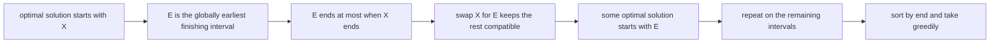
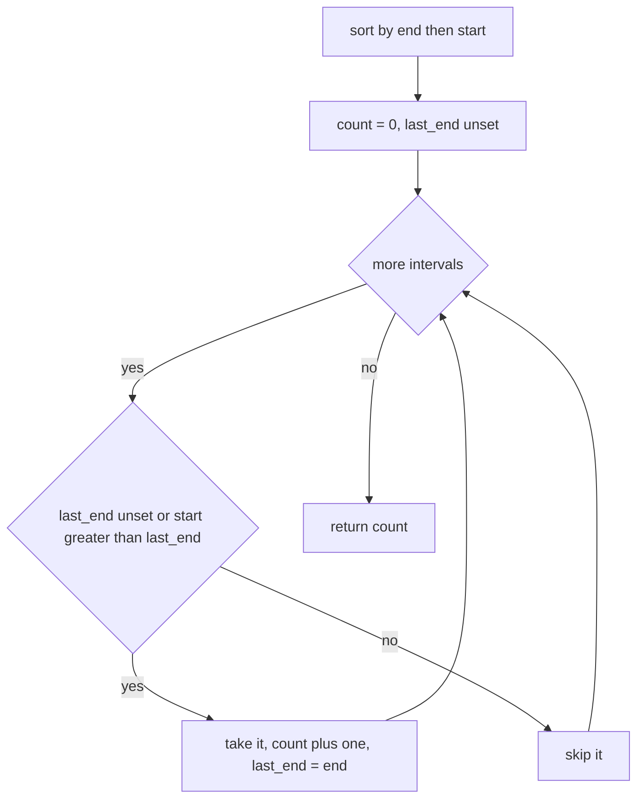
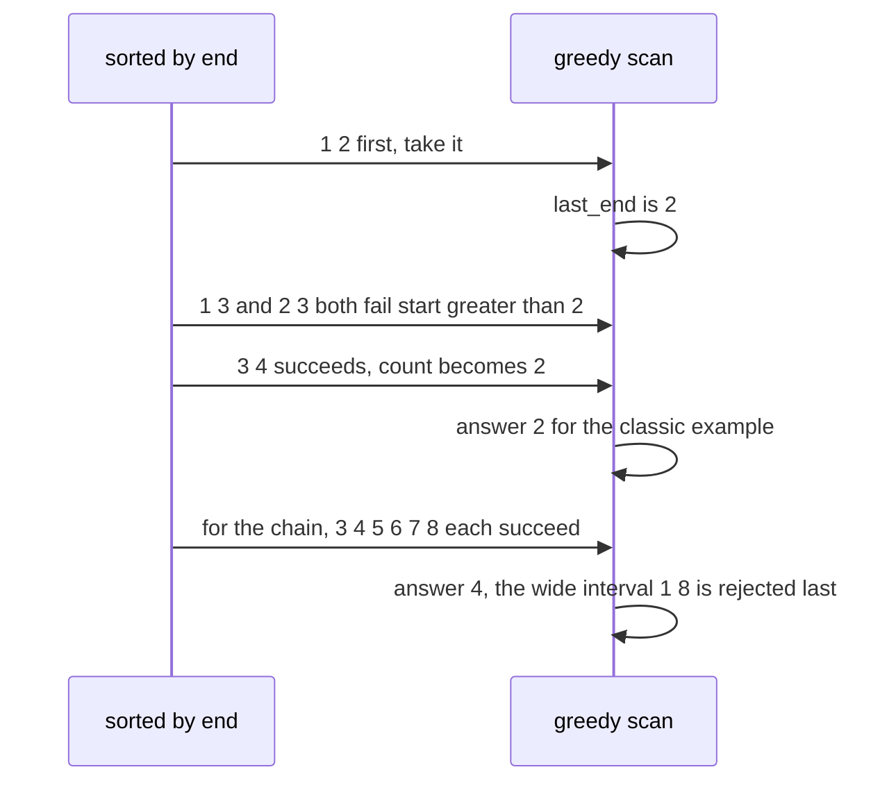

# 324 — Interval scheduling to maximize number of non-overlapping intervals (greedy).

> **Tier:** Intermediate · **CTCI chapter:** Ch 1 — Arrays and Strings
> **Task spec:** [324-interval-scheduling-to-maximize-number-of-non-overlapping-interv.md](../../../tasks/intermediate/324-interval-scheduling-to-maximize-number-of-non-overlapping-interv.md)
> **Solutions:** [Python](../../../solutions/python/intermediate/324-interval-scheduling-to-maximize-number-of-non-overlapping-interv/solution.py) ·
> [Java](../../../solutions/java/intermediate/324-interval-scheduling-to-maximize-number-of-non-overlapping-interv/Solution.java) ·
> [JavaScript](../../../solutions/javascript/intermediate/324-interval-scheduling-to-maximize-number-of-non-overlapping-interv/solution.js) ·
> [C#](../../../solutions/csharp/intermediate/324-interval-scheduling-to-maximize-number-of-non-overlapping-interv/Solution.cs)

## 1. Problem restatement

**Input:** a list of intervals `[start, end]`.

**Output:** the *maximum number* of intervals that can be selected so that no two of them overlap. This
is the classic "activity selection" problem: pick as many activities as possible when they cannot run at
the same time.

The convention matters, and the solution files fix it explicitly: **touching endpoints conflict**, so a
new interval is compatible only when `previous.end < next.start`, strictly. That is what makes the
classic example answer 2 rather than 3.

| Call | Result | Why |
| --- | --- | --- |
| `max_non_overlapping([[1,2],[2,3],[3,4],[1,3]])` | `2` | `[1,2]` and `[2,3]` touch, so they conflict; `[1,3]` blocks two |
| `max_non_overlapping([[1,2],[3,4],[5,6],[7,8],[1,8]])` | `4` | the chain beats the wide decoy |
| `max_non_overlapping([[1,2],[3,4],[5,6],[7,8]])` | `4` | every interval is compatible |
| `max_non_overlapping([[1,3],[2,4],[3,5],[4,6]])` | `2` | `[1,3]` then `[4,6]` |
| `max_non_overlapping([[1,2],[1,2],[1,2]])` | `1` | duplicates conflict with each other |
| `max_non_overlapping([[1,4],[4,4]])` | `1` | touching conflicts again |
| `max_non_overlapping([[1,5]])` / `([])` | `1` / `0` | single interval, and the empty list |

Every assertion is also checked against `max_non_overlapping_dp`, an independent dynamic program, and
the two are compared on 400 randomly generated interval sets.

## 2. Intuition

Trying subsets is hopeless: `2^n` of them, and the compatibility test is itself a scan. The greedy
question is "which interval should I pick first?" — and the answer is not the shortest one, nor the one
that starts earliest. It is the one that **finishes earliest**.

The reason is an exchange argument. Suppose some optimal solution starts with interval `X`, and let `E`
be the interval with the globally earliest end. Since `E` ends no later than `X`, replacing `X` with `E`
cannot conflict with anything the rest of the optimal solution uses — the rest all start after `X`
ends, hence after `E` ends too, if `E`'s end is at most `X`'s. So some optimal solution starts with `E`.
Repeat the argument on what remains, and you get the greedy: sort by end, take an interval whenever it
does not conflict with the last one taken.

Sorting by end is the whole trick. Sorting by start breaks the argument on the input
`[[1,10],[2,3],[4,5]]`: taking the earliest start first commits to the long interval and returns 1,
while the optimum is 2. Sorting by length fails too — in the chain example below, the wide interval
`[1,8]` outlives every member of the chain it would block.



## 3. Algorithm

1. Sort the intervals by `(end, start)` — the secondary key keeps ties deterministic.
2. Set `count = 0` and `last_end = None`.
3. For each interval `[start, end]` in that order: if `last_end` is unset, or `start > last_end`, the
   interval is compatible, so take it — `count += 1` and `last_end = end`. Otherwise skip it.
4. Return `count`.

```text
procedure max_non_overlapping(intervals)
    ordered ← intervals sorted by end then start
    count ← 0
    last_end ← none
    for each (start, end) in ordered do
        if last_end is none or start > last_end then
            count ← count + 1
            last_end ← end
        end
    end
    return count
end
```

The DP oracle reaches the same number from the other direction. Sort by end, then for each prefix
compute the best answer:

```text
procedure max_non_overlapping_dp(intervals)
    ordered ← intervals sorted by end then start
    finishes ← the ends of ordered
    best ← array of length n + 1 initialised to 0
    for i ← 1 to n do
        start ← the start of interval i of ordered
        j ← the largest index k ≤ i with finishes[k - 1] < start, found by binary search
        best[i] ← maximum(best[i - 1], 1 + best[j])
    end
    return best[n]
end
```

`best[i]` is "the best answer using the first `i` intervals"; either interval `i` is skipped
(`best[i - 1]`) or it is taken together with the best answer among the compatible earlier intervals
(`1 + best[j]`), where `j` comes from a binary search over the sorted finishes. The greedy is the
special structure of this recurrence: because the intervals are sorted by end, `j` is always the index
of the last taken interval.



## 4. Worked example

Trace `[[1,2],[2,3],[3,4],[1,3]]`. Sorting by `(end, start)` gives
`[1,2]`, `[1,3]`, `[2,3]`, `[3,4]`.

| Step | Interval | `start > last_end`? | Taken? | `count` | `last_end` |
| --- | --- | --- | --- | --- | --- |
| 1 | `[1,2]` | unset, so take | yes | 1 | 2 |
| 2 | `[1,3]` | `1 > 2` no | no | 1 | 2 |
| 3 | `[2,3]` | `2 > 2` no | no | 1 | 2 |
| 4 | `[3,4]` | `3 > 2` yes | yes | 2 | 4 |

The answer is 2: `[1,2]` followed by `[3,4]`. Note that `[2,3]` is rejected because it *touches* the
chosen `[1,2]` at the point 2, and touching conflicts under this task's convention.

Now the chain example `[[1,2],[3,4],[5,6],[7,8],[1,8]]`, sorted by end:

| Step | Interval | `start > last_end`? | Taken? | `count` | `last_end` |
| --- | --- | --- | --- | --- | --- |
| 1 | `[1,2]` | unset | yes | 1 | 2 |
| 2 | `[3,4]` | `3 > 2` yes | yes | 2 | 4 |
| 3 | `[5,6]` | `5 > 4` yes | yes | 3 | 6 |
| 4 | `[7,8]` | `7 > 6` yes | yes | 4 | 8 |
| 5 | `[1,8]` | `1 > 8` no | no | 4 | 8 |

The wide interval that spans everything sorts last because of its late end, and by then it conflicts with
the whole chain — the greedy never has to wonder whether taking it early would have been better.



## 5. Complexity

Let `n` be the number of intervals.

| Measure | Bound | Why it holds |
| --- | --- | --- |
| Time | `O(n log n)` | the sort dominates; the scan is one pass |
| Time, scan only | `O(n)` | one comparison per interval |
| Space | `O(n)` for the sorted copy, `O(1)` extra | no dynamic programming table |
| DP oracle time | `O(n log n)` | one binary search per interval |
| DP oracle space | `O(n)` | the `best` table |
| Brute force | `O(2^n)` subsets | the reason greedy is used at all |

The greedy and the DP have the same asymptotic cost here, which is typical: the DP's binary search
recovers what the greedy gets from the sorted order alone. The greedy's practical advantage is its tiny
constant — one pass, no table, no binary search — and the fact that it needs no explanation of
sub-problems to trust, only the exchange argument.

## 6. Pitfalls and edge cases

- **Touching conflicts.** The compatibility test is `start > last_end`, strictly. `[1,2]` and `[2,3]`
  cannot both be chosen. Relaxing it to `>=` changes the classic example from 2 to 3 and fails the
  assertion; the file's docstring calls this out as the convention that defines the answer.
- **Sort by end, not by start.** Taking the earliest start first returns 1 on `[[1,10],[2,3],[4,5]]`
  instead of 2. Sorting by length is wrong differently — the wide interval `[1,8]` is longer than any
  chain member and taking it blocks everything.
- **Ties are broken by start.** The key is `(end, start)`, which makes the scan deterministic when two
  intervals share an end.
- **Empty input.** The loop never runs and `count` is 0; `last_end` starting as unset is what avoids a
  special case for the first interval.
- **Duplicate intervals.** `[[1,2],[1,2],[1,2]]` yields 1: after taking one, the other two fail the
  strict test against `last_end = 2`.
- **Degenerate intervals.** `[4,4]` is valid: it conflicts with anything touching 4, which is why
  `[[1,4],[4,4]]` yields 1.
- **The greedy returns a count, not a selection.** Producing the chosen intervals would require carrying
  the last chosen interval along; the count alone is what the task asks for and what both the greedy and
  the DP return.
- **`last_end` must be updated only on a take.** Updating it on every interval would make the algorithm
  reject compatible intervals immediately after any rejected one.
- **The DP's binary search index.** `j` is the largest index `k ≤ i` with `finishes[k - 1] < start`,
  which mirrors the strict convention; using `≤` there would let the DP choose touching intervals and
  the two implementations would disagree on the 400-trial fuzz comparison.

## 7. Variants and follow-ups

- **Count the rooms instead of the intervals.**
  [326-meeting-rooms-required-interval-partitioning.md](326-meeting-rooms-required-interval-partitioning.md)
  is the dual question: how many simultaneous activities must be running at the worst moment. Its answer
  is a maximum depth, not a maximum independent set.
- **Sweep lines over the same events.**
  [325-minimum-number-of-platforms-for-trains-sweep-line.md](325-minimum-number-of-platforms-for-trains-sweep-line.md)
  uses half-open intervals and releases a resource before acquiring the next, which is the opposite tie
  convention to this task's touching rule.
- **Merging instead of selecting.**
  [323-insert-interval-and-merge-intervals.md](323-insert-interval-and-merge-intervals.md) merges the
  intervals rather than choosing a subset, and it merges touching intervals — again the opposite policy.
- **Weighted version.** If intervals carry weights, greedy fails and the binary-search DP of this task
  becomes the real answer (weighted interval scheduling), which is why the DP is shipped alongside.
- **Difference-array capacity checks.**
  [327-car-pooling-capacity-check-difference-array-sweep.md](327-car-pooling-capacity-check-difference-array-sweep.md)
  counts passengers on and off at each stop, a capacity version of the same "how many at once" question.

## 8. Check yourself

1. Why is "earliest finish time" the right greedy choice?

<details><summary>Show answer</summary>

Because of the exchange argument: the interval with the earliest end can always be swapped into the first
position of some optimal solution without breaking the rest, since every other chosen interval starts
after that early end. Once the first pick is settled, the same argument applies recursively to the
remaining intervals. Choosing by earliest start or longest length has no such exchange property, and the
classic example defeats both.

</details>

2. What exactly does the convention "touching endpoints conflict" change?

<details><summary>Show answer</summary>

It changes the compatibility test from `start >= last_end` to `start > last_end`, which changes the
answer for any input where an interval ends exactly when another begins. In
`[[1,2],[2,3],[3,4],[1,3]]`, the relaxed version would let `[1,2]`, `[2,3]` and `[3,4]` chain to 3
activities, while the strict version allows only 2. The files document the strict convention and assert
the value 2.

</details>

3. Why is `last_end` unset rather than `-infinity` initially?

<details><summary>Show answer</summary>

It avoids inventing a sentinel. The first interval is always compatible — nothing has been chosen yet —
so the loop takes it and initialises `last_end` from its end. A numeric sentinel would work too, but
would require the interval coordinates to be bounded, which the contract does not guarantee.

</details>

4. The DP and the greedy return the same number. Why ship both?

<details><summary>Show answer</summary>

Because the DP is the independent oracle for the fuzz tests. Comparing a greedy against a second
implementation of the same idea proves nothing about correctness; the DP is derived from the definition
(`best[i] = max(best[i - 1], 1 + best[j])`) and does not rely on the exchange argument, so agreement on
400 random inputs is real evidence. The DP also generalises to the weighted version, where greedy fails.

</details>

5. What is the answer for `[[1,3],[2,4],[3,5],[4,6]]` and how does the scan reach it?

<details><summary>Show answer</summary>

2. Sorted by end, the list is `[1,3]`, `[2,4]`, `[3,5]`, `[4,6]`. `[1,3]` is taken with `last_end = 3`;
`[2,4]` fails (`2 > 3` is false) and `[3,5]` fails (`3 > 3` is false, they touch); `[4,6]` succeeds
(`4 > 3`). So the selection is `[1,3]` and `[4,6]`. Note that picking `[2,4]` and `[4,6]` would also give
two, which is exactly why only the count is asserted.

</details>
