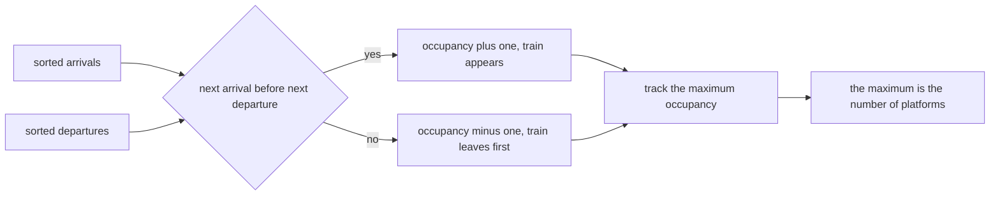
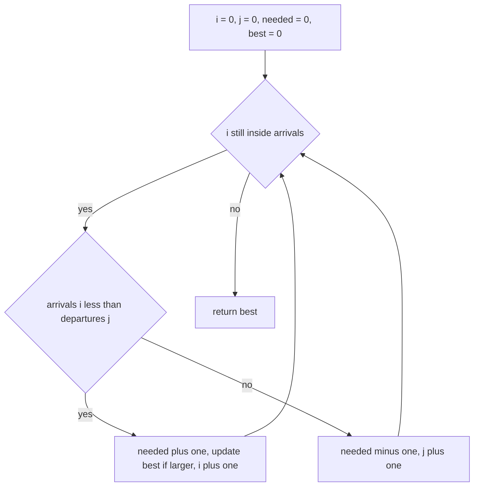
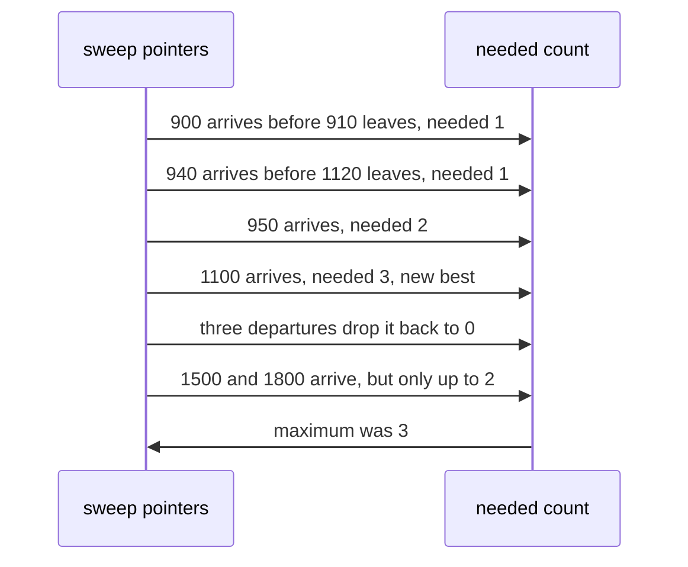

# 325 — Minimum number of platforms for trains (sweep-line).

> **Tier:** Intermediate · **CTCI chapter:** Beyond — Software Engineering & Tooling
> **Task spec:** [325-minimum-number-of-platforms-for-trains-sweep-line.md](../../../tasks/intermediate/325-minimum-number-of-platforms-for-trains-sweep-line.md)
> **Solutions:** [Python](../../../solutions/python/intermediate/325-minimum-number-of-platforms-for-trains-sweep-line/solution.py) ·
> [Java](../../../solutions/java/intermediate/325-minimum-number-of-platforms-for-trains-sweep-line/Solution.java) ·
> [JavaScript](../../../solutions/javascript/intermediate/325-minimum-number-of-platforms-for-trains-sweep-line/solution.js) ·
> [C#](../../../solutions/csharp/intermediate/325-minimum-number-of-platforms-for-trains-sweep-line/Solution.cs)

## 1. Problem restatement

**Input:** two parallel lists, `arrivals` and `departures`, of equal length. Entry `k` describes one
train: it arrives at `arrivals[k]` and departs at `departures[k]`.

**Output:** the minimum number of platforms the station needs so that no train ever waits for a
platform. Equivalently, the maximum number of trains present at the station at the same instant.

A train occupies its platform over the half-open interval `[arrival, departure)`, so **a train departing
at minute `t` frees its platform before any train arriving at `t` needs one**. That single tie rule is
what makes `min_platforms([1, 2], [2, 3]) == 1`.

| Call | Result | Why |
| --- | --- | --- |
| the 6-train schedule below | `3` | three trains overlap between 1100 and 1120 |
| `min_platforms([1, 2], [2, 3])` | `1` | release before acquire at minute 2 |
| `min_platforms([1, 1, 1], [2, 2, 2])` | `3` | three simultaneous arrivals |
| `min_platforms([5], [9])` | `1` | one train |
| `min_platforms([], [])` | `0` | empty schedule |

Both the sweep and the per-minute oracle are compared on 300 generated schedules.

## 2. Intuition

The naive idea is to simulate minute by minute: at each minute count how many trains are between their
arrival and departure, and take the maximum. It is correct, and it costs `O(range · n)` — fine for a
toy schedule, unusable when the coordinates are timestamps spread over a year.

The insight is that the occupancy only changes at **arrival and departure times**. Nothing happens
between events, so the maximum must be attained just after some arrival. That observation turns the
problem into a sweep over two sorted lists:

- Sort the arrivals and the departures separately.
- Walk both with two pointers `i` and `j`.
- If the next arrival is *strictly before* the next departure, a train appears: increment the occupancy
  and, if it is a new maximum, record it.
- Otherwise a train leaves: decrement the occupancy and advance the departure pointer.

The comparison `arrivals[i] < departures[j]` is the half-open convention in disguise. When the two
times are equal, the `else` branch fires and the departure is processed first, so a releasing train is
always accounted for before the arriving one takes its platform.



## 3. Algorithm

1. Sort `arrivals` and `departures` into `arr` and `dep`.
2. Set `i = 0`, `j = 0`, `needed = 0`, `best = 0`.
3. While `i` is still inside `arr`:
   1. If `arr[i] < dep[j]`, a train arrives before the next departure: `needed += 1`, and if
      `needed > best` then `best = needed`; advance `i`.
   2. Otherwise (including the equal case) a train leaves: `needed -= 1`, advance `j`.
4. Return `best`.

```text
procedure min_platforms(arrivals, departures)
    arr ← arrivals sorted
    dep ← departures sorted
    i ← 0
    j ← 0
    needed ← 0
    best ← 0
    while i < length(arr) do
        if arr[i] < dep[j] then
            needed ← needed + 1
            if needed > best then
                best ← needed
            end
            i ← i + 1
        else
            needed ← needed - 1
            j ← j + 1
        end
    end
    return best
end
```

The oracle `min_platforms_per_minute` materialises the occupancy at every integer minute from the first
arrival to the last departure and takes the maximum, using the same half-open test
`arrival ≤ minute < departure`. The sweep only visits `2n` events, while the oracle visits every minute
in the range, so the oracle is adequate for tests and impractical for real timestamps.



## 4. Worked example

The schedule asserted first in every file:

| Train | Arrival | Departure |
| --- | --- | --- |
| 0 | 900 | 910 |
| 1 | 940 | 1200 |
| 2 | 950 | 1120 |
| 3 | 1100 | 1130 |
| 4 | 1500 | 1900 |
| 5 | 1800 | 2000 |

Sorted arrivals: `900, 940, 950, 1100, 1500, 1800`. Sorted departures:
`910, 1120, 1130, 1200, 1900, 2000`.

| Step | `i`, `j` | Compare | Branch | `needed` | `best` |
| --- | --- | --- | --- | --- | --- |
| 1 | 0, 0 | `900 < 910` | arrival | 1 | 1 |
| 2 | 1, 0 | `940 < 910` false | departure | 0 | 1 |
| 3 | 1, 1 | `940 < 1120` | arrival | 1 | 1 |
| 4 | 2, 1 | `950 < 1120` | arrival | 2 | 2 |
| 5 | 3, 1 | `1100 < 1120` | arrival | 3 | 3 |
| 6 | 4, 1 | `1500 < 1120` false | departure | 2 | 3 |
| 7 | 4, 2 | `1500 < 1130` false | departure | 1 | 3 |
| 8 | 4, 3 | `1500 < 1200` false | departure | 0 | 3 |
| 9 | 4, 4 | `1500 < 1900` | arrival | 1 | 3 |
| 10 | 5, 4 | `1800 < 1900` | arrival | 2 | 3 |

The loop ends when `i` reaches 6, and the answer is 3. The peak sits between steps 5 and 6: trains 1
(`940–1200`), 2 (`950–1120`) and 3 (`1100–1130`) are all at the station, which is exactly the overlap
the per-minute oracle finds by scanning from 900 to 2000.



Step 2 is worth reading twice: the first train's departure at 910 happens *before* the second train
arrives at 940, so the pointer `j` advances while `needed` drops to zero. A version that compared
`arr[i] <= dep[j]` would reach the same answers whenever no two events share a timestamp, and would
silently over-count stations where a train leaves exactly when another arrives — the case the assertion
`min_platforms([1, 2], [2, 3]) == 1` pins down.

## 5. Complexity

Let `n` be the number of trains and `R` the span from the first arrival to the last departure.

| Measure | Bound | Why it holds |
| --- | --- | --- |
| Time | `O(n log n)` | two sorts dominate the linear sweep |
| Time, sweep only | `O(n)` | each pointer advances at most `n` times |
| Space | `O(n)` | the sorted copies; the algorithm itself needs two indices and two counters |
| Naive per-minute oracle | `O(R · n)` | every minute scans every train |
| Event-list variant | `O(n log n)` | identical asymptotics, sorting `2n` events instead of two lists |

The two-pointer sweep is slightly cheaper than an event-list sweep because it never builds the event
list: the sorted arrivals and sorted departures *are* the event streams, and the comparison decides
which stream supplies the next event. Both forms are preferred to the per-minute simulation for any
input where the coordinate range is not tiny.

## 6. Pitfalls and edge cases

- **Half-open occupancy.** A departure exactly at an arrival time releases first. The comparison
  `arr[i] < dep[j]` implements this; changing it to `<=` makes `min_platforms([1, 2], [2, 3])` return 2
  instead of 1.
- **The departure pointer never runs off the end.** The loop is driven by `i` and the number of arrivals
  equals the number of departures, so there is always a departure left to compare against when an
  arrival remains. With empty lists the loop does not run at all.
- **Empty schedule.** Both the sweep and the oracle return 0. The oracle has an explicit guard because
  `min()` of an empty sequence would raise.
- **Simultaneous arrivals.** `[[1,1,1],[2,2,2]]` needs three platforms: the equal-time arrivals each
  increment `needed` before any departure is processed.
- **Duplicate timestamps at the same instant.** When an arrival at `t` and a departure at `t` coincide,
  the departure is processed first, so the count can dip and rise within one step boundary. The peak
  recorded is still the true maximum occupancy because only arrivals raise the count.
- **Unsorted input.** The routine sorts internally, so the caller's ordering does not matter; the
  oracle reads the lists in their original order, which is fine because it looks at all minutes.
- **`best` is initialised to 0, not to `needed`.** With an empty schedule the answer must be 0, and
  with a single train it becomes 1 on the first arrival.
- **Coordinate scale.** The sweep works with arbitrary integers or timestamps; the oracle would need
  `R` iterations, one per minute of the schedule, which is why it stays a test-only helper.
- **One platform is often enough.** `min_platforms([1, 2], [2, 3])` is 1, because the two trains never
  occupy the station at the same instant under the half-open convention. Readers who assume closed
  intervals will predict 2 and be surprised.

## 7. Variants and follow-ups

- **Meeting rooms instead of platforms.**
  [326-meeting-rooms-required-interval-partitioning.md](326-meeting-rooms-required-interval-partitioning.md)
  is the same maximum-overlap question asked with a different phrasing, and its endpoint-event sweep
  encodes the identical half-open rule by letting an end sort before a start at the same coordinate.
- **Capacity instead of count.**
  [327-car-pooling-capacity-check-difference-array-sweep.md](327-car-pooling-capacity-check-difference-array-sweep.md)
  weighs each interval by a number of passengers and asks whether the running load ever exceeds a
  capacity — a difference array rather than a count.
- **Selecting rather than counting.**
  [324-interval-scheduling-to-maximize-number-of-non-overlapping-interv.md](324-interval-scheduling-to-maximize-number-of-non-overlapping-interv.md)
  is the packing version of the same inputs, and it takes the opposite tie convention: there, touching
  intervals conflict.
- **Merging the intervals.**
  [323-insert-interval-and-merge-intervals.md](323-insert-interval-and-merge-intervals.md) unifies the
  same inputs into disjoint ranges instead of measuring overlap.
- **Event sweeps beyond intervals.**
  [322-implement-algorithm-to-find-skyline-divide-conquer.md](322-implement-algorithm-to-find-skyline-divide-conquer.md)
  and [328-skyline-problem-heap-sweep-line.md](328-skyline-problem-heap-sweep-line.md) sweep the same
  kinds of boundaries while tracking a maximum height instead of a count.

## 8. Check yourself

1. Why does the answer equal the maximum overlap rather than some more complicated quantity?

<details><summary>Show answer</summary>

Because a schedule is feasible with `p` platforms precisely when no instant has more than `p` trains
present. If the maximum overlap is `m`, then `m` platforms suffice — assign each entering train any
platform whose previous occupant has left, which is always possible below `m` — and `m - 1` obviously do
not, since at the peak instant there are `m` trains needing `m` distinct platforms. So the two numbers
are equal.

</details>

2. Why is the arrival comparison strict (`<`) rather than inclusive (`<=`)?

<details><summary>Show answer</summary>

Because occupancy is half-open: a train is present on `[arrival, departure)`, so a train departing at
minute `t` is already gone when a train arriving at `t` appears. The strict `arr[i] < dep[j]` sends the
equal case into the `else` branch, processing the departure first. With `<=`, `min_platforms([1,2],[2,3])`
would report 2 platforms where 1 is enough.

</details>

3. Why can the sweep ignore the minute-by-minute timeline?

<details><summary>Show answer</summary>

Because occupancy is a step function that only changes at arrival and departure times. Between two
consecutive events nothing changes, so the maximum is attained immediately after some event, and the
sweep visits exactly those `2n` events. Simulating every minute in between would compute the same
function on a finer grid, at `O(R · n)` cost.

</details>

4. What is the answer for `[[900,910],[900,910]]` written as `min_platforms([900,900],[910,910])`?

<details><summary>Show answer</summary>

2. Both arrivals happen before either departure, so the first comparison takes the arrival branch twice
and `needed` reaches 2 before the departures bring it back to 0. The `[[1,1,1],[2,2,2]] == 3` assertion
is the three-train version of the same situation.

</details>

5. The oracle returns the same number. Why is the two-pointer version still the right answer for the
task?

<details><summary>Show answer</summary>

Because the oracle's cost depends on the *range* of the timestamps, not on the number of trains. In the
worked example the oracle scans about 1100 minutes; with real-world timestamps the span can be years
while the number of trains stays small. The two-pointer sweep costs `O(n log n)` and is independent of
how far apart the events are, which is exactly what a sweep-line algorithm is for.

</details>
