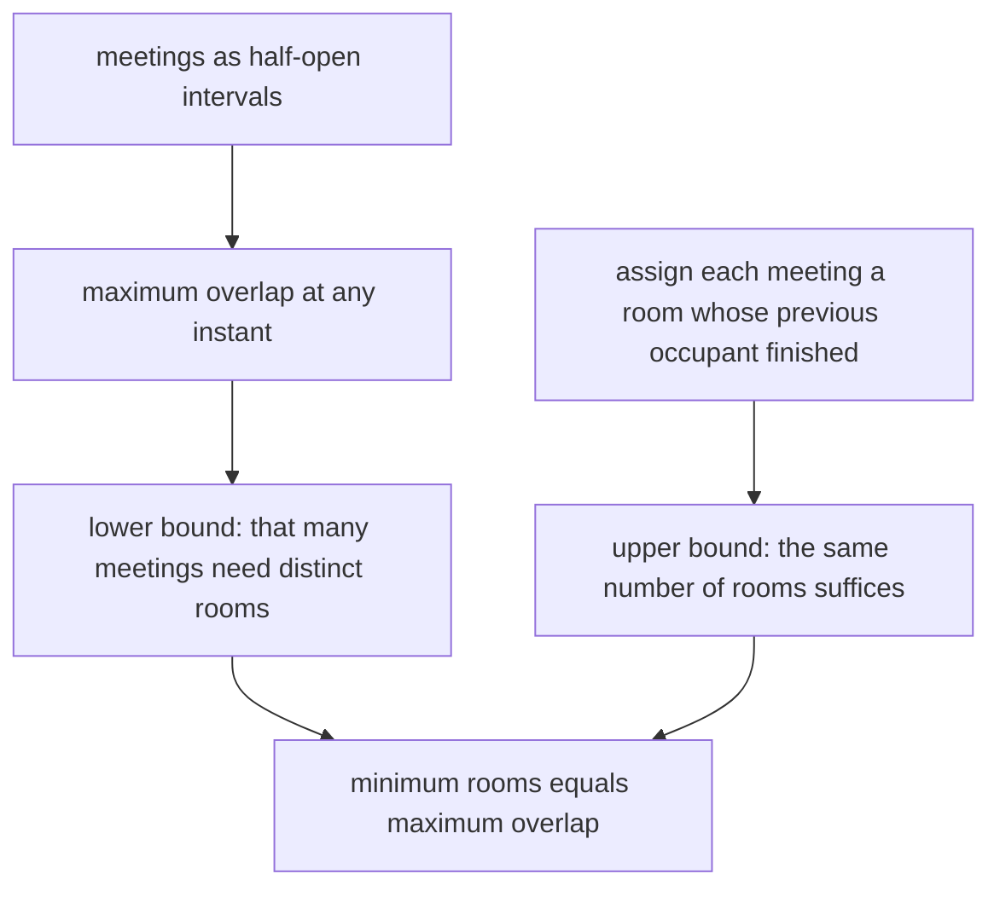
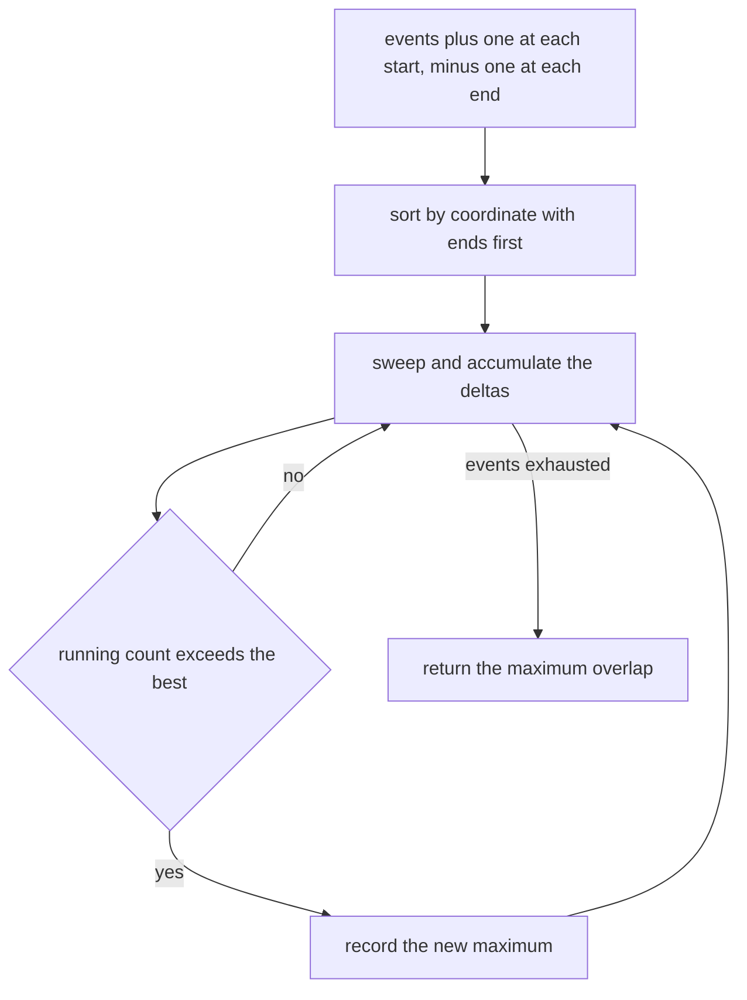
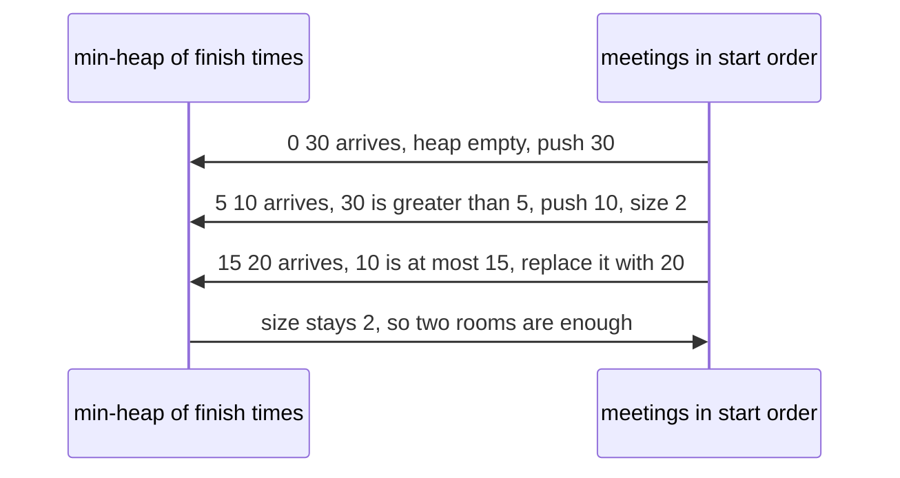

# 326 — Meeting rooms required (interval partitioning).

> **Tier:** Intermediate · **CTCI chapter:** Ch 1 — Arrays and Strings
> **Task spec:** [326-meeting-rooms-required-interval-partitioning.md](../../../tasks/intermediate/326-meeting-rooms-required-interval-partitioning.md)
> **Solutions:** [Python](../../../solutions/python/intermediate/326-meeting-rooms-required-interval-partitioning/solution.py) ·
> [Java](../../../solutions/java/intermediate/326-meeting-rooms-required-interval-partitioning/Solution.java) ·
> [JavaScript](../../../solutions/javascript/intermediate/326-meeting-rooms-required-interval-partitioning/solution.js) ·
> [C#](../../../solutions/csharp/intermediate/326-meeting-rooms-required-interval-partitioning/Solution.cs)

## 1. Problem restatement

**Input:** a list of meetings `[start, end]`.

**Output:** the minimum number of rooms needed so that no two meetings that overlap share a room. This is
*interval partitioning*, the dual of the interval-scheduling problem: there, the number of intervals is
maximised under a conflict rule; here, the number of resources is minimised under a coverage rule.

Meetings are **half-open**, `[start, end)`, so a meeting ending exactly when another starts reuses the
same room — `min_meeting_rooms([[1,2],[2,3],[3,4]]) == 1`.

| Call | Result | Why |
| --- | --- | --- |
| `min_meeting_rooms([[0,30],[5,10],[15,20]])` | `2` | `[5,10]` and `[15,20]` share a room inside `[0,30]` |
| `min_meeting_rooms([[7,10],[2,4]])` | `1` | disjoint |
| `min_meeting_rooms([[1,2],[2,3],[3,4]])` | `1` | back-to-back meetings share one room |
| `min_meeting_rooms([[1,5],[2,6],[3,7]])` | `3` | all three overlap |
| `min_meeting_rooms([])` | `0` | nothing scheduled |
| `min_rooms_heap([[0,30],[5,10],[15,20]])` | `2` | the independent heap implementation agrees |

The event sweep and the heap sweep are both checked against `min_rooms_per_minute`, a per-minute brute
force, on 300 generated interval sets.

## 2. Intuition

The lower bound is immediate: if `m` meetings overlap at some instant, they all need distinct rooms, so
the answer is at least the maximum overlap. The pleasant surprise is that this bound is *achievable* —
the minimum number of rooms **equals** the maximum overlap, which is why both shipped implementations
compute a maximum rather than performing any assignment.

The proof of achievability is the assignment argument: process the meetings in start order and give each
one any room whose previous occupant has already finished. If `m` is the maximum overlap, then when a
meeting starts there are at most `m - 1` other meetings alive, so at least one of `m` rooms is free. No
greedy choice can paint you into a corner, because rooms are interchangeable.

Two ways to compute the maximum overlap are shipped:

1. **Endpoint events.** Turn every start into `(start, +1)` and every end into `(end, -1)`, sort by
   `(x, delta)` so that `-1` (an end) precedes `+1` (a start) at the same coordinate, then sweep and
   track the running sum. The order within a coordinate is what encodes the half-open convention.
2. **Heap of finish times.** Sort by start; keep a min-heap of the finish times of meetings currently
   holding a room. Before assigning a room to the next meeting, evict every finish time `≤ start` — those
   rooms became free. The heap size at the end is the answer.



## 3. Algorithm

**Event sweep.**

1. For each meeting `[start, end]`, append the events `(start, +1)` and `(end, -1)`.
2. Sort the events by `(coordinate, delta)`, which places the ends before the starts at equal
   coordinates.
3. Sweep in order: add the delta to `rooms`, and whenever `rooms` exceeds `best`, record it.
4. Return `best`.

**Heap sweep.**

5. Sort the meetings by start.
6. Keep a min-heap of finish times, initially empty.
7. For each meeting in order: if the heap is non-empty and its smallest finish time is `≤ start`, the
   room is free — replace that entry with the new finish time. Otherwise push the new finish time; a new
   room is needed.
8. Return the heap size.

```text
procedure min_meeting_rooms(intervals)
    events ← empty list
    for each (start, end) in intervals do
        append (start, +1) to events
        append (end, -1) to events
    end
    sort events by coordinate then by delta
    rooms ← 0
    best ← 0
    for each (x, delta) in events do
        rooms ← rooms + delta
        if rooms > best then
            best ← rooms
        end
    end
    return best
end

procedure min_rooms_heap(intervals)
    heap ← empty min-heap of finish times
    for each (start, end) in intervals sorted by start do
        if heap is not empty and smallest element of heap ≤ start then
            replace the smallest element with end
        else
            push end onto heap
        end
    end
    return size of heap
end
```

The bruteforce oracle counts live meetings at every minute from the earliest start to the latest end,
using the same half-open test `start ≤ t < end`. Its cost depends on the *span* of the coordinates, which
is why the files describe it as an oracle for small coordinates.



## 4. Worked example

Take `[[0,30],[5,10],[15,20]]`. The events are `(0,+1)`, `(30,-1)`, `(5,+1)`, `(10,-1)`, `(15,+1)`,
`(20,-1)`, and sorting by `(x, delta)` gives:

| Step | Event | `rooms` after | `best` | Comment |
| --- | --- | --- | --- | --- |
| 1 | `(0, +1)` | 1 | 1 | the long meeting starts |
| 2 | `(5, +1)` | 2 | 2 | a second meeting starts inside it |
| 3 | `(10, -1)` | 1 | 2 | the second meeting ends |
| 4 | `(15, +1)` | 2 | 2 | a third one starts, still inside the first |
| 5 | `(20, -1)` | 1 | 2 | the third ends |
| 6 | `(30, -1)` | 0 | 2 | the long meeting ends |

Two rooms suffice: `[5,10]` and `[15,20]` never overlap each other, and both fit inside the room
occupied by `[0,30]`. The per-minute oracle finds the maximum 2 by scanning minutes 0 through 30.

The heap implementation reaches the same number differently:

| Step | Meeting | Heap before | Test | Action | Heap after |
| --- | --- | --- | --- | --- | --- |
| 1 | `[0,30]` | `[]` | empty | push 30 | `[30]` |
| 2 | `[5,10]` | `[30]` | `30 ≤ 5`? no | push 10 | `[10,30]` |
| 3 | `[15,20]` | `[10,30]` | `10 ≤ 15`? yes | replace 10 by 20 | `[20,30]` |

The heap size ends at 2. Step 3 is the reuse: `[15,20]` takes the room vacated by `[5,10]` at minute 10,
which the `heap[0] <= start` test detects because 10 is at most 15. The same test is what makes
`[[1,2],[2,3],[3,4]]` fit in one room: at `start = 2` the smallest finish time is exactly 2, the eviction
fires, and the heap never grows past size 1.



## 5. Complexity

Let `n` be the number of meetings and `R` the span from the first start to the last end.

| Measure | Bound | Why it holds |
| --- | --- | --- |
| Event sweep time | `O(n log n)` | sorting `2n` events, then one linear pass |
| Event sweep space | `O(n)` | the event list |
| Heap sweep time | `O(n log n)` | one sort plus `O(log n)` heap operations per meeting |
| Heap sweep space | `O(n)` | the heap, whose final size is the answer |
| Per-minute oracle | `O(R · n)` | every minute rescans every meeting |
| Assignment actually needed | `O(n log n)` too | the eviction rule is the assignment, with rooms interchangeable |

Both shipped algorithms are `O(n log n)`, and both stop at the count: neither needs to record which room
served which meeting, because the count is the whole answer. That is another reason the maximum-overlap
formulation is the right one to implement.

## 6. Pitfalls and edge cases

- **Half-open meetings.** `[1,2]` and `[2,3]` share one room. The event sweep gets this from sorting
  `-1` before `+1` at equal coordinates; the heap gets it from the `≤` in `heap[0] <= start`. Change
  either to a strict comparison and `[[1,2],[2,3],[3,4]]` needs three rooms instead of one.
- **Empty input.** Both implementations return 0; the per-minute oracle needs an explicit guard because
  `min()` over an empty sequence is an error.
- **All overlaps.** `[[1,5],[2,6],[3,7]]` gives 3 — the maximum is attained in the middle, not at an
  endpoint of the whole list.
- **Nested meetings.** `[[0,30],[5,10],[15,20]]` shows that the peak can be created by two short meetings
  nested inside one long one; only two rooms are needed even though the long meeting spans everything.
- **Duplicate intervals.** Two identical meetings need two rooms, since both are alive in between.
  Nothing in either implementation deduplicates.
- **Degenerate meetings.** A meeting with `start == end` covers no instant under the half-open rule; the
  event sweep sees `+1` then `-1` at the same coordinate and, because `-1` sorts first, the sum goes to
  `-1` and back rather than up. Such inputs are not exercised by the assertions but are consistent.
- **The heap must evict before pushing.** Testing after the push would count a meeting against itself.
- **`heapreplace` versus `heappush`.** The Python code uses `heapq.heapreplace` when a room is free — it
  pops the smallest finish and pushes the new one in a single operation, keeping the heap valid. Pushing
  first and popping afterwards would temporarily inflate the size without changing the final answer, but
  it makes the invariant "heap size = rooms in use" false in between.
- **The answer is not the number of overlapping *pairs*.** `[[1,5],[2,6],[3,7]]` has three overlapping
  pairs and three live meetings at once; the answer is the latter. Counting pairs is a different and
  common mistake.
- **Coordinate scale.** The event sweep and the heap both ignore the magnitude of the coordinates, while
  the oracle would iterate over every minute of the span.

## 7. Variants and follow-ups

- **Platforms at a station.** [325-minimum-number-of-platforms-for-trains-sweep-line.md](325-minimum-number-of-platforms-for-trains-sweep-line.md)
  asks the identical question with a two-pointer sweep over sorted arrivals and departures and the same
  half-open convention.
- **Weighted overlap (capacity).** [327-car-pooling-capacity-check-difference-array-sweep.md](327-car-pooling-capacity-check-difference-array-sweep.md)
  gives each interval a weight and asks whether the running total ever exceeds a capacity, which is the
  same sweep with a threshold test instead of a maximum.
- **The packing dual.** [324-interval-scheduling-to-maximize-number-of-non-overlapping-interv.md](324-interval-scheduling-to-maximize-number-of-non-overlapping-interv.md)
  selects the largest conflict-free subset of the same kind of input — and takes the *opposite* tie
  convention, where touching intervals conflict.
- **Merging instead of partitioning.** [323-insert-interval-and-merge-intervals.md](323-insert-interval-and-merge-intervals.md)
  collapses overlapping intervals into disjoint ranges, which is the complementary view of overlap.
- **Sweeps with heights.** [328-skyline-problem-heap-sweep-line.md](328-skyline-problem-heap-sweep-line.md)
  runs a heap sweep over the same kind of boundaries, tracking a maximum height with lazy deletion
  instead of a live count.

## 8. Check yourself

1. Prove that the minimum number of rooms equals the maximum overlap.

<details><summary>Show answer</summary>

The lower bound is that `m` simultaneously live meetings need `m` distinct rooms. For the upper bound,
process meetings in start order and assign each to any room whose last occupant has finished. Just before
a meeting starts, at most `m - 1` other meetings are alive, so among `m` rooms at least one is free —
unless that meeting itself pushes the live count to `m`, in which case one free room still exists among
the `m`. So `m` rooms always suffice, and the two quantities are equal.

</details>

2. Why does an end event sort before a start event at the same coordinate?

<details><summary>Show answer</summary>

Because meetings are half-open, so a meeting ending at `x` has already released its room when another
meeting starting at `x` claims one. Packing `-1` before `+1` in the sort key means the sweep subtracts
before it adds, keeping the running count at the true occupancy. Sorting starts first would report a peak
that never occurs.

</details>

3. What does the heap actually contain during the heap sweep?

<details><summary>Show answer</summary>

The finish times of the meetings that currently hold a room, one entry per occupied room. Its size is the
number of rooms in use at the current start time, and the maximum size over the run is the answer. The
eviction test `heap[0] <= start` removes rooms whose occupant has already finished — again the half-open
convention, this time as an inclusive comparison on the finish side.

</details>

4. `[[0,30],[5,10],[15,20]]` returns 2, not 3. Where does the reuse happen?

<details><summary>Show answer</summary>

The two short meetings are disjoint, so they can share a room: `[5,10]` ends at 10 and `[15,20]` starts at
15. In the heap trace the reuse is the replacement of finish time 10 by 20 at step 3; in the event sweep
it is the drop from 2 back to 1 at minute 10 before the rise to 2 at minute 15, which never exceeds the
earlier maximum.

</details>

5. When is the per-minute oracle acceptable, and when is it not?

<details><summary>Show answer</summary>

It is acceptable when coordinates are small integers with a narrow span, as in the fuzz tests where
starts are below 30 and lengths below 10. It is unusable when coordinates are timestamps spread over
years, because its cost is the span times the number of meetings. The sweep algorithms do not care how
far apart the coordinates are: they only sort the `2n` endpoints.

</details>
