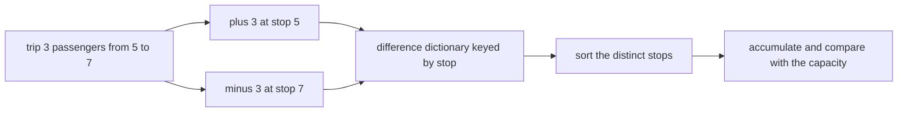
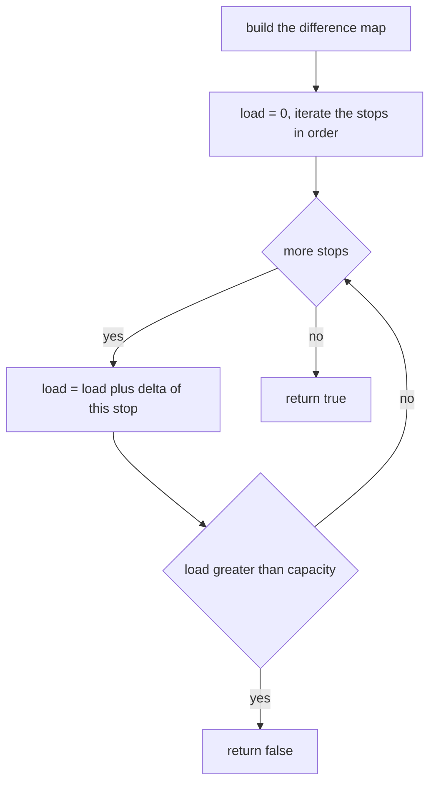
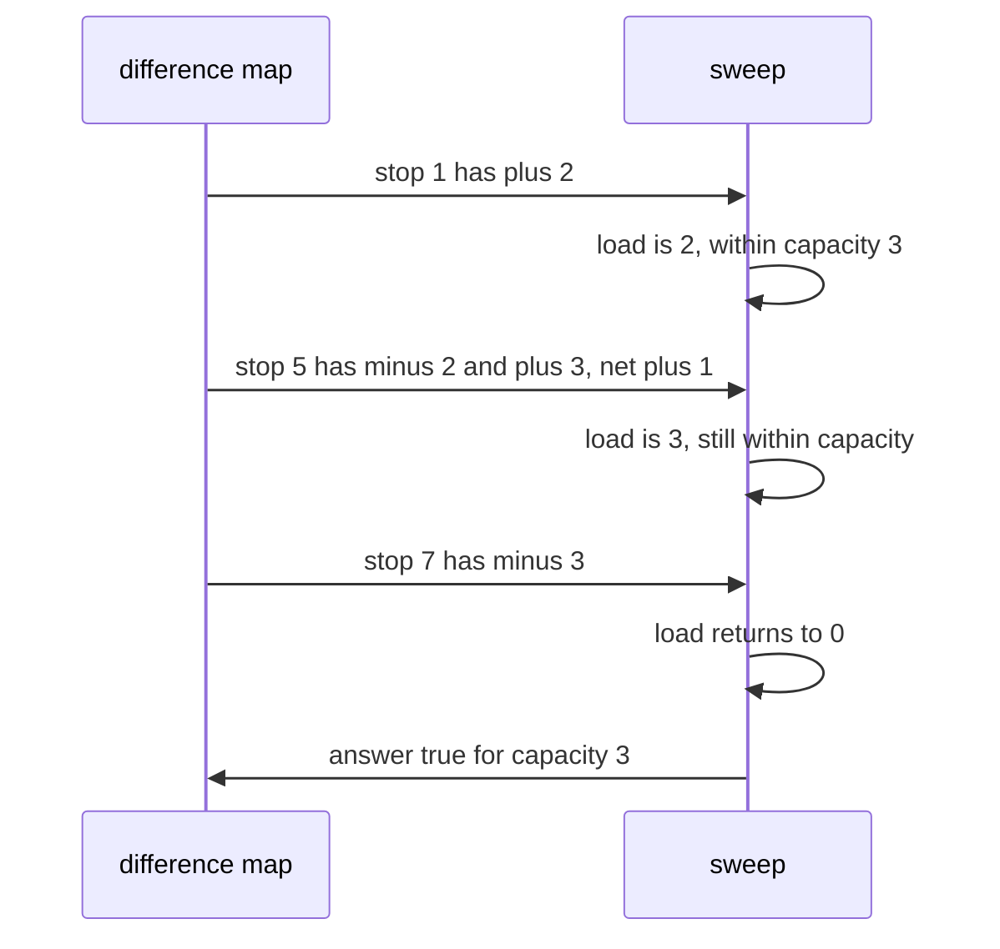

# 327 — Car pooling capacity check (difference array / sweep).

> **Tier:** Intermediate · **CTCI chapter:** Ch 1 — Arrays and Strings
> **Task spec:** [327-car-pooling-capacity-check-difference-array-sweep.md](../../../tasks/intermediate/327-car-pooling-capacity-check-difference-array-sweep.md)
> **Solutions:** [Python](../../../solutions/python/intermediate/327-car-pooling-capacity-check-difference-array-sweep/solution.py) ·
> [Java](../../../solutions/java/intermediate/327-car-pooling-capacity-check-difference-array-sweep/Solution.java) ·
> [JavaScript](../../../solutions/javascript/intermediate/327-car-pooling-capacity-check-difference-array-sweep/solution.js) ·
> [C#](../../../solutions/csharp/intermediate/327-car-pooling-capacity-check-difference-array-sweep/Solution.cs)

## 1. Problem restatement

**Input:** a list of trips, each `[passengers, start, end]`, and a vehicle `capacity`. A trip means
`passengers` people board at stop `start` and get off at stop `end`, occupying the vehicle over
`[start, end)`.

**Output:** `true` if every trip can be served without the load ever exceeding `capacity`, otherwise
`false`. The route runs in one direction, so passengers never get off before the stop where they boarded.

The tie rule matters: **passengers get off before the next ones get on at the same stop**. A trip ending
at stop `x` frees its seats for a trip starting at `x`, which is why
`car_pooling([[2,1,5],[3,5,7]], 3)` is `true` even though the two trips meet at stop 5.

| Call | Result | Why |
| --- | --- | --- |
| `car_pooling([[2,1,5],[3,3,7]], 4)` | `false` | the load reaches 5 between 3 and 5 |
| `car_pooling([[2,1,5],[3,3,7]], 5)` | `true` | 5 fits exactly |
| `car_pooling([[2,1,5],[3,5,7]], 3)` | `true` | at stop 5 the pair drops to 2 before the three board |
| `car_pooling([[2,1,5],[3,5,7]], 2)` | `false` | the peak of 3 exceeds 2 |
| `car_pooling([], 0)` | `true` | no trips, nothing to check |
| `car_pooling([[1,0,1]], 0)` | `false` | one passenger with a capacity of zero |

The sweep is cross-checked against `car_pooling_bruteforce`, which materialises the load at every stop,
on 300 generated trip lists.

## 2. Intuition

The straightforward check walks the route stop by stop, adding each trip's passengers to every stop it
covers, and asks whether any stop exceeds the capacity. That is `O(total span)` work — one increment per
trip per stop — and it is wasteful in exactly the same way as the per-minute oracles of the neighbouring
tasks: the load only changes at stops where something happens.

A **difference array** fixes that. For each trip, record two numbers:

- `+passengers` at `start`,
- `−passengers` at `end`.

Then sweep the *distinct stops* in increasing order, accumulating the deltas. The running total after
each stop is the load on the segment that begins there, and the answer is `false` the moment that total
exceeds the capacity. Each trip contributes exactly two entries instead of one per stop it spans.

The same dictionary also implements the tie rule for free. When a trip ends at stop 5 and another starts
at stop 5, both deltas land on the key 5 and are summed: `−2 + 3 = +1`. The sweep applies the net change
once and then measures, so the load is evaluated *after* the drop and the pickup — which is precisely
"passengers get off before the next ones get on".



## 3. Algorithm

1. Build an empty dictionary `delta` mapping a stop to a signed change in load.
2. For each trip `[passengers, start, end]`:
   - `delta[start] += passengers`,
   - `delta[end] -= passengers`.
   Adding rather than assigning is essential: several trips may share a stop.
3. Set `load = 0`.
4. For each stop in `sorted(delta)`:
   1. `load += delta[stop]`.
   2. If `load > capacity`, return `false` immediately.
5. Return `true`.

```text
procedure car_pooling(trips, capacity)
    delta ← empty map from stop to integer
    for each (passengers, start, end) in trips do
        delta[start] ← delta[start] + passengers
        delta[end] ← delta[end] - passengers
    end
    load ← 0
    for each stop in the keys of delta sorted ascending do
        load ← load + delta[stop]
        if load > capacity then
            return false
        end
    end
    return true
end
```

The oracle `car_pooling_bruteforce` builds an explicit array of loads over `[min start, max end)` and
adds each trip's passengers to `loads[stop - lo]` for `stop` from `start` to `end - 1`. It is the same
semantics with a different representation, which is what makes it a useful independent check on the 300
random trials.



## 4. Worked example

Trip list `[[2,1,5],[3,3,7]]`, the first case asserted in every file. The difference map is built as
follows:

| Trip | Stop 1 | Stop 3 | Stop 5 | Stop 7 |
| --- | --- | --- | --- | --- |
| `2 passengers from 1 to 5` | `+2` | | `−2` | |
| `3 passengers from 3 to 7` | | `+3` | | `−3` |
| summed delta | `+2` | `+3` | `−2` | `−3` |

Sweeping the stops in order with `capacity = 4`:

| Stop | Delta | `load` after | Exceeds 4? |
| --- | --- | --- | --- |
| 1 | `+2` | 2 | no |
| 3 | `+3` | 5 | **yes** → return `false` |

With `capacity = 5` the same sweep passes stop 3 with `load = 5`, continues to stop 5 where the load
drops to 3, then to stop 7 where it reaches 0, and returns `true`. The peak is the value 5, which is
visible directly in the third column.

Now the touching case `[[2,1,5],[3,5,7]]`, where the interesting thing is the shared stop:

| Stop | Contributions | Summed delta | `load` after | Comment |
| --- | --- | --- | --- | --- |
| 1 | `+2` | `+2` | 2 | the first trip boards |
| 5 | `−2` and `+3` | `+1` | 3 | two people leave *before* three board |
| 7 | `−3` | `−3` | 0 | the second trip ends |

The peak is 3, so `capacity = 3` returns `true` and `capacity = 2` returns `false`. Both assertions are
in the file. Note that the load never becomes `−2 + 3 = 1` as a separate step: the dictionary can only
hold one value per stop, so the two changes are necessarily applied together, which is exactly the
behaviour the problem wants.



## 5. Complexity

Let `n` be the number of trips and `D` the number of distinct stops (at most `2n`).

| Measure | Bound | Why it holds |
| --- | --- | --- |
| Build | `O(n)` | two dictionary updates per trip |
| Sort | `O(D log D)` | sorting the distinct stops |
| Sweep | `O(D)` | one accumulation per distinct stop |
| Total time | `O(n log n)` | `D ≤ 2n`, so the sort dominates |
| Space | `O(D)` | the difference map; no per-stop array |
| Brute force oracle | `O(span)` | one increment per trip per stop of its span |
| Early exit | as soon as a stop exceeds the capacity | a `false` answer often costs far less than a full sweep |

The reason the difference representation wins is that its cost follows the number of *events*, not the
number of stops the route covers. A trip from stop 1 to stop 10 000 costs two dictionary entries and two
accumulations, while the brute force would touch ten thousand array slots for that single trip.

## 6. Pitfalls and edge cases

- **Off-by-one on the end stop.** The drop is recorded `at` the end stop, not at `end - 1`, and the
  half-open convention means the load for the segment ending at `end` excludes those passengers. In the
  brute force this appears as `range(start, end)` — the last stop is not included.
- **Deltas must accumulate, not overwrite.** Two trips starting at the same stop must add up. Using an
  assignment (`delta[start] = passengers`) silently drops the earlier trip and the check passes when it
  should fail.
- **Touching trips do not clash.** At stop 5 the pair in the worked example nets to `+1`; the load is
  measured after the net change, so it reaches 3 rather than 5. The `[[2,1,5],[3,5,7]]` pair with
  capacity 3 and 2 pins this down.
- **Empty trip list.** The loop over `sorted(delta)` never runs and the routine returns `true`; the
  assertion is `car_pooling([], 0) is True`. The oracle handles it separately, returning `capacity >= 0`,
  because materialising a range from an empty list would fail.
- **Zero capacity.** `car_pooling([[1,0,1]], 0)` is `false`: the load becomes 1 at stop 0 and exceeds 0
  before any drop is applied.
- **Check after applying, not before.** `load` is updated and then compared. Comparing before the update
  would miss the very stop that breaks the capacity, because the update is what raises the load.
- **Early return is safe.** Once the load exceeds the capacity, no later stop can undo the violation for
  the trips already on board, since drops are non-negative in effect. Returning `false` immediately is
  therefore correct and faster.
- **Stops need not be contiguous or small.** The map is keyed by stop value, so a route with stops
  `1, 5, 1000000` behaves identically to one with consecutive stops; there is no array indexed by stop.
- **Passenger counts are positive in the tests.** A negative `passengers` value would make the model
  meaningless, and the generator produces values in `1..6`. The routine itself would still process the
  arithmetic faithfully.
- **Both boundaries of a trip can coincide with other trips.** The dictionary handles any number of
  changes at one stop; no special case is needed for three or more trips sharing a stop.

## 7. Variants and follow-ups

- **Count instead of capacity.** [326-meeting-rooms-required-interval-partitioning.md](326-meeting-rooms-required-interval-partitioning.md)
  is the same sweep with every weight equal to 1 and no threshold: it asks for the maximum overlap
  rather than comparing against a limit.
- **Platforms at a station.** [325-minimum-number-of-platforms-for-trains-sweep-line.md](325-minimum-number-of-platforms-for-trains-sweep-line.md)
  uses the identical half-open convention with two sorted pointer lists instead of a map.
- **A boolean answer versus a maximum.** The difference array here stops at the first violation, so the
  answer is `true` or `false`; the meeting-room version must sweep everything to report a number.
- **Selection under conflict.** [324-interval-scheduling-to-maximize-number-of-non-overlapping-interv.md](324-interval-scheduling-to-maximize-number-of-non-overlapping-interv.md)
  maximises the number of trips instead, under the opposite tie rule where touching conflicts.
- **Difference arrays beyond intervals.** The same technique answers range-add and range-max queries and
  is the standard tool for offline range updates; [322-implement-algorithm-to-find-skyline-divide-conquer.md](322-implement-algorithm-to-find-skyline-divide-conquer.md)
  shows the height-valued cousin whose sweep tracks a maximum rather than a sum.

## 8. Check yourself

1. Why does the difference array need only two entries per trip?

<details><summary>Show answer</summary>

Because the load is constant between a trip's start and end. Adding `+p` at the start and `−p` at the end
makes the accumulated total equal to the load on every segment, without touching the intermediate stops.
The sweep reconstructs the whole load profile from those `2n` numbers, and the intermediate stops simply
never appear in the map.

</details>

2. How does the dictionary encode "passengers get off before the next ones get on"?

<details><summary>Show answer</summary>

Every change at a stop is summed into one value. A trip ending at stop 5 contributes `−2` and a trip
starting at 5 contributes `+3`, so the key 5 holds `+1`. The sweep adds that single number and then
compares with the capacity, so the load is measured after both changes have been applied — the departing
passengers are already gone when the boarding ones are counted.

</details>

3. Why is `car_pooling([[2,1,5],[3,5,7]], 3)` true while `car_pooling([[2,1,5],[3,3,7]], 4)` is false?

<details><summary>Show answer</summary>

In the first case the trips meet only at stop 5, where the first trip's passengers leave before the second
trip's board, so the load peaks at 3. In the second case the second trip boards at stop 3 while the first
is still on board: the load is 2 at stop 1 and 5 at stop 3, which already exceeds the capacity of 4. The
difference is entirely about whether the two trips overlap between stops.

</details>

4. What does the brute-force oracle do differently, and why is it still a valid check?

<details><summary>Show answer</summary>

It materialises an explicit array of loads, adding each trip's passengers to every stop of its span via
`range(start, end)`, then takes the maximum and compares with the capacity. It reaches the same
definition of load — passengers present on `[start, end)` — through a different mechanism, so agreement
on 300 random inputs is genuine evidence rather than a restatement of the same code. Its cost depends on
the span, which is why the shipped solution does not use it.

</details>

5. What happens if two trips share a start stop but the deltas are assigned rather than accumulated?

<details><summary>Show answer</summary>

The second assignment overwrites the first, so the load at that stop is understated. In the fuzz corpus,
where several trips routinely share a start, the check would pass where the oracle says it must fail —
which is exactly the kind of bug the 300-trial comparison against `car_pooling_bruteforce` is there to
catch. The fix is `delta[stop] = delta.get(stop, 0) + change`, which is what every file does.

</details>
