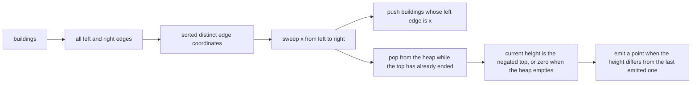
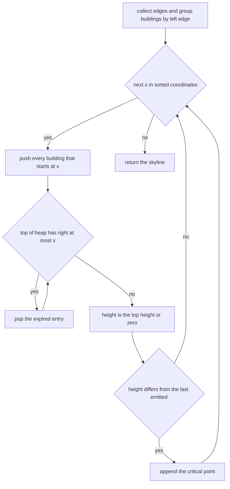
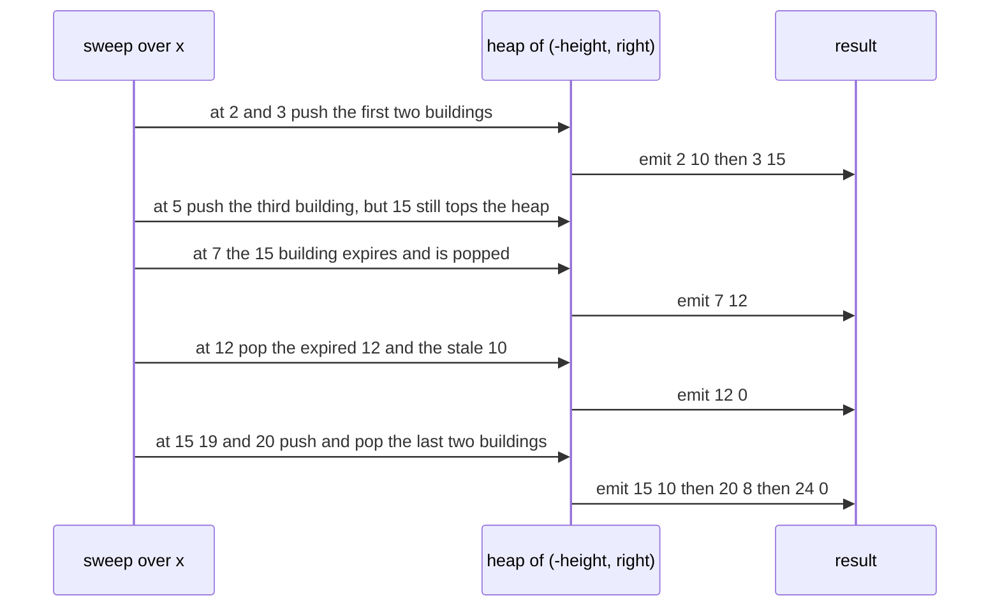

# 328 — Skyline problem (heap + sweep line).

> **Tier:** Intermediate · **CTCI chapter:** Beyond — Graphics, Geometry & Robotics
> **Task spec:** [328-skyline-problem-heap-sweep-line.md](../../../tasks/intermediate/328-skyline-problem-heap-sweep-line.md)
> **Solutions:** [Python](../../../solutions/python/intermediate/328-skyline-problem-heap-sweep-line/solution.py) ·
> [Java](../../../solutions/java/intermediate/328-skyline-problem-heap-sweep-line/Solution.java) ·
> [JavaScript](../../../solutions/javascript/intermediate/328-skyline-problem-heap-sweep-line/solution.js) ·
> [C#](../../../solutions/csharp/intermediate/328-skyline-problem-heap-sweep-line/Solution.cs)

## 1. Problem restatement

**Input:** a list of buildings, each `[left, right, height]`. A building is active on `[left, right)` —
it appears at its left edge and disappears at its right edge.

**Output:** the skyline as critical points `[x, height]` in increasing `x`, one point per position where
the visible height changes. The first left edge always produces a point, and the last right edge always
produces a height of 0. An empty input yields an empty list.

| Call | Result | Why |
| --- | --- | --- |
| `[[2,9,10],[3,7,15],[5,12,12],[15,20,10],[19,24,8]]` | `[[2,10],[3,15],[7,12],[12,0],[15,10],[20,8],[24,0]]` | the canonical example |
| `[[0,2,5],[2,4,7]]` | `[[0,5],[2,7],[4,0]]` | the taller neighbour takes over at the shared edge |
| `[[0,2,5],[5,8,3]]` | `[[0,5],[2,0],[5,3],[8,0]]` | a gap returns to height 0 |
| `[]` | `[]` | nothing to draw |

The file ships **two** implementations. `skyline_heap` is the subject of this tutorial: a sweep over the
sorted edge coordinates with a max-heap of active buildings. `skyline_divide_conquer` — the subject of
[322](322-implement-algorithm-to-find-skyline-divide-conquer.md) — is included here as the cross-check,
and the tests require the two to agree on 300 randomly generated building sets.

## 2. Intuition

At any horizontal position `x`, the visible height is the maximum height among the buildings that
**cover** `x`. The whole problem is therefore: find every `x` where that maximum changes.

Since each building's coverage is a single interval, the set of active buildings only changes at its two
edges. So sweep the sorted set of all edges — every `left` and every `right` — and maintain the active
set as a multiset of heights. The two operations are symmetric:

- at a `left` edge, a building **enters** the active set;
- at a `right` edge, a building **leaves** it.

The current height is the maximum of the multiset, and a critical point is emitted whenever that maximum
differs from the last emitted height.

Two implementation details make this practical:

1. **A max-heap keyed by `(-height, right)`.** Python's `heapq` is a min-heap, so heights are negated to
   get a max-heap. The `right` coordinate is the tiebreaker and, more importantly, the **expiry stamp**:
   the top entry may have already ended.
2. **Lazy deletion.** A building that is still in the heap but has passed its right edge is simply
   ignored — and popped — whenever it reaches the top. There is no need to search the heap for it at the
   moment it ends, because an expired entry can never change the maximum: if it were the tallest active
   entry, it would be at the top, and the sweep pops it before reading the height.



## 3. Algorithm

1. If the building list is empty, return an empty list.
2. Build two structures: `starts`, a map from a left coordinate to the list of `(right, height)` pairs
   that begin there, and `xs`, the set of every left and every right coordinate.
3. Initialise an empty heap (storing `(-height, right)` entries) and an empty result list.
4. For each `x` in `sorted(xs)`:
   1. Push `(-height, right)` for every building starting at `x`.
   2. While the heap is non-empty and the top entry's `right` is `≤ x`, pop it — that building has
      finished by the time the sweep reaches `x`.
   3. The current height is `-heap[0][0]` when the heap is non-empty, otherwise 0.
   4. If the result is empty or its last height differs from the current height, append `[x, height]`.
5. Return the result.

```text
procedure skyline_heap(buildings)
    if buildings is empty then
        return empty list
    end
    starts ← empty map from coordinate to list of (right, height)
    xs ← empty set of coordinates
    for each (left, right, height) in buildings do
        append (right, height) to starts[left]
        add left to xs
        add right to xs
    end
    heap ← empty max-heap of (height, right) pairs, stored as (-height, right)
    result ← empty list
    for each x in xs sorted ascending do
        for each (right, height) in starts[x] do
            push (-height, right) onto heap
        end
        while heap is not empty and the right coordinate of the top entry ≤ x do
            pop the top entry
        end
        if heap is empty then
            height ← 0
        else
            height ← -height component of the top entry
        end
        if result is empty or the height of the last result point ≠ height then
            append [x, height] to result
        end
    end
    return result
end
```

The cross-check implementation is the recursive divide-and-conquer of task 322: split the buildings in
half, solve each side, and merge two x-sorted skylines in one linear pass using `max` of the two current
heights. The two approaches share no code, so comparing them is a real test.



## 4. Worked example

Sweep the canonical buildings `A[2,9,10]`, `B[3,7,15]`, `C[5,12,12]`, `D[15,20,10]`, `E[19,24,8]`. The
edge coordinates are `2, 3, 5, 7, 9, 12, 15, 19, 20, 24`.

| `x` | Pushed at `x` | Heap top after popping expired | Height | Emitted? | Result |
| --- | --- | --- | --- | --- | --- |
| 2 | `A(-10, 9)` | `(-10, 9)` | 10 | yes | `[[2,10]]` |
| 3 | `B(-15, 7)` | `(-15, 7)` | 15 | yes | `…[3,15]` |
| 5 | `C(-12, 12)` | `(-15, 7)` still tallest | 15 | no | unchanged |
| 7 | — | `(-12, 12)` after popping `B` | 12 | yes | `…[7,12]` |
| 9 | — | `(-12, 12)` (A's entry is stale but lower) | 12 | no | unchanged |
| 12 | — | empty after popping `C` and `A` | 0 | yes | `…[12,0]` |
| 15 | `D(-10, 20)` | `(-10, 20)` | 10 | yes | `…[15,10]` |
| 19 | `E(-8, 24)` | `(-10, 20)` still taller | 10 | no | unchanged |
| 20 | — | `(-8, 24)` after popping `D` | 8 | yes | `…[20,8]` |
| 24 | — | empty after popping `E` | 0 | yes | `…[24,0]` |

The result is the seven-point canonical skyline. Two rows deserve attention:

- **`x = 9`.** Building `A` ends here, so its entry `(-10, 9)` is now stale — but it is not at the top,
  because `C` at height 12 outranks it. The sweep never pops it, and it does not need to: a stale entry
  whose height is below the current top cannot change the maximum. This is lazy deletion in action.
- **`x = 12`.** Now `C` ends, so the top entry `(-12, 12)` is popped, exposing `(-10, 9)`, which is also
  expired and popped in the same `while` loop. Only then does the heap empty and the height fall to 0.



## 5. Complexity

Let `n` be the number of buildings and `m` the number of distinct edge coordinates (`m ≤ 2n`).

| Measure | Bound | Why it holds |
| --- | --- | --- |
| Collecting edges | `O(n)` | one map insert and two set inserts per building |
| Sorting coordinates | `O(m log m)` | the distinct edge values |
| Heap operations | `O(n log n)` | each building is pushed once and popped at most once |
| Total time | `O(n log n)` | the sort and the heap work have the same order |
| Space | `O(n)` | the heap, the starts map and the coordinate set |
| Emitted points | at most `2n` | one per edge coordinate at worst |
| Divide-and-conquer cross-check | `O(n log n)` | see [322](322-implement-algorithm-to-find-skyline-divide-conquer.md) |

The lazy-deletion trick is what keeps the heap work linear-logarithmic: without it, a building's
departure would require finding it inside the heap (a linear scan, or a balanced structure with
deletion). Deferring the removal to the moment the entry reaches the top costs nothing extra, because
each entry is pushed and popped exactly once over the whole sweep.

## 6. Pitfalls and edge cases

- **Half-open intervals again.** `[[0,2,5],[2,4,7]]` gives `[[0,5],[2,7],[4,0]]`: at `x = 2` the first
  building is already gone and the height rises rather than dipping to zero. The heap implements this
  with the `right ≤ x` pop condition — a building whose right edge *is* `x` is expired at `x`.
- **Emit only on change.** The check is against the *last emitted* height, not the previous coordinate's
  height. Without it, every edge coordinate would produce a point and the exact-list assertions would
  fail.
- **Lazy deletion is not "no deletion".** The `while` loop must run on every coordinate, before the
  height is read. Reading the top without popping first can report a building that has already ended.
- **Stale entries below the top are harmless.** They can never change the maximum, because the heap
  orders by height first. This is the argument that makes the trick sound, and `x = 9` in the trace is
  the demonstration.
- **The heap key needs the `right` coordinate.** A heap keyed by height alone could not answer "has this
  building expired?" without a lookup table, and two buildings with the same height at different ends
  would be indistinguishable.
- **Empty input.** Both implementations return `[]`; the heap version guards before touching `starts`.
- **Gaps.** `[[0,2,5],[5,8,3]]` returns to 0 between the buildings, emitting `[2,0]` and `[5,3]`. An
  implementation that collapsed consecutive coordinates would lose the gap.
- **Two buildings starting at the same coordinate.** `starts[x]` is a list, so all of them are pushed
  before the expiry loop and the height is the maximum of them.
- **A building taller than everything before it.** The point is emitted at its own left edge with its own
  height, because the maximum changed — that is the `[3,15]` step in the trace.
- **Zero or negative heights** are outside the tested contract; the emitted point for an empty heap is
  hard-coded as 0, which is the correct "nothing visible" value for the tested inputs.

## 7. Variants and follow-ups

- **The divide-and-conquer formulation.** [322-implement-algorithm-to-find-skyline-divide-conquer.md](322-implement-algorithm-to-find-skyline-divide-conquer.md)
  reaches the same output without any heap, by merging two recursively computed skylines. This task
  ships it as the cross-check, so the two tutorials describe the same assertion set from opposite ends.
- **Maximum overlap instead of maximum height.**
  [326-meeting-rooms-required-interval-partitioning.md](326-meeting-rooms-required-interval-partitioning.md)
  sweeps the same edge coordinates while tracking a count of live intervals — the heap is replaced by a
  running sum.
- **Platforms and trains.** [325-minimum-number-of-platforms-for-trains-sweep-line.md](325-minimum-number-of-platforms-for-trains-sweep-line.md)
  gets the same maximum with two sorted pointer lists instead of a heap, which is cheaper but only works
  when every interval carries weight 1.
- **Weighted sweeps.** [327-car-pooling-capacity-check-difference-array-sweep.md](327-car-pooling-capacity-check-difference-array-sweep.md)
  uses a difference map where this task uses a heap: the same sweep, a different aggregate.
- **Beyond the skyline.** The same "active set plus maximum" pattern solves the union area of rectangles
  (a sweep with a segment tree instead of a heap) and the maximum number of simultaneous intervals of
  arbitrary width.

## 8. Check yourself

1. Why can a stale heap entry simply be left in place?

<details><summary>Show answer</summary>

Because the heap is ordered by height first and expiry second, so an expired entry that is not at the top
has a height no greater than the current top's height. The reported height is the top's height, so the
stale entry cannot raise it. It will be removed the moment it becomes the top, by the `while` loop that
pops every entry whose right coordinate has passed the current `x`.

</details>

2. What would break if the expiry loop ran *after* reading the height?

<details><summary>Show answer</summary>

The height would be read from a building that has already ended at this coordinate, producing a point
that is too tall and an extra transition later. In the canonical trace, at `x = 7` the building `B` ends
and the correct height is 12; reading before popping would report 15 again, delaying the change and
desynchronising the output from the asserted list.

</details>

3. Why is the heap key `(-height, right)` rather than just `-height` or `(height, right)`?

<details><summary>Show answer</summary>

Python's `heapq` is a min-heap, so negating the height makes the *largest* height the smallest tuple and
therefore the top. The `right` component is needed as the expiry stamp: it is the only way to know,
without extra bookkeeping, whether the building that owns the top entry is still active. Using
`(height, right)` would put the shortest building on top and require popping the bottom of the heap.

</details>

4. Where does the point for a gap between buildings come from?

<details><summary>Show answer</summary>

From the heap becoming empty. When the last building covering an interval ends at `x`, the expiry loop
pops its entry, the heap is empty, and the height is taken as 0 and emitted if it differs from the last
point. `[[0,2,5],[5,8,3]]` shows it twice: `[2,0]` when the first building ends, and `[5,3]` when the
second begins.

</details>

5. Both implementations produce identical output on 300 random inputs. What does that prove?

<details><summary>Show answer</summary>

That two algorithms with entirely different structures — one sweeping a heap of active buildings, the
other recursively merging sorted point lists — agree on the same definition of the skyline. Because they
share no code, agreement rules out a large class of implementation slips (wrong expiry condition, dropped
zero points, mishandled shared coordinates) that a single implementation tested against its own
assumptions would not catch.

</details>
